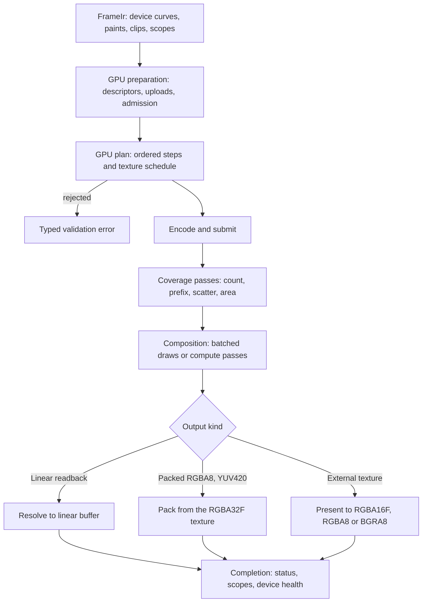
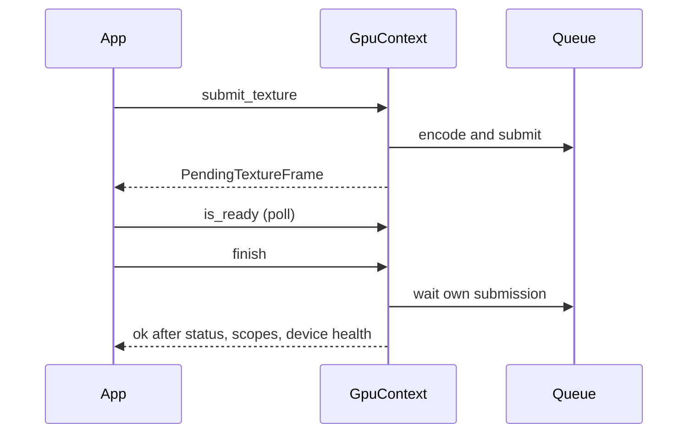
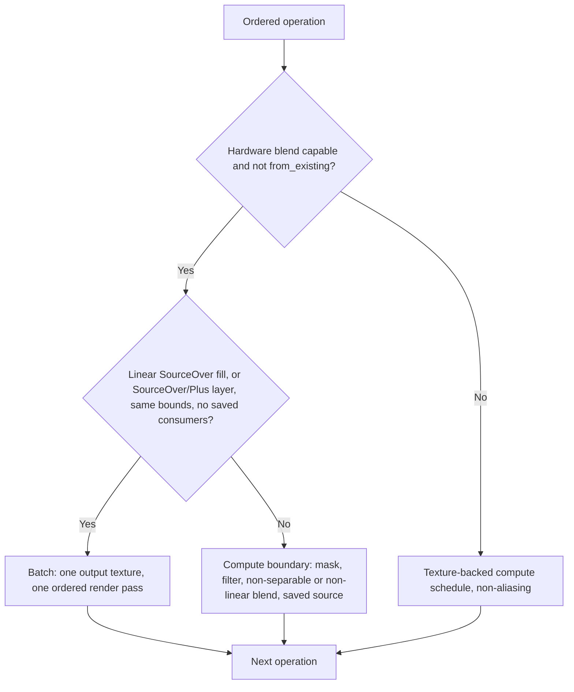
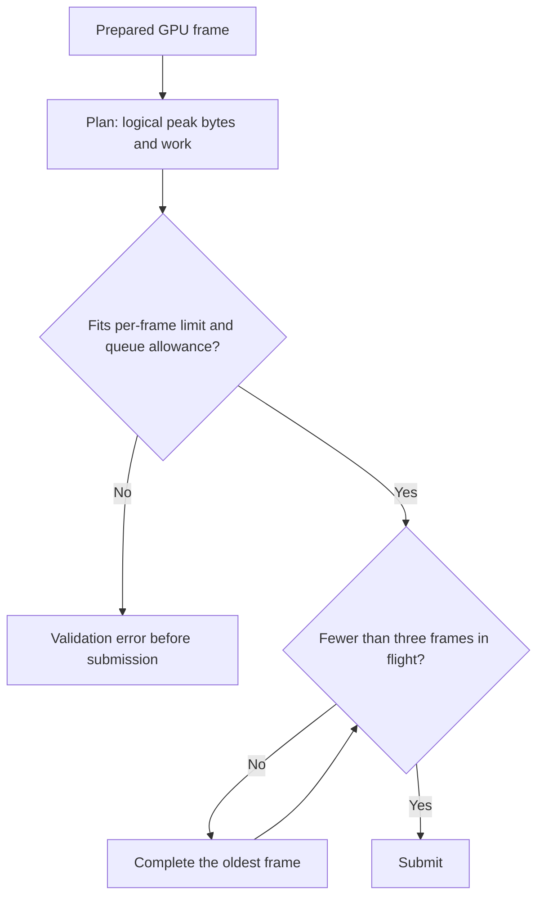
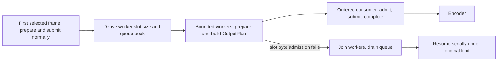

# GPU Rendering

This page states the contracts of the GPU backend: device ownership, how a frame
travels from the shared Frame IR to pixels, working textures, uploads, scheduling,
completion and limits. Chinese translation: [gpu.zh-CN.md](gpu.zh-CN.md); this
English page is the source of truth.

## Selection and Device Ownership

- With feature `gpu` the engine defaults to the GPU backend; without it the CPU
  backend is the default. `BackendPreference::Cpu` explicitly selects the scalar
  reference backend and never touches a device.
- `Gpu` requires a supported native wgpu adapter. Software adapters are accepted only
  when `allow_software` is true.
- Nothing falls back to the CPU. Adapter, policy and self-check failures, unsupported
  content, plan rejection, device loss and execution failures are typed errors.
  `BackendKind` only reports the backend that was actually used.
- `GpuContext` owns the device, queue, pipelines, device-loss monitor and submission
  serialization. Clones share that identity. Studio and external textures import an
  existing compatible device (`GpuContext::from_existing`) instead of creating one
  per frame.
- `RenderOptions::gpu_context` is the explicit injection point. `RenderContext` owns
  assets and structural policy, not a device, and attaching a device does not select
  the backend. `RenderSession` owns backend decisions and request-local diagnostics;
  context clones keep the shared device alive.

### Context construction and self-check

Construction creates the texture, particle and every supported output pipeline
(packing, finite checks, RGBA16F/RGBA8/BGRA8 presentation), queries `Rgba32Float`
attachment and blending support, requests the adapter-specific format feature only when
it is supported, and completes one empty submission under validation and out-of-memory
scopes. Clones and worker sessions reuse the pipelines. This does not prove that
driver first-use costs disappear.

The first GPU selection runs a once-only visual self-check shared by all clones. It
prepares CPU reference coverage and GPU edge records independently and compares small
fixtures: spatial paints, group blending, curves, self-intersections under both fill
rules, subpixel contours, nested geometric clips, filter guard bands and
large-coordinate coverage. Geometry fixtures must actually contain GPU coverage. The
comparison checks alpha and linear-light compositing on black and white with
fixture-specific RMS allowances, so transparent padding cannot dilute errors. Success
never hides a later device loss. It is a correctness check, not a latency benchmark.

## Frame Pipeline

The diagram shows the main route, not every constant-frame or format fast path. Every
step before submission is admitted against byte and work limits; see
[limits and validation](#limits-and-validation).

## Shared Data and Output

`FrameIr` admits f64 device curves, segment upper bounds, immutable resources and
normalized composition semantics before either backend prepares coverage. CPU and GPU
preparation share one scene walk through a backend interface that decides only how a
fill produces coverage, which resources stay live and how particles are observed.
`FrameIr` charges each distinct pattern image once by identity; a CPU frame borrows
immutable resources and releases that charge, while a GPU frame keeps it for upload.

GPU preparation owns device edge records separately from the public CPU
`PreparedFrame`. `FrameRenderer`'s GPU preparation and packed export workers never
construct a CPU prepared frame or initialize a device. Low-level APIs can still upload
an explicitly prepared CPU frame.

Working color is finite linear premultiplied RGBA32F. Eligible curves reach the GPU as
descriptors sized by a static Wang bound; a pass expands them into edge records, so the
host neither flattens nor uploads those edges. Line-only uploads are also accepted.
All other coverage (decals, CPU-generated clip coverage) is generated on the CPU and
uploaded. Analytic rectangles and CPU clip coverage are part of GPU preparation, not
fallbacks.

Mesh and atmosphere paints upload control or parameter descriptions rather than baked
texels; CPU and WGSL independently evaluate patch geometry, Oklab interpolation, seeded
noise and envelopes. Explicit baking APIs are separate and can differ in tessellation
and sampling. See [procedural paints](content.md#procedural-paints).

### Coverage model

Coverage follows the Skia analytic-AA and Vello fine-rasterizer model: each pixel
accumulates signed area from its tile edges plus a per-row carry, then folds the total by
the fill rule (non-zero clamps its magnitude, even-odd folds it). Contours that overlap
inside one pixel are approximated, so duplicate even-odd edges and opposite windings
sharing an edge within a pixel row can differ from the CPU sweep. Localized
antialiasing differences are allowed. CPU rendering keeps its own reference arithmetic,
and a selected GPU never switches backends after a failure.

Coverage uses 16-by-16 pixel tiles. The passes below produce f32 samples that
composition consumes without u8 quantization:

```mermaid
flowchart LR
    Desc["Fill, line and curve descriptors"] --> Expand["Expand curves to edges"]
    Expand --> Count["Count edges per tile"]
    Count --> Prefix["Prefix counts per fill reservation"]
    Prefix --> Scatter["Scatter edge indices"]
    Scatter --> Heights["Prefix signed row heights"]
    Heights --> Area["Tile-local trapezoid area"]
    Area --> Fold["Fold by fill rule"]
    Fold --> Samples["Device coverage, f32 per pixel"]
```

An edge enters every tile its tile-band-clipped x range touches. Signed heights
propagate only after the edge's last tile, so empty interior tiles keep their winding,
including holes and offscreen-left contours. Edge uploads are relative to the fill
origin and area evaluation subtracts the tile origin.

Before choosing GPU coverage, host preparation admits conservative tile counts, index
capacity and work from line endpoints or curve control-point hulls (up to eight subcurve
hulls per curve, split at uniform segment boundaries) and Wang segment bounds. One extra
tile on each horizontal side covers interpolation rounding at seams. Limits:

| Quantity | Limit |
| --- | --- |
| Edge references per tile | 4096 |
| Tile work units per fill | 2^28 |
| Tile work units per frame | 2^30 |
| Bounding-box pixels per frame | 2^24 |
| Fills per frame | 32768 |
| Local coordinate range | 8192 pixels |

Coordinates outside the range, excessive tile density, decal image patterns or the
ceilings above return an unsupported `gpu.coverage` validation error naming the path;
there is no CPU coverage route. Exhausting the caller's byte or work allowance is also a
validation error.

Planning reserves host, upload and device descriptors, tile counters and offsets, the
full conservative index capacity and one integrated signed-height value per row. The
count, prefix and scatter passes never grow a buffer or read back. Device buffer and
two-dimensional dispatch limits are checked before encoding. Pooled counters are cleared
before every count pass, and each row carry and output sample has one writer. Packed
plans validate their actual packed buffer against device limits; linear readback plans
keep the float buffer check, including filter padding.

### Coverage and clip uploads

Coverage uploads keep a local integer rectangle instead of the whole canvas. Fills with
strips refer to absolute ranges in one per-frame upload of the strip, span and packed u8
alpha arrays. Each five-word strip record stores a storage discriminator in bit 31 of its
height word: CPU records address packed u8 bytes in the shared coverage buffer; device
records address f32 words in the separate `device_coverage` binding (binding 12) that the
coverage passes write and composition reads.

Hardware fill fragments index their record from the quad instance, so they are charged
like sparse fills. A fill that must run as a compute pass, and any clip of at most 16
strips and spans, scans the referenced ranges per pixel and is charged for that scan.
Larger clips use dense packed coverage, whose lookup does not grow with the record count.
Conditional clips carry an eight-word header and three independent alpha, child and
ancestor payloads; the shader evaluates `alpha * min(child / ancestor, 1)`, with zero for
a zero denominator. Spatial paint payloads follow the encoded coverage region, and decals
keep CPU f64 rejection and CPU coverage.

### Particle instances

Instance uploads use checked, renderer-independent Disc, Glow, Sprite and Segment
records: a 16-byte header, 48 bytes per primitive and optional shared sprite texels.
Eligible built-in analytic trajectories upload explicit seeds, times and model
parameters instead, and a GPU pass generates the primitive records consumed by support,
ordered tiles and composition. Unsupported or imprecise analytic cases use diagnosed CPU
materialization, not a backend switch. Upload, generated state and metadata storage are
charged separately, and fixed-step simulation stays on the CPU. See
[particles](particles.md) for count, work and replay constraints.

### Diagnostics

`PreparedGpuFrame::gpu_stats` returns `GpuPreparationStats`: logical preparation totals,
retained GPU segments, admitted tiles and index capacity, and geometry-upload bytes
(binning uniforms and fill, line and curve descriptors only). `RenderSession::report()`
exposes the same completed attempt as `gpu_preparation` for memory, texture and
preparation-only requests, including partial execution failure; a new request clears it.

### Uniform ABI

Each composition dispatch uses a 256-byte `#[repr(C)]` Pod `GpuUniforms`. Frame, bounds,
operation, value rows, source rectangles and flags start at byte offsets 0, 16, 32, 64,
192 and 240. The WGSL `Settings` struct has the same layout, and the assertions in
`crates/motion-render/src/gpu/layout.rs` plus ABI tests check size, offsets and Naga
validation. Shader assembly generates operation and blend constants from the Rust
discriminants, so WGSL does not duplicate numeric tables.

## Output Targets

| Target | Behavior |
| --- | --- |
| Linear readback | Resolves the final working image to a linear buffer; synchronous |
| Packed RGBA8 and YUV420 (8/10-bit) | Reads the final RGBA32F texture directly; synchronous readback |
| External texture | Pixels stay on the GPU; only a finite-status word is read |

- All targets apply the same finite-value check and deferred alpha correction before
  conversion. Cropped packing also checks values outside the crop in its packing
  dispatch; cropped texture output uses a parallel finite check outside the crop, and
  fragments validate the crop. An uncropped present needs no extra pass. The RGBA16F
  half-float range check is kept.
- RGBA8 and BGRA8 are encoded outputs; RGBA16F is linear. Conversion keeps alpha and uses
  the shared deterministic dither policy. An unsupported external target is an error, not
  a CPU upload.
- External textures must belong to the same device and be single-layer, single-mip,
  single-sample 2D render attachments in a supported output format.
- YUV packing requires width divisible by 8 and even height; other valid even sizes use
  linear readback and CPU conversion. Both depths use an 8x2-tile dispatch with
  exclusive word ownership. Ten-bit YUV stores two little-endian u16 samples per u32,
  limited-range Y in 64..=940 and U/V in 64..=960. Transfer, grading and grain run before
  quantization and dither stays below half a sample. FFmpeg consumes host planes, not
  GPU surfaces.

### Asynchronous completion

`GpuContext::submit_texture` and `FrameRenderer::submit_to_texture` return a
`PendingTextureFrame` without waiting. Call `finish` before publishing the target: it
checks the frame's own submission, finite status, validation and out-of-memory scopes and
device health. `is_ready` polls without a global queue wait, and synchronous texture APIs
use the same implementation. Dropped pending frames do not return in-flight resources to
a pool.

## Working Textures and Batches

All working color images are pooled RGBA32F textures, including isolated layers, masks
and retained filter inputs. Intermediate images keep a global integer origin and bounds
but use local row strides and dispatch extents. Reads outside a retained image return
transparent black, including blur taps and fractional displacement. Paint, noise, clip,
guard-band and output coordinates stay global, and the final image is full-sized.

### Scheduling

Planning classifies each operation once and chooses one of two native schedules:

- **Batch.** Eligible consecutive operations share one output texture and render pass.
  The pass initializes the backdrop from its input texture and shades instanced quads or
  layer rectangles with hardware blending. When this batch is the backdrop's last
  consumer, bounds match, alpha is not deferred and no source aliases it, the batch
  accumulates into the backdrop texture itself. A read-only compute pass first checks
  every logical backdrop pixel for finite values. Conservative source-payload bounds of
  65536 keep unbounded HDR sources on the checked compute path.
- **Plus.** Hardware Plus adds RGB and alpha. A batch containing Plus marks its result for
  deferred alpha saturation: texture input reads and final output conversion cap only
  that marked alpha at 1, without rescaling HDR RGB.
- **Compute boundary.** Masks, filters, non-separable and non-linear blends and saved
  intermediate consumers read working textures directly and write a distinct output
  texture with the shared composition arithmetic. Devices without hardware blend support
  and contexts from `from_existing` use the texture-backed compute schedule. This is a
  native GPU path, not a CPU fallback.

Dependency-aware last-use scheduling assigns two-dimensional texture slots before
submission. Free slots are chosen by capacity and can grow independently in width and
height. Inputs, saved filter sources and the final output stay live until their last
read; a batch or compute output never aliases a live backdrop or source, and
simultaneously live slots get independent leases. Static admission charges the larger
total capacity of the batched and compute-only schedules. Pooled capacity can exceed a
logical image's extent; viewport, scissor, dispatch guards and global-to-local reads use
the logical extent, so spare capacity never affects pixels.

### Buffer pooling and residency

- **Mutable pool.** Completed working textures and uniform, data, status and vertex
  uploads are reused by exact size, format and usage. Leases stay with their pending
  submission until it completes successfully. Idle payload is limited to a quarter of the
  frame allowance and 64 MiB per shared context, with at most 512 buffers and 32
  textures. Bind groups are not pooled; this is not a zero-allocation guarantee.
- **Resident resources.** Immutable image, mip and atlas words live in a separate shared
  context LRU read through binding 11. A pattern image that is the same shared pixel
  storage as a resident entry hits by identity without hashing; any other or first-seen
  image is hashed and compared for exact encoded equality, so changed pixels never alias
  an older resource. The default limit is 64 entries and 64 MiB, counting host comparison
  words and device payload, with at most 4096 entries configurable. Admission covers a
  miss and bounded lookup work even for a hit. Resident buffers have dedicated in-flight
  leases and never enter the mutable pool, so eviction cannot overwrite pending frames.
  Limits, clearing and statistics are in
  [resources](resources.md#limits-and-accounting).
- **Staging.** Hardware draw batches aggregate uploads in admitted
  `MAP_WRITE | COPY_SRC` staging buffers. After successful completion, staging is
  remapped asynchronously and shares the idle byte and 512-buffer limits; only a mapped
  buffer of the exact size is reused. Pending mappings are skipped, failed mappings are
  discarded, and a miss creates fresh mapped staging without waiting or extra polling.
  Dropped or failed submissions do not return staging.

### Shared vertex, uniform and operation data

Within a hardware batch, instance rectangles share one vertex buffer and each draw binds
its own contiguous slice with local instance indices, preserving quad order. The
backdrop keeps a separate rectangle buffer. Parameter records share one buffer when
their 256-byte stride satisfies the device's minimum uniform offset alignment and the
payload fits one buffer; each binding exposes one record through a static offset and
size, never a dynamic offset. Otherwise, including an oversized instance payload, the
batch keeps per-draw buffers without extra padding or charges. For N draws and Q
instance records, sharing removes 2(N - 1) working-buffer leases and, with mapped
staging, 2(N - 1) copy commands while payload bytes (16Q vertex, 256N uniform) are
unchanged.

The operation-data path (binding 4) aggregates separately and only for hardware runs of
at least three draws; shorter runs keep per-draw data. Planning admits an eight-byte size
entry and four layout work units per step and tries each eligible batch transactionally.
Record starts are aligned to 256 bytes, the last record has no trailing padding, and
padding is charged to both working-buffer and staging admission (one work unit per padded
f32 word for initialization and one for transfer). Metadata or padding admission failure,
device alignment limits or oversized payloads leave that batch on per-draw buffers
without partial charges. Mapped staging zeroes the gaps and encodes one copy per shared
batch. Layout metadata stays admitted even when every run is short. This policy is
experimental: it is not an accepted general optimization, and measurements are kept in
[the performance history](../performance-runs.json).

## Stage Observations

`RenderSession::enable_timings` records separate host observations for evaluation,
compilation, coverage preparation, GPU planning, command encoding and submission,
completion and readback, and output conversion. CPU banded output reports composition
and conversion as one fused stage. Command encoding is not video or audio encoder time.

Devices negotiate `TIMESTAMP_QUERY` only; each timestamp starts a marker compute pass,
so no feature that writes between commands is needed (`TIMESTAMP_QUERY_INSIDE_ENCODERS`
is deliberately not used). Imported devices use only their existing features, and
devices without support keep rendering and report no device timestamps.

An enabled submission owns six queries and two 48-byte resolve and readback payloads
(96 bytes, reported apart from raster totals). Disabled observation allocates nothing.
GPU timestamps bracket composition and filters, final packing, resolve and
presentation, and output and status readback copies; they exclude host waits, mapping
callbacks, pixel extraction and queue latency. Per-submission handles isolate in-flight
results, including reverse completion, and results publish only after the frame passes
its device, scoped-error, finite-value and output checks. Dropped or failed frames
publish none. Studio Stats separates device intervals from host wall time.

## Limits and Validation

- `FrameQueue` reserves each submitted plan's logical peak, not its configured ceiling,
  admits at most three frames and rejects excess aggregate bytes before executing a plan.
  Packed output uses `OutputPlan::peak_bytes` to include output and readback resources.
  Plans are crate-private; callers plan through `OutputPlan`, `FrameQueue::submit` and
  `Gpu::render_linear`.
- Memory output and GPU exports use dedicated packed plans. They reserve output
  resources before optional batch-data padding, omit the unused RGBA32F mapped readback
  and CPU linear-frame reservations, and keep the real RGBA32F working and output
  textures. Packed storage, mapped readback and owned CPU output coexist, so all three
  payloads and the status and metadata words are charged. Output size and format are
  fixed by planning; a packed plan cannot be reused for floating-point readback or
  external textures. Unsupported packed formats use linear readback. Optional layout
  fallback is transactional.
- Raster limits count logical live payloads and conservative work, not physical VRAM or
  process RSS. Local image capacities, metadata, uploads, staging and output are charged
  before submission, and logical peaks are not allocation or RSS savings. Remaining
  pooling and lower-copy output work is [planned](../plan.md#performance).

### GPU export workers

Preparation and planning maximums plus the packed-plan peak separate CPU worker slots
from the GPU queue. Planning charges conservatively include device and staging
reservations. `OutputPlan::with_planning_limit` bounds construction independently of the
submission allowance, and worker count is neither fixed at two nor derived from the raster
ceiling. Each completed plan is checked against in-flight bytes, and the oldest output
completes when the queue needs space. Plans keep the original submission limit; the
smaller slot limit bounds only CPU preparation and device-independent planning. Only slot
byte-admission failures trigger the serial retry; invalid content, work-limit errors and
panics remain failures. Policy, packing, frame order and transactional failure handling do
not change.

## Verification Scope

GPU fixtures compare against the CPU backend for clipping, masks, blending, filters, text,
image, vector and particle output, external textures and device failure, and check
visually stable replay with declared tolerances. Comparisons require visual equivalence
with fixture-specific tolerances, not a global LSB threshold or byte identity; missing
geometry, clip leakage and visible replay flicker are defects. Stricter existing fixtures
are local regression checks, not restrictions on new GPU algorithms. CPU determinism
checks stay exact. Native fixtures also cover linear and HDR output, packed RGBA and YUV,
ordered three-frame completion, shared vertex and uniform buffers, all four mask modes,
Plus and Hue boundaries, and the compute-only path. Font and hardware inputs are
explicit; compilation does not establish adapter availability or cross-platform pixel
parity, and none of these checks is an FPS, RSS or cross-device performance result.
Measurements are in the [benchmark report](../benchmarks.md#current-measurements).
