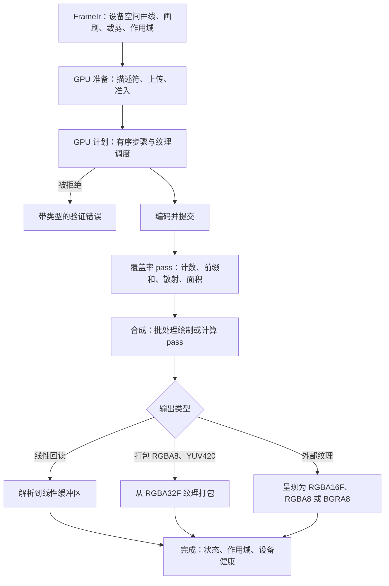
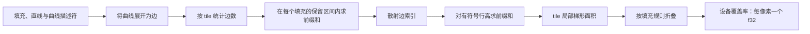
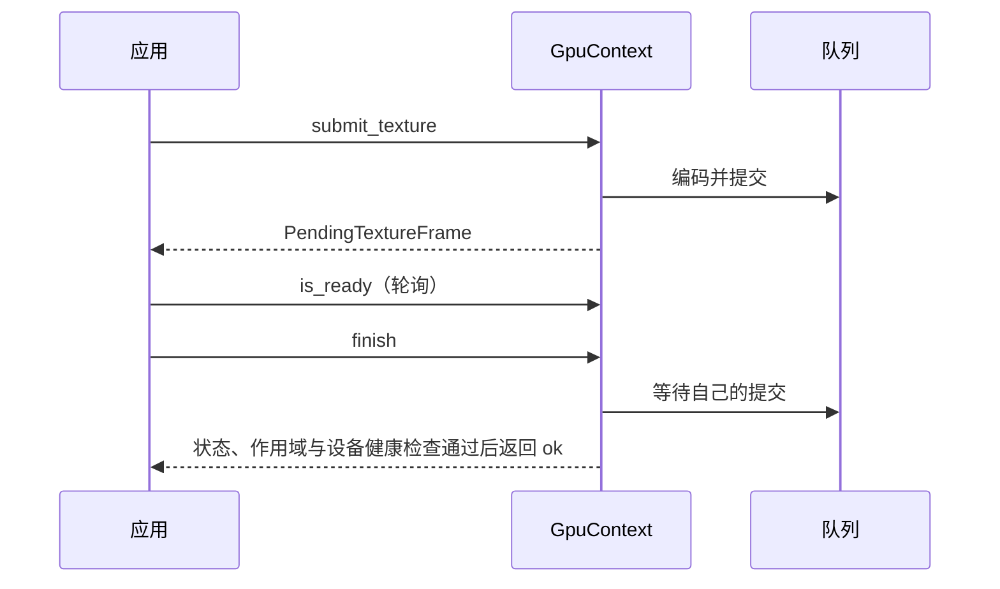
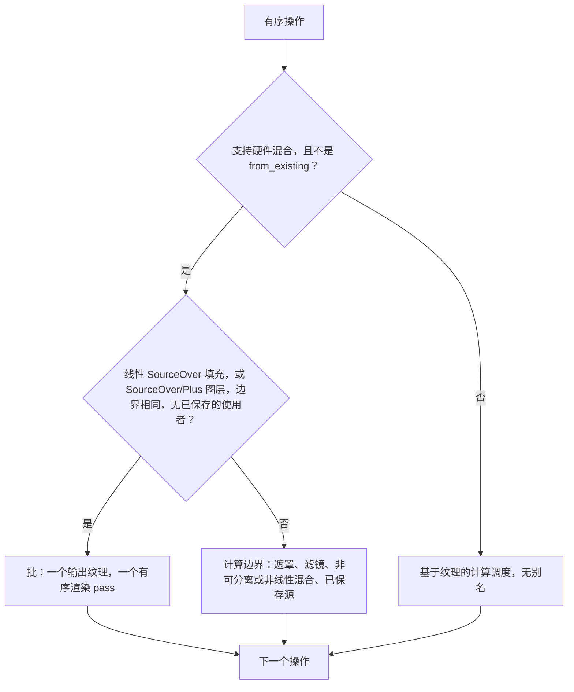
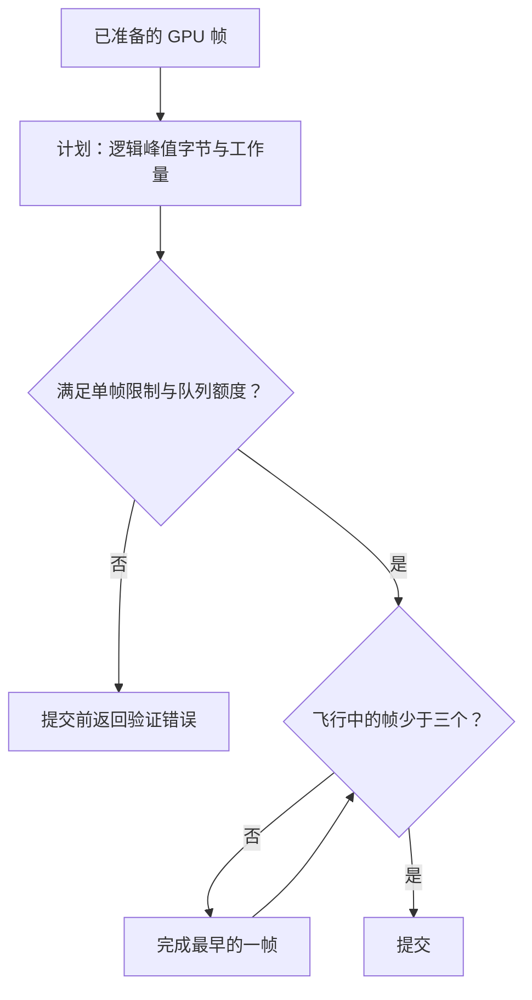
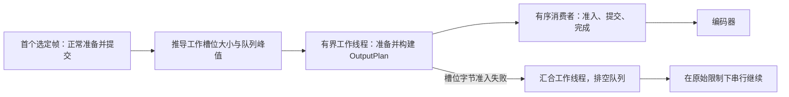

# GPU 渲染

本文说明 GPU 后端的契约：设备归属、一帧如何从共享的 Frame IR 走到像素、工作纹理、上传、调度、完成与限制。本文是 [gpu.md](gpu.md) 的中文翻译，以英文版为准；两者不一致时，以英文版为准。

## 后端选择与设备归属

- 启用 `gpu` feature 时，引擎默认使用 GPU 后端；未启用时默认使用 CPU 后端。`BackendPreference::Cpu` 显式选择标量参考后端，且不会接触任何设备。
- `Gpu` 需要受支持的原生 wgpu 适配器。仅当 `allow_software` 为 true 时才接受软件适配器。
- 不会回退到 CPU。适配器、策略与自检失败、不支持的内容、计划被拒绝、设备丢失和执行失败，都以带类型的错误返回。`Renderer` 只报告实际使用的后端。
- `GpuContext` 拥有设备、队列、管线、设备丢失监视器和提交串行化。克隆共享同一身份。Studio 与外部纹理通过导入已有的兼容设备（`GpuContext::from_existing`）接入，而不是每帧创建设备。
- `RenderOptions::gpu_context` 是显式注入点。`RenderContext` 只拥有资源与结构策略，不拥有设备；挂载设备并不会选择后端。`RenderSession` 负责后端决策与请求级诊断，上下文克隆维持共享设备的生命周期。

### 上下文构造与自检

构造阶段创建纹理、粒子以及所有受支持的输出管线（打包、有限值检查、RGBA16F/RGBA8/BGRA8 呈现），查询 `Rgba32Float` 的附件与混合能力，仅在适配器支持时才请求适配器特定格式特性，并在验证与内存不足作用域内完成一次空提交。克隆与工作会话复用这些管线。这并不保证驱动的首次使用开销消失。

首次选择 GPU 时会运行一次所有克隆共享的视觉自检：独立准备 CPU 参考覆盖率与 GPU 边记录，并比较小型夹具：空间画刷、分组混合、曲线、两种填充规则下的自相交、亚像素轮廓、嵌套几何裁剪、滤镜保护带以及大坐标覆盖率。几何夹具必须确实包含 GPU 覆盖率。比较在黑、白背景上检查 alpha 与线性光合成，使用各夹具自己的 RMS 容差，因此透明填充区域不会稀释误差。自检成功不会掩盖之后发生的设备丢失。它是正确性检查，不是延迟基准。

## 帧流水线

图中只展示主路径，不包含所有常量帧或格式的快速路径。提交之前的每一步都要按字节和工作量限制准入，参见[限制与验证](#限制与验证)。

## 共享数据与输出

`FrameIr` 在任一后端准备覆盖率之前，先准入 f64 设备曲线、线段上界、不可变资源以及规范化的合成语义。CPU 与 GPU 的准备共用一次场景遍历，通过后端接口只决定：填充如何产生覆盖率、哪些资源保持存活、粒子如何被观察。`FrameIr` 按身份对每张不同的图案图像只计费一次；CPU 帧借用不可变资源并释放这部分 IR 计费，GPU 帧则保留它以供上传。

GPU 准备独立持有设备边记录，与公开的 CPU `PreparedFrame` 分开。`FrameRenderer` 的 GPU 准备与打包导出工作线程既不构造 CPU 准备帧，也不初始化设备。底层 API 仍可上传显式准备好的 CPU 帧。

工作颜色为有限的线性预乘 RGBA32F。符合条件的曲线以按静态 Wang 上界确定大小的描述符形式到达 GPU，由一个 pass 展开为边记录，因此主机既不展平也不上传这些边。仅含直线的上传同样被接受。其余覆盖率（贴花、CPU 生成的裁剪覆盖率）仍在 CPU 上生成并上传。解析矩形和 CPU 裁剪覆盖率属于 GPU 准备的一部分，不是回退。

网格（mesh）与大气（atmosphere）画刷上传控制点或参数描述，而不是预烘焙的纹素；CPU 与 WGSL 各自独立计算面片几何、Oklab 插值、带种子的噪声与包络。显式烘焙 API 是独立的，其细分与采样可能与之不同。参见[程序化画刷](content.md#procedural-paints)。

### 覆盖率模型

覆盖率遵循 Skia 解析抗锯齿与 Vello 精细光栅化器的模型：每个像素累积其所在 tile 内各边的有符号面积，再加上每行的进位，然后按填充规则折叠总和（非零规则对其幅值取上限，奇偶规则对其折叠）。在同一像素内相互重叠的轮廓只是近似处理，因此重复的奇偶边，以及在同一像素行内共享一条边的相反绕向，可能与 CPU 扫描结果不同。允许出现局部的抗锯齿差异。CPU 渲染保持自己的参考算术；选定 GPU 后，失败也绝不会切换后端。

覆盖率使用 16×16 像素的 tile。下列 pass 产生 f32 采样，合成时直接使用，不经过 u8 量化：

一条边会进入其经 tile 带裁剪后的 x 范围所接触的每个 tile。有符号高度只在该边的最后一个 tile 之后才向后传播，所以空的内部 tile 仍保留绕数，包括孔洞与位于屏幕左侧之外的轮廓。边上传相对于填充原点，面积计算时再减去 tile 原点。

在选择 GPU 覆盖率之前，主机端准备阶段会根据直线端点或曲线控制点凸包（每条曲线最多八个按均匀分段边界切分的子曲线凸包）以及 Wang 分段上界，保守地准入 tile 数量、索引容量与工作量。水平方向两侧各多留一个 tile，以覆盖接缝处的插值舍入。限制如下：

| 项目 | 上限 |
| --- | --- |
| 每个 tile 的边引用数 | 4096 |
| 每个填充的 tile 工作单元 | 2^28 |
| 每帧的 tile 工作单元 | 2^30 |
| 每帧的包围盒像素数 | 2^24 |
| 每帧的填充数 | 32768 |
| 局部坐标范围 | 8192 像素 |

坐标超出范围、tile 密度过高、贴花图像图案或超出上述上限时，返回指明路径的不受支持 `gpu.coverage` 验证错误；不存在 CPU 覆盖率路线。调用方的字节或工作量额度耗尽同样是验证错误。

计划阶段会预留主机、上传与设备描述符、tile 计数器与偏移、完整的保守索引容量，以及每行一个积分后的有符号高度值。计数、前缀和、散射 pass 从不扩容缓冲区，也不回读。设备缓冲区与二维 dispatch 的限制在编码前检查。池化的计数器在每次计数 pass 之前清零，每个行进位和输出采样都只有一个写入者。打包计划按实际的打包缓冲区校验设备限制；线性回读计划则保留浮点缓冲区检查，包括滤镜填充。

### 覆盖率与裁剪上传

覆盖率上传保留本地整数矩形，而不是整张画布。含 strip 的填充引用每帧一次上传的 strip、span 与打包 u8 alpha 数组中的绝对范围。每条五字的 strip 记录在其高度字的第 31 位存放存储判别位：CPU 记录寻址共享覆盖率缓冲区中打包的 u8 字节；设备记录寻址独立的 `device_coverage` 绑定（binding 12）中的 f32 字，该绑定由覆盖率 pass 写入、由合成读取。

硬件填充片元通过 quad 实例索引自己的记录，因此按稀疏填充计费。必须以计算 pass 运行的填充，以及任何不超过 16 个 strip 与 span 的裁剪，会逐像素扫描所引用的范围，并按该扫描计费。更大的裁剪使用稠密的打包覆盖率，其查找开销不随记录数增长。条件裁剪携带一个八字的头部，以及三个相互独立的 alpha、child、ancestor 载荷；着色器计算 `alpha * min(child / ancestor, 1)`，分母为零时结果为零。空间画刷载荷跟随已编码的覆盖区域，贴花保留 CPU 的 f64 拒绝逻辑与 CPU 覆盖率。

### 粒子实例

实例上传使用经过检查、与渲染器无关的 Disc、Glow、Sprite 与 Segment 记录：16 字节头部、每个图元 48 字节，以及可选的共享 sprite 纹素。符合条件的内置解析轨迹则改为上传显式的种子、时间与模型参数，由一个 GPU pass 生成支撑区域、有序 tile 与合成所使用的图元记录。不支持或精度不足的解析情形采用带诊断的 CPU 物化，而不是切换后端。上传、生成状态与元数据存储分别计费，定步长模拟仍在 CPU 上。数量、工作量与重放约束参见[粒子](particles.md)。

### 诊断

`PreparedGpuFrame::gpu_stats` 返回 `GpuPreparationStats`：逻辑准备总量、保留的 GPU 线段、已准入的 tile 与索引容量，以及几何上传字节数（仅包括分箱 uniform 与填充、直线、曲线描述符）。`RenderSession::report()` 以 `gpu_preparation` 暴露同一次已完成的尝试，适用于内存、纹理与仅准备请求，包括部分执行失败的情形；新请求会清除它。

### Uniform ABI

每次合成 dispatch 使用 256 字节的 `#[repr(C)]` Pod 结构 `GpuUniforms`。帧、边界、操作、值行、源矩形与标志分别从字节偏移 0、16、32、64、192 与 240 开始。WGSL 的 `Settings` 结构具有相同布局，`crates/motion-render/src/gpu/layout.rs` 中的断言与 ABI 测试会检查大小、偏移以及 Naga 验证。着色器装配从 Rust 的判别值生成操作与混合常量，因此 WGSL 不重复维护数值表。

## 输出目标

| 目标 | 行为 |
| --- | --- |
| 线性回读 | 将最终工作图像解析到线性缓冲区；同步 |
| 打包 RGBA8 与 YUV420（8/10 位） | 直接读取最终的 RGBA32F 纹理；同步回读 |
| 外部纹理 | 像素留在 GPU 上；只读取一个有限值状态字 |

- 所有目标在转换前都执行相同的有限值检查与延迟 alpha 校正。裁剪打包还会在其打包 dispatch 中检查裁剪区域之外的值；裁剪的纹理输出使用并行的有限值检查覆盖裁剪区域之外，片元负责校验裁剪区域本身。未裁剪的呈现不需要额外 pass。保留 RGBA16F 的半精度范围检查。
- RGBA8 与 BGRA8 是编码输出，RGBA16F 是线性输出。转换保留 alpha，并使用共享的确定性抖动策略。不支持的外部目标是错误，不会走 CPU 上传。
- 外部纹理必须属于同一设备，并且是单层、单 mip、单采样的 2D 渲染附件，格式须为受支持的输出格式。
- YUV 打包要求宽度能被 8 整除且高度为偶数；其他合法的偶数尺寸使用线性回读与 CPU 转换。两种位深都使用 8×2 tile 的 dispatch，并保证每个字只有一个所有者。10 位 YUV 在每个 u32 中存放两个小端 u16 采样，有限范围下 Y 为 64..=940，U/V 为 64..=960。传输函数、调色与颗粒在量化之前执行，抖动幅度保持在半个采样以内。FFmpeg 消费的是主机平面，而不是 GPU 表面。

### 异步完成

`GpuContext::submit_texture` 与 `FrameRenderer::submit_to_texture` 返回 `PendingTextureFrame`，不会等待。发布目标之前必须调用 `finish`：它会检查该帧自己的提交、有限值状态、验证与内存不足作用域以及设备健康。`is_ready` 轮询时不会进行全局队列等待，同步的纹理 API 使用同一实现。被丢弃的待完成帧不会把飞行中的资源归还到池中。

## 工作纹理与批处理

所有工作颜色图像都是池化的 RGBA32F 纹理，包括隔离图层、遮罩和保留的滤镜输入。中间图像保留全局整数原点与边界，但使用局部的行步长与 dispatch 范围。读取保留图像之外的位置返回透明黑，包括模糊采样点与小数位移。画刷、噪声、裁剪、保护带与输出坐标保持全局，最终图像为完整尺寸。

### 调度

计划阶段对每个操作只分类一次，并选择两种原生调度之一：

- **批。** 符合条件的连续操作共享一个输出纹理与一个渲染 pass。该 pass 先用输入纹理初始化背景，再用硬件混合绘制实例化的 quad 或图层矩形。当该批是背景的最后一个使用者、边界一致、alpha 未被延迟且没有源与之别名时，该批直接累积到背景纹理本身。一个只读计算 pass 会先检查背景每个逻辑像素是否有限。源载荷的保守界限为 65536，使无界的 HDR 源走经检查的计算路径。
- **Plus。** 硬件 Plus 同时累加 RGB 与 alpha。包含 Plus 的批会把结果标记为延迟 alpha 饱和：纹理输入读取与最终输出转换只对被标记的 alpha 取上限 1，不会重新缩放 HDR 的 RGB。
- **计算边界。** 遮罩、滤镜、非可分离与非线性混合以及已保存的中间使用者，直接读取工作纹理，并用共享的合成算术写入另一张输出纹理。不支持硬件混合的设备以及来自 `from_existing` 的上下文使用基于纹理的计算调度。这是原生 GPU 路径，不是 CPU 回退。

基于依赖关系的最后使用调度在提交前分配二维纹理槽位。空闲槽位按容量选择，宽高可以独立增长。输入、已保存的滤镜源与最终输出保持存活直到最后一次读取；批或计算输出从不与存活的背景或源别名，同时存活的槽位获得相互独立的租约。静态准入按批调度与纯计算调度两者中较大的总容量计费。池化容量可能超过逻辑图像的范围；viewport、scissor、dispatch 保护以及全局到局部的读取都使用逻辑范围，因此多余容量不会影响像素。

### 缓冲池与驻留

- **可变池。** 已完成的工作纹理以及 uniform、数据、状态和顶点上传，按精确的大小、格式与用途复用。租约在对应提交成功完成之前由该待完成提交持有。空闲载荷限制为帧额度的四分之一，且每个共享上下文最多 64 MiB，最多 512 个缓冲区与 32 个纹理。绑定组不池化；这不是零分配保证。
- **驻留资源。** 不可变的图像、mip 与图集字存放在独立的共享上下文 LRU 中，通过 binding 11 读取。与某个驻留条目是同一份共享像素存储的图案图像，按身份命中，无需哈希；其他图像或首次出现的图像则先哈希，再比较精确的编码内容是否相等，因此像素改变后绝不会与旧资源混淆。默认上限为 64 个条目与 64 MiB，计入主机比较字与设备载荷，条目数最多可配置到 4096。即使命中，准入仍按未命中与有界查找工作量保守计算。驻留缓冲区有专用的飞行中租约，且从不进入可变池，所以淘汰不会覆盖待完成的帧。限制、清除与统计参见[资源](resources.md#limits-and-accounting)。
- **暂存。** 硬件绘制批把上传聚合到已准入的 `MAP_WRITE | COPY_SRC` 暂存缓冲区中。成功完成后，暂存缓冲区被异步重新映射，并与其他缓冲区共享空闲字节与 512 个缓冲区的限制；只有大小精确匹配且已映射的缓冲区才会被复用。仍在映射中的被跳过，映射失败的被丢弃，未命中时直接创建新的已映射暂存缓冲区，不等待也不增加额外轮询。被丢弃或失败的提交不会归还暂存缓冲区。

### 共享顶点、uniform 与操作数据

在一个硬件批内，实例矩形共享一个顶点缓冲区，每次绘制绑定自己的连续切片并使用局部实例索引，从而保持 quad 顺序。背景保留单独的矩形缓冲区。当参数记录的 256 字节步长满足设备的最小 uniform 偏移对齐且载荷能放入一个缓冲区时，它们共享一个缓冲区；每个绑定通过静态偏移与大小暴露一条记录，从不使用动态偏移。否则（包括实例载荷过大时），该批保持每次绘制独立缓冲区，不增加填充或计费。对于 N 次绘制与 Q 条实例记录，共享可减少 2(N - 1) 个工作缓冲区租约，使用已映射暂存时还可减少 2(N - 1) 条拷贝命令，而载荷字节数（顶点 16Q、uniform 256N）不变。

操作数据路径（binding 4）单独聚合，且仅用于至少三次绘制的硬件运行；更短的运行保留每次绘制独立的数据。计划阶段为每一步准入一个八字节的大小条目和四个布局工作单元，并对每个符合条件的批以事务方式尝试。记录起点按 256 字节对齐，最后一条记录没有尾部填充，填充会同时计入工作缓冲区与暂存的准入（初始化与传输各为每个填充 f32 字一个工作单元）。元数据或填充准入失败、设备对齐限制或载荷过大，都会让该批保持每次绘制独立缓冲区，且不产生部分计费。已映射暂存会将间隙清零，并为每个共享批编码一次拷贝。即使所有运行都很短，布局元数据仍保持准入。该策略仍处于实验阶段：它不是已被接受的通用优化，测量结果保存在[性能历史](../performance-runs.json)中。

## 阶段观测

`RenderSession::enable_timings` 分别记录求值、编译、覆盖率准备、GPU 规划、命令编码与提交、完成与回读、输出转换的主机端观测。CPU 分带输出把合成与转换作为一个融合阶段报告。命令编码并不是视频或音频编码器的耗时。

设备只协商 `TIMESTAMP_QUERY`；每个时间戳是一个标记计算 pass 的起点，因此不需要在命令之间写入的特性（有意不使用 `TIMESTAMP_QUERY_INSIDE_ENCODERS`）。导入的设备只使用其已有特性，不支持的设备继续渲染，只是不报告设备时间戳。

启用观测的提交拥有六个查询以及两个 48 字节的解析与回读载荷（共 96 字节，与光栅化总量分开报告）。未启用观测时不分配任何资源。GPU 时间戳覆盖合成与滤镜、最终打包、解析与呈现，以及输出与状态回读拷贝；不包括主机等待、映射回调、像素提取与队列延迟。每个提交有自己的句柄，可隔离飞行中的结果，包括倒序完成；只有该帧通过设备、作用域错误、有限值与输出检查后才发布结果。被丢弃或失败的帧不发布任何时间戳。Studio 的 Stats 将设备区间与主机墙钟时间分开显示。

## 限制与验证

- `FrameQueue` 为每个已提交计划预留其逻辑峰值，而不是配置的上限；最多接纳三帧，并在执行计划之前拒绝超出的聚合字节。打包输出使用 `OutputPlan::peak_bytes` 把输出与回读资源计入。计划本身是 crate 私有的；调用方通过 `OutputPlan`、`FrameQueue::submit` 与 `Gpu::render_linear` 规划。
- 内存输出与 GPU 导出使用专用的打包计划。它们先于可选的批数据填充预留输出资源，省略未使用的 RGBA32F 映射回读与 CPU 线性帧预留，并保留真实的 RGBA32F 工作与输出纹理。打包存储、映射回读与 CPU 持有的输出同时存在，因此三份载荷以及状态与元数据字都要计费。输出尺寸与格式由规划固定；打包计划不能复用于浮点回读或外部纹理。不支持的打包格式使用线性回读。可选的布局回退是事务性的。
- 光栅限制统计的是逻辑存活载荷与保守工作量，而不是物理显存或进程 RSS。本地图像容量、元数据、上传、暂存与输出都在提交前计费，逻辑峰值不等于实际分配或 RSS 的节省。其余的池化与减少拷贝的输出工作属于[计划事项](../plan.md#performance)。

### GPU 导出工作线程

准备与规划的最大值以及打包计划的峰值，把 CPU 工作槽位与 GPU 队列区分开。规划计费会保守地包含设备与暂存预留。`OutputPlan::with_planning_limit` 独立于提交额度限制构造开销，工作线程数量既不固定为两个，也不由光栅上限推导。每个完成的计划都会对照飞行中字节检查，队列需要空间时先完成最早的输出。计划保持原始的提交限制；较小的槽位限制只约束 CPU 准备与与设备无关的规划。只有槽位字节准入失败才会触发串行重试；无效内容、工作量限制错误与 panic 仍是失败。策略、打包、帧顺序与事务性失败处理均不改变。

## 验证范围

GPU 夹具与 CPU 后端对比，覆盖裁剪、遮罩、混合、滤镜、文本、图像、矢量与粒子输出、外部纹理以及设备失败，并以声明的容差检查视觉上稳定的重放。比较要求视觉等价并使用各夹具自己的容差，而不是全局 LSB 阈值或逐字节一致；几何缺失、裁剪泄漏和可见的重放闪烁属于缺陷。更严格的既有夹具只是局部回归检查，不限制新的 GPU 算法。CPU 确定性检查保持精确。原生夹具还覆盖线性与 HDR 输出、打包 RGBA 与 YUV、有序的三帧完成、共享顶点与 uniform 缓冲区、全部四种遮罩模式、Plus 与 Hue 边界以及纯计算路径。字体与硬件输入是显式的；编译通过并不能证明适配器可用或跨平台像素一致，这些检查也都不是 FPS、RSS 或跨设备性能结果。测量数据见[基准报告](../benchmarks.md#current-measurements)。
