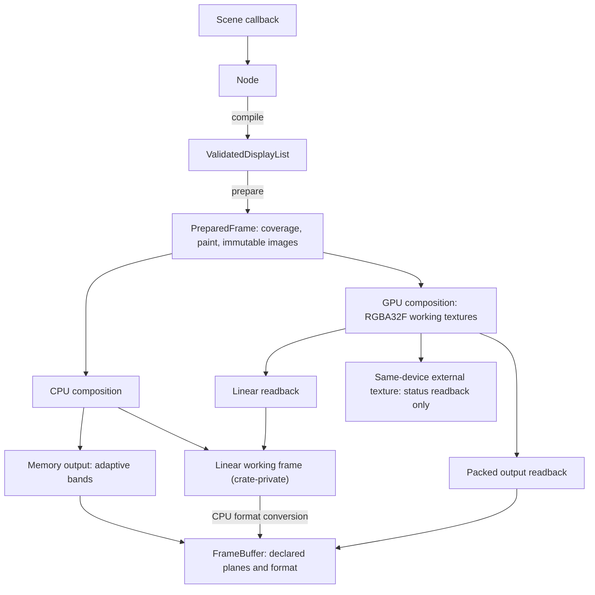
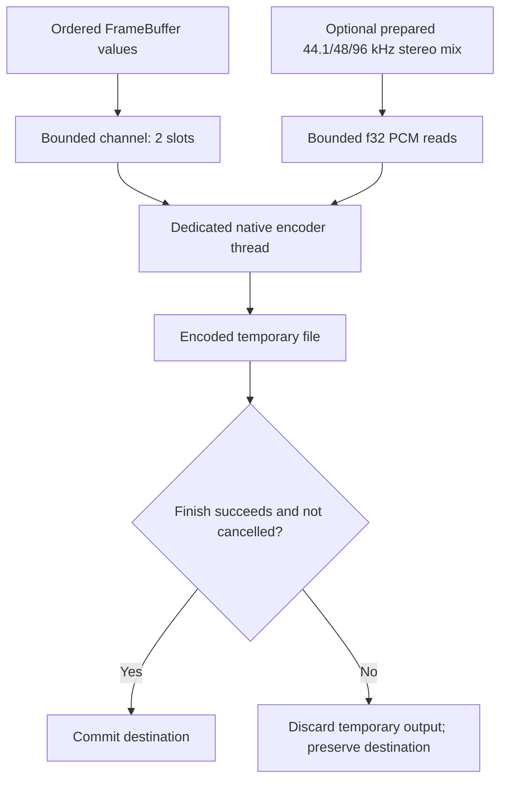

# Rendering and Export

Import `motion::prelude` for authoring, `motion::render` for rendering contracts,
`motion::encode` for encoders and progress sinks, and `motion::extend` for implementation
protocols. Prepared coverage (strips, spans, paint records and layers) and the GPU plan
are crate-private to `motion-render`; `PreparedFrame` exposes sizes, statistics and counts only. Logical sizes
use f64; output PixelSize uses positive integer dimensions. A composition uniformly
contains logical content in its output viewport.

## Shared Coverage and Effects

Preparation validates and expands paths, flattens curves using device-space
tolerance, integrates polygon area and records compact coverage for both backends.
Intersection-free bands use a verified area/cover prefix fast path; other bands
retain precise row-wise integration. Neither path is a supersampling renderer.
The reference and fallback path is:

1. Build vertical cuts at events needed to preserve edge order, including relevant
    intersections.
2. Sort active crossings in each interval and update NonZero winding or EvenOdd
    parity, merging consecutive inside regions.
3. Clip/integrate trapezoids against pixel columns in f64, then quantize coverage
    into compact spans, strips and u8 alpha.

The fast path collects endpoints and row boundaries for the whole band, sorts
edges once and proves the same order over every active interval. Only proven
coincident edges or shared endpoints bypass its rounding guard. NonZero/EvenOdd
state changes select actual fill boundaries, so overlapping contours are not
blindly summed. Selected boundaries accumulate f64 area/cover, with one prefix
per row and one shared cover row. Crossings, uncertain order, large coordinates
or insufficient fast-path scratch use the reference path without modifying
coverage. Proof work is charged even on fallback; scratch is released on success
and rejection. A tighter byte limit can select a lower-peak fallback, so an
unconstrained run's peak is not necessarily the smallest admissible limit.

Four-column groups in bands of up to four rows omit empty coverage, merge fully
covered groups into spans and retain edge coverage as strips. Each area is
quantized once, stored in the existing band scratch and reused for strip output;
the first block of a different kind is not classified again. Quantization is scalar
(clamp, multiplication, half-stability epsilon, round). Strip/Span origins
are absolute; translated caches can change alignment, so consumers use each
record's actual coordinates and height. Rectangles have a specialized analytic
path. Curve accuracy still depends on flattening tolerance and u8 quantization.
Both CPU paths preserve the CPU coverage format and exact reference replay;
changes to area arithmetic still need the applicable independent output checks.

Curve flattening uses Wang's second-derivative bound in device space: chord
error is at most `0.75 * curvature / count^2`. Curved counts round up to the
smallest even count satisfying that bound, preserving symmetric reversals when
horizontal edges are omitted. The former roughly fourfold over-subdivision is
removed; historical curve alpha references can change even at the same tolerance.
The chord bound is now met with equality, so consumers that depend on area rather
than edge position choose their own tolerance: `VectorTree::surface` uses 0.0025
tree units so that inscribed-polygon area stays within 0.03 on a radius-3 circle.
Coordinate precision, generated storage and work guards remain intact. Replay
uses the [same-environment determinism contract](reliability.md#determinism),
not a cross-platform byte-identity promise or an exact curve-area guarantee.

Session preparation reuses polygon band-area, edge-sweep, active-edge, row-crossing and
trapezoid-column storage across coverage-cache misses. Every band still initializes its
admitted area values to zero and retains the same integration order, logical byte/work
charges and failure boundaries; only vector capacity persists. Each session retains at
most 1 MiB of idle capacity per vector, independently of shared coverage-cache entries;
oversized storage is discarded after the path, including failed attempts.
PreparedFrame layout is unchanged. Measured cold-preparation gains are workload-specific;
they do not establish warm-frame, full-film or RSS gains. Shape-clip rasterization still
allocates its own scratch.

CPU composition is scalar. Solid SourceOver spans hoist the remaining-alpha term out
of the pixel loop; every other mode keeps its per-pixel formula and operation order. No
multiply-add fusion is introduced; every pixel still checks finite working storage before
publishing, and failed composition leaves the destination unchanged.

An explicit-lane `wide` implementation (f32x4/f32x8 SourceOver, f64x4 RGB blending and
f64x4 coverage quantization) was measured and removed. In paired alternating runs on an
Apple M1 Max at 1920x1080 (four pairs per case, 61 samples, `performance` cases), it was within
noise on `shapes` and `fill` (-2.2%, -0.5%) and slower on `isolation` (+2.9%), `grade`
(+3.7%), `mask-alpha` (+1.6%), `bloom` (+2.3%), `cross-fade` (+9.4%) and `particles-orbit`
(+12.6%). Per-pixel lane packing and per-pixel finite checks cost as much as the arithmetic
they replaced. Reintroduce vectorization only for row-wise loops that are measured first.

### Removed CPU Optimizations

Two CPU paths were measured against the code they replaced and removed because they
were slower or within noise while adding hundreds of lines. Paired alternating runs
used one binary with a switch on an Apple M1 Max, `performance` at 1920x1080 and
`breadth` at 640x360, three rounds each.

- **Tile-parallel composition** (256x256 tiles on a private Rayon pool). It made `empty`
  and `path-trim` 25-30% slower, `nodes-10k` and `path-complex` 6-9% slower, and helped only
  `layers-nested` (3.4 ms against 7.6 ms) and type-in-motion (about 1 ms). Frames with filters
  were never eligible, and Export workers already run on Rayon threads that disabled it.
- **Fused point filters** (one in-place traversal for adjacent color, vignette, grain and
  matrix filters, and a fused Glow). `filter-chain` was 15% slower with fusion and `grade`
  gained 3.6%, which is within run-to-run noise.

Reintroduce either only with a measured case that wins and no case that loses.

Effects use shared ordered Filter primitives. Layout bounds remain unchanged while
preparation derives conservative device captures. Child effects finish before
parent effects; the source is filtered, masked/clipped and then composited with
opacity/blending. Blur uses bounded normalized box approximations and transparent
borders. CPU uniform boxes use direct integer weighted taps for radii 1/2 and, for larger
radii, a sliding window made of the suffix of one aligned block of 2r+1 samples plus the
prefix of the next. Each sample is only added and never subtracted again, so work is three
additions per sample whatever the radius, and a large HDR value that leaves the window cannot
erase the smaller values that remain. Vertical passes walk whole rows across at most 32 KiB of
sum table at a time, so the table stays in L1 and a lane group is narrow enough for clear
blocks to occur. A block whose windows contain only transparent black is written without
summing; every sum would be zero, so output is bit-identical, and a layer of bokeh discs or a
thresholded glow is mostly such blocks. Pass buffers are not cleared before
use: only the pixels outside the written domain are zeroed. The fractional small-sigma kernel
keeps its original weighted path. All paths preserve finite output checks, admitted scratch
bytes (the sum table is charged and released per pass) and exact same-backend replay.
Large-box accumulation order differs from the earlier compensated rolling sums, which in turn
differed from the old convolution, so historical output need not be bit-identical (differences
are at the f32 rounding level); cross-backend tolerances remain unchanged. On an Apple M1 Max at
1920x1080 the change made `blur`, `shadow` and `bloom` 4.7x, 3.7x and 3.4x faster.

Bloom is a downsampling pyramid shared by both backends. Level `k` pixel `(x, y)` averages the
2x2 block at `(2x, 2y)` of level `k - 1`, in device coordinates halved `k` times; every level is
downsampled from its unblurred parent and then blurred by `radius` level pixels, which spans
`radius * 2^k` device pixels. From the coarsest level, each finer level adds its normalized
weight times its blur to the coarser sum sampled bilinearly at
`((x + 0.5) / 2 - 0.5, (y + 0.5) / 2 - 0.5)`. The tint, alpha clamp and Plus composite apply
once to the full-resolution sum. `motion_core::filter::bloom_bounds` gives the resulting
support, and the GPU plan uses `Downsample` and `Upsample` steps with the same geometry. Coarse
levels cost a quarter of their parent, so the pyramid costs about 4/3 of one full-resolution
blur instead of one per level.

`Optics::Bokeh` uses `Optics::bokeh_taps(radius)` aperture taps, `ceil(1.4 * radius^2)` within
8..=64, which keeps Vogel-spiral spacing near 1.5 pixels until the maximum. Both backends read
the count from the shared parameters and charge four reads per tap.
Several per-pixel stages skip or shorten work without changing any output bit, checked against
the earlier implementations in tests and by identical checksums of all six gallery films:
`ChannelOffset` samples only the channel and alpha it needs and drops bilinear taps of weight
zero (a whole-pixel offset reads one line); layer composition and the Glow pass skip source
pixels that are transparent black, which compositing leaves untouched in every mode; and the
RGBA8 encoder looks a dithered byte up through a bucket index over the threshold bit patterns,
with a straight path for opaque pixels. Gallery Signal Garden at 960x540 takes 73 ms per Draft
frame instead of 117 ms (Final 95 ms instead of 176 ms).
Saved-source operations retain their explicit input. Coverage clips,
geometric intersection and content masks have different quantization/order contracts.
See [drawing](../tutorial/05-drawing.md) for usage.

Final brush ink admits each indexed candidate distance evaluation before it
executes, against the unchanged 32-million default material limit. It no longer
rejects a texture solely because texels times all samples exceeds that limit.
Texture dimensions and the 262144-texel cap remain unchanged; failed preparation
publishes no material image. Material admission is separate from frame raster work/bytes.
A texel farther from the stroke than any coverage or wash can reach (its edge offset plus the
larger of half a texel and the bleed) is written transparent after a few bounding-box tests
instead of a nearest-segment search; this is bit-identical to the full search, and made
ink-journey's busiest frame 3.5x faster (445 -> 129 ms at 960x540 on an M1 Max).

An unfiltered CPU PushLayer/Fill/PopLayer sequence without added clips can draw
directly into its parent instead of allocating an isolated image. Each covered
pixel still fills a transparent local pixel, rounds, applies layer opacity and
rounds again before the original blend. Opacity is not folded into paint alpha.
Curves and intersecting paths retain the shared nonoverlapping coverage records.
Filtered layers, added alpha/geometric clips, inherited geometric clips and
multi-item layers retain isolated composition.

Preparation also intersects eligible unfiltered, unclipped Plus/LinearPlus
captures with the union of Fill coverage and completed child-layer bounds.
Filtered children contribute their full conservative capture, including halos;
mask owners and particle captures keep their original bounds. This shared bound
reduction applies to CPU and GPU consumers. The conditional scan and its stack
metadata are admitted during preparation; no performance gain is assumed without
separate measurement.

## Frames and Stills

Composition owns a `FrameClock` (rational rate and frame count, never defaulted) and one
`RenderOptions` (dimensions, background, resources, backend policy and the rest); there are
no per-option setters beyond `with_options` and `configure`. Reuse `frame_renderer(size)` for random-access frames and cache reuse;
its FrameRenderer wraps a RenderSession. For Timeline output, render_still/export
apply the same RenderOptions policy.
`render_frame` and `render_frame_sampled` return a fully opaque straight `SrgbRgba8` `FrameBuffer`: the frame
composites over `RenderOptions::background` made opaque, or over white when it is absent. Its `write_ppm` and
`write_rgb` truncate/replace the selected file explicitly and reject non-opaque buffers.
Use `render_still` and a straight RGBA8 FrameBuffer for transparent PNG with protected output destinations.

On Unix, transactional PNG, GIF and native video outputs request mode 0666;
PNG sequence directories request 0777. The process umask is applied at creation
for both new and overwritten outputs; export never reads or changes that umask.

```rust,no_run
use motion::prelude::*;
use motion::render::Composition;
let composition = Composition::new(320, 180, motion::render::FrameClock::new(fps!(30), 60));
let mut renderer = composition.frame_renderer(Size::new(320.0, 180.0))?;
let circle = Circle::new(Point::new(160.0, 90.0), 24.0)?;
let frame = renderer.render_frame(15, |_| {
    Node::from(circle.clone().fill(Color::rgb(20, 160, 130)))
})?;
frame.write_ppm("frame.ppm")?;
# Ok::<(), motion::Error>(())
```

RenderOptions selects output size, background/transparency, backend,
resources, structural/raster limits and optional shutter sampling. FrameBuffer
preserves its declared planes/format: straight or premultiplied sRGB RGBA8,
linear-premultiplied RGBA16F or unquantized RGBA32F, or limited-range BT.709 YUV420 at 8/10 bits.
YUV requires even dimensions and opaque pixels. There is no implicit HDR tone mapper.
`PreparedFrame::render_linear` and `Gpu::render_linear` return RGBA32F `FrameBuffer`s that
`FrameBuffer::linear_pixel`, `linear_pixels` and `to_format` read or convert; the CPU working
frame behind them is crate-private.

RenderQuality::Final is the default production policy. Draft explicitly permits
preview approximations in geometry, shutter sampling and ink material; it is not
a different output resolution or an equivalent Final result. Draft blur uses one
variance-matched box for sigma at least 1, while smaller sigmas retain Final's
small-kernel policy. Quality must remain fixed for replay and cache identity.
Studio requests Draft during playback/dragging and forces Final for export; see
[the Studio guide](../studio.md#preview-and-playback) for preview transitions.

### Execution and Output Paths

Authoring, preparation and pixel execution are separate boundaries. Coverage is
prepared on the CPU for both backends; GPU composition is not GPU path rasterization.
The diagram shows the main routes, not every constant-frame or format fast path.



These routes are not interchangeable: a normal RenderSession memory target on GPU
uses linear readback followed by CPU format conversion, while supported packed-output APIs
and a request with `device_packing` (the one `render_frame*` makes) pack before readback. An external texture avoids
frame-pixel readback but still checks submission completion and finite status.
See [GPU rendering](gpu.md) for supported targets and asynchronous completion.

CPU requests do not initialize a composition GPU. Automatic may choose CPU during
startup checks and records its reason; an explicit GPU request does not silently
fall back after a failure. Supplying a shared GpuContext establishes device identity,
not backend selection.

Explicit CPU memory output composes full-width adaptive bands. Preparation caches
the maximum nested filter-chain halo; independent siblings do not add their halos.
Band height is normally `min(max(8 * halo, 16), frame_height)`, with full-height
composition when `16 * halo >= frame_height`. A tight byte allowance shrinks bands
before retrying, while all failed-attempt work remains charged. Conservative filter
halos retain offscreen and cross-band dependencies; only valid output rows are
converted. Masks, once-per-layer opacity, source-only effects and global noise
coordinates are unchanged. Bayer phase is relative to the final output origin,
and YUV bands preserve complete 2x2 chroma blocks. Explicit full-linear APIs retain full linear frames; a GPU request with `device_packing`
reads back packed straight sRGB RGBA8 instead.

CPU linear-frame-to-RGBA8 conversion and FrameBuffer plane conversion share one
row-wise encoder, including straight/premultiplied alpha and Bayer phase. They
write directly to their own output storage without an intermediate RGBA image.
Synchronous and pending GPU linear readback likewise share crop and finite-pixel
validation: aligned little-endian rows use a checked typed copy; other rows decode
little-endian components explicitly. Both preserve the caller's diagnostic path.
Packed readback and external-texture output remain separate from this linear kernel.

CPU layer, mask, saved-source and filter scratch storage share a bounded session
pool (four buffers, at most 64 MiB and one quarter of the active byte allowance).
Encoded memory planes have a separate shared pool (four buffers, at most 64 MiB
and one eighth of the allowance). Frames hold their planes until dropped; clones
own independent bytes and never alias writable storage. Query pooled_cpu_bytes
and pooled_output_bytes for idle capacity, not live frame payload or process RSS.
All bands share cumulative work admission, including repeated command/halo work;
the logical peak includes prepared data, final output, live captures and conversion
scratch. Failure publishes no partial frame and a healthy retry can reuse storage.

Gradient geometry and image inverses are prepared once. CPU paint rows reuse
vertical mapping terms; bounded binary-grid horizontal products advance exactly,
while other transforms use direct evaluation. The same LUTs, hard-stop semantics,
extension and floating-point order remain the reference.

CPU YUV conversion retains the original f32 `libm` transfer and f64 BT.709
quantization as its exact reference. A shared 2,150-entry (8,600-byte) sRGB table
interpolates within f32 exponent segments; the linear toe and endpoint handling
remain exact. The `2^-20` transfer-error guard is verified against every
interpolated f32 input by the explicit release-only exhaustive test. Rerun that
test when changing the compiler, `libm` or transfer arithmetic.
The guard propagates separately through Y and the averaged 2x2 Cb/Cr values,
including the 4x sample scale for 10-bit output. Any interval that can cross a
half-integer quantization boundary uses the original exact computation instead.
Uniform blocks reuse exactly quantized samples, not approximate RGB bytes.
No output tolerance, alpha policy or conversion-work allowance changes. The
shared immutable table is outside per-frame logical live-byte accounting.

`RasterLimits::default()` selects `authoring()`: 16,777,216 raster pixels and
256 MiB logical live bytes, without a work ceiling (`max_work = u64::MAX`).
Work counters and overflow checks remain active. Opt into `RasterLimits::sandbox()`
for the previous 200,000,000-unit work cap, or supply an explicit `max_work`.
Neither policy bounds arbitrary Rust callbacks, wall-clock time or process RSS.

For explicit destinations and exact-time requests, reuse RenderSession directly:

```rust,no_run
use motion::prelude::*;
use motion::render::{FrameAt, FrameBuffer, FrameRequest, PixelFormat, RasterLimits, RenderSession, RenderTarget};

let size = PixelSize::new(320, 180);
let mut session = RenderSession::new(Size::new(320.0, 180.0), RenderOptions::default().size(size))?;
let mut output = FrameBuffer::new(size, RasterLimits::default())?;
session.render(FrameRequest {
    at: FrameAt::Time(250.milliseconds().after_origin()),
    frame_rate: FrameRate::NTSC,
    duration: 2.seconds(),
    background: None,
    target: RenderTarget::Memory(&mut output),
    format: PixelFormat::SrgbRgba8 { premultiplied: false },
    device_packing: false,
}, |context| Node::from(context.bounds().fill(Color::WHITE)))?;
# Ok::<(), motion::Error>(())
```

`FrameAt::Time` is not snapped to the frame grid; `FrameAt::Index` converts exactly with the request's rate.
`FrameRenderer::render_frame*`, `Composition::render_frame*` and `render_still` are thin wrappers over this one request path;
`device_packing` lets a GPU-rendered straight `SrgbRgba8` request pack bytes on the device, which may differ from host
conversion by GPU f32 rounding. Motion blur may call the builder
multiple times. A memory target is replaced only on success and its old retained
payload is charged while rendering; an external texture has no rollback guarantee
after a GPU failure. Each request installs new diagnostics and clears prior totals.
last_stats describes successful memory output, not external-texture conversion. Each stage reports a `WorkStats { peak_bytes, work }`, and `RenderSession::report()` aggregates stats, timings and the backend decision into one `FrameReport`.
Request background overrides the options' background. `render_frame*` output composites over
`RenderOptions::background` made opaque, or white when it is absent; `render_still` and direct requests
keep transparency when no background is given. Query
backend_decision for the actual backend; `requested_backend()` reports the request.

## Resources and Content

Cache retention, reusable idle storage and per-request admission measure different
things. Sharing one owner does not merge these allowances or establish an RSS cap.

| Owner | Retained data | Sharing and accounting boundary |
| --- | --- | --- |
| Assets / ResourceStore | Decoded typed assets | Cloned Assets share registrations; with_store shares the store across independent owners. |
| SceneCache | Pure scene computations | Entry-bounded by default; byte accounting requires declared key/value costs. |
| RenderCache | Coverage, paragraphs, glyphs, gradients, formulas | RenderOptions.cache can share partitions across sessions and export workers; hits still undergo raster admission. |
| RenderSession pools | Idle CPU scratch and encoded plane storage | Active frames and captures remain live payload, not idle capacity; dropped output planes can return to their shared pool. |
| GpuContext | Device state and reusable GPU working resources | Clones share device identity; in-flight leases stay with their submission until successful completion. |

Assets loads typed resources lazily with sticky shared results and bounded logical
retention. FontLibrary is explicit; freeze it on resources or text before rendering.
Missing assets fail production output. Placeholder rendering is an explicit preview
policy, with typed diagnostics still retained.

Assets::preload registers decoded objects in the same entries used by lazy handles.
Each new Assets owner starts with its own
256 MiB/4096-entry ResourceStore; clones share it and with_store opts independent
owners into shared accounting/cache identity. ResourceStore::with_limits configures a positive
byte allowance and 1..=4096 entries. Assets clones share registrations; snapshot()
isolates future edits. remove::<A>(source) unregisters without invalidating handles;
retained snapshots and handles keep their payload charged. Direct decoded Arc pins may outlive
owners/handles and their charges. RequestDiagnostics plus Handle::get_with associate
resource errors with caller-managed background work. There is no ambient frame scope:
handles made by the request's Assets view inherit its sink, while captured external
handles must use get_with(context.diagnostics()) at the drawing boundary.

SceneCache is a separate pure-computation LRU. Its default 256-entry limit is not a
byte bound. with_limits and cache_with_cost support cooperative payload accounting,
including inline key/value sizes; declare both owned heap payloads in the cost.
Keys are retained and require `Eq + Hash + Send + Sync + 'static`; matching hashes
still require equal keys of the same type, calling location and value type. Cache
entry metadata, allocator overhead and external Arc pins are not accounted, so
the allowance is not process RSS. RenderOptions.cache shares RenderCache partitions
across FrameRenderer/RenderSession and export worker clones: coverage (2048 entries,
16 MiB), paragraphs (256, 8 MiB), glyphs (2048, 16 MiB), gradient LUTs (64, 8 MiB)
and formulas (32, 32 MiB). Each evicts individual oldest entries independently;
raster budgets are still checked on hits. Public RenderPrepare calls do not
implicitly gain a cross-frame cache.

Coverage keys retain complete verb equality, fill rule, tolerance and raster size.
Curves and multi-contour glyph paths can reuse any integer translation phase when
their affine terms lie exactly on a bounded 1/65536 grid and their control hull
stays four pixels inside the raster. Cold and cached paths use the same canonical
origin. Fractional phases, clipped paths and unsafe precision fall back; cache hits
still undergo the request's storage/work admission and tiny-budget failure path.

Immutable Path2D snapshots retain up to four successful stroke outlines within
1 MiB of logical verb/entry payload per source path. The full stroke style is the
key. Successful path edits invalidate this cache through copy-on-write; failed
edits preserve it and old clones remain reusable. Cached snapshots do not pin
derived arc-length or further stroke caches. Canvas still charges source/output
structural limits on hits; this does not freeze custom drawing callbacks.

RenderSession also retains up to 64 gradient color tables within 8 MiB of logical
payload. Complete stop/color bit patterns and interpolation space identify tables;
geometry, transform, LOD and validity checks remain per-request. Tables are shared
through Arc, while active-frame work/byte charges remain unchanged. Query
`cached_paint_bytes()` separately from `cached_coverage_bytes()`. These limits
exclude allocator capacity, driver overhead and externally held snapshots, not RSS.

Image decodes PNG/JPEG/WebP; AnimatedImage supports GIF/APNG and explicit frame
sequences. SVG becomes shared VectorTree geometry, not a private raster backend.
Text uses one paragraph shaper and shared glyph artwork. FormulaCompiler converts
trusted Typst math directly into that vector model; Typst also supports single-page
markup imported through its outlined SVG output.

Node::compile returns ValidatedDisplayList after incremental command validation;
ordinary preparation reuses its measured requirements without another successful
command scan. Command preparation within a frame is serial; export workers provide
concurrency across frames, not a separate parallel coverage-preparation backend.
DisplayList remains editable for low-level callers and must validate
after edits. Use into_editable for explicit mutation and with_background for a
background-only snapshot. Image paints reference immutable ImagePixels through
ImagePattern; prepared frames do not require a separate image-resolution phase.
RenderContext carries assets and structural limits. RenderOptions.gpu_context is
the explicit GPU injection point, and FrameRenderer::submit_to_texture supports
same-device preview output without full-frame CPU readback. Memory output and
external texture output remain separate contracts.

System font indexing does not retain every font file's bytes. Selected text faces
are loaded on demand; ExportReport.fonts lists the actually observed names and source
hashes. Each export starts a fresh observation sink even when options/cache are reused.

## Video and Audio

Native video encoding overlaps rendering using a bounded two-frame queue. The
native encoder stays on one dedicated thread, including creation and teardown.
No raw-frame temporary spool or raw-byte duration cap is used. Only an explicit
successful finish commits the encoded temporary file; cancellation, dropped
encoders, render errors and worker panics join the worker and discard it.
Custom Encoder::open receives normalized options, frame rate and the prepared
cropped audio mix before any write calls; Encoder::finish takes no audio argument.

Project and `export` use Timeline, ExportOptions, ProgressSink and ordered Encoder
operations. Ranges are half-open absolute times aligned to represented frame
boundaries. Callbacks retain absolute scene time; output timestamps start at zero.
Cancellation is cooperative and checked before destination commit.

The two-slot native channel bounds queued frame messages, not all live frames or
process RSS: the producer and encoder can also own a frame. Audio preparation is
separate from this video queue.



Export renders the first selected frame and uses its actual startup backend
decision and output to schedule remaining frames. CPU selection enables parallel
rendering, including Automatic when GPU support is absent or startup chooses CPU.
Parallel CPU slots explicitly select CPU, preserving the first session's choice
instead of probing a GPU again. Requested workers default to available parallelism,
capped at 64; frame count and twice the first frame's logical peak further limit
concurrency. Parallel CPU slots divide `max_parallel_bytes`, rather than reserving
the configured per-frame ceiling. If a later frame needs more than its slot,
workers are joined and unwritten frames resume serially under the original limits.
Only byte-admission failures trigger this retry; invalid content, work-limit errors
and panics remain failures. Scene callbacks must be pure and may be retried.
`.workers(1)` retains serial evaluation. Encoder/progress callbacks remain ordered
on the caller through the public Encoder and ProgressSink protocols; native codec
execution runs on its dedicated thread. Automatic selecting GPU retains one render session;
explicit supported GPU output
uses measured preparation/planning slots and a bounded queue. Workers build GPU
plans and packed-output charges; the ordered consumer handles admission, submission
and encoding, as described in [GPU rendering](gpu.md#limits-and-validation).
The aggregate allowance excludes encoder storage, shared assets, caches and idle
pools; it is not an RSS cap. A frame that cannot fit parallel slots can still render
serially under its configured per-frame limit.

Timeline AudioClip sources default to 48 kHz stereo, with 44.1/96 kHz AAC delivery options. `AudioClip::file(path)` is
inherent and lazy: it does not open or decode the file while authoring. Execution
resolves metadata and decodes bounded requested windows; file errors propagate as
Asset failures. Prepared PCM is still bounded by the existing 128 MiB mix allowance.
Selected ranges retain original clip fade/envelope clocks. Keep file sources
unchanged during execution; reads are random-access, not retained immutable PCM.

The native adapter encodes H.264/MP4, H.265/MP4, VP9/WebM (optional alpha) and
ProRes 4444/MOV through first-party FFmpeg bindings, not an executable. Codec
availability is probed before opening output. AAC audio is supported in MP4/MOV;
WebM audio is rejected until an Opus/Vorbis adapter is available. Video frames are
streamed from memory, not staged in temporary YUV/RGBA files. Audio is read directly
from immutable prepared f32 PCM using absolute sample timestamps, without an audio
temporary WAV. The encoded container is written to a same-directory temporary file
before transactional commit. See [audio contracts](../tutorial/10-audio.md) for
offline effect/master baking, preparation bounds and measurement approximations.

PngSequenceEncoder commits a same-directory staging directory atomically, supports
odd dimensions and full alpha, and rejects audio. Overwrite atomically exchanges
real directories where the platform supports rename exchange. GifEncoder uses the
requested output frame grid, per-frame palettes and cumulative rational delays.
GIF has one-bit transparency, 2..=256 palette colors, no audio and at most 100 fps.
Unsupported combinations fail before output creation. All codecs use ExportOptions
builders for size/range/backend/motion_blur/overwrite and share ProgressSink.

Encoder::capabilities advertises audio support, maximum size and dimension multiples.
Dimensions are checked before opening output; unsupported timeline audio is rejected
before PCM preparation/render frames. Custom encoders still own transactional commit,
codec-specific checks and cleanup; capability defaults are permissive.

Existing output files are protected unless overwrite is explicit. Failures,
cancellation and panics before commit leave committed output unchanged. An output
must not replace an audio source. Keep streaming source files unchanged throughout
preview/export.

See [GPU rendering](gpu.md), [effects](core.md#layers-and-sampling), [Studio](../studio.md)
and [reliability](reliability.md) for their specific contracts.
