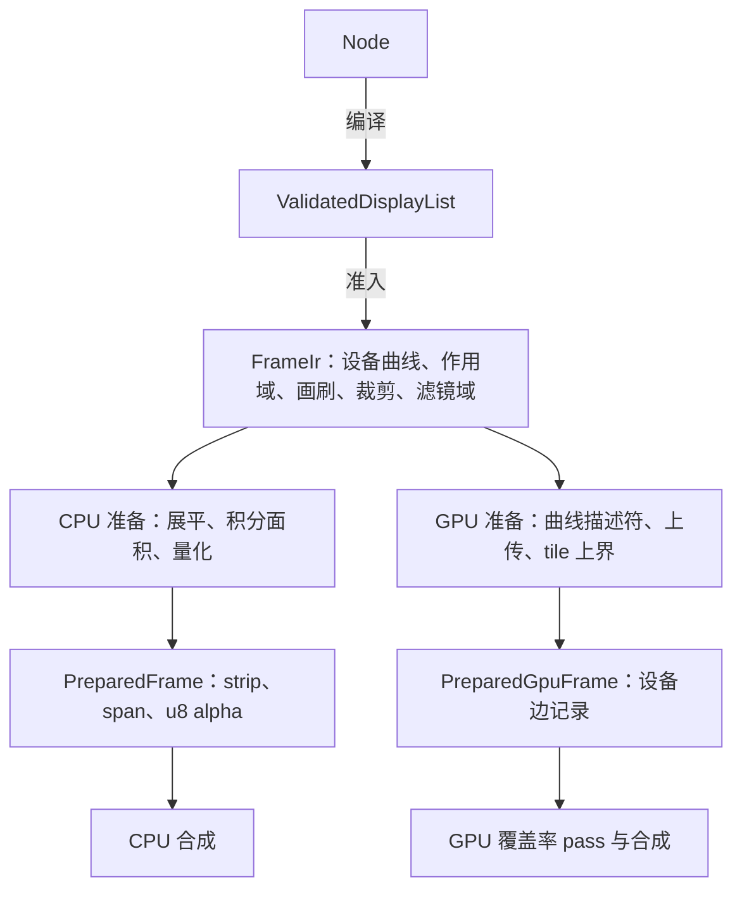
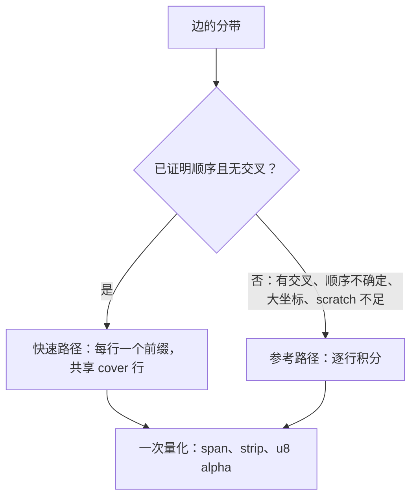
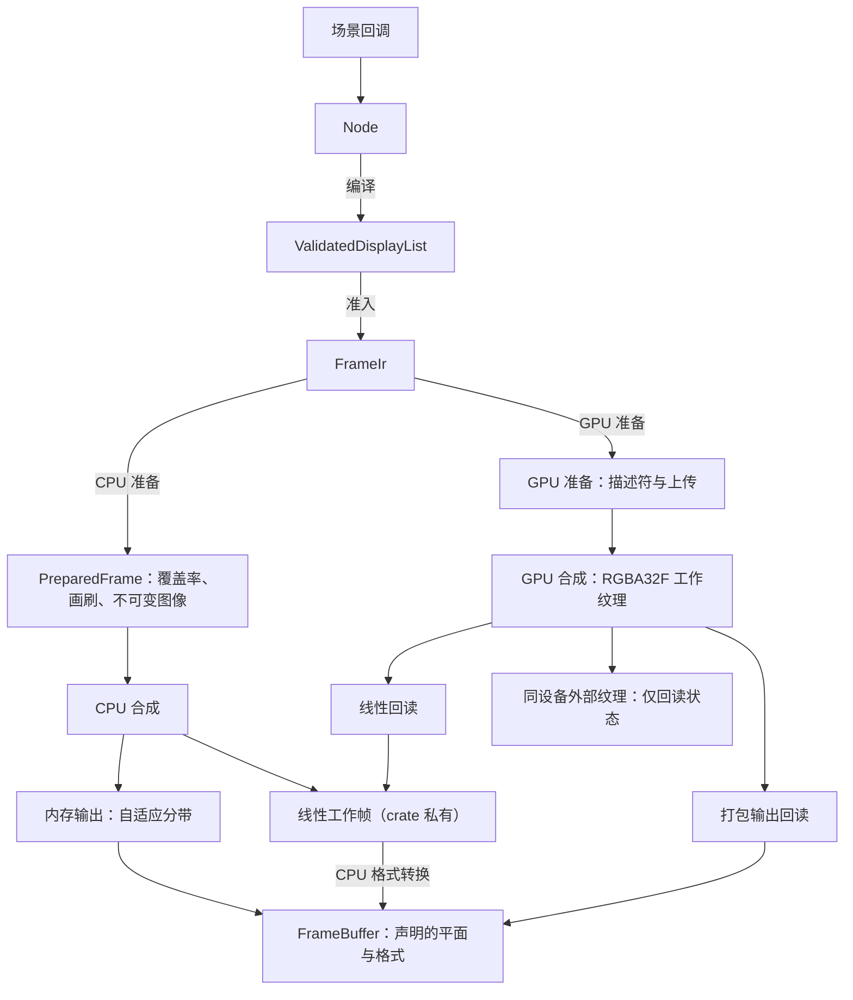
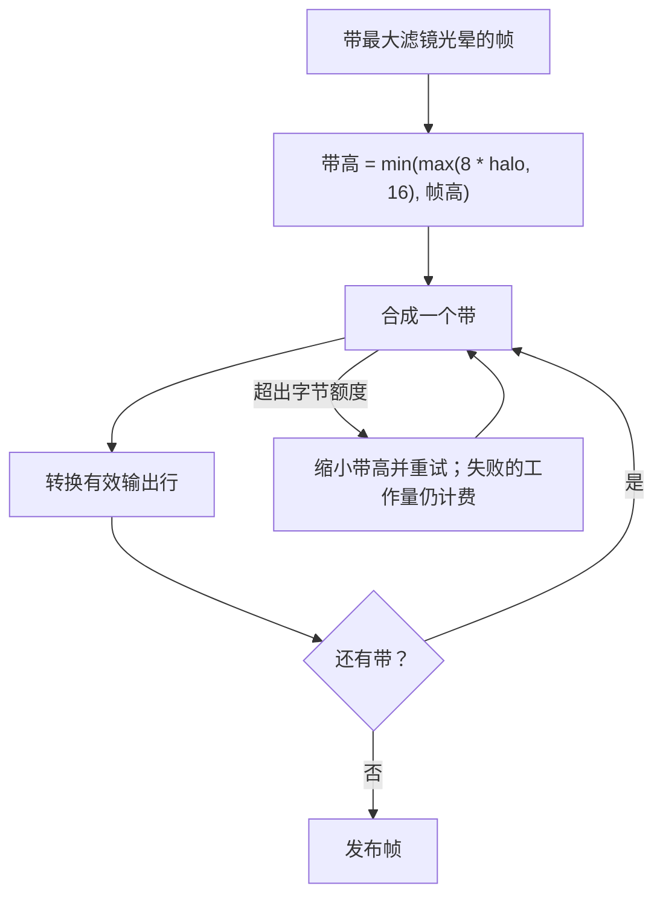
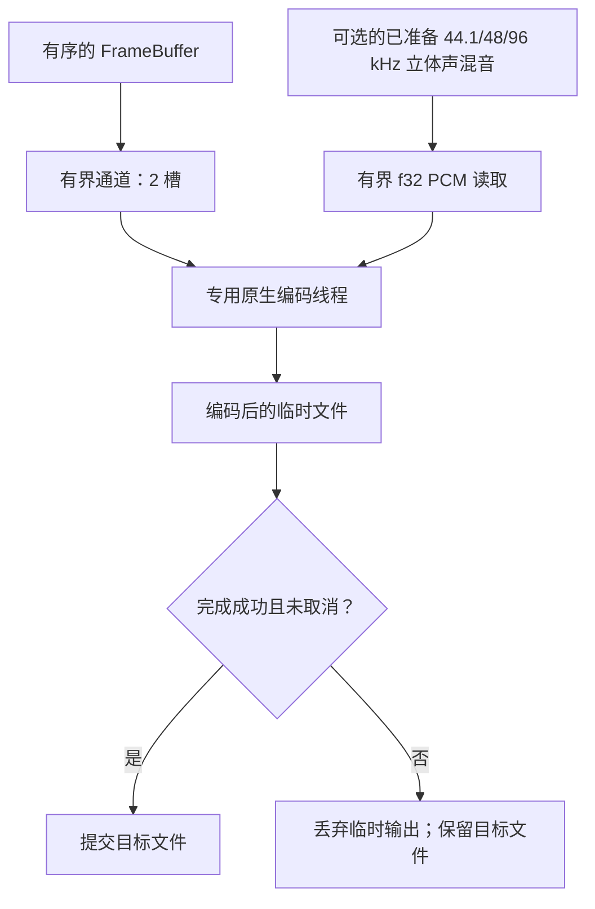
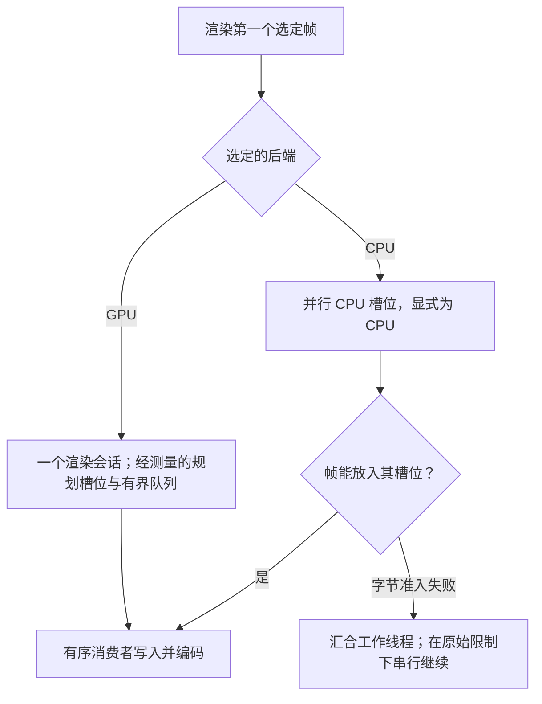

# 渲染与导出

使用 `motion::prelude` 进行创作，`motion::render` 获取渲染契约，`motion::encode` 获取编码器与进度接收器，`motion::extend` 获取实现协议。已准备的覆盖率（strip、span、画刷记录与图层）以及 GPU 计划是 `motion-render` 的 crate 私有内容；`PreparedFrame` 只公开尺寸、统计与计数。逻辑尺寸使用 f64；输出的 `PixelSize` 使用正整数维度。Composition 会把逻辑内容等比包含进输出视口。本文是 [rendering.md](rendering.md) 的中文翻译，以英文版为准。

## 后端准备与效果

`FrameIr` 在分配任何覆盖率之前，先校验全部内容，并规范化设备空间曲线、作用域、画刷、裁剪与滤镜域。它准入结构存储、资源字节以及保守的 Wang 线段上界。CPU 与 GPU 后端各自独立消费这份不可变描述：



公开的 `RenderPrepare` 与 `PreparedFrame` 只描述 CPU 覆盖率。GPU 会话与打包导出工作线程使用独立的准备结果，从不构造 CPU 准备帧；底层 GPU 使用者仍可显式上传一个 CPU 准备帧。符合条件的填充由设备生成覆盖率，参见 [GPU 渲染](gpu.zh-CN.md#共享数据与输出)。

### CPU 覆盖率

CPU 准备用设备空间容差展平曲线、积分多边形面积并记录紧凑的覆盖率。两条路径都不是超采样渲染器。没有相交的带使用经过验证的面积/覆盖前缀快速路径；其余带使用精确的逐行积分参考路径：

1. 在保持边顺序所需的事件处建立垂直切分，包括相关的交点。
2. 对每个区间内的活动交叉点排序，并更新 NonZero 绕数或 EvenOdd 奇偶，合并连续的内部区域。
3. 以 f64 对像素列裁剪并积分梯形，然后把覆盖率量化为紧凑的 span、strip 与 u8 alpha。



快速路径对整个带的边只排序一次，并证明每个活动区间的顺序相同。只有被证明重合的边或共享端点才会绕过其舍入保护。填充规则的状态变化选出真实的填充边界，因此重叠轮廓不会被盲目求和。回退绝不修改覆盖率；即使回退也会计入证明工作量，scratch 在成功与拒绝时都会释放。较紧的字节限制可能选择峰值更低的回退，所以不受限运行的峰值不一定是最小可准入限制下的峰值。

每带最多四行、以四列为一组的分组会省略空覆盖，把完全覆盖的组合并为 span，把边缘覆盖保留为 strip。每个面积只量化一次（钳制、乘法、半稳定 epsilon、舍入），存放在带的 scratch 中并复用于 strip 输出。Strip 与 span 的原点是绝对坐标；平移后的缓存可能改变对齐，因此使用者应采用每条记录的实际坐标与高度。矩形有专门的解析路径。两条 CPU 路径都保持 CPU 覆盖率格式与精确的参考重放。

曲线展平使用设备空间中 Wang 的二阶导数上界：弦误差至多为 `0.75 * curvature / count^2`。曲线分段数向上取整到满足该上界的最小偶数，这在省略水平边时保持对称反转。该上界是以等号满足的，所以依赖面积而非边位置的使用者要自行选择容差：`VectorTree::surface` 使用 0.0025 个树单位。重放遵循[同环境确定性契约](reliability.md#determinism)，而不是跨平台逐字节一致或精确曲线面积的承诺。

会话准备会在覆盖率缓存未命中之间复用多边形带面积、边扫描、活动边、行交叉与梯形列的存储。每个带仍会把其准入的面积值清零，并保持相同的积分顺序、字节与工作量计费及失败边界；只有向量容量得以保留，每个向量每个会话最多空闲 1 MiB，与共享覆盖率缓存无关。超大的存储在该路径结束后丢弃，包括失败的尝试。形状裁剪的光栅化仍分配自己的 scratch。

### CPU 合成

CPU 合成是标量实现。纯色 SourceOver 的 span 把剩余 alpha 项提到像素循环之外；其他所有模式保持逐像素公式与运算顺序。不使用乘加融合。每个像素在发布前都检查工作存储是否有限，合成失败时目标保持不变。

下面两项实验都与它们所取代的代码做过对比测量，因为更慢或在噪声之内且增加了数百行代码而被移除。只有在存在一个获胜且没有任何失败的测量用例时才可重新引入。

- **显式通道向量化**（`wide` 的 f32x4/f32x8 SourceOver、f64x4 混合与覆盖率量化）。逐像素的通道打包与有限值检查与其替代的运算开销相当。只对先经测量的逐行循环做向量化。
- **tile 并行合成**（私有 Rayon 线程池）与**融合的点滤镜**。它们只对少数图层密集的用例有帮助，对多数用例反而更慢，带滤镜的帧从不适用，而导出工作线程本来就运行在 Rayon 线程上。

### 效果

效果使用共享的有序 Filter 原语。布局边界保持不变，准备阶段推导保守的设备捕获区域。子效果先于父效果完成；源经过滤镜、遮罩或裁剪，然后以不透明度与混合合成。保存源的操作保留其显式输入。覆盖率裁剪、几何求交与内容遮罩有不同的量化与顺序契约。用法参见[绘制](../tutorial/05-drawing.md)。

- **模糊**使用有界归一化的盒式近似与透明边界。CPU 的均匀盒在半径 1 与 2 时使用直接的整数加权采样。更大的半径使用滑动窗口：由一个对齐的 2r+1 样本块的后缀加上下一个块的前缀构成，因此每个样本只做加法、从不再减，无论半径多大每个样本都是三次加法，并且离开窗口的大 HDR 值不会抹掉剩下的较小值。垂直 pass 一次遍历整行、最多 32 KiB 的和表，使表留在 L1 中。窗口全为透明黑的块不经求和直接写出，输出逐位一致。pass 缓冲区事先不清零，只清零写入域之外的像素。小 sigma 的小数核保持其加权路径。所有路径都保持有限值检查、计费字节（和表在每个 pass 计费并释放）以及同后端的精确重放。大盒的累加顺序与早先的补偿式和不同，所以历史输出会在 f32 舍入级别上有差异；跨后端容差不变。
- **泛光（Bloom）**是两个后端共享的降采样金字塔。第 `k` 层像素 `(x, y)` 对第 `k - 1` 层位于 `(2x, 2y)` 的 2×2 块取平均，坐标为设备坐标减半 `k` 次。每一层都从其未模糊的父层降采样，然后以 `radius` 个本层像素模糊，覆盖 `radius * 2^k` 个设备像素。从最粗的层开始，每个更细的层把其归一化权重乘以自己的模糊结果，加到以 `((x + 0.5) / 2 - 0.5, (y + 0.5) / 2 - 0.5)` 双线性采样的更粗层之和上。着色、alpha 钳制与 Plus 合成只对全分辨率之和应用一次。`motion_core::filter::bloom_bounds` 给出支撑范围，GPU 计划使用几何相同的 `Downsample` 与 `Upsample` 步骤。粗层的开销是其父层的四分之一，所以整个金字塔约为一次全分辨率模糊的 4/3。
- **散景（Bokeh）**（`Optics::Bokeh`）使用 `Optics::bokeh_taps(radius)` 个孔径采样点，即 `ceil(1.4 * radius^2)` 并限制在 8..=64，在达到上限之前使 Vogel 螺旋间距保持在约 1.5 像素。两个后端都从共享参数读取该数量，并按每个采样点四次读取计费。
- **精确的捷径。** 多个阶段跳过或缩短工作而不改变任何输出位：`ChannelOffset` 只采样所需的通道与 alpha，并丢弃权重为零的双线性采样；图层合成与 Glow 跳过透明黑的源像素（在所有模式下合成都不会改变它们）；RGBA8 编码器通过对阈值位模式的桶索引查找抖动后的字节，不透明像素走直接路径。
- **墨迹（Ink）。** 最终画笔墨迹在每次带索引的候选距离计算执行之前先准入，依据 3200 万的默认材质上限，而不是因为纹素数乘以全部采样数超过该上限就拒绝纹理。纹理尺寸与 262144 纹素的上限不变，准备失败不会发布材质图像。材质准入与帧的光栅工作量和字节相互独立。距离笔画比任何覆盖或晕染所能到达的范围更远的纹素，经几次包围盒测试后直接写为透明；这与完整的最近线段搜索逐位一致。

未加滤镜且没有额外裁剪的 CPU `PushLayer`/`Fill`/`PopLayer` 序列可以直接绘制到父层，而不分配隔离图像。每个被覆盖的像素仍然填充透明的局部像素、舍入、应用图层不透明度，再次舍入后才进行原始混合；不透明度不会折叠进画刷 alpha。曲线与相交路径保留共享的非重叠覆盖率记录。带滤镜的图层、添加了 alpha 或几何裁剪的图层、继承了几何裁剪的图层以及多项目图层保持隔离合成。

准备阶段还会把符合条件的、无滤镜无裁剪的 Plus/LinearPlus 捕获区域，与 Fill 覆盖和已完成子图层边界的并集求交。带滤镜的子图层贡献其完整的保守捕获区域（含光晕）；遮罩所有者与粒子捕获保留其原始边界。这种边界收缩同时适用于 CPU 与 GPU 使用者，其条件扫描与栈元数据在准备阶段准入。

## 帧与静帧

Composition 拥有一个 `FrameClock`（有理帧率与帧数，不设默认值）和一个 `RenderOptions`（尺寸、背景、资源、后端策略等）；除 `with_options` 与 `configure` 之外没有逐项设置器。随机访问帧与缓存复用请复用 `frame_renderer(size)`，其 `FrameRenderer` 包装一个 `RenderSession`。对于 Timeline 输出，`render_still` 与导出使用相同的 `RenderOptions` 策略。`render_frame` 与 `render_frame_sampled` 返回完全不透明的直通 `SrgbRgba8` `FrameBuffer`：帧合成在 `RenderOptions::background`（取为不透明）之上，未设置时合成在白色之上。其 `write_ppm` 与 `write_rgb` 显式截断或替换所选文件，并拒绝非不透明缓冲区。需要透明 PNG 与受保护的输出位置时，请使用 `render_still` 与直通 RGBA8 `FrameBuffer`。

在 Unix 上，事务性的 PNG、GIF 与原生视频输出请求 0666 权限；PNG 序列目录请求 0777。创建新文件与覆盖已有文件时都会应用进程的 umask；导出从不读取或修改该 umask。

```rust,no_run
use motion::prelude::*;
use motion::render::Composition;
let composition = Composition::new(320, 180, motion::render::FrameClock::new(fps!(30), 60));
let mut renderer = composition.frame_renderer(Size::new(320.0, 180.0))?;
let circle = Circle::new(Point::new(160.0, 90.0), 24.0)?;
let frame = renderer.render_frame(15, |_| {
    Node::from(circle.clone().fill(Color::rgb(20, 160, 130)))
})?;
frame.write_ppm("frame.ppm")?;
# Ok::<(), motion::Error>(())
```

`RenderOptions` 选择输出尺寸、背景与透明度、后端、资源、结构与光栅限制，以及可选的快门采样。`FrameBuffer` 保留其声明的平面与格式：直通或预乘的 sRGB RGBA8、线性预乘的 RGBA16F 或未量化的 RGBA32F，或有限范围 BT.709 的 8 或 10 位 YUV420。YUV 要求偶数维度与不透明像素。没有隐式的 HDR 色调映射。`PreparedFrame::render_linear` 与 `Gpu::render_linear` 返回 RGBA32F 的 `FrameBuffer`，可由 `FrameBuffer::linear_pixel`、`linear_pixels` 与 `to_format` 读取或转换；它们背后的 CPU 工作帧是 crate 私有的。

`RenderQuality::Final` 是默认的生产策略。Draft 显式允许在几何、快门采样与墨迹材质上使用预览近似；它不是不同的输出分辨率，也不等价于 Final 的结果。当 sigma 至少为 1 时，Draft 模糊使用一个方差匹配的盒，更小的 sigma 保持 Final 的小核策略。质量必须在重放与缓存标识中保持固定。Studio 在播放与拖动时请求 Draft，导出时强制使用 Final；参见 [Studio 指南](../studio.md#preview-and-playback)。

### 执行与输出路径

创作、准备与像素执行是相互分离的边界。两个后端都消费 `FrameIr`：CPU 后端准备 CPU 覆盖率，而 GPU 后端在设备上为符合条件的填充生成覆盖率，其余的上传。图中展示的是主要路径，不包含所有常量帧或格式的快速路径。



这些路径不可互换：GPU 上普通的 `RenderSession` 内存目标使用线性回读再进行 CPU 格式转换，而受支持的打包输出 API 以及带 `device_packing` 的请求（`render_frame*` 发出的就是这种）则在回读之前打包。外部纹理避免了帧像素回读，但仍会检查提交完成与有限值状态。受支持的目标与异步完成参见 [GPU 渲染](gpu.zh-CN.md)。

CPU 请求不会初始化合成用的 GPU。启用 `gpu` feature 时默认使用 GPU，且 GPU 请求在失败后绝不会回退到 CPU。提供共享的 `GpuContext` 只确立设备身份，不选择后端。

### CPU 内存输出

显式的 CPU 内存输出以全宽自适应分带进行合成。准备阶段缓存最大的嵌套滤镜链光晕；相互独立的兄弟节点不会叠加光晕。带高通常为 `min(max(8 * halo, 16), frame_height)`，当 `16 * halo >= frame_height` 时使用全高合成。字节额度紧张时会先缩小带高再重试，所有失败尝试的工作量仍保持计费。保守的滤镜光晕保留屏幕外与跨带的依赖；只转换有效的输出行。遮罩、每层一次的不透明度、仅源效果与全局噪声坐标均不变。Bayer 相位相对于最终输出原点，YUV 的带保持完整的 2×2 色度块。显式的完整线性 API 保留完整线性帧；带 `device_packing` 的 GPU 请求则回读打包后的直通 sRGB RGBA8。



CPU 线性帧到 RGBA8 的转换与 `FrameBuffer` 平面转换共用一个逐行编码器，包括直通与预乘 alpha 以及 Bayer 相位，并直接写入各自的输出存储，没有中间 RGBA 图像。同步与待完成的 GPU 线性回读共享裁剪与有限像素的校验：对齐的小端行使用经检查的类型化拷贝，其他行则显式解码小端分量。两者都保留调用方的诊断路径。打包回读与外部纹理输出独立于这个线性内核。

CPU 的图层、遮罩、保存源与滤镜 scratch 存储共享一个有界的会话池（四个缓冲区，最多 64 MiB 且不超过当前字节额度的四分之一）。编码后的内存平面有单独的共享池（四个缓冲区，最多 64 MiB 且不超过额度的八分之一）。帧持有其平面直到被丢弃；克隆拥有独立的字节，绝不别名可写存储。查询 `pooled_cpu_bytes` 与 `pooled_output_bytes` 得到的是空闲容量，而不是存活的帧载荷或进程 RSS。所有带共享累计的工作量准入，包括重复的命令与光晕工作；逻辑峰值包含已准备的数据、最终输出、存活的捕获与转换 scratch。失败不会发布部分帧，健康的重试可以复用存储。

渐变几何与图像逆变换只准备一次。CPU 画刷行复用垂直映射项；有界二进制网格上的水平乘积精确递推，其他变换使用直接求值。相同的 LUT、硬停止语义、延伸方式与浮点顺序仍是参考标准。

CPU YUV 转换保留 f32 `libm` 传输函数与 f64 BT.709 量化作为精确参考。共享的 2150 项（8600 字节）sRGB 表在 f32 指数段内插值；线性趾部与端点处理保持精确。`2^-20` 的传输误差保护由显式的、仅在 release 下运行的穷举测试对每一个插值后的 f32 输入验证；更换编译器、`libm` 或传输算术时需重新运行。该保护分别传播到 Y 与平均后的 2×2 Cb/Cr 值，包括 10 位输出的 4 倍样本缩放，任何可能跨越半整数量化边界的区间都使用精确计算。均匀块复用精确量化的样本。输出容差、alpha 策略与转换工作量额度均不变，共享的不可变表不计入每帧逻辑存活字节。

### 限制

`RasterLimits::default()` 选择 `authoring()`：16,777,216 个光栅像素与 256 MiB 逻辑存活字节，没有工作量上限（`max_work = u64::MAX`）。工作量计数与溢出检查仍然启用。选用 `RasterLimits::sandbox()` 可得到 200,000,000 单位的工作量上限，也可提供显式的 `max_work`。两种策略都不约束任意 Rust 回调、墙钟时间或进程 RSS。

### 渲染请求

对于显式目标与精确时间的请求，直接复用 `RenderSession`：

```rust,no_run
use motion::prelude::*;
use motion::render::{FrameAt, FrameBuffer, FrameRequest, PixelFormat, RasterLimits, RenderSession, RenderTarget};

let size = PixelSize::new(320, 180);
let mut session = RenderSession::new(Size::new(320.0, 180.0), RenderOptions::default().size(size))?;
let mut output = FrameBuffer::new(size, RasterLimits::default())?;
session.render(FrameRequest {
    at: FrameAt::Time(250.milliseconds().after_origin()),
    frame_rate: FrameRate::NTSC,
    duration: 2.seconds(),
    background: None,
    target: RenderTarget::Memory(&mut output),
    format: PixelFormat::SrgbRgba8 { premultiplied: false },
    device_packing: false,
}, |context| Node::from(context.bounds().fill(Color::WHITE)))?;
# Ok::<(), motion::Error>(())
```

`FrameAt::Time` 不会对齐到帧网格；`FrameAt::Index` 按请求的帧率精确换算。`FrameRenderer::render_frame*`、`Composition::render_frame*` 与 `render_still` 都是这一条请求路径的薄封装。`device_packing` 让 GPU 渲染的直通 `SrgbRgba8` 请求在设备上打包字节，其结果可能因 GPU 的 f32 舍入而与主机转换不同。运动模糊可能多次调用构建器。

- 内存目标仅在成功时才被替换，渲染期间其旧的保留载荷仍然计费。外部纹理在 GPU 失败后没有回滚保证。
- 每个请求安装新的诊断并清除之前的总量。`last_stats` 描述成功的内存输出，而不是外部纹理的转换。每个阶段报告 `WorkStats { peak_bytes, work }`，`RenderSession::report()` 把统计、计时与渲染器汇总为一个 `FrameReport`。
- 请求中的背景覆盖选项中的背景。`render_frame*` 合成在 `RenderOptions::background`（取为不透明）之上，未设置时为白色；`render_still` 与直接请求在没有给定背景时保持透明。
- `backend_kind()` 报告由后端偏好确定的后端类型；`requested_backend()` 报告偏好本身。

## 资源与内容

缓存保留、可复用的空闲存储与逐请求准入衡量的是不同的东西。共享同一个所有者并不会合并这些额度，也不构成 RSS 上限。

| 所有者 | 保留的数据 | 共享与计费边界 |
| --- | --- | --- |
| Assets / ResourceStore | 已解码的类型化资源 | 克隆的 Assets 共享注册；with_store 让相互独立的所有者共享存储。 |
| SceneCache | 纯场景计算 | 默认按条目数限制；按字节计费需要声明键与值的开销。 |
| RenderCache | 覆盖率、段落、字形、渐变、公式 | RenderOptions.cache 可以在会话与导出工作线程之间共享分区；命中仍要经过光栅准入。 |
| RenderSession 池 | 空闲的 CPU scratch 与编码平面存储 | 活动帧与捕获仍是存活载荷，而不是空闲容量；被丢弃的输出平面可以回到共享池。 |
| GpuContext | 设备状态与可复用的 GPU 工作资源 | 克隆共享设备身份；飞行中的租约保留在其提交上，直到成功完成。 |

`Assets` 惰性加载类型化资源，结果是粘性共享的，逻辑保留有界。`FontLibrary` 是显式的；渲染前请在资源或文本上冻结它。缺失资源会使生产输出失败。占位渲染是显式的预览策略，仍保留带类型的诊断。

`Assets::preload` 把已解码对象注册到与惰性句柄相同的条目中。每个新的 `Assets` 所有者从自己的 256 MiB/4096 条目 `ResourceStore` 开始；克隆共享它，`with_store` 让相互独立的所有者共享计费与缓存标识。`ResourceStore::with_limits` 配置正的字节额度与 1..=4096 个条目。`snapshot()` 隔离后续的修改，`remove::<A>(source)` 取消注册但不使句柄失效；保留的快照与句柄使其载荷继续计费，直接持有的已解码 `Arc` 可能比所有者、句柄及其计费存活得更久。`RequestDiagnostics` 加 `Handle::get_with` 把资源错误关联到调用方管理的后台工作。不存在环境式的帧作用域：由请求的 `Assets` 视图创建的句柄继承其接收器，而捕获的外部句柄必须在绘制边界处使用 `get_with(context.diagnostics())`。

### 缓存

`SceneCache` 是独立的纯计算 LRU。其默认的 256 条目限制不是字节上限。`with_limits` 与 `cache_with_cost` 支持协作式的载荷计费，包括内联的键与值大小；请在开销中声明两者拥有的堆载荷。键会被保留，要求 `Eq + Hash + Send + Sync + 'static`；哈希匹配仍要求键相等，且调用位置与值类型相同。条目元数据、分配器开销与外部 `Arc` 持有均不计入，因此该额度不是进程 RSS。

`RenderOptions.cache` 在 `FrameRenderer`、`RenderSession` 与导出工作线程的克隆之间共享 `RenderCache` 分区。各分区的默认值如下：

| 分区 | 条目数 | 字节 |
| --- | --- | --- |
| 覆盖率 | 2048 | 16 MiB |
| 段落 | 256 | 8 MiB |
| 字形 | 2048 | 16 MiB |
| 渐变 LUT | 64 | 8 MiB |
| 公式 | 32 | 32 MiB |

各分区独立淘汰最旧的单个条目，命中时仍会检查光栅预算。公开的 `RenderPrepare` 调用不会隐式获得跨帧缓存。

覆盖率键保留完整的动词相等性、填充规则、容差与光栅尺寸。当曲线与多轮廓字形路径的仿射项恰好位于有界的 1/65536 网格上，且其控制凸包位于光栅内四像素时，可以复用任意整数平移相位。冷路径与缓存路径使用相同的规范原点。小数相位、被裁剪的路径与不安全的精度会回退，缓存命中仍要经过请求的存储与工作量准入。

不可变的 `Path2D` 快照为每个源路径保留最多四个成功的描边轮廓，逻辑动词与条目载荷合计不超过 1 MiB，以完整的描边样式为键。成功的路径编辑通过写时复制使该缓存失效；失败的编辑保留它，旧的克隆仍可复用。缓存的快照不固定派生的弧长或更多描边缓存。`Canvas` 在命中时仍计费源与输出的结构限制；这并不冻结自定义绘制回调。

`RenderSession` 还保留最多 64 个渐变颜色表，逻辑载荷合计不超过 8 MiB。完整的色标与颜色位模式以及插值空间标识一张表；几何、变换、LOD 与有效性检查仍是逐请求的。表通过 `Arc` 共享，活动帧的工作量与字节计费不变。请分别查询 `cached_paint_bytes()` 与 `cached_coverage_bytes()`。这些限制不含分配器容量、驱动开销与外部持有的快照，也不是 RSS。

### 内容

`Image` 解码 PNG、JPEG 与 WebP；`AnimatedImage` 支持 GIF、APNG 与显式帧序列。SVG 变成共享的 `VectorTree` 几何，而不是私有的光栅后端。文本使用一个段落排版器与共享的字形图形。`FormulaCompiler` 把受信任的 Typst 数学公式直接转换为该矢量模型；Typst 还支持通过其轮廓化 SVG 输出导入的单页标记。

`Node::compile` 在增量命令校验后返回 `ValidatedDisplayList`；普通准备会复用其已测得的需求，不再对命令做一次成功的扫描。帧内的命令准备是串行的；导出工作线程提供跨帧的并发，而不是单独的并行覆盖率准备后端。`DisplayList` 对底层调用方保持可编辑，编辑后必须重新校验：使用 `into_editable` 进行显式修改，使用 `with_background` 获得仅背景的快照。图像画刷通过 `ImagePattern` 引用不可变的 `ImagePixels`；准备帧不需要单独的图像解析阶段。`RenderContext` 携带资源与结构限制。`RenderOptions.gpu_context` 是显式的 GPU 注入点，`FrameRenderer::submit_to_texture` 支持无需整帧 CPU 回读的同设备预览输出。内存输出与外部纹理输出仍是各自独立的契约。

系统字体索引不会保留每个字体文件的字节。被选中的文本字体面按需加载；`ExportReport.fonts` 列出实际观察到的名称与来源哈希。即使复用选项与缓存，每次导出也会启动新的观察接收器。

## 视频与音频

原生视频编码使用有界的两帧队列与渲染重叠。原生编码器始终位于一个专用线程上，包括创建与销毁。不使用原始帧临时假脱机，也没有原始字节的时长上限。只有显式的成功完成才会提交编码后的临时文件；取消、编码器被丢弃、渲染错误与工作线程 panic 都会汇合工作线程并丢弃它。自定义 `Encoder::open` 在任何写入调用之前接收规范化的选项、帧率与已准备好的裁剪音频混音；`Encoder::finish` 不接收音频参数。

Project 与 `export` 使用 `Timeline`、`ExportOptions`、`ProgressSink` 与有序的 `Encoder` 操作。范围是对齐到所表示帧边界的半开绝对时间。回调保持绝对场景时间；输出时间戳从零开始。取消是协作式的，并在提交目标之前检查。

两槽的原生通道限制的是排队的帧消息，而不是所有存活的帧或进程 RSS：生产者与编码器也可能各自持有一帧。音频准备与该视频队列相互独立。



### 导出调度

导出先渲染第一个被选中的帧，并用其实际的启动后端决策与输出来调度其余帧。



- CPU 选择会启用对显式 CPU 请求以及未启用 `gpu` feature 的构建的并行渲染。并行 CPU 槽位显式选择 CPU，保留第一个会话的选择，而不是再次探测 GPU。
- 请求的工作线程数默认取可用并行度，上限为 64；帧数与第一帧逻辑峰值的两倍会进一步限制并发。并行 CPU 槽位平分 `max_parallel_bytes`，而不是各自预留配置的单帧上限。`.workers(1)` 保持串行求值。
- 如果后续的帧需要超过其槽位，工作线程会被汇合，尚未写入的帧在原始限制下串行继续。只有字节准入失败才会触发这次重试；无效内容、工作量限制错误与 panic 仍是失败。场景回调必须是纯的，并且可能被重试。
- 编码器与进度回调通过公开的 `Encoder` 与 `ProgressSink` 协议在调用方上保持有序；原生编解码执行在其专用线程上运行。
- GPU 选择保持一个渲染会话。工作线程构建 GPU 计划与打包输出计费，有序消费者负责准入、提交与编码，详见 [GPU 渲染](gpu.zh-CN.md#gpu-导出工作线程)。
- 聚合额度不含编码器存储、共享资源、缓存与空闲池，也不是 RSS 上限。无法放入并行槽位的帧仍可在其配置的单帧限制下串行渲染。

### 音频

Timeline 的 `AudioClip` 源默认为 48 kHz 立体声，AAC 交付选项支持 44.1 与 96 kHz。`AudioClip::file(path)` 是固有且惰性的：创作时不会打开或解码文件。执行时解析元数据并解码有界的请求窗口；文件错误以 `Asset` 失败传播。已准备的 PCM 受 128 MiB 混音额度约束。被选中的范围保留原始片段的淡入淡出与包络时钟。执行期间请保持文件源不变；读取是随机访问的，不是保留的不可变 PCM。

### 编码器

原生适配器通过第一方 FFmpeg 绑定（而不是可执行文件）编码 H.264/MP4、H.265/MP4、VP9/WebM（可选 alpha）与 ProRes 4444/MOV。编解码器可用性在打开输出之前探测。MP4 与 MOV 支持 AAC 音频；在提供 Opus/Vorbis 适配器之前，WebM 音频会被拒绝。视频帧从内存流式传入，不经过临时 YUV 或 RGBA 文件。音频直接从不可变的已准备 f32 PCM 读取，使用绝对采样时间戳，不经过临时 WAV。编码后的容器先写入同目录的临时文件，再事务性提交。离线效果与母带烘焙、准备上限与测量近似参见[音频契约](../tutorial/10-audio.md)。

`PngSequenceEncoder` 以原子方式提交同目录的暂存目录，支持奇数尺寸与完整 alpha，并拒绝音频。在平台支持重命名交换的情况下，覆盖会原子地交换真实目录。`GifEncoder` 使用请求的输出帧网格、逐帧调色板与累计的有理延迟。GIF 为一位透明、2..=256 个调色板颜色、无音频、最高 100 fps。不支持的组合会在创建输出之前失败。所有编解码器使用 `ExportOptions` 的构建器设置尺寸、范围、后端、`motion_blur` 与覆盖，并共享 `ProgressSink`。

`Encoder::capabilities` 声明音频支持、最大尺寸与维度倍数。维度在打开输出之前检查；不支持的时间线音频在 PCM 准备与帧渲染之前就被拒绝。自定义编码器仍负责事务性提交、特定编解码器的检查与清理；能力声明的默认值是宽松的。

已有的输出文件受到保护，除非显式允许覆盖。提交之前的失败、取消与 panic 都使已提交的输出保持不变。输出不得替换音频源。预览与导出期间请保持流式源文件不变。

各自的具体契约参见 [GPU 渲染](gpu.zh-CN.md)、[效果](core.md#layers-and-sampling)、[Studio](../studio.md) 与[可靠性](reliability.md)。
