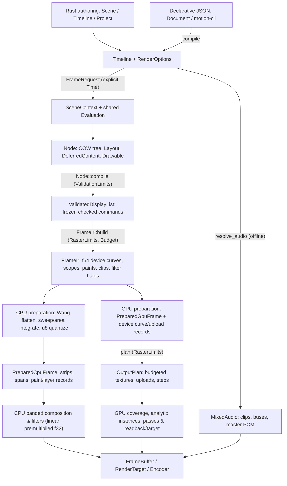
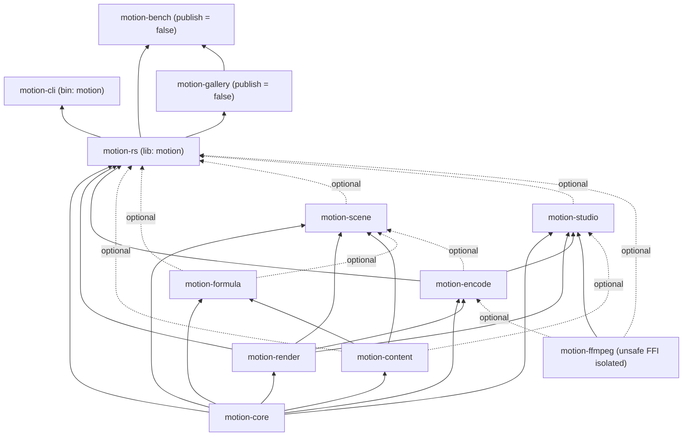

# Architecture

Motion is a programmable 2D video engine built around deterministic, pure-function
scene evaluation and a shared rendering pipeline that feeds independent CPU and GPU
backends. Preview, still rendering and film export evaluate the exact same authored
`Timeline` at explicit times without hidden playback state.

## Design principles and boundaries

- **Determinism and explicit time.** Visuals are a pure function of exact signed
  integer ticks (`Time` at `705,600,000` ticks per second), nonnegative `Duration`,
  signed `TimeOffset`, rational `FrameRate`, keyed `Random` streams and fixed inputs.
  There is no global mutable state or wall-clock advancement; random seeking and
  sequential export produce identical `Node` snapshots.
- **Explicit I/O and zero ambient state.** Nothing scans directories, discovers
  system fonts, opens windows, initializes audio devices or picks GPU adapters
  implicitly. Resources, font snapshots, caches and shared GPU handles enter through
  `Assets`, `ResourceStore`, `FontEnvironment`, `RenderOptions` and `RenderContext`.
- **Immutable snapshots and full-branch validation.** `Node` trees are immutable
  copy-on-write values. Compilation measures layout, expands deferred content and
  validates every branch—including zero-opacity and offscreen subtrees—against
  `ValidationLimits` before backend preparation begins.
- **Admission before allocation.** `ValidationLimits`, `Budget` and `RasterLimits`
  admit structural occurrences, resource bytes, curve segments and logical work before
  allocating scratch buffers or encoding GPU work. Every library crate except the
  native FFI boundary (`motion-ffmpeg`) enforces `#![forbid(unsafe_code)]`.
- **Shared semantics, independent backends.** Backend-neutral normalization
  (`FrameIr`) encodes device-space geometry, scopes, paints, clips and filter domains
  once. The CPU backend and GPU backend consume those immutable semantics
  independently rather than sharing coverage buffers or requiring bit-identical
  cross-backend pixels.

## End-to-end pipeline

Both Rust authoring (`Project`, `Timeline`, `Scene`) and declarative JSON documents
(`motion::declarative::Document` / `motion-cli`) compile into the same `Timeline`
contract, while timeline audio resolves on a parallel stateless path outside scene
evaluation:

### Numeric and color precision across stages

| Stage | Representation and contract |
| --- | --- |
| Timing | Exact `i64`/`u64` ticks (`TICKS_PER_SECOND = 705_600_000`), rational `FrameRate`; frame boundaries convert independently without accumulating floating-point seconds |
| Authoring and normalization | `f64` logical coordinates (top-left origin, `+x` right, `+y` down), radians, animation progress, layout and `FrameIr` device-space curves; `Transform` stays affine while `Perspective` projects planar 2.5D path geometry |
| Working compositing | Finite linear-sRGB premultiplied `f32` on CPU bands and pooled GPU `RGBA32F` working/mask/saved-source textures (`RGBA16F` for GPU image mips); `Color` stores finite extended encoded-sRGB `f32` |
| Output boundary | Explicit quantization to `PixelFormat`: `LinearRgba32Float`, `LinearRgba16Float`, `SrgbRgba8 { premultiplied }` or 8/10-bit BT.709 limited-range `Yuv420` |

### 1. Scene evaluation and compilation

`SceneContext` supplies signed local and global ticks, clip duration, rational
`FrameRate`, logical design bounds, keyed `Random` streams, an author-facing
`SceneCache` and one shared `Arc<Evaluation>` carrying `RenderQuality`, `Assets`,
`FontEnvironment`, `RequestDiagnostics` and `RenderCache`. `Scene` callbacks return
immutable `Node` snapshots (or fallible `IntoSceneOutput` results). `Row` and `Column`
resolve deterministic layout in insertion order; `SceneContext::measure` hands the
shared `Evaluation` to a `DrawContext` at local time; `Camera` applies an inverse view
transform; and `Skeleton` solves 2D forward kinematics in authoring space.

Animated text, SVG and Typst formulas share one `DeferredContent` pipeline built from
an immutable `CompileCache` key, `VectorTree`, `VectorSelection` and arc-length
`VectorTree::reveal`, rather than maintaining separate per-feature effect engines.
`Node::compile` validates structural invariants and `ValidationLimits` while recording
commands into an `Arc`-backed `ValidatedDisplayList` (whereas `DisplayList` remains
the editable low-level command buffer). Image paints reference immutable
`ImagePixels`, while procedural `Paint::Mesh` and `AtmospherePaint` retain bounded
mathematical descriptors evaluated independently by each backend—there is no deferred
bitmap-callback phase inside rendering. `ValidatedDisplayList` proves structural
validity, not live device availability or sufficient raster budget. See
[core authoring](core.md) and [content](content.md).

### 2. Backend-neutral normalization (`FrameIr`)

`FrameIr::build` re-validates the `ValidatedDisplayList`, enforces `RasterLimits`
through `Budget` and normalizes ordered scopes, paint and clip references,
conservative nested filter halos (sibling filters do not sum halos), padded
dimensions and the output viewport before any pixel coverage is allocated.

`FrameIr` retains `f64` device-space curves, conservative Wang second-derivative
segment upper bounds and admitted resource bytes, without coverage. A local-geometry
recipe preserves CPU transform arithmetic and canonical coverage-cache identities.
Because live `FrameIr` storage overlaps backend preparation scratch, both count toward
the frame's admitted logical peak. After structural and geometry validation, zero-opacity
layer scopes are marked hidden so both backends skip fill coverage inside them without
consuming fill, pixel or coverage-work ceilings.

### 3. Backend preparation, planning and execution

The CPU backend and GPU backend each consume the immutable `FrameIr` directly, never
each other's output:

- **CPU backend (`RenderPrepare` / `PreparedCpuFrame`).** Subdivides curves with
  even-rounded Wang bounds, sweeps bands of up to four rows—using a verified
  non-crossing prefix fast path when edge order is proven and falling back to
  row-wise `f64` trapezoid integration otherwise—and quantizes once into `u8` strips
  and merged full-coverage spans (with an analytic path for axis-aligned rectangles).
  Ordinary paths and glyph contours reuse canonical device-origin coverage cache keys
  preserving fractional subpixel phase; clips and extreme coordinates use raw keys.
  Session scratch vectors retain at most 1 MiB of idle capacity per vector across
  cache misses. Composition walks full-width adaptive bands (defaulting to 16 rows,
  growing for nested filter halos and shrinking under tight byte budgets) in scalar
  linear-premultiplied `f32`, checking every pixel for finiteness before publishing.
- **GPU backend (`PreparedGpuFrame` → `OutputPlan` → `gpu/execute`).** Independently
  emits device curve descriptors and `f32` tile-coverage uploads for eligible fills
  while retaining explicit CPU coverage for ineligible paths and clips. Device-free
  planning (`gpu/plan`, exposed via `PreparedGpuFrame::plan`) skips complete
  zero-opacity scopes—allocating no filter, mask or layer passes for hidden trees—and
  admits all uploads, pooled `RGBA32F` working textures, staging buffers and packed
  output copies before touching `wgpu`. Execution (`gpu/execute`) separates command
  encoding and packing (`submission`), GPU curve flattening and tile coverage
  (`device_coverage`), closed-form GPU trajectory evaluation (`analytic`), texture
  uploads and blend/filter passes (`textures`), 16×16 ordered tile binning
  (`particles`), fence completion and pool recycling (`pending`), and bounded ordered
  in-flight scheduling (`queue`).
- **Instance and particle tiers.** `Canvas::instances` records an `InstanceBatch`
  bounded by `MAX_INSTANCE_COUNT` (`1,048,576`). Arbitrary custom trajectories and
  fixed-step simulations evaluate in deterministic Rust and upload validated 12-word
  (48-byte `InstanceRecord`) or 16-word (64-byte `ExtendedInstanceRecord`) primitives
  via `InstanceUpload`, with immutable sprite atlases cached on `GpuContext`
  separately from per-draw headers. Eligible built-in closed-form trajectories can
  instead supply `AnalyticInstanceUpload` descriptors evaluated on the GPU into
  primitive records before 48-byte support derivation and source-ordered 16×16 tile
  compositing, diagnosing precision fallbacks without switching backends. See
  [particles](particles.md) and [rendering and export](rendering.md).

### 4. Composition, shutter sampling and display transform

`RenderOptions` holds session policy (`RenderQuality`, output `PixelSize`,
`background`, `BlendSpace`, `MotionBlur`, `ShutterSampling`, `DisplayTransform`,
`allow_missing_assets`, `mark_invalid_geometry`, `BackendPreference`, optional
`GpuContext`, `Assets`, `RenderContext`, `RenderCache`, `RasterLimits` and
`FontUsage`). `RenderSession` owns reusable backend state, scratch pools and per-frame
`RequestDiagnostics`; `FrameRequest` addresses one frame by index or exact `Time`; and
`FrameRenderer` binds a `RenderSession` to a `Composition`'s `FrameClock`.

Whole-frame `MotionBlur` and `ShutterSampling` accumulate deterministic sub-frame
samples in linear premultiplied `f32` before `DisplayTransform` runs in fixed order:
`exposure_stops` → scene-linear `Cdl` (`look`) → optional `look_lut` → `ToneMap` (with
optional `reference_white`) → `saturation` → optional `display_lut` → `OutputTransfer`
(`Srgb` or `Gamma24`) → coordinate-seeded `FilmGrain`. `Look` pairs scene-side
`SceneEffects` (`Optics`, `DepthOfField`, `GateWeave`, shutter and filters) with an
output `DisplayTransform`.

### 5. Output surfaces, audio and transactional encoding

Rendered frames and prepared audio materialize through three explicit contracts:

- **`FrameBuffer`.** Straight `SrgbRgba8` for transparent stills (`render_still`) or
  opaque background-backed frames (`Composition::render_frame`), or explicit
  `PixelFormat` planes (`LinearRgba16Float`, `LinearRgba32Float`, `SrgbRgba8`,
  8/10-bit `Yuv420`). Encoded output planes return to a separately bounded shared pool
  on `Drop`. Direct single-frame writers (`save_png`, `write_ppm`, `write_rgb`) live on
  `FrameBuffer` rather than the video export pipeline.
- **`RenderTarget`.** Borrowed external memory slices (updated only after frame
  success) or external `wgpu` textures validated against the active device (written in
  place). In [Studio](studio.md), preview workers default to a private GPU device per
  session and upload premultiplied `ColorImage` frames to avoid contending with
  `eframe`'s surface fence; setting `MOTION_STUDIO_SHARED_GPU=1` switches workers onto
  the UI's shared `wgpu` device and renders directly into a zero-readback texture ring.
- **`Encoder` and `MixedAudio`.** `motion-encode` drives ordered frame streaming
  (`Preparing` → `Rendering` → `Finalizing` → `Completed`) across pure-Rust
  `PngSequenceEncoder` and `GifEncoder`, optional in-process native `FfmpegEncoder`
  (`H264`, 8/10-bit `H265`, `Vp9` with optional alpha, `ProRes4444` via `libav*` in
  `motion-ffmpeg`, never an `ffmpeg` subprocess) and custom `Encoder`s. Built-in file
  exports stage to a same-directory temporary path and atomically commit only after
  codec flush and cancellation checks. Timeline audio resolves offline via
  `Timeline::resolve_audio` and `MixedAudio` (per-clip source-rate effects, resampling,
  envelopes, ordered buses, ducking and master chain) and feeds native muxing on a
  dedicated worker thread or Studio's `cpal` preview clock. See
  [export and FFmpeg](export.md) and [audio](audio.md).

## Ownership, caches and execution boundaries

- **Resources and font snapshots.** `Assets` manages preloaded values and lazy typed
  `Handle<A>` entries inside an explicit `ResourceStore` (`Weak` index plus logical
  byte counter). Separate stores isolate projects; clones share resolved entries while
  mutations or `with_fonts` derive a new snapshot identity. Relative file loads
  require an explicit root directory. `FontLibrary` starts empty; explicit font
  registrations freeze bytes with copy-on-write `snapshot_id`s, while opt-in system
  discovery indexes metadata and loads selected faces lazily. `ExportReport.fonts`
  records non-cryptographic source-byte hashes from `FontUsage` for provenance
  auditing. `RequestDiagnostics` propagates background asset failures explicitly via
  `Handle::get_with`—there is no ambient frame thread-local. See
  [resources](resources.md).
- **Seven-partition compute cache.** `RenderOptions.cache` (`RenderCache`) is a
  cloneable array of seven independently LRU-bounded `SceneCache` domains
  (`CachePartition`): `Coverage`, `Paragraph` (used by `SceneContext::measure` and
  `cache_layout`), `Glyph`, `Gradient`, `Formula`, `Ink` and `Scene`. Computations run
  outside cache locks and entries are pure and recomputable. Studio forks
  `CachePartition::Scene` per registered scene while sharing the remaining six
  partitions across preview workers and settings changes.
- **Logical quotas versus physical memory.** `ValidationLimits` counts structural
  occurrences rather than unique `Arc` pointers, so DAG sharing does not bypass scene
  complexity limits. `RasterLimits` bounds admitted logical work and simultaneous live
  payloads (`RasterLimits::authoring()` by default; `RasterLimits::sandbox()` adds a
  `200,000,000`-unit work cap); it is not a process RSS cap, GPU driver allocator hook
  or untrusted-callback sandbox.
- **Failure, panic and device rules.** Headless evaluation runs synchronously and
  propagates user callback panics; Studio workers catch panics via `catch_unwind` and
  surface typed `Error` diagnostics without crashing the window, recovering plain-data
  locks through `motion_core::sync` while rejecting poisoned third-party font shapers.
  Preview requests coalesce; exports render every selected frame (parallelizing across
  bounded worker slots sized from frame 0's logical peak, with serial retry on larger
  frames). Shared `GpuContext` handles serialize scoped submissions on one device, and
  GPU selection or device loss aborts the frame with `Error` rather than silently
  falling back to the CPU backend. See [reliability](reliability.md).

## Packages and features

The workspace root is a virtual manifest whose default member is
[crates/motion](../../../crates/motion/Cargo.toml) (package `motion-rs`, library
`motion`). Dependencies flow strictly upward—lower-level crates never depend on the
facade:

| Package | Responsibility | Engine dependencies |
| --- | --- | --- |
| [`motion-core`](../../../crates/motion-core/src/lib.rs) | Time, geometry, animation, `Scene`/`Node`/`Layout`/`Timeline`, commands, budgets, resources, instance and audio descriptions; optional `serde`/`schema` | None |
| [`motion-render`](../../../crates/motion-render/src/lib.rs) | `FrameIr`, CPU/GPU preparation, planning and execution, filters, sessions, `FrameBuffer`/`RenderTarget`, `DisplayTransform` and `Look` | `motion-core` |
| [`motion-content`](../../../crates/motion-content/src/lib.rs) | Images, fonts/text, SVG, `VectorTree`/morphing, particles, LUT loaders and optional `ink`/`diagram`/`captions`; optional `serde`/`schema` | `motion-core` |
| [`motion-formula`](../../../crates/motion-formula/src/lib.rs) | In-process Typst document/math compilation and formula morphing/selection | `motion-core`, `motion-content` |
| [`motion-encode`](../../../crates/motion-encode/src/lib.rs) | Offline `MixedAudio` preparation, progress/cancellation and transactional PNG/GIF/FFmpeg export | `motion-core`, `motion-render`; optional `motion-ffmpeg` |
| [`motion-scene`](../../../crates/motion-scene/src/lib.rs) | Versioned declarative JSON `Document` model, JSON Schema and compilation to `Timeline` | `motion-core`, `motion-render`, `motion-content`; optional `motion-formula`, `motion-encode` |
| [`motion-studio`](../../../crates/motion-studio/src/lib.rs) | Native `egui`/`eframe` desktop preview, real-time `cpal` playback, inspector and export workbench | `motion-core`, `motion-render`, `motion-encode`, `motion-ffmpeg`; optional `motion-content` |
| [`motion-rs`](../../../crates/motion/src/lib.rs) | Public facade (`motion`), five import namespaces, `Project` CLI grammar and `VisualCheckPolicy` | Feature-selected workspace crates |
| [`motion-ffmpeg`](../../../crates/motion-ffmpeg/src/lib.rs) | Native `libav*` bindings (`bindgen`) and thread-confined codec, muxer and audio contexts | None |
| [`motion-cli`](../../../crates/motion-cli/src/main.rs) | Thin `motion` binary delegating declarative JSON workflows to `motion::Project` | `motion-rs` |
| [`motion-bench`](../../../crates/motion-bench/Cargo.toml) | Unpublished Criterion, stage, breadth and film benchmarks plus provenance `build.rs` | `motion-rs`, `motion-gallery`; optional `motion-core` |
| [`motion-gallery`](../../../gallery/Cargo.toml) | Unpublished showcase films and golden/JSON demos | `motion-rs`; optional `motion-ffmpeg` |

### Facade namespaces

Only `motion-rs` ([`crates/motion/src/lib.rs`](../../../crates/motion/src/lib.rs))
assembles public authoring namespaces; internal crates import upstream items directly
and never import `prelude` or glob-reexport upstream roots:

- `motion::prelude`: everyday authoring types, `Project`, `render_still`, `export`,
  `RenderOptions` and `ExportOptions` (optional production tools such as `ink`,
  `diagram`, `captions` and `particles` stay outside `prelude` in their own modules).
- `motion::extend`: open extension traits and records (`Drawable`, `DeferredContent`,
  `Transition`, `Asset`, `AudioSource`, `RenderPrepare`, `Encoder`, `ProgressSink`,
  instance protocols).
- `motion::render`: explicit low-level commands (`DisplayList`,
  `ValidatedDisplayList`), budgets/limits, `Composition`, `RenderSession`,
  `FrameRequest`, `FrameRenderer`, `PixelFormat` and `GpuContext`.
- `motion::encode`: concrete encoders (`FfmpegEncoder`, `GifEncoder`,
  `PngSequenceEncoder`), `EncoderFactory`, `ExportPhase`, `ExportReport`, `MixedAudio`
  and `PcmBuffer`.
- `motion::eager`: explicit pre-evaluation compilation (`CompileCache`, `VectorTree`,
  `Morph`, `MorphPath`, `ParagraphLayout`, `FormulaCompiler`).

### Cargo feature boundaries

The facade enables
`gpu,image,svg,text,particles,ffmpeg,studio,ink,diagram,captions,declarative` by
default (`docs.rs` builds the same set minus `ffmpeg` and `studio`, adding `audio`).
Enabling a feature exposes types and codecs at compile time without implicitly
selecting a GPU, scanning system fonts, opening a window or starting audio output.

| Feature | Capability and dependency boundary |
| --- | --- |
| `vector` | `motion-content` vector trees, `Morph`/`MorphPath`, LUT loaders and `Image` layout contracts without raster decoders, fonts or particles |
| `image` | Implies `vector`; enables PNG/JPEG/WebP/GIF raster decoding and `AnimatedImage` |
| `text` | Implies `image`; enables `FontLibrary`, `cosmic-text` shaping and `skrifa` glyph outlines |
| `svg` | Implies `image` and `text`; parses SVG via `usvg` (no `resvg` bitmap backend) into shared vector/command nodes |
| `particles` | Implies `image` (independent of `text`); enables `particles` emitters, forces, fixed-step simulation and styles |
| `ink` | Implies `image`; exposes deterministic brush strokes, paper and pigment mixing under `ink` / `vector::ink` |
| `diagram` / `captions` | Imply `text`; expose namespaced chart/scale and SRT/caption tracks |
| `typst` / `formula` | `typst` compiles self-contained markup with bundled fonts via `motion-formula`; `formula` implies `typst` and adds math selection/morphing |
| `audio` / `ffmpeg` | `audio` enables pure-Rust `symphonia`/`rubato`/`rustfft` decoding, mixing and analysis; `ffmpeg` implies `audio` and links `motion-ffmpeg` |
| `gpu` | Enables `wgpu` (Metal, Vulkan, DX12) across `motion-render`, `motion-encode` and active content/formula/studio crates |
| `studio` | Implies `ffmpeg` and enables `motion-studio` without forcing `gpu` scene rendering |
| `declarative` | Enables `motion-scene` (`motion::declarative`), activating `serde` + `schema` on `motion-core` and `motion-content` plain policy types without enabling optional content engines; active content features forward to `motion-scene` |

## Source layout and structural invariants

Repository-wide structural rules are enforced offline by
[`tools/check-structure.cjs`](../../../tools/check-structure.cjs) and
[`tools/check-expects.cjs`](../../../tools/check-expects.cjs):

- **Module layout.** Modern Rust 2024 module files (`foo.rs` + `foo/bar.rs`, never
  `mod.rs`). Every non-test `.rs` file starts with a capitalized `//!` module summary,
  places `mod` and `use` declarations before items, keeps `#[cfg(test)]` modules last
  and stays within **800 lines** (large test suites live in adjacent `tests.rs` files,
  and cross-crate integration tests live in `crates/motion/tests/`).
- **Crate responsibilities on disk.**
  - `motion-core/src/`: `time`, `geometry`, `path2d` (including `boolean` and
    `morph`), `shape`, `color`, `grading`, `optics`, `noise`, `animation`, `authoring`
    (`scene`, `node`, `modifiers`, `layout`, `context`, `compile`, `camera`,
    `skeleton`, `timeline`, `transition`), `drawing`, `display_list`, `instances`,
    `asset`, `audio`, `budget` and `validation`.
  - `motion-render/src/`: `raster` (`frame_ir`, `paint`, `prepare`), `prepared`, `cpu`
    (sweep, coverage cache, blending, clipping, masking, filters, output, pool), `gpu`
    (`abi`, `layout`, `context`, `residency`, `raster`, `plan`, `execute`),
    `composition`, `display`, `look`, `options` and `output`.
  - `motion-content/src/` and `motion-formula/src/`: domain modules (`image`, `font`,
    `text`, `svg`, `vector` + `vector/ink`, `particles`, `diagram`, `captions`) and
    Typst `compiler`, `frame`, `operations` and `typst_asset`.
  - `motion-encode/src/`, `motion-scene/src/` and `motion-studio/src/`: `audio`,
    `encoder` (`png`, `gif`, `ffmpeg`) and `export`; declarative data model plus
    `compile/*`; and workbench `app`, `preview`, `playback`, `timeline_ui`, `viewer`,
    `panels`, `audio` and `export`.
- **Safety and panic discipline.** Only `motion-ffmpeg` permits `unsafe`, with a
  `// SAFETY:` justification on every block; host/WGSL ABI layouts are verified in
  [`crates/motion-render/src/gpu/layout.rs`](../../../crates/motion-render/src/gpu/layout.rs),
  and every production `.expect(...)` must be registered with a reason in
  `tools/check-expects.cjs`.

Use the [tutorial](../tutorial/README.md) and
[architecture and extensions chapter](../tutorial/14-architecture-and-extending.md)
for runnable authoring and extension examples, [CLI reference](../cli.md) for
`Project` and `motion` commands, [development checks](../development.md) for feature
and fixture gates, and [Benchmarks](../benchmarks.md) for performance methodology.
