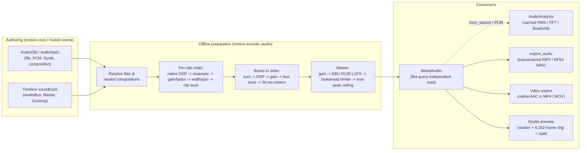

# Audio

Audio is split into a pure authoring description and an offline, deterministic preparation pipeline. Neither layer touches a physical playback device; real-time audio output exists only in Studio as an isolated consumer. Exact signatures live in Rustdoc; this page records ownership, limits, signal-flow order, determinism, and failure contracts. Asset-level context is in [Content](content.md#authored-tools-and-audio) and container/commit rules are in [Export and FFmpeg](export.md).

## Ownership split

| Layer | Crate | Owns |
| --- | --- | --- |
| Core description | [`motion-core`](../../../crates/motion-core/src/audio.rs) | `AudioSource`, `AudioClip`, `AudioBus`, `Master`, `Limiter`, `Loudness`, `Duck` / `Ducking`, `PanLaw`, `AudioEffect`, `AudioMetadata`, `ResolvedAudio`; structural validation without I/O or DSP state |
| Declarative schema | [`motion-scene`](../../../crates/motion-scene/src/audio.rs) | `AudioSpec`, `SpatialSpec`, `BusSpec`, `MasterSpec`, `EffectSpec`, `DuckSpec`; JSON lowering into `Timeline` audio |
| Offline preparation & DSP | [`motion-encode`](../../../crates/motion-encode/src/audio.rs) | `PcmBuffer`, `MixedAudio`, `BusMeter`, `LoudnessReport`, source transforms, resampling, built-in `Effect` / `AnimatedEq`, `Synth`, `AudioAnalysis`, `WaveformPyramid`, transactional `export_audio` |
| Interactive preview | [`motion-studio`](../../../crates/motion-studio/src/audio/preview.rs) | Background mix worker, lock-free playback ring buffer, `cpal` stream lifecycle, `AudioReadout` |

- **Stateless random-access sources**: `AudioSource` is a pure, concurrent (`Send + Sync`), random-access interleaved `f32` reader. Repeated reads must never depend on prior read history; short reads and EOF fill the trailing region with silence; nonfinite samples are rejected. Mixing supports mono (`1`) and stereo (`2`) channels.
- **Deferred occurrences**: `AudioClip::file` and `AudioClip::composition` record paths or nested `Timeline`s without opening files or decoding media during scene construction. `Timeline::resolve_audio` produces a `ResolvedAudio` snapshot without mutating the `Timeline`, and `MixedAudio::new` resolves deferred sources only at an execution boundary (export, standalone mixing, Studio preview, or duration fitting). Nested audio compositions are bounded to `16` levels.
- **Explicit timeline fitting**: when a `Timeline` opts into `fit_to_audio`, `audio::fitted` extends the effective timeline duration to cover resolved clips and effect tails without mutating authored visual scenes; visual tracks hold past their natural end while trailing audio finishes.

## Limits

| Limit | Value | Where checked |
| --- | --- | --- |
| Source sample rate / channels | `1..=192,000 Hz`, mono (`1`) or stereo (`2`) | `AudioClip::resolved_duration`, `PcmBuffer::new` |
| Clips per prepared mix, WAV export, or Studio list | `256` (`MAX_CLIPS`) | `MixedAudio::new`, Studio audio settings |
| Buses / effects per chain / ducking triggers per target | `16` / `16` / `4` | `Timeline` validation, `AudioClip::resolved_duration` |
| Bus name length / nested composition depth | `1..=128` bytes / `16` levels | `AudioClip`, `prepare_timeline` |
| Effect tail | `0..=30 s` (appended as silent input to the occurrence) | `AudioClip::resolved_duration` |
| Declared span | `<= 86,400 s` (`24 h`) | Clip, loop, ADSR, and mix validation |
| Volume / pan / stereo width | `0..=16` / `-1..=1` / `0..=2` | `AudioClip::resolved_duration` |
| Spatial rolloff / width | `0..=1,000` / finite `> 0` design units | `AudioClip::spatial`, `SpatialSpec` |
| Speed / WSOLA time-stretch / pitch-shift | `0.25..=4.0`x / `0.25..=4.0`x (`128,000,000` correlation ops) / `-12..=12` semitones | `SpeedSource`, `PcmBuffer::time_stretch`, `PcmBuffer::pitch_shift` |
| Retained PCM buffer | `32 Mi` `f32` samples = `128 MiB` (`MAX_SAMPLES`) | `PcmBuffer`, mixes, bus submixes, snapshots, resampling scratch |
| Encoded audio input | `64 MiB` (`MAX_ENCODED_BYTES`) | `PcmBuffer::from_bytes` / `open` |
| Bus meter / analysis cache | `16 MiB` meter traces; `16` traces or `64 MiB` per `PcmBuffer` (`<= 1,000,000` points) | `process_buses`, `AudioAnalysis` |
| Metadata | `64` tags, `4,096` chapters, `4,096`-byte text | `AudioMetadata::validate` |
| Output sample rate | `1..=192,000 Hz` (`MixedAudio`); `8,000..=192,000 Hz` (WAV); `44,100` / `48,000` / `96,000 Hz` (video AAC) | `MixedAudio`, `AudioExportOptions`, `ExportOptions` |

These bounds cap per-artifact allocation and algorithmic work rather than process RSS. Oversized inputs fail with `ValidationError` instead of truncating silently.

## Occurrences, transforms, and spatial placement

- **Independent clip clocks**: an `AudioClip` wraps a shared `AudioSource` with timeline `start`, source `offset`, optional `duration` (or `trim(start, end)`), containing-scene `limit` crop, linear `volume`, `fade_in` / `fade_out` (overlapping fades multiply), and local-time `Signal<f64>` animations for `volume_envelope` and `pan_animation`.
- **Source-time transforms (`AudioClipExt` and `PcmBuffer`)**:
  - `ReverseSource` (`.reverse()`) reflects frame indices across a finite source without mutating shared PCM buffers.
  - `SpeedSource` (`.speed(factor)`) resamples with a stateless 33-tap Hann-windowed sinc kernel over `0.25..=4.0`, coupling playback speed and pitch.
  - `LoopSource` (`.loop_until(duration, crossfade)`) repeats a finite region up to `86,400 s` with an equal-power crossfade seam (`crossfade < 0.5 * region`); `.crossfade` overlaps two consecutive clips with equal-power gain curves.
  - `PcmBuffer::time_stretch` runs deterministic mono-correlated WSOLA overlap-add over `0.25..=4.0` without changing pitch, and `PcmBuffer::pitch_shift` shifts `-12..=12` semitones while preserving exact frame count by pairing `SpeedSource` with inverse WSOLA stretch.
- **2D screen-coupled spatialization**: `AudioClip::spatial` (and declarative `SpatialSpec`) couples an animated 2D `Point` against a `listener` point and stereo `width` into local-time pan (`[-1, 1]`) and inverse-distance gain attenuation (`rolloff` in `0..=1,000`), multiplying any existing volume envelope. It is an explicit 2D screen-space mapping, not 3D HRTF or room acoustics.

## Preparation and signal-flow order

For each occurrence in `MixedAudio::new`:

1. Read the source window (including any declared effect-tail silence) at the **native source sample rate**.
2. Run the clip's `effects` chain in order at the native source rate.
3. Resample to the mix sample rate when native and mix rates differ.
4. Apply static `volume`, clip-local `volume_envelope`, and linear `fade_in` / `fade_out`.
5. Apply mid/side `stereo_width` (`1.0` preserves the stereo image; `0.0` collapses to mono) and `pan` / `pan_animation`. Mono sources always pan with constant power; stereo balance follows `PanLaw::ConstantPower` (default), `PanLaw::Minus4_5dB` (both unity-normalized at center), or `PanLaw::Linear` (attenuates only the opposite channel).
6. Apply clip-level sidechain `ducking` and retain the result as an immutable `PreparedClip`.

Then, once across the mix:

1. **Buses (`process_buses`)**: evaluated in declaration order. Each `AudioBus` sums its routed clips, runs its bus `effects`, applies static gain, applies bus-level `ducking`, and records `50 ms` RMS and sample-peak `BusMeter` traces. Unbussed clips bypass buses; referencing an undeclared bus fails validation.
2. **Sidechain ducking isolation**: every ducking trigger is rendered completely before its target is attenuated. A bus trigger must be declared earlier than the ducked bus; a clip trigger is rendered standalone at its own gain and pan with its own ducking ignored. Peak-hold detection, attack, release, and lookahead run offline over the complete trigger envelope.
3. **Master (`MixedAudio::apply_master`)**: static `gain_db` (`-96..=24 dB`) -> optional EBU R128 gated integrated loudness normalization (`Loudness`, `-70..=-5 LUFS` with a true-peak ceiling) -> optional lookahead limiter (`Limiter`, `<= 20 ms` lookahead, `(0, 2] s` linear recovery) -> 4x windowed-sinc reconstructed true-peak clamp below the ceiling. `Master::default()` is bit-transparent identity (never normalizing peaks automatically); `Master::safe()` enables a `-1.0 dBFS` ceiling limiter (`5 ms` lookahead, `100 ms` release) without loudness normalization.

## Offline effects and tails

`AudioEffect::process` receives complete interleaved buffers starting from a zeroed state. Filter and dynamics state exists only during offline preparation: the mixer processes each clip or bus once from its origin and retains the resulting samples, so random-access reads never encounter uninitialized IIR history.

- **Built-in DSP (`Effect` and `AnimatedEq`)**: RBJ biquad `Eq` (`HighPass`, `LowPass`, `Peak`, `LowShelf`, `HighShelf`, `Notch` with `Q` in `0.1..=20` and gain in `-24..=24 dB`), `AnimatedEq` (sampled on the clip's native clock with `64`-frame coefficient ramps), linked-channel `Compressor`, smoothed `Gate`, split-band `DeEsser`, feedback `Delay` (`<= 5 s`, `|feedback| < 0.99`), and parallel-comb / all-pass `Reverb`.
- **Explicit tails**: `Delay` and `Reverb` require an explicit `tail` (`0..=30 s`) that deterministically pads silent input and truncates the decay. Custom `AudioEffect` implementations must be deterministic and implement `validate(rate)` without touching PCM.
- **Windowing rule**: `MixedAudio::new` with `MixOptions::range` reads a direct sub-window only when the soundtrack has no clip effects, no ducking, no buses, and `Master::default()`. Whenever stateful DSP, buses, ducking, or master processing is active, `MixedAudio::new` prepares the full timeline from `Time::ZERO` and crops the prepared output so IIR states, envelopes, and EBU R128 gating never restart at a range boundary.

## Determinism, synthesis, and analysis

- **Query-order-independent mixing**: `MixedAudio::read` sums prepared clips in fixed declaration order using `f64` accumulation before converting to `f32`, never touching underlying sources or resampler state. Seeking or changing read chunk sizes yields identical samples.
- **Explicit resampling**: `ResampleQuality::Fast` (FFT resampler, default, requires feature `audio`) or `ResampleQuality::Sinc` (windowed sinc with `32` zero crossings per side).
- **Analytic procedural synthesis (`Synth`)**: integrates oscillator phase analytically from integer frame indices and hashes noise directly from `(seed, frame)`. Sinusoids interpolate a fixed `4,096`-segment table (error `< 3e-7`, ~`-130 dB`) instead of calling platform `sin`. Includes `Wave` (`Sine`, `Saw`, `Square`, `Triangle`, `White`, `Pink`, `Brown`), `Adsr` envelopes, seeded `Sound` accents (`Whoosh`, `Click`, `Pop`, `Tick`, `Riser`, `Impact`, `SubDrop`, `Kick`, `Snare`, `Hat`, `Ambience`), `metronome`, and 16-step `drums`.
- **Frozen visual analysis (`AudioAnalysis`)**: wraps an immutable `PcmBuffer` (via `Handle<PcmBuffer>` or `from_pcm`) or freezes a bounded interval of any `AudioSource` via `from_source`. Produces stateless `AudioSignal` curves (`FiniteAnimation<f64>`, linearly interpolated between hop frames and `0.0` outside `[0, duration)`): `loudness` (linear forward-window RMS, not LUFS), `band`, `pitch`, and `onset_strength`, alongside `AudioSpectrum` (`spectrum`, `chroma`), `AudioMarkers` (`onsets`, JSON import/export), `BeatGrid`, and `WaveformPyramid` (`<= 1,000,000` base bins). Sampling an analysis signal inside `Scene::render` performs zero I/O or FFT work. Analyze a prepared `MixedAudio` rather than a raw source when visuals must react to post-DSP or ducked levels.

## Export

- **Video containers**: `export` resolves timeline audio up front, rejects output paths that alias any audio input file (checked via canonical paths), prepares one `MixedAudio` over the selected export range at `ExportOptions::audio_sample_rate` (`44,100`, `48,000`, or `96,000 Hz`), and passes it to `Encoder::open` before frame `0` renders. Native MP4 and MOV encode stereo `aac` capped to the exact video duration (`ceil(frames * sample_rate / fps)`); codecs without audio support (`Vp9`, `Gif`, `PngSequence`) reject non-empty soundtracks before frame work begins.
- **Standalone WAV (`export_audio`)**: writes `AudioFormat::Wav16` (with optional deterministic hashed TPDF dither), `AudioFormat::Wav24` (default), or `AudioFormat::WavF32` in `AudioChannels::Stereo` or `AudioChannels::Mono` (`(L + R) / 2`), automatically switching from RIFF to RF64 when payload size requires it. Stages output in a sibling temporary file, writes bounded RIFF `LIST INFO` tags (chapters are rejected for WAV), refuses to overwrite existing files unless `overwrite` is set, and rejects destination paths that alias an input source.
- **Loudness inspection**: `MixedAudio::loudness_report` computes EBU R128 `400 ms` gated integrated LUFS, sample peak, 4x oversampled true peak, and cross-channel phase correlation (`None` on silent signals or clips shorter than one gating block), memoizing results by exact sample-bit content.

## Studio preview boundary

Studio previews audio through a dedicated `motion-audio-preview` worker thread, a lock-free `8,192`-frame stereo ring buffer (`512`-frame producer steps), and `cpal` at `48 kHz` stereo `f32`. Timelines with buses, effects, ducking, or master processing prepare once in full; dry timelines stream `8,192`-frame `MixOptions::range` windows on demand. Playback stops cooperatively via atomic cancellation, and device loss, stream underruns, or mix errors report `AudioStatus::Failed` in the UI without affecting deterministic export. `AudioReadout` computes LUFS, sample/true peaks, correlation, and bus meters from `MixedAudio` without opening an audio device. See [Studio workbench](studio.md).

## Features and failure

| Feature | Capability |
| --- | --- |
| `audio` (default in `motion-encode`; opt-in on `motion-rs` unless implied by `ffmpeg`) | Symphonia decoding (WAV, MP3, AAC, FLAC, Vorbis in MP4/OGG/WAV containers), `rubato` resampling, `rustfft` analysis, declarative `EffectSpec` |
| `ffmpeg` (implies `audio`) | In-process `libavcodec` AAC encoding and MP4/MOV muxing |
| Neither enabled | Explicit `PcmBuffer`, `Synth`, and same-rate mixing remain available; file decoding and rate conversion fail with explicit errors |

All failures surface as `motion_core::Error`: invalid parameters return field-tagged `ValidationError`s (`audio.<field>`), missing or mutated files return `Error::Asset`, and nonfinite samples from sources, envelopes, effects, or master stages abort preparation before any output file is committed.

## Tutorial coverage

[Chapter 10](../tutorial/10-audio.md) walks through authoring: sources, occurrences, narration clocks, buses, sidechain ducking, procedural synthesis, audio-reactive visuals, and common pitfalls.

## Owning sources

- Core audio model & validation: [`crates/motion-core/src/audio.rs`](../../../crates/motion-core/src/audio.rs), [`crates/motion-core/src/audio/clip.rs`](../../../crates/motion-core/src/audio/clip.rs), [`crates/motion-core/src/audio/metadata.rs`](../../../crates/motion-core/src/audio/metadata.rs)
- Declarative audio schema: [`crates/motion-scene/src/audio.rs`](../../../crates/motion-scene/src/audio.rs)
- PCM, source transforms, & mixing: [`crates/motion-encode/src/audio.rs`](../../../crates/motion-encode/src/audio.rs), [`crates/motion-encode/src/audio/pcm.rs`](../../../crates/motion-encode/src/audio/pcm.rs), [`crates/motion-encode/src/audio/pcm/mix.rs`](../../../crates/motion-encode/src/audio/pcm/mix.rs), [`crates/motion-encode/src/audio/sources.rs`](../../../crates/motion-encode/src/audio/sources.rs)
- Offline DSP, master loudness, synthesis, & analysis: [`crates/motion-encode/src/audio/effects.rs`](../../../crates/motion-encode/src/audio/effects.rs), [`crates/motion-encode/src/audio/master.rs`](../../../crates/motion-encode/src/audio/master.rs), [`crates/motion-encode/src/audio/synth.rs`](../../../crates/motion-encode/src/audio/synth.rs), [`crates/motion-encode/src/audio/analysis.rs`](../../../crates/motion-encode/src/audio/analysis.rs)
- Standalone WAV export & Studio preview: [`crates/motion-encode/src/audio/export.rs`](../../../crates/motion-encode/src/audio/export.rs), [`crates/motion-studio/src/audio/preview.rs`](../../../crates/motion-studio/src/audio/preview.rs)

