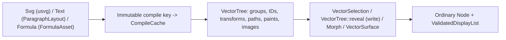

# Content contracts

Images, SVG, typography, Typst formulas, ink, diagrams, captions, particles and
audio descriptions compile into the same `Node` and `ValidatedDisplayList` pipeline
rather than maintaining separate rendering engines. Plain policy enums (`Fit`,
`Sampling`, `TextAlignment`, `TextSplit`, `WriteOptions`, `NibMode`, `BrushCap`,
`PigmentMix`, `Preset`, `FieldCoordinate`, `CollisionResponse`, `ParticleEventKind`,
`Inherit`) remain available in `motion-content` without enabling optional decoders or
font shapers, with optional `serde` and `schema` support reused directly by
`motion-scene`. Start with [content](../tutorial/06-content.md),
[particles](../tutorial/07-particles.md), [formulas](../tutorial/08-formula-typst.md)
and [audio](../tutorial/10-audio.md).

## Assets and images

- **Lazy handles and explicit roots.** `Assets` manages preloaded `Arc<A>` values and
  lazy typed `Handle<A>` entries inside one explicit `ResourceStore`. Clones share
  registrations; `Assets::snapshot` freezes resolved entries and isolates subsequent
  mutations, while removing an entry never invalidates existing handles. Relative file
  sources require an explicit root directory—an empty `Assets` owner never authorizes
  ambient working-directory reads. `Image::open` and `Svg::open` capture a `Source`
  without decoding at authoring time; decoding runs against the session's `Assets`
  owner and `FontEnvironment` snapshot. Strict production rendering fails on missing
  assets, whereas `RenderOptions::allow_missing_assets` emits visible diagnostic
  placeholders while recording typed failures. Custom decoded resources implement
  `Asset`; pure recomputable work belongs in `SceneCache`. See
  [resources](resources.md) and [resource accounting](rendering.md#resources-and-content).
- **Static images, animated images and LUTs.** Decoded images accept dimensions in
  `1..=16,384` per axis, at most `16,777,216` source pixels and at most `64 MiB` of
  encoded bytes. `ImageAsset` retains immutable linear-premultiplied texels (`ImagePixels`)
  and bounded mipmaps; `Fit`, `Sampling`, UV mapping and rounded-corner presentation
  belong to the `Image` drawable rather than separate decoders. `AnimatedImageAsset`
  retains composed GIF/APNG frames or explicit timed frames; tick lookup,
  `ImageLoopMode` (`Loop`, `Once`, `PingPong`), trimming and reversal are stateless
  source-time operations that never duplicate turnaround endpoint durations.
  Standalone `.cube` color tables load explicitly through `load_lut` (`Lut3d`) and
  `load_shaper` (`Lut1d`), capped at `8 MiB` of UTF-8 text. Image storage, GPU working
  textures (`RGBA16F` mips, `RGBA32F` targets) and output `PixelFormat` remain
  independent precision boundaries.

## Procedural paints

`motion-core` owns the immutable descriptions and mathematical contracts of analytic
procedural paints so content recipes never bake hidden bitmaps during scene
evaluation:

- **Analytic mesh paint (`Paint::Mesh`).** `MeshPaint` retains a bounded
  `MeshGradient` control lattice (`MAX_MESH_POINTS_PER_AXIS = 64`) mapped through the
  painted shape's local bounds. The CPU backend and GPU WGSL shaders independently
  invert bilinear patch coordinates and blend straight Oklab color with cubic
  smoothstep weights and linear alpha. Overlapping patches follow lattice order (the
  last matching patch wins) and uncovered regions remain transparent. Analytic patches
  admit normalized coordinates within `±10^6` and Oklab components within `±10^10` so
  `f32` GPU intermediates stay finite.
- **Analytic atmosphere paint (`AtmospherePaint`).** Retains an explicit canvas (`<=
  16,384` per axis), signed `Time`, seed, tint, drift vector, amplitude-normalized
  Perlin fBm octaves and a `Fog`, `Dust` or elliptical `LightLeak` envelope (with
  normalized dust radii and leak extents `>= 1e-15`). Construction validates full-canvas
  octave lattice support and envelope bounds regardless of layer visibility. CPU and
  WGSL evaluate the identical core formula—including wrapping mote hashes and fixed
  dust neighborhoods—uploading compact parameter descriptors rather than pre-rendered
  texels.
- **Budgeting and explicit baking.** Backend preparation admits patch descriptors,
  upload words and per-pixel candidate-patch or octave/envelope work through `Budget`
  before allocation; GPU `f32` evaluation is visually equivalent to CPU `f64`
  evaluation within fixture tolerances rather than bit-identical. Explicit baking APIs
  (`MeshGradient::rasterize`, `MeshGradient::pattern`, `MeshPaint::pattern` with
  `1..=32` subdivisions, and `Atmosphere::render`, `render_region`, `overlay`) remain
  available for bitmap workflows; switching between analytic `Paint::Mesh` and baked
  `ImagePattern` intentionally removes fixed bitmap resolution, triangle tessellation
  and bilinear texel filtering.

## SVG and vector trees

- **SVG import boundary.** `Svg` parses XML through `usvg`'s tree model rather than
  `resvg` bitmap rendering, converting supported paths, groups, embedded raster
  images, shaped text, clips, masks and filters into Motion's shared vector and
  command primitives. External non-`data:` `href`s, scripts, `foreignObject` and SVG
  animation elements are rejected; `<text>` elements require a non-empty
  `FontLibrary`. Unsupported constructs surface as `SvgDiagnostic`s or validation
  errors—never a hidden browser or fallback rasterizer.
- **Shared deferred vector pipeline.** `VectorTree` preserves group hierarchy, IDs,
  transforms, opacity, paths, paints and images. SVG, animated text and Typst formulas
  converge on one `DeferredContent` mechanism: an immutable compile key constructs a
  `CompileCache` holding the compiled `VectorTree` (or `ParagraphLayout`), authored
  `VectorSelection` queries target original group/symbol IDs, and `VectorTree::reveal`
  applies visibility and arc-length `WriteOptions` stroke/fill reveal. Modifying any
  compile-defining parameter creates a new compile key and fresh `CompileCache`, so
  callers never invalidate caches manually.
- **Morphing and surface sampling.** `Morph` interpolates between `VectorTree`s using
  explicit leaf/subpath correspondence and handles unmatched contours deterministically
  instead of assuming identical topology. `VectorSurface` triangulates filled contours
  for area-weighted seeded point sampling (feeding `SurfaceEmitter` particle origins
  and targets without a second simulation runtime). Caching a `VectorTree` caches
  parsed geometry only—it neither caches rendered frames nor bypasses per-frame
  `ValidationLimits` and `RasterLimits`.

## Fonts and text

- **Explicit `FontLibrary` snapshots.** `FontLibrary::new()` is empty and never scans
  the host OS. `load_file`, `load_dir` and `load_data` freeze font bytes (up to
  `4,096` faces and `256 MiB` per library; lazy `FontFace` handles cap at `32 MiB`)
  under a copy-on-write `snapshot_id`, while opt-in `load_system_fonts` /
  `load_system_family` index up to `65,536` metadata entries and read selected font
  files lazily. `Text::fonts` overrides `DrawContext`'s `FontEnvironment` locally;
  shaping requires one or the other.
- **Single shaper and three-stage typography.** One text engine pairs `cosmic-text`
  (shaping, line breaking, bidirectional reordering and font fallback) with `skrifa`
  glyph outline extraction; glyph contours feed the shared CPU/GPU coverage pipeline
  rather than a separate bitmap glyph atlas, and font `snapshot_id`, face ID, weight
  and variation coordinates participate in `CachePartition::Paragraph` and
  `CachePartition::Glyph` keys (color-bitmap emoji tables are not implied by outline
  support). Text authoring splits cleanly into three stages:
  1. `ParagraphStyle` declares text, spans (`TextSpan`), metrics, wrap width,
     `TextAlignment` and optional `FontLibrary`.
  2. Shaping produces `ParagraphLayout`—the single intermediate retaining lines,
     typographic baselines, positioned `TextGlyph`s, extended grapheme boundaries and
     byte ranges (inspectable ahead of time via `motion::eager`).
  3. `Text` attaches paint/ink and at most one reveal mode (`write` handwriting or
     `TextSplit` per-part `TextPart` transforms on the inherited scene clock; last
     configured wins), never splitting UTF-8 code points or grapheme clusters.
- **Font provenance.** `ExportReport.fonts` records observed face names and
  non-cryptographic source-byte hashes from `FontUsage` (including cached glyph
  draws) for source auditing, not cross-platform pixel identity.

## Typst and formulas

`motion-formula` isolates Typst compiler dependencies behind two Cargo features:
`typst` (`TypstCompiler`, `TypstDocument`) compiles self-contained single-page markup
with bundled fonts and zero filesystem, package or network access; `formula` adds
math-focused `Formula`, `FormulaOptions`, `FormulaCompiler`, `FormulaSelection` and
`FormulaMorph` (with no LaTeX parser or on-disk cache).

- **Immutable compile keys and symbol mapping.** `Formula::typst` records markup and
  options without initializing Typst. Calling `size` or `fill` produces a new
  immutable compile key with its own `CompileCache`, and `FormulaSelection` caches
  pruned subtrees the same way. `FormulaAsset` retains vector glyphs and rules
  alongside source byte spans and rendered `FormulaSymbol` occurrences; bounded
  in-memory reuse in `CachePartition::Formula` keys on source, style, caller revision,
  `FORMULA_BACKEND_VERSION` and compiler environment. Eager compilation supports
  upfront symbol inspection and selection, while `FormulaMorph` delegates contour
  interpolation to the shared `VectorTree` morph engine. Typst inputs are treated as
  trusted authoring markup, not an untrusted-code sandbox.

## Authored tools and audio

- **Ink (`ink` / `vector::ink`).** `BrushStroke` (`BrushStrokeBuilder`, `BrushPreset`)
  models variable-width nib strokes (`NibMode`, `BrushCap`, pressure/ink-load curves,
  `BrushTiming` lifts and up to `512` recorded `InputSample`s) as nonzero filled
  contours, distinct from uniform `StrokeStyle` outlines; `StrokeFont` provides
  single-line vector lettering. `Ink` applies deterministic seeded dryness, bleed,
  edge roughness, granulation, directional fibers, build-up, edge pooling/darkening,
  anisotropy, optional `height_map` (for `Optics::Relight`) and `Paper` (seeded
  procedural or `<= 512×512` RGBA8 texture in `paper_transform` space); `InkFill`
  applies the non-directional subset to even-odd path fills, and `PigmentMix` blends
  paints in linear light or a six-band Kubelka-Munk approximation. A built
  `BrushStroke` caches its full baked material once (`<= 262,144` texels and
  `32,000,000` default distance evaluations, configurable via `material_work_limit`)
  and reuses it across arc-length `write` reveals; **every `RenderQuality` evaluates
  the full ink material**, and both backends share CPU coverage for ink contours.
- **Diagrams (`diagram`), captions (`captions`) and particles (`particles`).**
  `Scale`, `LineChart`, `LabelLayout` and `Callout` construct ordinary `f64` vector
  and `Text` nodes using explicit fonts without implicit discovery. `CaptionTrack`
  validates half-open `CaptionCue`s and SRT interchange; `CaptionStyle` and
  `CaptionLayout` precompute measured safe-area subtitle stacks atop
  `ParagraphStyle`; and `CueSheet` coordinates captions with up to `256` named
  narration markers (`<= 24h`), where `CueSheet::retimed` scales cue/marker
  nanoseconds exactly without time-stretching audio or implicitly rebuilding cached
  layouts. Particle emitters, forces, fixed-step `ParticleSimulation` replay and GPU
  analytic/tiled instance contracts live in [particles](particles.md).
- **Audio description versus offline preparation.** `motion-core` owns pure
  declarations (`AudioSource`, `AudioClip`, `AudioBus`, `Master`, `Ducking`,
  `AudioEffect`, `AudioMetadata`), while `motion-encode` (`audio` feature) performs
  offline decoding, resampling, source-rate effects, bus/master mixing and FFT/RMS
  `AudioAnalysis` without an audio device (`Timeline::resolve_audio` → `MixedAudio`).
  File sources decode lazily in windows and must remain immutable during execution;
  `PcmBuffer` freezes explicit samples. RMS traces are visual/modulation summaries,
  not ITU BS.1770 LUFS loudness or causal hardware capture, and real-time `cpal`
  playback belongs exclusively to [Studio](studio.md). See [audio](audio.md) and
  [export and FFmpeg](export.md).

## Owning sources

- [Assets and handles](../../../crates/motion-core/src/asset.rs) (`Assets`, `ResourceStore`, `Handle`)
- [Content crate root](../../../crates/motion-content/src/lib.rs) and [shared policies](../../../crates/motion-content/src/options.rs)
- [Static and animated images](../../../crates/motion-content/src/image.rs), [SVG](../../../crates/motion-content/src/svg.rs) and [vectors](../../../crates/motion-content/src/vector.rs)
- [Ink and brushes](../../../crates/motion-content/src/vector/ink.rs), [diagrams](../../../crates/motion-content/src/diagram.rs) and [captions](../../../crates/motion-content/src/captions.rs)
- [Fonts](../../../crates/motion-content/src/font.rs) and [text layout](../../../crates/motion-content/src/text.rs)
- [Typst and formulas](../../../crates/motion-formula/src/lib.rs)
- [Audio preparation](../../../crates/motion-encode/src/audio.rs) · [Audio contracts](audio.md) · [Particle instances](particles.md) · [Resources](resources.md)
