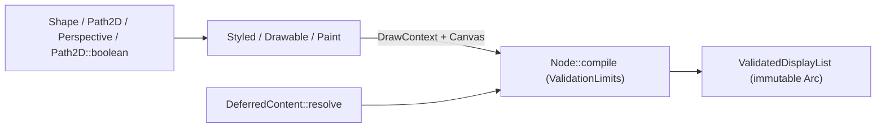

# Core authoring contracts

`motion-core` owns exact time, geometry, stateless animation, immutable `Node`
snapshots, layout, structural and logical budgets, color grading/optics data and the
backend-neutral drawing protocol. It never initializes font engines, GPU devices,
media codecs, desktop windows or playback clocks. Optional `serde` and `schema`
features expose JSON serialization and JSON Schema on plain value and policy types so
`motion-scene` reuses core definitions directly without mirror structs. See the
[tutorial](../tutorial/README.md) for runnable authoring examples.

## Numeric boundaries

- **Precision split.** Authoring geometry (`Point`, `Vector2`, `Size`, `Rect`,
  `Transform`, `Perspective`), rotation angles, interpolation progress and easing
  parameters use `f64`. CPU area integration retains `f64` trapezoids before single
  `u8` coverage quantization. `Color` stores finite extended encoded-sRGB `f32`
  channels; shading, grading (`Cdl`, `Lut1d`, `Lut3d`) and linear-premultiplied
  working pixels use `f32`. Image storage and output `PixelFormat` targets maintain
  independent precision contracts; there is no blanket `f64` guarantee across every
  public numeric API.
- **Coordinate space and viewport mapping.** Logical design coordinates place the
  origin at the top-left with `+x` right and `+y` down. `Rect` stores opposite corners
  and uses half-open containment (`left <= x < right`, `top <= y < bottom`); empty or
  inverted geometry fails validation instead of silently normalizing. Rotations use
  radians (`AngleLiteral` converts degrees and turns explicitly). A composition
  uniformly scales and centers logical design dimensions (`contain`) inside the
  integer `PixelSize` viewport; stroke widths and filter radii follow the composed
  transform while curve-flattening tolerance is measured in device pixels.
- **Tick arithmetic and frame rates.** `Time` (signed timeline point), `Duration`
  (nonnegative span) and `TimeOffset` (signed displacement) wrap exact integer ticks
  at `TICKS_PER_SECOND = 705_600_000` (an exact multiple of standard cinema/broadcast
  rates `24`, `25`, `30`, `48`, `50`, `60`, `120` and common audio sample rates up to
  `192,000` Hz):
  - `Time - Time -> TimeOffset`
  - `Time ± Duration -> Time` and `Time ± TimeOffset -> Time`
  - `Time + Time` is rejected at compile time, and negative `Duration` values cannot be
    constructed.
  Literals such as `2.seconds()` construct `Duration`; `Duration::after_origin`,
  `Duration::offset` and `Time::since_origin` convert explicitly. `FrameRate` stores a
  nonzero rational pair (`fps!(30)`, `FrameRate::NTSC` at `30_000/1001`,
  `FrameRate::new` or fallible `FrameRate::try_new`), converting each frame boundary
  independently via integer arithmetic rather than accumulating floating-point
  seconds. `f64` seconds (`SceneContext::seconds`) are a read-only view for animation
  formulas, never mutable playback state.

## Stateless animation

`Signal` samples a value purely from an explicit local `Time` and has no intrinsic end.
`FiniteAnimation` extends `Signal` with a nonnegative `duration()`; only finite
animations provide `delay`, `then`, `repeat` and `ping_pong`, preventing combinators
from inventing a duration for an unbounded signal.

- **Intervals, easing and interpolation.** `Interval { start, duration }` is the single
  definition of clamped progress and eased progress over a half-open tick span, shared
  by `SceneContext::progress_in`, `SceneContext::ease_in` and `Tween`. `Interpolate`
  accepts `f64` progress and permits overshoot/extrapolation: Oklab color
  interpolation may extrapolate extended RGB while clamping alpha to `0..=1`, and
  `Transform` interpolation decomposes translation, rotation, scale and skew
  (`TransformComponents`) rather than interpolating matrix entries or pixels.
- **Keyframes, procedural signals and curves.** `Keyframes` takes strictly increasing
  local destination times (equal or decreasing timestamps fail rather than sorting),
  relative `hold` spans and per-segment arrival `Easing`. Built-in easings pin `0.0`
  and `1.0`; `Easing::Custom` clamps its input progress while preserving callback
  overshoot. `Spring` evaluates closed-form damped motion with a conservative tick
  envelope (`settle_duration`) rather than frame-to-frame integration; like `Noise`
  and `Oscillator`, it implements `Signal` only. `FollowPath` (`PathSample` position
  and tangent), `remap` / `try_remap` and `piecewise` / `try_piecewise` compose
  without hidden state.
- **Validation boundaries.** `SpringBuilder`, `OscillatorBuilder` and `NoiseBuilder`
  validate parameters once in `build()` so sampling cannot overflow. Convenience
  combinators delegate to fallible `try_*` counterparts and document `# Panics`;
  dynamic or untrusted inputs use `try_*`. Checked parameter contracts do not sandbox
  arbitrary user closures. See [animation](../tutorial/03-animation.md).

## Scenes and snapshots

A `Scene` maps `&SceneContext` to an immutable `Node` (with `IntoSceneOutput`
supporting `Drawable` leaves, heterogeneous tuples and `Result<_, ValidationError>`).
Validation or callback failures preserve their `ValidationErrorKind`, structural
`path`, `field` and optional `frame` index across hidden branches and memoized
subtrees—a failed scene never degrades into empty output.

- **Evaluation context.** `SceneContext` carries signed local/global `Time`, clip
  `Duration`, `FrameRate`, logical `Size`, keyed `Random` streams, an author
  `SceneCache` and one shared `Arc<Evaluation>` (`RenderQuality`, `Assets`,
  `FontEnvironment`, `RequestDiagnostics`, `RenderCache`). Time shifting, nested
  timelines and shutter sub-frame sampling derive explicit child contexts. Random keys
  and `SceneCache` keys must include every result-defining input; cache hits never
  permit side effects or frame-to-frame history.
- **Copy-on-write `Node` trees and modifiers.** `Node` values share immutable `Arc`
  subtrees on clone and allocate only along mutated paths. Siblings draw in stable
  `z_index` order, preserving insertion order on ties (`z_index` is local to a group,
  neither global 3D depth sorting nor a layout reordering). Spatial and compositing
  modifiers live on `NodeModifiers`: default `Pivot` is the measured bounds center;
  placement (`at`, `align_to`, `next_to`) positions the pivot while `translate`
  offsets local coordinates; group `opacity` composites the completed subtree once
  rather than multiplying each overlapping child independently; and `Elevation`
  (`0..=1024` local units) expands into contact, directional key and ambient
  `ShadowLayer` silhouettes.

## Layout and timelines

- **Deterministic layout.** `Row` and `Column` measure transformed children in
  insertion order using the exact `FontEnvironment` and `ValidationLimits` active at
  compilation (`SceneContext::measure` forwards the shared `Evaluation` at local
  time). Text aligns on its shaped typographic baseline while non-text nodes use an
  explicit geometric fallback; deferred relative placement never measures against a
  mismatched font snapshot.
- **Cameras, depth planes and skeletons.** `Camera` (`camera` / `try_camera`) applies
  a validated finite, invertible inverse-view `Transform` (`center`, positive `zoom`,
  clockwise `rotation`) to an ordinary group; `world_to_screen` and `screen_to_world`
  convert viewport points without ancestor transforms, while HUD overlays remain
  outside the camera node. `DepthOfField::capture` sorts up to `256` `DepthPlane`s
  far-to-near, applying thin-lens circle-of-confusion blur (exact zero at
  `focus_distance`, capped at `max_radius`) and optional pinhole parallax. `Skeleton`
  evaluates 2D forward kinematics from `Pose` values into `BoneTransform`s on ordinary
  `Node`s.
- **Immutable `Timeline` and `Project`.** `TimelineBuilder::build` freezes design
  `Size`, rational `FrameRate`, ordered `Track`s, `Soundtrack` (`AudioClip`
  occurrences, `AudioBus`es, `Master`) and total `Duration` (accumulating bounded
  builder errors into `ErrorReport`). Clip boundaries snap independently to frame
  ticks and record alignment `TimelineWarning`s in `Diagnostics`. `Transition`s join
  at most two adjacent clips (no triple overlaps), keeping independent local clocks on
  both scenes. Higher tracks composite above lower tracks. `Timeline` is not a
  `Scene`: `TrackBuilder::nest` embeds a child `Timeline` (up to `16` nesting levels)
  by clipping and `contain`-mapping its viewport while merging its audio into the
  parent `Soundtrack`, without retiming the parent clock. In the facade, `Project`
  registers lazy timeline factories and typed CLI parameters so `--list` and `--help`
  never build timelines or touch external resources.

## Geometry and recording

- **Paths, booleans and planar 2.5D perspective.** `Shape` defines pure geometry;
  fill/stroke styling produces a `Drawable`. `Path2D` is a copy-on-write `f64` Bezier
  path (`MAX_PATH_VERBS = 16_384`, `MAX_SVG_PATH_BYTES = 1_048_576`) with cached exact
  curve-extrema bounds and Gaussian arc-length tables that preserve Bezier segments
  under `trim` and dash splitting; a subsequent valid mutation never clears an earlier
  builder error. `Path2D::boolean` (`Union`, `Intersection`, `Difference`, `Xor`)
  admits edge counts (`MAX_BOOLEAN_EDGES`), scratch bytes and quadratic intersection
  work through `Budget`, flattens and splits crossings in `f64`, and emits closed
  line contours before backend preparation so the CPU backend and GPU backend agree
  by construction. `Perspective` rotates the `z = 0` plane around a pivot (`z`, `y`,
  then `x`) in front of a pinhole camera (`distance > 0`), projecting lines to lines
  and curves to at most `MAX_PERSPECTIVE_CURVE_PIECES` (`64`) cubics; points closer
  than `1e-3 * distance` to the camera plane fail explicitly rather than clipping, and
  `faces_camera` reports orientation for optional backface culling. Selected curve,
  stroke and arc primitives use `kurbo` as part of the numerical environment while
  coverage rasterization remains Motion-owned.
- **Paints and procedural descriptions.** `Paint` covers solid `Color`, linear/radial/
  sweep gradients, immutable `ImagePattern` (`ImagePixels` + `Sampling`) and two
  analytic procedural variants: `Paint::Mesh(MeshPaint)` (`MAX_MESH_POINTS_PER_AXIS = 64`)
  and `Paint::Atmosphere(AtmospherePaint)`. Both analytic paints retain compact
  mathematical descriptions evaluated independently on the CPU backend and GPU WGSL
  shaders without per-frame CPU bitmap baking, while explicit `MeshGradient::rasterize`,
  `MeshGradient::pattern` and `MeshPaint::pattern` (`1..=32` `MAX_MESH_SUBDIVISIONS`)
  preserve opt-in image baking. See [procedural paints](content.md#procedural-paints).
- **Recording and structural budgets.** `Drawable::draw` emits commands into a checked
  `Canvas` under `DrawContext` (retaining the first error even if user code ignores a
  `Result`), while `DeferredContent` resolves into ordinary `Node`s at compile time.
  `Node::compile` validates every branch—including invisible layers and inactive
  transition scenes—against `ValidationLimits` (default `100,000` nodes and `64`
  depth; custom caps up to `1,000,000` nodes and `128` depth, counting structural
  occurrences rather than unique `Arc`s) and freezes an `Arc`-backed
  `ValidatedDisplayList`. Low-level `DisplayList` edits require re-validation;
  `Budget` / `RasterLimits` (`RasterLimits::authoring()` at `16,777,216` pixels and
  `256 MiB` live bytes; `RasterLimits::sandbox()` adding a `200,000,000`-unit work
  cap) enforce pixel and memory admission downstream during preparation and rendering.

## Layers and sampling

- **Ordered filters, grading and optics.** `Filter` is a closed data model (`Blur`,
  `DropShadow`, `Glow`, pyramid `Bloom`, `Cdl`, `Lut`, `Optics`, `ColorAdjust` and
  `Custom(Vec<FilterOperation>)`), never an arbitrary per-backend pixel callback.
  Child effects complete before parent effects: a completed source is filtered,
  clipped or masked, and then composited with group `opacity` and `BlendMode`. In
  `Filter::Custom`, `CompositeWithSource` always references that filter's original
  input rather than the preceding primitive. `Optics` encapsulates bounded spatial
  effects (`LensFlare`, radial/chromatic `Lens`, `cos^4` `LensVignette`, Vogel-spiral
  `Bokeh` with `Disc` or `3..=16`-blade `Polygon` apertures, `RadialBlur`, horizontal
  `Anamorphic` streaks and Sobel/Lambert/Blinn-Phong `Relight` driven by `HeightFrom::Luma`
  or `Alpha`). Filters never alter layout or pivot bounds; preparation derives
  conservative device-space capture halos separately.
- **Clips, masks and blend spaces.** Coverage clips multiply quantized coverage
  independently; geometric clips (`RectClip`, `ShapeClip`) intersect analytically
  before quantization—attaching a second geometric clip on the same `Node` replaces
  the first, whereas nested nodes intersect them. Content masks weight coverage by
  alpha (`MaskMode::Alpha`) or Rec.709 linear-premultiplied luminance
  (`MaskMode::Luminance`). `BlendSpace::LinearRgb` is the default compositing space;
  `BlendSpace::Srgb` introduces an explicit transfer conversion boundary.
- **Temporal shutter sampling.** A `Node` is a single-instant snapshot and cannot be
  resampled in time. Whole-frame or subtree `MotionBlur` (`shutter_angle` in
  `0..=360` degrees, `1..=64` samples) and `ShutterSampling` (`ShutterCurve::Box`,
  `Triangle` or `Cosine`, optional `jitter_seed`, and `adaptive` `8..=64` sample
  selection from endpoint displacement) invoke the scene builder at exact integer-tick
  offsets and accumulate linear-premultiplied samples, preserving empty-sample
  weights and rejecting nested shutter captures. `RenderQuality::Draft` collapses
  shutter capture to one sample and relaxes filter/flattening approximations; final
  exports use `RenderQuality::Final`.

## Owning sources

- [Time and frame rates](../../../crates/motion-core/src/time.rs) (`Time`, `Duration`, `TimeOffset`, `FrameRate`)
- [Animation](../../../crates/motion-core/src/animation.rs) (`Signal`, `FiniteAnimation`, `Interval`, `Keyframes`, `Spring`)
- [Authoring, layout and timelines](../../../crates/motion-core/src/authoring.rs) (`Scene`, `Node`, `Row`, `Column`, `Camera`, `DepthOfField`, `Timeline`)
- [Geometry and perspective](../../../crates/motion-core/src/geometry.rs) and [paths](../../../crates/motion-core/src/path2d.rs) (`Path2D`, `MorphPath`, `PathBooleanOp`)
- [Drawing, meshes and atmosphere](../../../crates/motion-core/src/drawing.rs) (`Canvas`, `Paint`, `MeshGradient`, `AtmospherePaint`)
- [Filters](../../../crates/motion-core/src/filter.rs), [optics](../../../crates/motion-core/src/optics.rs) and [grading](../../../crates/motion-core/src/grading.rs)
- [Validation](../../../crates/motion-core/src/validation.rs), [budgets](../../../crates/motion-core/src/budget.rs) and [instances](../../../crates/motion-core/src/instances.rs)
- [Rendering and export](rendering.md) · [Reliability](reliability.md)
