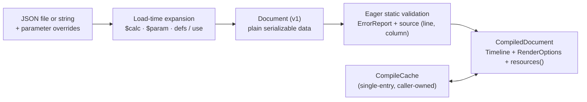

# Declarative Documents

A document is a versioned JSON description of a complete motion film: canvas size, frame rate, background, tracks of timed scenes, transitions, audio occurrences, font files, and an optional film look. The `motion-scene` package owns the data model, its JSON Schema, and compilation into an engine `Timeline`; the facade re-exports it as `motion::declarative` behind the `declarative` feature and adds `Project` and command-line entry points ([command line](../cli.md#declarative-documents)). Authoring guidance is in the [tutorial](../tutorial/16-declarative.md); Rustdoc lists the types.

## Reuse of core and content types

The document model reuses core and content value types directly so spec definitions never drift from engine contracts:

- **Core value types (`motion-core`):** Plain enumerations (`BlendMode`, `FillRule`, `MaskMode`, `ClipMode`, `LineCap`, `LineJoin`, `GradientSpace`, `GradientUnits`, `GradientExtend`, `Waveform`, `ArrowHead`, `Sampling`, `Direction`, `IrisShape`, `Pivot`, `InstanceBlend`) and value types (`Color`, `Point`, `Rect`) implement `Serialize`, `Deserialize`, and `JsonSchema` behind `motion-core`'s `serde` and `schema` features. Validation of reused types (such as stroke miter limits) belongs to core; the compiler calls core constructors instead of duplicating checks.
- **Content policy types (`motion-content`):** Image fit, paragraph alignment and splitting, vector write options, ink nib modes, brush caps, pigment mixing modes, particle preset names, color-field coordinates, collision responses, event kinds, and inheritance policies reuse `motion-content` types exposed through its feature-independent `serde` and `schema` features. Duplicate `*Spec` aliases are omitted in favor of the canonical type names.
- **Spec-owned wrappers (`motion-scene`):** The spec layer defines only what core and content value types cannot represent directly: animated wrappers (`Animated<T>`), load-time parameter and template placeholders, gradients written with degree angles and `start` / `end` / `stops` objects, strokes with animated width and dash progress, resource path specs, and `f64`-precision authoring shapes. Disabling a content feature still permits parsing and serialization, while compilation reports the unsupported capability.

## Data model

- **Plain data and builder parity:** Parsing and serialization never read external files, scan fonts, or evaluate a frame. The same Rust structs serve as a programmatic builder API, so a `Document` constructed in Rust and one parsed from JSON are equal values that round-trip cleanly through `Document::from_json` and `Document::to_json`.
- **Element structure:** Every `Element` carries optional identity (`id`, `name`), style (`fill`, `stroke`, `fill_rule`, `trim`), local transform (`position`, `translate`, `rotate`, `scale`, `scale_xy`, `pivot`), compositing (`opacity`, `blend`, `z_index`, `hidden`), and effects (`filters`, `clip`, `mask`), alongside at most one content key (`children`, `rect`, `circle`, `ellipse`, `line`, `polyline`, `polygon`, `regular_polygon`, `star`, `arc`, `ring`, `arrow`, `spline`, `path`, `morph`, `text`, `image`, `svg`, `svg_morph`, `particles`, `trajectory`, `ruler`, `callout`, `line_chart`, `captions`, `formula`, `brush_stroke`, or `ink_fill`). Two content keys, unknown keys, and unknown enum variants are parse errors; an element with no content key draws nothing.
- **Units and spellings:** Times are seconds, angles are clockwise degrees, lengths are design units, points are `[x, y]`, and rectangles are `[left, top, right, bottom]`. Frame rates are an integer or a `"NUMERATOR/DENOMINATOR"` string. Colors are CSS-style strings parsed by `Color::parse`; serialization emits `#rrggbb[aa]`, or `rgb()` with fractional channels when 8-bit integers cannot represent the color losslessly. Stroke joins are `"round"`, `"bevel"`, or `{"miter": {"limit": 4}}`; pivots are named anchors such as `"top_left"`, `{"relative": [x, y]}`, or `{"point": [x, y]}`.
- **Animated properties:** Any `Animated<T>` field accepts either a fixed value or an object with exactly one motion key: `tween`, `keyframes`, `oscillate`, `noise`, `expr`, `spring`, `clock`, `map`, `follow_path`, `components`, or `sum`. Fixed values are never JSON objects with those keys, so constant and animated forms cannot collide. Oscillators and noise apply to numeric properties only. Easing is a closed serializable set; custom Rust callbacks are not representable.

## Load-time expansion

### Parameters and calculations

A root `params` object declares named default values—numbers, booleans, strings, colors, arrays, or arbitrary JSON subtrees:

- **Parameter overrides and `$param`:** Overrides arrive via `Document::from_json_with`, `load_with`, `Project::document`, or the CLI `--params` flag as a JSON object whose keys must already be declared in `params`, each replacing the whole default value. Any `{"$param": "name"}` object outside `params` is replaced by its effective value during loading before schema types are checked. Unknown override keys and unknown `$param` names fail with the referring JSON path.
- **Load-time `$calc`:** Any `{"$calc": "ceil($seconds * $fps / $pages) / $fps"}` object computes a finite `f64` once during loading—after overrides merge and before `$param` substitution and `defs` expansion. Calculations work inside `params` and anywhere in the document body, reading numeric or boolean parameters as `$name` and resolving calculated parameter dependencies regardless of declaration order. Scene time `t`, element bindings, dependency cycles, and non-finite results are rejected. Integer-valued results within exact `f64` integer range are accepted by integer fields. Raw non-calculated parameters (such as full-width `u64` seeds) are never coerced through `f64` unless referenced in arithmetic.
- **Admission and serialization:** Each parameter is capped at `64 KiB` (up to `256` parameters per document; dependency chains up to `32` deep), and the post-substitution document must stay within `MAX_DOCUMENT_BYTES` (`16 MiB`)—charging each `$param` expansion once while declarations themselves are not charged twice. The loaded `Document` retains effective values in `params` with body references resolved, and numeric parameters remain readable inside runtime expressions as `$name`.

### Reusable definitions

A root `defs` object declares named values, styles, or component subtrees expanded during loading after parameter substitution and before type checking:

- **Template expansion (`use`):** Any `{"use": "name"}` object outside root `params` expands the named definition. Sibling keys on an object `use` site override the definition's top-level fields wholesale rather than deep-merging nested objects or arrays; scalar and array definitions reject sibling keys. Definitions may inherit from other definitions via `use` and reference `$param` values; `use` objects inside parameter values also expand at the use site without mutating stored `params`.
- **Reserved keys and hygiene:** `$param`, `$calc`, and `use` are reserved keys across the entire schema (`ValueRef`), so an object carrying one is unambiguously a load-time reference. Instance `id` fields are not auto-renamed, so authors override `id` when instantiating a component multiple times in the same scene. Unused definitions are size-checked (`<= 64 KiB`) without expanding or type-checking them. Reference chains are capped at `32` levels, expanded JSON nesting at `128` levels, and cumulative cloned bytes (counted without allocating temporary JSON buffers) must fit within `16 MiB`. The loaded `Document` stores expanded trees and omits `defs`.

## Motion, expressions, and bindings

### Animation composition

- **Closed-form `spring` and `follow_path`:** `spring` evaluates core closed-form `Spring` motion from `from` and `to` with optional `mass`, `stiffness`, `damping`, `initial_velocity`, and `settling_threshold`; invalid parameters or settling durations above `1e6` seconds fail compilation. `follow_path` samples core arc-length motion from SVG `data`, `duration`, `easing`, and a `component` (`x`, `y`, or clockwise `angle` in degrees) without introducing a separate path approximation.
- **Time remapping (`clock`) and value mapping (`map`):** `clock` takes a nested `source`, finite `scale`, and signed `offset` (each within `±1e6`), sampling the nested animation at `clamp(t * scale + offset, -1e6, 1e6)` rounded to engine ticks; negative scales reverse time, and nested expressions/bindings observe the remapped clock. `map` transforms a numeric `source` through an arithmetic `expr` where `t` denotes the source's output value rather than seconds (`$param` reads are allowed; `@id` element bindings are rejected).
- **Multi-channel `components` and `sum`:** `components` supplies an independent numeric animation per channel of a scalar, `Point`, or `Rect`. `sum` adds `1..=32` numeric sources in order. Recursive motion composition is capped at `32` levels. `Animated::<f64>::compile` validates a standalone sampler without parameters, bindings, or I/O so Rust builders can precompute sampled curves directly.

### Expressions and bindings

- **Pure arithmetic grammar:** Numeric, point (`{"expr": ["x", "y"]}`), and rectangle properties accept pure `f64` expressions with `+ - * / % ^`, comparisons (`1.0` or `0.0`), constants (`pi`, `tau`), scene-local time `t`, numeric `$parameter` values, `@id.path` bindings, and built-in functions (`sin`, `cos`, `tan`, `asin`, `acos`, `atan`, `atan2`, `sqrt`, `abs`, `floor`, `ceil`, `round`, `fract`, `exp`, `ln`, `sign`, `radians`, `degrees`, `min`, `max`, `pow`, `mod`, `clamp`, `lerp`, `smoothstep`, `step`, `if`). Expressions are capped at `4,096` bytes, `1,024` terms, and `48` nesting levels.
- **Same-scene property bindings (`@id.path`):** Any element with a scene-unique `id` exposes its own authored numeric properties (such as `@dot.rotate`, `@dot.position.x`, or `@ring.circle.radius`) evaluated at the same scene-local time—not its accumulated world transform. Binding chains may reach `32` levels deep (up to `1,024` distinct bindings per scene); cycles, duplicate or unknown `id`s, and non-numeric target paths fail compilation. Expressions never read frame history, files, or global state.

## Content kinds and features

| Content key | Feature | Notes |
| --- | --- | --- |
| `children`, `rect`, `circle`, `ellipse`, `line`, `polyline`, `polygon`, `regular_polygon`, `star`, `arc`, `ring`, `arrow`, `spline`, `path`, `morph` | none | Built-in vector geometry and groups; `morph` pairs two SVG path strings once and interpolates by progress |
| `image` | `image` | Raster files resolved against `base_dir` (`vector` in `motion-scene`, forwarded by facade `image`) |
| `svg`, `svg_morph` | `svg` | External SVG files or inline `{"data": "<svg ...>"}` (`<= 16 MiB`), parsed eagerly at compile time |
| `text` | `text` | Plain `content`, rich `spans` (`<= 256`), `number` readouts, `split`, `visible_parts`, and per-part `parts` animation |
| `brush_stroke`, `ink_fill` | `ink` | Variable-width nib strokes, recorded tablet samples, paper grain, wetness/boil, and pigment mixing |
| `particles`, `trajectory` | `particles` | Seeded particle simulations, presets, operators, sub-emitters, and analytic trajectories |
| `ruler`, `callout`, `line_chart` | `diagram` | Data-driven annotations and charts; labels draw through the render font environment |
| `captions` | `captions` | Timed word/phrase cues laid out at compile time against document `fonts` |
| `formula` | `formula` | Typst math compilation, optional handwriting reveal, and formula morphing |

Documents using a content kind whose Cargo feature is disabled still parse and serialize, failing cleanly at compile time with an unsupported-feature diagnostic. Compilation constructs static vector, SVG, text, caption, and Typst content eagerly so syntax and layout errors surface immediately at their JSON path, while `CompiledDocument::render_options` (used automatically by `Project` and the CLI) installs document `fonts` into `RenderOptions` for `diagram` labels.

### Vector paint and effects

- **Animated gradients and point lists:** Linear gradient endpoints, radial centers/radii/focal points, and sweep centers/angles (in clockwise degrees; full turns tolerate float conversion roundoff without accepting spans above `360°`) accept `Animated` values while color stops and interpolation modes remain fixed. Polygon (`>= 3` points) and polyline (`>= 2` points) specs take exactly one of static `points`, path-sampled `sample`, or per-vertex `animated` point lists (all capped at `65,536` points).
- **Spatial and optical filters:** Element `filters` support `blur`, `blur_xy`, `drop_shadow`, `glow`, `color_adjust`, seeded `grain` (with full `u64` seed plus optional animated `frame` in `0..=u32::MAX` XORed into the seed), and shared `optics` passes (lens flare, distortion/dispersion, vignette, bokeh with degree rotation, radial blur, anamorphic streaks, relighting), while `LookSpec` adds shutter motion blur, spatial bloom/halation (with animated `intensity` and `strength`), gate weave, CDL, and tone mapping. Every animated gradient and filter is validated at compile time and re-validated per frame, reporting dynamic range violations at `filters[i]` before reaching a backend.

### Subtree clipping

An element's `clip.shape` selects `rect`, `rounded_rect`, `circle`, or `path` in element-local coordinates. `rounded_rect` reuses rectangle `bounds` and optional `corner_radius` (defaulting to `0`), both accepting `Animated` values, and lowers to core `RoundedRect` under the same coverage or geometric `ClipMode` as other clip shapes. Invalid sampled clip geometry returns a `ValidationError` rather than silently dropping the clip.

### Numeric text readouts

`text` accepts exactly one of `content`, `spans`, or `number`. A numeric readout pairs an animated `value` with decimal `precision` in `0..=16` and optional fixed `prefix` and `suffix` strings whose combined UTF-8 length is at most `4,096` bytes. It shares paragraph alignment, layout, and explicit font binding with ordinary text; non-finite expression values format with Rust's standard numeric spelling, and no unbounded user formatting script executes.

### Ink content

- **Brush strokes and pressure:** `brush_stroke` selects exactly one geometry source—fixed SVG `path`, compile-time sampled `points`, or recorded `samples` (`<= 512` entries with position, pressure, clockwise `tilt` degrees, and seconds)—paired with `width` and `paint` (element `fill`, `stroke`, `trim`, and `fill_rule` do not apply). Pressure uses a 3-point `pressure` tuple, an ordered `pressure_curve`, or a `pressure_from` expression where `t` represents normalized arc length (`$param` allowed; `@id` bindings rejected).
- **Reveal clocks and timing:** `write` reveals normalized full-path arc length (`0..=1`), while `write_time` supplies explicit non-negative seconds (`0..=86,400`) driven by recorded sample timestamps or an explicit `timing` spec (`<= 512` entries) with moving duration, monotone controls, and inter-subpath pauses.
- **Material, paper, and pigment mixing:** `ink` configures deterministic dryness, bleed, fibers, granulation, edge pooling, grayscale height, optional `wetness` (age and drying seconds in `0..=86,400`), optional two-frame `wobble.frame` (`<= 2 * u32::MAX`), `paper_transform` (6 affine coefficients), and `paper` (procedural noise, inline RGBA8 texture, or seeded compile-time `noise_texture` with sides in `1..=512` texels). `ink_fill` applies bounded even-odd contour filling with its own `path`, `paint`, and `ink`. `PaintSpec` also accepts `{"pigment": {"first": ..., "second": ..., "amount": ..., "mode": ...}}` (`amount` in `0..=1`), mixing colors via `linear` light or the six-band `kubelka_munk` model. Fixed brush recipes bake and share one immutable stroke across reveal frames; animated paint, wetness, or boil rebuilds from explicit inputs without mutable playback state.

### Particle simulations

- **Presets and explicit simulations:** `particles` accepts either explicit `emitters` / `modifiers` / `style` or a `preset` (`sparks`, `embers`, `dust`, `motes`, `snow`, `rain`, `smoke`, `fire`, `confetti`, `fireworks`, `fireflies`, `logo_dissolve`, `logo_assemble`) over local `bounds` with optional `density`, `speed`, and `intensity` multipliers and required `duration` in `(0, 3600]` seconds (`preset.logo` accepts up to `256` fixed colored SVG paths). Optional animated `sample_time` (`0..=1e6` seconds) decouples simulation time from scene time without stateful seeking.
- **Sources, operators, and trajectories:** Explicit emitters support painted vector surfaces, alpha/luminance-weighted inline RGBA8 images (`<= 512` texels per side), animated path progress, linear `premultiplied_color` birth energy, and glyph outlines lazily prepared in the `Scene` cache partition. `configuration` controls prewarm, two-phase looping, query remapping, reverse opt-in, worker/admission budgets, trails, stretch, parallax, and flip policies; `operator` modifiers add population forces, swept colliders, SDF grids, color fields, 32-bit `curl_noise` / `curl_flow` seeds (`0..=u32::MAX`), and custom slots `0..=2` (slot `3` is reserved by `root_only` `sub_emitters`). Generated sprite atlases bound frame sides to `2..=256`, and `node_circles` provide callback-free age-dependent vector presentation. `trajectory` evaluates analytic `Ballistic`, `Orbit`, `NoiseDrift`, and `Converge` models (`1..=65,536` compile-time points).

### Audio

Root `audio` clips, `buses`, `master`, `effects`, `spatial`, and `ducked_by` compile directly into the core `AudioTrack` and `AudioMix` model (`<= 256` clips, `<= 16` buses, `<= 16` effects per chain, `<= 4` ducks per target). Clip `volume`, `pan`, `spatial` position, and automated EQ `frequency` / `gain` sample in clip-local seconds; `effects` require the `audio` feature. See [Audio](audio.md) for the full mixing, DSP, and export contract.

## Versioning and JSON Schema

- **Strict format version:** `version` must equal `FORMAT_VERSION` (`1`); any other value fails before compilation with an unsupported-value diagnostic and no implicit migration. An optional `$schema` key is accepted for editors and ignored by the parser.
- **Generated schema:** `motion::declarative::schema()` emits a Draft 2020-12 JSON Schema covering document structure, closed enums, `ValueRef` (`$param` / `$calc` / `use`) alternatives, and static numeric ranges; [`schemas/motion.schema.json`](../../../schemas/motion.schema.json) is tested in CI to stay byte-for-byte in sync.
- **Compatibility boundary:** Widening an existing field to accept additional JSON forms preserves `FORMAT_VERSION = 1` whenever every previously valid JSON document parses with identical semantics, even when the corresponding Rust spec field widens (for example to `Animated<T>` or `SvgSourceSpec`, where constants convert via `.into()`).

## Compilation, caching, and reload

- **Collect-all validation and immutable evaluation:** `Document::compile` validates every property upfront and aggregates diagnostics before constructing the `Timeline`. Inside each scene, elements with no animated properties build once and share a single `Node` snapshot across all frames; animated subtrees rebuild only themselves at scene-local time `t`. Track items follow engine cursor rules (`scene`, `gap`, `transition`), and `LookSpec` splits cleanly between per-scene stages and `CompiledDocument::render_options`.
- **Caller-owned `CompileCache`:** `CompileCache` is a single-entry file cache shared across `Project`'s registered documents, CLI `.json` targets, and clones (Rust closures are never cached). A cache hit requires exact equality of canonical path, document bytes, serialized parameter overrides, and every watched dependency's byte contents—catching same-length edits even when filesystem timestamps do not advance. Snapshot admission is capped at `16 MiB` total input bytes and `256` dependencies; larger dependency sets compile normally without caching, and failed compilations never evict the last good cache entry.
- **Resource paths and hot reload:** Relative font, image, SVG, and audio paths resolve against `CompileOptions::base_dir` (defaulting to the document's parent directory in `load`) and reject `..` parent traversal. Document `fonts` load at compile time and override ambient render fonts; raster `image` paths open lazily through `Assets`; `svg` files parse at compile time; `audio` files decode at export ([Resources](resources.md)). `CompiledDocument::resources()` returns the deduplicated dependency list (document file first), which `Project::check` / `validate` preflight at first, middle, and last frames and Studio watches for [hot reload](studio.md#hot-reload).

## Limits

| Limit | Value |
| --- | --- |
| Document size (`MAX_DOCUMENT_BYTES`) | `16 MiB` |
| Inline SVG source (`svg`, `svg_morph`) | `16 MiB` |
| `CompileCache` snapshot bytes / watched dependencies | `16 MiB` / `256` files |
| Times, durations, delays, `clock` offset/scale, and `sample_time` | `0..=1e6 s` (`±1e6` for `clock`) |
| Design canvas width and height | `1..=65,536` |
| Element nesting depth (including masks) | `64` levels |
| Polygon, polyline, spline, `Converge`, and `Seek` point lists | `65,536` points |
| Regular-polygon sides / star points | `3..=4,096` / `2..=4,096` |
| Retained diagnostics per compilation | `256` |
| Parameters per document / single parameter size / `$calc` chain | `256` / `64 KiB` / `32` levels |
| Definitions per document / single definition size | `256` / `64 KiB` |
| Definition `use` chain depth / expanded JSON nesting | `32` levels / `128` levels |
| Expression or `$calc` source / terms / AST nesting | `4,096 B` / `1,024` terms / `48` levels |
| Motion composition depth / `sum` inputs | `32` levels / `32` sources |
| Binding chain depth / distinct bindings per scene | `32` levels / `1,024` bindings |
| Rich text `spans` / numeric readout `precision` and affixes | `256` spans / `0..=16` digits, `4,096 B` |
| Ink recorded `samples` or `timing` entries / paper or inline image side | `512` entries / `1..=512` texels |
| Ink recording, `write_time`, and `wetness` clocks | `0..=86,400 s` |
| Particle preset duration / `preset.logo` paths / sprite atlas side | `(0, 3,600] s` / `256` paths / `2..=256` px |
| Particles requested, burst count, or trajectory count | `1,000,000` |
| Audio clips / buses / effects per chain / ducks per target | `256` / `16` / `16` / `4` |

Underlying engine limits for vector paths, strokes, filters, caches, and rasterization remain enforced at render time ([Reliability](reliability.md), [Resources](resources.md)).

## Diagnostics

- **Source line and column mapping:** Diagnostics produced from loaded files locate each failing JSON path and field in the raw source text and append `(line L, column C)`—falling back to the deepest existing key when `$param` or `use` stands in for a synthesized subtree, pointing directly at unknown keys (suppressing serde's valid-field list when more than `8` candidates exist), and omitting compile-time coordinates only for raw strings parsed via `Document::from_json`.
- **Typo suggestions and structured paths:** Unknown keys, enum variants, parameter names, scene element `id`s, audio clip/bus names, and expression functions suggest the closest valid identifier within Levenshtein edit distance `<= 3`. Parse errors return a `ValidationError` at the offending JSON path; compile errors return a `ValidationError` or multi-error `ErrorReport` with full paths such as `tracks[0].items[0].scene.content.children[2].circle.radius`.

## Owning sources

- [`crates/motion-scene/src/document.rs`](../../../crates/motion-scene/src/document.rs), [`element.rs`](../../../crates/motion-scene/src/element.rs), [`content.rs`](../../../crates/motion-scene/src/content.rs), [`paint.rs`](../../../crates/motion-scene/src/paint.rs), [`effects.rs`](../../../crates/motion-scene/src/effects.rs) — `Document`, `Element`, `Content`, `PaintSpec`, `FilterSpec`, and JSON Schema generation.
- [`crates/motion-scene/src/params.rs`](../../../crates/motion-scene/src/params.rs), [`definitions.rs`](../../../crates/motion-scene/src/definitions.rs) — load-time `$calc`, `$param`, and `defs` / `use` expansion and byte accounting.
- [`crates/motion-scene/src/animation.rs`](../../../crates/motion-scene/src/animation.rs), [`value.rs`](../../../crates/motion-scene/src/value.rs), [`ink.rs`](../../../crates/motion-scene/src/ink.rs), [`particles.rs`](../../../crates/motion-scene/src/particles.rs), [`audio.rs`](../../../crates/motion-scene/src/audio.rs) — declarative motion, ink, particle, and audio specifications.
- [`crates/motion-scene/src/compile.rs`](../../../crates/motion-scene/src/compile.rs), [`compile/`](../../../crates/motion-scene/src/compile), [`cache.rs`](../../../crates/motion-scene/src/cache.rs), [`diagnostics.rs`](../../../crates/motion-scene/src/diagnostics.rs) — eager validation, `CompiledDocument`, `CompileCache`, source coordinate mapping, and edit-distance suggestions.
- [`schemas/motion.schema.json`](../../../schemas/motion.schema.json) — committed Draft 2020-12 JSON Schema artifact.
