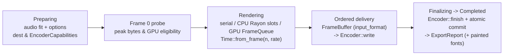

# Export and FFmpeg

This page records the contracts of the export path: how a timeline frame becomes pixels, how pixels reach an encoder, which codecs and pixel formats exist, and how output is committed atomically or discarded on failure. [Rendering](rendering.md) owns single-frame coverage, GPU execution, caches, and frame budgets; [Audio](audio.md) owns offline PCM preparation; [Reliability](reliability.md) owns the general failure model. Usage walkthroughs live in the [export tutorial](../tutorial/11-export.md).

## Pipeline

[`export`](../../../crates/motion-encode/src/export.rs) orchestrates built-in and custom encoders (`ExportOptions::encoder`) on the caller's thread and always writes frames strictly in ascending index order:

| Stage | Contract |
| --- | --- |
| `Preparing` | Resolves timeline audio (fitting `AudioDuration::Fit` scenes if present), normalizes options and frame range (`selected`), rejects overwrite or audio-source collisions, checks `EncoderCapabilities`, mixes any timeline audio into `MixedAudio`, and calls `Encoder::open` before rendering a single frame. |
| `Rendering` | Evaluates frame `n` at `Time::from_frame(n, rate)` directly into the `PixelFormat` returned by `Encoder::input_format()` without reinterpretation, reporting `ProgressSink::frame_completed` as each frame is handed to `Encoder::write`. |
| `Finalizing` | Calls `Encoder::finish` to flush delayed codec packets, close temporary containers, and atomically commit the output path, then attaches the deduplicated `Vec<FontIdentity>` (family names and source hashes) observed from a fresh per-export sink, unaffected by reused `RenderOptions` or `RenderCache`. |
| `Completed` | Emitted only after `Encoder::finish` commits cleanly and `ExportReport` (`path`, `frames`, `range`, `elapsed_seconds`, `bytes`, `fonts`) is ready to return. |

## Native API only

Video and audio encoding run in-process against `libav*` through [`motion-ffmpeg`](../../../crates/motion-ffmpeg/src/lib.rs). No `ffmpeg` executable is spawned and there is no subprocess fallback; media verification in the test suite ([`inspect.rs`](../../../crates/motion-ffmpeg/src/inspect.rs)) uses native `libavformat` / `libavcodec` demuxing as well. `PngSequence` and `Gif` encoders are pure Rust and require no FFmpeg libraries.

## Defaults, frame range, and rate

`ExportOptions::new(path)` defaults to `Codec::h264(18)` (`EncoderPreset::Medium`), an opaque `Color::BLACK` background, `48,000 Hz` audio, `overwrite = false`, `workers = available_parallelism().min(64)`, and `max_parallel_bytes = 4 GiB`.

| Rule | Contract |
| --- | --- |
| Half-open `range` | Must satisfy `0 <= start < end <= duration`; `None` selects `0..duration`. |
| Frame-grid rounding | `start` and `end` round up to the next frame boundary on the output grid; ranges enclosing zero frames fail validation, and `ExportReport::range` records the normalized interval. |
| Output frame rate | Matches `timeline.frame_rate()`, except `Codec::Gif { frame_rate, .. }`, which samples the timeline on its own `frame_rate` grid. |
| Concurrency bounds | `workers` must be in `1..=64` and `max_parallel_bytes` must be positive (`> 0`). |

## Codec matrix

| `Codec` | Container / library | `input_format()` | `EncoderCapabilities` | Alpha | Key constraints |
| --- | --- | --- | --- | --- | --- |
| `H264 { quality, preset }` | MP4 / `libx264` | `Yuv420 { bit_depth: 8 }` | audio: yes, max `16,384²`, even dims | no | CRF `0..=51`; `preset`: `Medium`, `Slow`, `Slower` |
| `H265 { quality, preset, bit_depth, params }` | MP4 / `libx265` | `Yuv420 { bit_depth: 8 \| 10 }` | audio: yes, max `16,384²`, even dims | no | CRF `0..=51`; `BitDepth::Ten` selects Main10 (`yuv420p10le`); optional `params` `<= 4,096 B` without NUL |
| `Vp9 { quality, alpha }` | WebM / `libvpx-vp9` | `Yuv420 { bit_depth: 8 }` or straight `SrgbRgba8` when `alpha` | audio: no, max `16,384²`, even dims | optional | CQ `0..=63`; timeline audio is rejected (`WebM` has no AAC mux path) |
| `ProRes4444` | MOV / `prores_ks` | straight `SrgbRgba8` (`yuva444p10le`) | audio: yes, max `16,384²`, even dims | yes | Fixed broadcast profile, no quality/preset tuning |
| `PngSequence` | Directory of `NNNNNN.png` | straight `SrgbRgba8` | audio: no, unbounded dims, multiple `1` | straight | Pure Rust; rejects timeline audio and container metadata |
| `Gif { frame_rate, colors }` | GIF | straight `SrgbRgba8` | audio: no, max `65,535²`, multiple `1` | 1-bit index | Pure Rust; `2..=256` palette colors; cumulative rational delays in `1..=65,535` centiseconds |

- **Background clearing for alpha codecs:** Calling `ExportOptions::codec` with `PngSequence`, `ProRes4444`, `Vp9 { alpha: true, .. }`, or `Gif` automatically clears the default `Color::BLACK` background to `None` so transparency is preserved; opaque codecs composite onto black unless overridden via `.render(...)`.
- **Native duration, audio, and container metadata:** Native FFmpeg exports require `1..=u32::MAX` frames and duration `<= 86,400` seconds. Timeline audio encodes as stereo AAC-LC at `44,100`, `48,000` (default), or `96,000 Hz`. Native video streams are tagged with BT.709 primaries and matrix in limited range, with sRGB (`IEC 61966-2-1`) transfer by default or BT.709 transfer when `DisplayTransform` selects `gamma24`. MP4 muxing enables `+faststart` and uses `705,600,000` ticks/second for movie timescales and chapter markers. `AudioMetadata` validates up to `64` container tags and up to `4,096` ordered, non-overlapping chapters, and is rejected on `PngSequence` and `Gif`. Missing encoders in the linked FFmpeg build fail at `open` with `io::ErrorKind::Unsupported` (`VideoCodec::available`).

## Pixels

[`output.rs`](../../../crates/motion-render/src/output.rs) defines the `PixelFormat` contract shared across CPU and GPU backends:

- **Supported layouts:** `LinearRgba16Float`, `LinearRgba32Float`, `SrgbRgba8 { premultiplied }`, and `Yuv420 { bit_depth }` (`8` or `10` bits, even dimensions, BT.709 limited range, 10-bit stored as little-endian `u16`). `FrameBuffer` owns tightly validated planes with explicit byte strides.
- **Quantization and raw writers:** [`yuv.rs`](../../../crates/motion-render/src/output/yuv.rs) performs 4:2:0 chroma subsampling, and display-transform quantization applies a deterministic `4×4` ordered dither. Opaque `SrgbRgba8` buffers also expose standalone `write_ppm` (P6) and `write_rgb` helpers ([`rgb.rs`](../../../crates/motion-render/src/output/rgb.rs)), which write raw pixels directly without FFmpeg or export-level overwrite staging.

## Streaming and threads

Export streams frame by frame and never buffers the entire film in memory:

- **Dedicated `motion-encoder` worker:** `FfmpegEncoder` spawns a dedicated `motion-encoder` thread fed by a bounded `2`-frame channel ([`worker.rs`](../../../crates/motion-encode/src/encoder/ffmpeg/worker.rs)). All `libav*` pointers (including creation and teardown) stay confined to that thread, and any worker panic converts cleanly into `Error::Encoder`. The `2`-slot channel bounds queued frame messages rather than all live frames or process RSS (the producer and encoder may each hold an active frame concurrently), and audio PCM is read directly from immutable prepared `f32` samples independently of this video queue.
- **CPU parallel slots and serial fallback:** When `workers > 1` on the CPU backend ([`parallel.rs`](../../../crates/motion-encode/src/export/parallel.rs); `.workers(1)` stays serial), frame `0` renders serially first to measure its peak memory footprint, bounding active worker count against total frames, twice the first frame's logical peak, and `max_parallel_bytes`. Parallel slots explicitly preserve the first frame's CPU choice rather than re-probing a GPU, and divide `max_parallel_bytes` across slots instead of reserving the full per-frame ceiling per slot. A private Rayon pool assigns slot `i` frames `i, i + workers, ...` while the coordinator retires frames strictly in index order, producing output bytes identical to serial execution (`parallel_export_matches_serial_pixels_ntsc_ranges_and_progress`). If a later frame exceeds its per-slot `max_bytes` allowance, only that structural budget error joins workers and resumes unwritten frames serially under the original per-frame limit; invalid content, work-limit errors, and panics propagate immediately. Scene closures must therefore be pure and repeatable.
- **GPU preparation and readback queue:** When `gpu` is enabled, `backend != Cpu`, more than `1` frame is exported, `Gpu::supports_packed_output` holds for `(size, format)`, and a `GpuContext` is active ([`gpu.rs`](../../../crates/motion-encode/src/export/gpu.rs)), frame `0` probes CPU preparation/planning maximums alongside `OutputPlan::peak_bytes` to separate CPU worker slots from the single render session's `FrameQueue` (`1..=3` frames in flight; worker count is measured rather than fixed at two). Workers build packed plans under `OutputPlan::with_planning_limit` (conservatively charging device and staging reservations per slot), while completed plans keep the original submission limit and check in-flight bytes against `FrameQueue` (completing the oldest output when space is needed) before ordered submission and encoding. Only slot byte-admission failures join workers, drain the queue, and resume serially under the original per-frame limit. Aggregate parallel allowances exclude encoder storage, shared `Assets`, caches, and idle pools, and are not an RSS cap.

## Transactions and overwrite

| Output target | Transactional staging mechanism |
| --- | --- |
| Video (`MP4`, `MOV`, `WebM`) & `Gif` | Writes to `.motion-video-*` / `.motion-gif-*` inside the destination's parent directory, then commits atomically via `persist` (`overwrite = true`) or `persist_noclobber` (`overwrite = false`). |
| `PngSequence` | Writes frames into a sibling `.motion-png-*` temporary directory, then swaps or installs it atomically (`renameat_with` `NOREPLACE` or `EXCHANGE` where supported; overwriting requires the existing target to be a real directory). |
| Custom `Encoder` | Owns its own staging transaction; dropping an unfinished encoder after an error or cancellation must discard partial output. |

- **Destination safety and Unix modes:** With `overwrite = false`, an existing destination fails with `io::ErrorKind::AlreadyExists` before `Encoder::open` or frame evaluation runs. With `overwrite = true`, the previous file or directory remains intact until final commit. Exporting over a canonical path currently referenced as a timeline `AudioSource::File` is rejected unconditionally even when `overwrite = true`. On Unix, transactional PNG, GIF, and native video files request creation mode `0666` and `PngSequence` staging directories request `0777`; the process `umask` applies at creation for both new and overwritten outputs, and export never reads or mutates `umask`. Cancellation, errors, or early drops remove staged temporary files and directories ([`native.rs`](../../../crates/motion-encode/src/encoder/ffmpeg/native.rs)).

## Cancellation and errors

- **Cooperative polling:** `ProgressSink::is_cancelled` is checked before preparation, between frames, every `10 ms` while waiting on bounded worker queues, and during finalization, returning `Error::Cancelled` with zero committed output.
- **Typed failure attribution:** Scene and raster errors carry the offending frame index via `Error::at_frame`. Panics on frame `0` or parallel worker threads are caught via `catch_unwind` and reported as `Error::ScenePanic`. Native codec and mux failures surface as `Error::Encoder` wrapping an `io::Error` with the FFmpeg error code and message. `Encoder::write` rejects out-of-order frame indices, mismatched dimensions, or wrong `PixelFormat`, and `Encoder::finish` rejects incomplete frame counts.

## Features, platform, and `unsafe` boundary

| Requirement | Detail |
| --- | --- |
| `ffmpeg` feature (`motion-encode`, default in `motion`) | Enables in-process `libav*` video/audio encoding; when disabled, video codecs fail at `open` with `Unsupported` while pure-Rust `PngSequence` and `Gif` remain available. |
| `gpu` feature | Enables GPU output packing and the pipelined `FrameQueue` export path. |
| Build & runtime libraries | Requires `pkg-config`, FFmpeg development headers/libraries (`libavformat`, `libavcodec`, `libavfilter`, `libswscale`, `libswresample`, `libavutil`), and `libclang` for `bindgen` ([`build.rs`](../../../crates/motion-ffmpeg/build.rs)); linked libraries (resolved via `rpath` on Unix) must provide `libx264`, `libx265`, `libvpx-vp9`, `prores_ks`, and `aac`. |
| Isolated `unsafe` FFI | Every workspace `unsafe` block lives inside `motion-ffmpeg` under `unsafe_op_in_unsafe_fn = "deny"` and `clippy::undocumented_unsafe_blocks = "warn"` with explicit `// SAFETY:` invariants. `bindgen` allowlists only required C symbols, `Encoder` exclusively owns and frees its `libav*` handles in `Drop` without committing, and `motion-encode` exposes safe Rust only. |

## Owning sources

- [`crates/motion-encode/src/export.rs`](../../../crates/motion-encode/src/export.rs), [`export/options.rs`](../../../crates/motion-encode/src/export/options.rs), [`export/render.rs`](../../../crates/motion-encode/src/export/render.rs) — `export`, `ExportOptions`, `Codec`, `Encoder`, `EncoderCapabilities`, `ExportReport`, and frame-range normalization.
- [`crates/motion-encode/src/export/parallel.rs`](../../../crates/motion-encode/src/export/parallel.rs), [`export/gpu.rs`](../../../crates/motion-encode/src/export/gpu.rs) — bounded Rayon CPU worker slots, serial budget fallback, and pipelined GPU `FrameQueue` export.
- [`crates/motion-encode/src/encoder/ffmpeg.rs`](../../../crates/motion-encode/src/encoder/ffmpeg.rs), [`encoder/png.rs`](../../../crates/motion-encode/src/encoder/png.rs), [`encoder/gif.rs`](../../../crates/motion-encode/src/encoder/gif.rs) — `FfmpegEncoder` (`motion-encoder` thread), `PngSequenceEncoder`, and `GifEncoder`.
- [`crates/motion-ffmpeg/src/lib.rs`](../../../crates/motion-ffmpeg/src/lib.rs), [`encoder.rs`](../../../crates/motion-ffmpeg/src/encoder.rs), [`settings.rs`](../../../crates/motion-ffmpeg/src/settings.rs), [`inspect.rs`](../../../crates/motion-ffmpeg/src/inspect.rs) — `unsafe` `libav*` FFI boundary, color metadata, `+faststart` MP4 muxing, and native stream inspection.
- [`crates/motion-render/src/output.rs`](../../../crates/motion-render/src/output.rs), [`output/yuv.rs`](../../../crates/motion-render/src/output/yuv.rs), [`output/rgb.rs`](../../../crates/motion-render/src/output/rgb.rs) — `PixelFormat`, `FrameBuffer`, BT.709 `Yuv420` conversion, and raw RGB/PPM writers.
