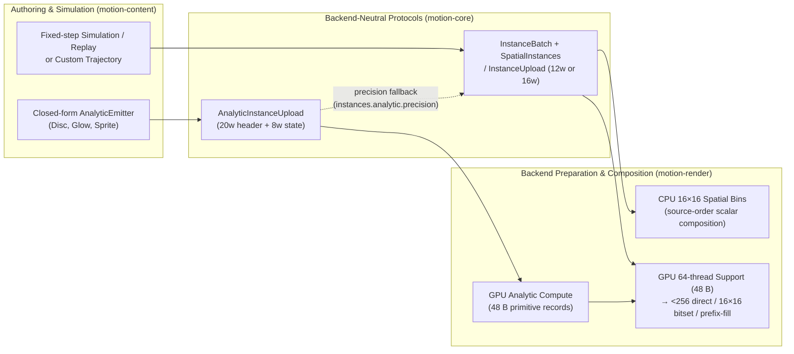

# Particle instance contracts

Particle systems execute as single `InstanceBatch` display-list operations rather than trees of child `Node` values. This document defines the record layouts, CPU/GPU evaluation and spatial-tiling protocols, admission limits and deterministic replay invariants shared across [`motion-core`](../../../crates/motion-core/src/instances.rs), [`motion-content`](../../../crates/motion-content/src/particles.rs) and [`motion-render`](../../../crates/motion-render/src/gpu/particle_tiles.rs). See the [particles tutorial](../tutorial/07-particles.md) for authoring APIs, [rendering](rendering.md#gpu-rendering) for frame-level GPU scheduling, and [resources](resources.md#limits-and-accounting) for shared sprite residency.

## Record layouts and execution flow

Motion separates authoring and simulation state (`Particle`) from backend-independent primitive records (`InstanceRecord`, `ExtendedInstanceRecord`), closed-form GPU trajectory uploads (`AnalyticInstanceUpload`) and device-side support metadata. No second `Layer`-based particle runtime and no arbitrary GPU trajectory-program interpreter exist.

| Structure | Owner | Layout | Contract |
| --- | --- | --- | --- |
| `Particle` | `motion-content` | `72` bytes (`#[repr(C)]`) | Runtime simulation and trajectory state: `position`, `velocity`, finite linear premultiplied `color` (`alpha` in `0..=1`, unclipped HDR RGB, zero RGB when `alpha == 0`), `size` (`0..=4096`), `rotation`, `age >= 0`, `lifetime` (`(0, 3600]` s), nonrecycled `index: u64` and `custom: [f32; 4]`. |
| `InstanceRecord` | `motion-core` | `12` `f32` words (`48` bytes) | Base evaluated primitive (`Disc`, `Glow`, `Sprite`, `Segment`): `position`, `start`, `color`, `radius`, `rotation`, `width` and `InstanceKind` (`0..=3`). Carries no age, velocity, seed, model or simulation history. |
| `ExtendedInstanceRecord` | `motion-core` | `16` `f32` words (`64` bytes) | `InstanceRecord` (`base`) plus `extra: [f32; 4]` supporting all 13 `InstanceKind` variants (`0..=12`), adding `SpriteSheet`, `TaperedSegment`, `Polygon`, `Ring`, `Capsule`, `Soft`, `Quad`, `Bokeh` and `Ribbon`. |
| `InstanceUpload` | `motion-core` | `4`-word (`16`-byte) header + `count * stride` words + optional RGBA texels | Header `[count, sprite_width, sprite_height, layout]` where `layout = stride + (blend_id << 5)` (`stride` is `12` or `16` in the low 5 bits; `InstanceBlend` is encoded above bit 5, exact in `f32`). |
| `AnalyticInstanceUpload` | `motion-core` | `20`-word (`80`-byte) header + `8` words (`32` bytes) per instance | Admitted explicit seed, frame time, bounded model parameters and per-instance `AnalyticInstanceState` for closed-form GPU evaluation into `48`-byte primitive records. |
| GPU support metadata | `motion-render` | `48` bytes per instance (`max(count * 48, 16)`) | Separate charged device buffer derived by a `64`-thread compute pass; never an alias for `InstanceUpload`. |

## CPU spatial binning and composition

Built-in batches scatter conservative per-instance supports into `16×16` device-space tiles when `InstanceBatch::spatial()` supplies `SpatialInstances`. Each tile retains ascending original instance indices so per-pixel scalar coverage and compositing visit only overlapping primitives while preserving exact source order.

- **Conservative support bounds.** Bounds preserve `Glow`'s `3×` radius cutoff, rotated sprites, line and trail extents, antialiasing feather and numeric guard bands. Batches whose bounds cannot be formed reliably in finite device coordinates, or custom `InstanceBatch` implementations that do not supply `SpatialInstances`, fall back to traversing the full ordered slice.
- **Zero-source identity.** Sampling skips destination read-modify-write on zero-source samples (`alpha == 0` and RGB all `0`) and executes every nonzero contribution in original order.
- **Admission and failure atomicity.** Tile metadata and index entries count toward logical live and peak bytes. Work charges cover bin construction and actual tile-instance pixel visits rather than `instances * frame_pixels`; this refines algorithm-work accounting without changing configured `RasterLimits`. Failed renders never commit a partially updated public output frame, and reduced logical work totals do not imply cross-backend byte identity or real-time frame-rate guarantees.

## Upload protocols and extended primitives

`Canvas::instances` and `InstanceBatch` remain the Rust-evaluated boundary for custom trajectories, CPU fixed-step simulations and styles outside the closed analytic set. `InstanceUpload` validates `count <= MAX_INSTANCE_COUNT` (`1,048,576`), finite geometry and colors, sprite dimensions (`width` and `height` both `0` or both in `1..=16_384`), exact linear RGBA texel counts and checked allocations. CPU-only batches that omit GPU upload data are rejected explicitly by GPU consumers rather than silently switching backends.

- **Unified header and blend policy.** Both `InstanceUpload::new` / `new_blended` (`stride = 12`) and `InstanceUpload::new_extended` (`stride = 16`) encode `stride + (blend_id << 5)` in header word `3`, with optional shared sprite texels starting at word `4 + count * stride`. `InstanceBlend` (`SourceOver`, `Plus`, `Screen`, `Multiply`) is a batch-wide compositing policy: `GlowDots` defaults to `Plus`, all other built-in styles default to `SourceOver`, and `ParticleVisual::blend` overrides any style on both backends.
- **Extended primitive invariants (`ExtendedInstanceRecord`).** Extended kinds keep `Disc`, `Glow`, `Sprite` and `Segment` discriminants (`0..=3`) unchanged and validate finite parameters at construction without clipping HDR RGB:
  - `SpriteSheet`: `base.width` stores stretch aspect in `(0, 64]`; `extra` holds normalized `[u0, v0, u1, v1]` cell bounds in `0..=1` with `u0 < u1` and `v0 < v1`.
  - `TaperedSegment` and `Ribbon`: `base.width` stores the start diameter, `base.radius` and `base.color` store the endpoint radius and color, and `extra` holds linear premultiplied start RGBA with endpoint alphas constrained to `0..=1`.
  - `Polygon`, `Ring`, `Soft`, `Capsule`, `Quad` and `Bokeh`: validate integer polygon sides (`3..=32`), ring ratio (`(0, 1]`), softness (`0..=1`), aspect ratio in `extra[2]` (`1..=64` for `Capsule` and extended `Sprite`, `(0, 64]` for `Quad`), and bokeh blades (`0` or integer `3..=32`) with roundness and rim in `0..=1`.
- **Sprite atlas residency.** GPU planning separates immutable trailing sprite texels from per-draw headers and records for both `12`-word and `16`-word strides. Binding `11` consumes the `GpuContext`-resident atlas so changing time, positions or transforms reuses resident pixels on cache hits. Raw `InstanceUpload` keeps trailing texels intact for CPU consumers, and GPU admission still charges host storage, worst-case device upload and comparison work on hits independently of cache occupancy (see [resources](resources.md#limits-and-accounting)).
- **Bounded neighbor and historical queries.** `Plexus` emits segments via deterministic spatial hashing (`NeighborIndex`) up to `65,536` states with explicit pair and logical-work caps, never unbounded $O(n^2)$ scans. Historical trail and ribbon segments share one sample and ID lookup per timestamp, advancing a render-local forward `ReplayCursor` across ascending query times within admitted working buffers (`64 MiB` history/index ceiling) and dropping it at render end so repeated renders of the same frame remain identical.

## GPU evaluation and ordered tiling

The GPU backend prepares `48`-byte primitive records from either uploaded records or closed-form analytic state before deriving support metadata and ordered `16×16` tiles:

- **Closed-form analytic evaluation (`AnalyticInstanceUpload`).** Eligible built-in `AnalyticEmitter` batches (`Disc`, `Glow` and `Sprite` under `Ballistic`, `Converge`, `Orbit` or `NoiseDrift`) upload explicit seed, frame time and model parameters instead of CPU-evaluated positions. Uploads admit up to `1,048,576` states with `0 <= age < lifetime <= 3600` seconds, numeric magnitudes `<= 1,000,000` and temporal/noise phases `<= 8192`. Out-of-range `f32` precision emits `Unsupported` at `instances.analytic.precision`, increments `InstanceBatch::analytic_fallback` and preparation's `analytic_cpu_fallbacks`, and materializes primitives on the CPU without changing the selected frame backend or CPU reference streams. Fixed-step simulation never runs on the GPU.
- **Support pass and `< 256` direct loop.** A `64`-thread compute pass transforms each primitive's conservative support into a separate charged `48`-byte metadata buffer (`max(count * 48, 16)` bytes). Batches below `256` instances keep the direct full-loop shader path without tiling dispatches or tile lookups.
- **Source-order bitset tiling (`>= 256`, primary path).** When the bitset layout and conservative work bound fit device storage and `RasterLimits`, one `64`-thread compute pass assigns an invocation per particle and atomically sets its source-order bit (`32` particles per `u32` word) in every overlapped `16×16` tile. A tile-specialized composition pipeline enumerates set bits from low to high, preserving exact blend order with no GPU summary readback.
- **Count–prefix–fill fallback.** When the bitset exceeds budget or device storage limits, GPU tiling executes `count`, `prefix` and `fill` passes, reading back a `16`-byte summary (`references`, 64-bit work, `overflow`) before allocating exact `16`-byte-aligned reference records (avoiding packed-component read/modify/write races) and admitting actual tile-instance pixel work. Any index, storage or work overflow fails the frame before output commits; indices are never truncated. Frame reports reflect path-specific storage and work, whereas internal GPU plan stats record static admission charges. Current throughput measurements live in [benchmarks](../benchmarks.md).

## Simulation replay and collisions

Fixed-step CPU simulations (`Simulation`) step deterministically from explicit seeds (`1/240` s default step) and retain bounded snapshots in `PreparedReplay` for random-access frame evaluation.

- **Quotas (`SimulationLimits`).** Defaults cap live state at `16,384` particles (`max_particles / 2` per lane when dual-phase `loop_period` is active), `64 MiB` total bytes across retained snapshots plus working buffers and event queues, `1,000,000` steps, `100,000,000` work units, sub-emitter depth `8` (at most `32`), `1,000,000` cumulative births and `65,536` queued events per step. Both phases of a seamless loop share the render query work budget.
- **Standard vs enhanced snapshots.** Simple simulations keep compact snapshots and original keyed streams. Simulations using events, sub-emitters, group modifiers (`Boids`, `ParticleCollisions`), `prewarm`, `loop_period`, time remapping, multi-worker evaluation or birth-dependent intensity/color rules select enhanced snapshots carrying birth color and sub-emitter depth. Monotonic nonrecycled `u64` IDs, ordered event queues and per-rule/per-step `Random` keys keep simulation results independent of worker thread count. Panics inside user callbacks propagate across joined worker threads.
- **Swept and SDF colliders.** Analytic colliders and `SignedDistanceGrid` (`SdfCollider`) use `Particle::size` as collision radius. SDF grids retain signed distance samples and exact cached boundary guards, require explicit resolution and preparation budgets with `speed * step < cell_size`, and key `SceneCache` entries by geometry identity, bounds, resolution and budget. Boundary guards protect thin features resolved after curve flattening, while curves omitted by the declared flattening tolerance are not recovered.
