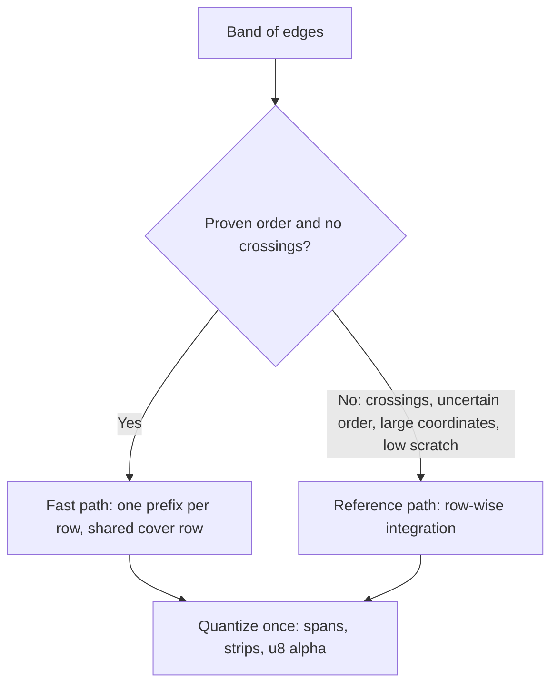
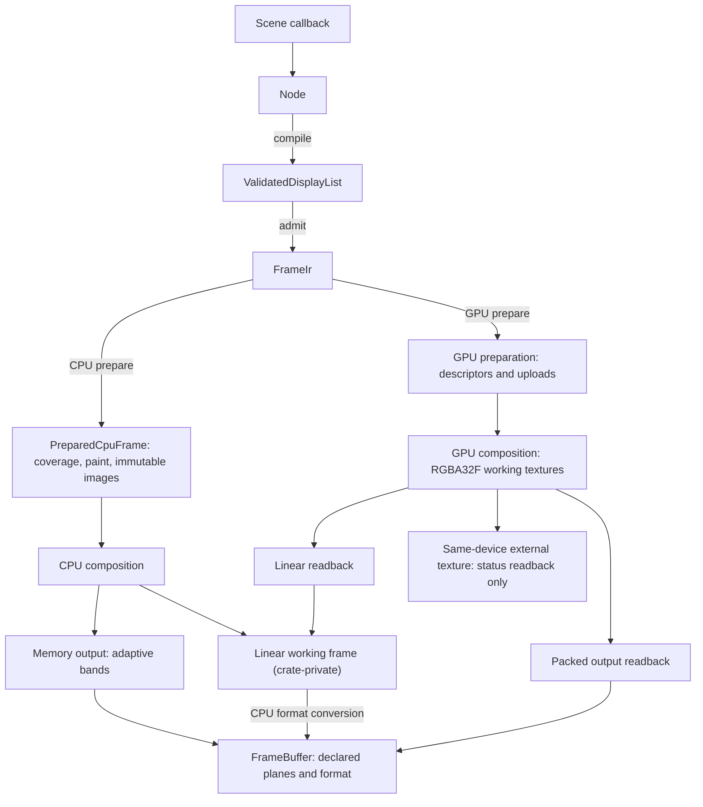
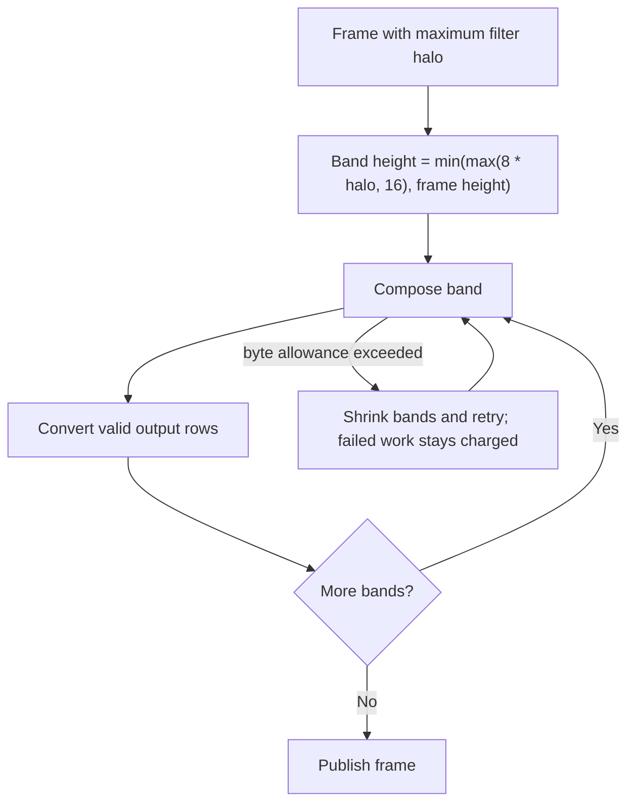
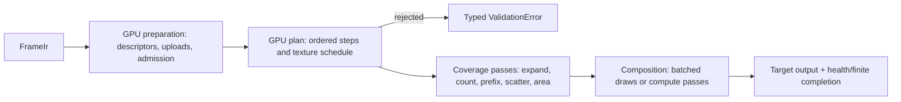
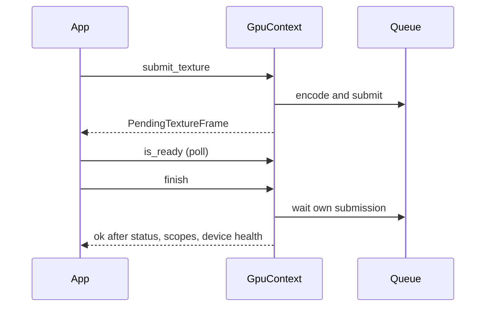
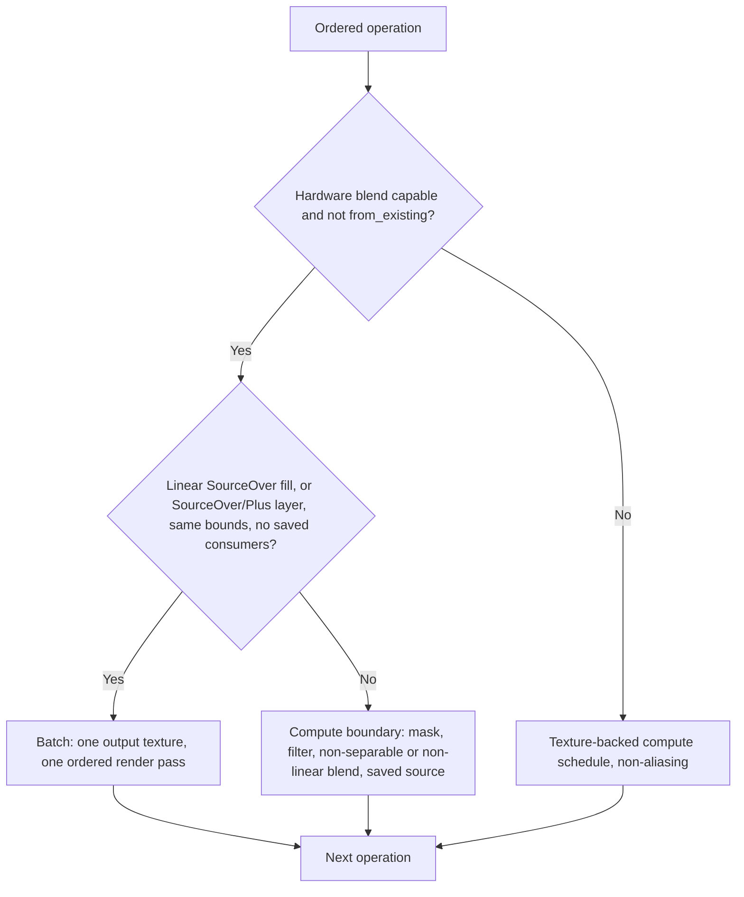
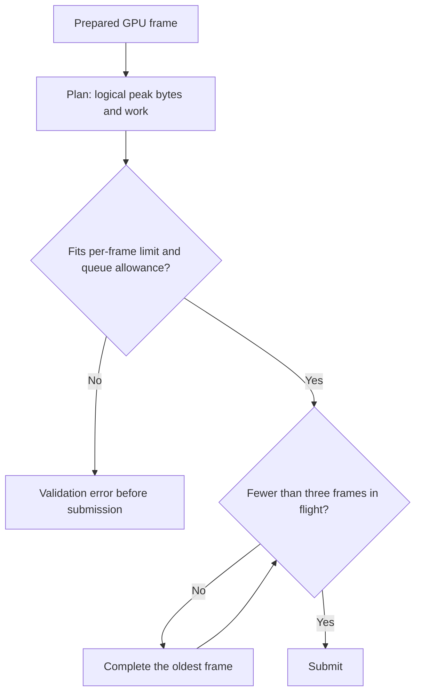

# Rendering

Import `motion::prelude` for authoring, `motion::render` for rendering contracts, and
`motion::extend` for implementation protocols. Prepared coverage (strips, spans, paint
records and layers) and the GPU plan are crate-private to
[`motion-render`](../../../crates/motion-render/src/lib.rs); `PreparedCpuFrame` exposes sizes,
statistics and counts only. Logical sizes use `f64`; output `PixelSize` uses positive
integer dimensions. A `Composition` uniformly contains logical content in its output
viewport. Multi-frame timeline export, worker scheduling and video/GIF/sequence encoding
belong to [export and FFmpeg](export.md). Chinese translation:
[../../zh-CN/design/rendering.md](../../zh-CN/design/rendering.md); this English page is the source of truth.

## Backend preparation and effects

`FrameIr` validates all content and normalizes device-space curves, scopes, paints, clips
and filter domains before any coverage is allocated. It admits structural storage,
resource bytes and conservative Wang segment bounds. The CPU backend and GPU backend consume this
immutable description independently.

After normalization, both backends skip fill coverage inside zero-opacity layers, including
nested filter and mask scopes. Hidden content still undergoes structural and geometry validation;
it does not consume device fill, pixel or coverage-work ceilings.
GPU planning also skips the complete zero-opacity scope, so hidden fills, filter passes,
mask captures and layer composites allocate no execution textures or GPU passes. The command
walk remains budgeted, and visible siblings resume after the matching scope closes.

The public `RenderPrepare` and `PreparedCpuFrame` describe CPU coverage only. GPU sessions and
packed export workers use a separate preparation result and never build a CPU prepared
frame, while low-level GPU consumers can still explicitly upload one. GPU coverage is
generated on the device for eligible fills; see [GPU rendering](#gpu-rendering).

`PreparedGpuFrame` directly owns shared `FrameRecords` and GPU-specific device geometry.
Internal rendering and public output planning use the same prepared value, without a
separate internal frame wrapper. Its records remain private and expose no CPU rendering API.

### CPU coverage

CPU preparation flattens curves with a device-space tolerance, integrates polygon area and
records compact coverage. Neither path is a supersampling renderer. Bands without
intersections use a verified area/cover prefix fast path; every other band uses the
precise row-wise reference path:

1. Build vertical cuts at the events needed to preserve edge order, including relevant
   intersections.
2. Sort the active crossings in each interval and update NonZero winding or EvenOdd parity,
   merging consecutive inside regions.
3. Clip and integrate trapezoids against pixel columns in f64, then quantize coverage into
   compact spans, strips and u8 alpha.



The fast path sorts the band's edges once and proves the same order over every active
interval. Only proven coincident edges or shared endpoints bypass its rounding guard. Fill
rule state changes select the actual fill boundaries, so overlapping contours are not
summed blindly. Falling back never modifies coverage; proof work is charged even then, and
scratch is released on success and rejection. A tighter byte limit can select a
lower-peak fallback, so an unconstrained run's peak is not the smallest admissible limit.

Four-column groups in bands of up to four rows omit empty coverage, merge fully covered
groups into spans and keep edge coverage as strips. Each area is quantized once (clamp,
multiplication, half-stability epsilon, round), kept in the band scratch and reused for
strip output. Strip and span origins are absolute; translated caches can change alignment,
so consumers use each record's actual coordinates and height. Rectangles have a specialized
analytic path. Both CPU paths keep the CPU coverage format and exact reference replay.

Curve flattening uses Wang's second-derivative bound in device space: chord error is at
most `0.75 * curvature / count^2`. Curved counts round up to the smallest even count
satisfying the bound, which preserves symmetric reversals when horizontal edges are
omitted. The bound is met with equality, so consumers that depend on area rather than edge
position choose their own tolerance: `VectorTree::surface` uses 0.0025 tree units. Replay
follows the [same-environment determinism contract](reliability.md#determinism), not a
cross-platform byte-identity promise or an exact curve-area guarantee.

Session preparation reuses polygon band-area, edge-sweep, active-edge, row-crossing and
trapezoid-column storage across coverage-cache misses. Every band still zero-initializes
its admitted area values and keeps the same integration order, byte and work charges and
failure boundaries; only vector capacity persists, at most 1 MiB of idle capacity per
vector and session, independent of the shared coverage cache. Oversized storage is
discarded after the path, including failed attempts. Shape-clip rasterization still
allocates its own scratch.

### CPU composition

CPU composition is scalar and row-oriented. Solid `SourceOver` spans hoist the remaining-alpha
term out of the pixel loop; every other mode keeps its exact per-pixel formula and operation
order without multiply-add fusion. Every pixel checks finite working storage before publishing,
and failed composition leaves the destination unchanged.

Composition intentionally avoids two tempting paths whose overhead outweighed their gains across
measured scenes:

- **Per-pixel lane vectorization (`wide` `f32x4`/`f32x8` `SourceOver`, `f64x4` blending and
  coverage quantization):** lane packing and finite checks cost as much as the scalar arithmetic
  they replace; only pre-measured row-wise loops qualify for SIMD.
- **Intra-frame tile-parallel Rayon pools and fused point filters:** filtered frames cannot use
  them, most layer counts regress from synchronization overhead, and CPU export workers already
  parallelize at frame granularity across Rayon threads.

### Effects

Effects use shared ordered Filter primitives. Layout bounds are unchanged while preparation
derives conservative device captures. Child effects finish before parent effects; the
source is filtered, masked or clipped, and then composited with opacity and blending.
Saved-source operations keep their explicit input. Coverage clips, geometric intersection
and content masks have different quantization and order contracts. See
[drawing](../tutorial/05-drawing.md) for usage.

- **Blur** uses bounded normalized box approximations and transparent borders. CPU uniform
  boxes use direct integer weighted taps for radii 1 and 2. Larger radii use a sliding
  window built from the suffix of one aligned block of 2r+1 samples and the prefix of the
  next, so each sample is only added, never subtracted: three additions per sample at any
  radius, and a large HDR value leaving the window cannot erase the smaller values that
  remain. Vertical passes walk whole rows across at most 32 KiB of sum table so the table
  stays in L1. A block whose windows contain only transparent black is written without
  summing, with bit-identical output. Pass buffers are not cleared beforehand; only pixels
  outside the written domain are zeroed. The fractional small-sigma kernel keeps its
  weighted path. All paths preserve finite checks, charged bytes (the sum table is charged
  and released per pass) and exact same-backend replay. Large-box accumulation order
  differs from older compensated sums, so historical output differs at f32 rounding level;
  cross-backend tolerances are unchanged.
- **Bloom** is a downsampling pyramid shared by both backends. Level `k` pixel `(x, y)`
  averages the 2x2 block at `(2x, 2y)` of level `k - 1`, in device coordinates halved `k`
  times. Every level is downsampled from its unblurred parent and then blurred by `radius`
  level pixels, spanning `radius * 2^k` device pixels. From the coarsest level, each finer
  level adds its normalized weight times its blur to the coarser sum sampled bilinearly at
  `((x + 0.5) / 2 - 0.5, (y + 0.5) / 2 - 0.5)`. Tint, alpha clamp and Plus composite apply
  once to the full-resolution sum. `motion_core::filter::bloom_bounds` gives the support,
  and the GPU plan uses `Downsample` and `Upsample` steps with the same geometry. Coarse
  levels cost a quarter of their parent, so the pyramid costs about 4/3 of one
  full-resolution blur.
- **Bokeh** (`Optics::Bokeh`) uses `Optics::bokeh_taps(radius)` aperture taps,
  `ceil(1.4 * radius^2)` within 8..=64, keeping Vogel-spiral spacing near 1.5 pixels until
  the maximum. Both backends read the count from the shared parameters and charge four reads
  per tap.
- **Exact shortcuts.** Several stages skip or shorten work without changing any output bit:
  `ChannelOffset` samples only the channel and alpha it needs and drops zero-weight bilinear
  taps; layer composition and Glow skip source pixels that are transparent black, which
  compositing leaves untouched in every mode; and the RGBA8 encoder looks a dithered byte up
  through a bucket index over the threshold bit patterns, with a straight path for opaque
  pixels.
- **Ink.** Final brush ink admits each indexed candidate distance evaluation before it
  executes, against the 32-million default material limit, rather than rejecting a texture
  because texels times all samples exceeds it. Texture dimensions and the 262144-texel cap
  are unchanged, and failed preparation publishes no material image. Material admission is
  separate from frame raster work and bytes. A texel farther from the stroke than any
  coverage or wash can reach is written transparent after a few bounding-box tests; this is
  bit-identical to the full nearest-segment search.

An unfiltered CPU `PushLayer`/`Fill`/`PopLayer` sequence without added clips can draw
directly into its parent instead of allocating an isolated image. Each covered pixel still
fills a transparent local pixel, rounds, applies layer opacity and rounds again before the
original blend; opacity is not folded into paint alpha. Curves and intersecting paths keep
the shared nonoverlapping coverage records. Filtered layers, added alpha or geometric
clips, inherited geometric clips and multi-item layers keep isolated composition.

Preparation also intersects eligible unfiltered, unclipped Plus/LinearPlus captures with
the union of Fill coverage and completed child-layer bounds. Filtered children contribute
their full conservative capture, including halos; mask owners and particle captures keep
their original bounds. This bound reduction applies to CPU and GPU consumers, and its
conditional scan and stack metadata are admitted during preparation.

## Frames and stills

Composition owns a `FrameClock` (rational rate and frame count, never defaulted) and one
`RenderOptions` (dimensions, background, resources, backend policy and the rest); there are
no per-option setters beyond `with_options` and `configure`. Reuse `frame_renderer(size)` for
random-access frames and cache reuse; its `FrameRenderer` wraps a `RenderSession`. For
Timeline output, `render_still` and export apply the same `RenderOptions` policy.
`render_frame` and `render_frame_sampled` return a fully opaque straight `SrgbRgba8`
`FrameBuffer`: the frame composites over `RenderOptions::background` made opaque, or over
white when it is absent. Its `write_ppm` and `write_rgb` truncate or replace the selected
file explicitly and reject non-opaque buffers. Use `render_still` and a straight RGBA8 `FrameBuffer` for transparent PNG output: it stages
a temporary file in the destination directory (requesting Unix mode `0666` subject to the
process `umask`, without reading or mutating `umask`) and protects existing destinations
unless overwrite is explicitly allowed. Multi-frame export staging and directory permissions
live in [export and FFmpeg](export.md#transactions-and-overwrite).

```rust,no_run
use motion::prelude::*;
use motion::render::Composition;
let composition = Composition::new(320, 180, motion::render::FrameClock::new(fps!(30), 60));
let mut renderer = composition.frame_renderer(Size::new(320.0, 180.0))?;
let circle = Circle::new(Point::new(160.0, 90.0), 24.0)?;
let frame = renderer.render_frame(15, |_| {
    Node::from(circle.clone().fill(Color::rgb(20, 160, 130)))
})?;
frame.write_ppm("frame.ppm")?;
# Ok::<(), motion::Error>(())
```

`RenderOptions` selects output size, background and transparency, backend, resources,
structural and raster limits, and optional shutter sampling. `FrameBuffer` preserves its
declared planes and format: straight or premultiplied sRGB RGBA8, linear-premultiplied
RGBA16F or unquantized RGBA32F, or limited-range BT.709 YUV420 at 8 or 10 bits. YUV requires
even dimensions and opaque pixels. There is no implicit HDR tone mapper.
`PreparedCpuFrame::render_linear` and `Gpu::render_linear` return RGBA32F `FrameBuffer`s that
`FrameBuffer::linear_pixel`, `linear_pixels` and `to_format` read or convert; the CPU working
frame behind them is crate-private.

`RenderQuality::Final` is the default production policy. Draft explicitly permits preview
approximations in geometry, shutter sampling and ink material; it is not a different output
resolution or an equivalent Final result. Draft blur uses one variance-matched box for sigma
at least 1, while smaller sigmas keep Final's small-kernel policy. Quality must stay fixed
for replay and cache identity. Studio requests Draft during playback and dragging and forces
Final for export; see [the Studio guide](studio.md#preview-and-playback).

### Execution and output paths

Authoring, preparation and pixel execution are separate boundaries. Both backends consume
`FrameIr`: the CPU backend prepares CPU coverage, while the GPU backend generates eligible
fill coverage on the device and uploads the rest. The diagram shows the main routes, not
every constant-frame or format fast path.



These routes are not interchangeable: a normal `RenderSession` memory target on GPU uses
linear readback followed by CPU format conversion, while supported packed-output APIs and a
request with `device_packing` (the one `render_frame*` makes) pack before readback. An
external texture avoids frame-pixel readback but still checks submission completion and
finite status. See [GPU rendering](#gpu-rendering) for supported targets and asynchronous
completion.

CPU requests do not initialize a composition GPU. The default is the GPU when feature `gpu`
is enabled, and a GPU request never falls back to the CPU after a failure. Supplying a shared
`GpuContext` establishes device identity, not backend selection.

### CPU memory output

Explicit CPU memory output composes full-width adaptive bands. Preparation caches the
maximum nested filter-chain halo; independent siblings do not add their halos. Band height is
normally `min(max(8 * halo, 16), frame_height)`, with full-height composition when
`16 * halo >= frame_height`. A tight byte allowance shrinks bands before retrying, and all
failed-attempt work remains charged. Conservative filter halos keep offscreen and cross-band
dependencies; only valid output rows are converted. Masks, once-per-layer opacity,
source-only effects and global noise coordinates are unchanged. Bayer phase is relative to
the final output origin, and YUV bands keep complete 2x2 chroma blocks. Explicit full-linear
APIs keep full linear frames; a GPU request with `device_packing` reads back packed straight
sRGB RGBA8 instead.



CPU linear-frame-to-RGBA8 conversion and `FrameBuffer` plane conversion share one row-wise
encoder, including straight and premultiplied alpha and Bayer phase, and write directly to
their own output storage without an intermediate RGBA image. Synchronous and pending GPU
linear readback share crop and finite-pixel validation: aligned little-endian rows use a
checked typed copy, and other rows decode little-endian components explicitly. Both keep the
caller's diagnostic path. Packed readback and external-texture output are separate from this
linear kernel.

CPU layer, mask, saved-source and filter scratch storage share a bounded session pool (four
buffers, at most 64 MiB and one quarter of the active byte allowance). Encoded memory planes
have a separate shared pool (four buffers, at most 64 MiB and one eighth of the allowance).
Frames hold their planes until dropped; clones own independent bytes and never alias writable
storage. Query `pooled_cpu_bytes` and `pooled_output_bytes` for idle capacity, not live frame
payload or process RSS. All bands share cumulative work admission, including repeated
command and halo work; the logical peak includes prepared data, final output, live captures
and conversion scratch. Failure publishes no partial frame, and a healthy retry can reuse
storage.

Gradient geometry and image inverses are prepared once. CPU paint rows reuse vertical mapping
terms; bounded binary-grid horizontal products advance exactly, and other transforms use
direct evaluation. The same LUTs, hard-stop semantics, extension and floating-point order
remain the reference.

CPU YUV conversion keeps the f32 `libm` transfer and f64 BT.709 quantization as its exact
reference. A shared 2,150-entry (8,600-byte) sRGB table interpolates within f32 exponent
segments; the linear toe and endpoint handling stay exact. The `2^-20` transfer-error guard is
verified against every interpolated f32 input by the explicit release-only exhaustive test;
rerun it when changing the compiler, `libm` or transfer arithmetic. The guard propagates
separately through Y and the averaged 2x2 Cb/Cr values, including the 4x sample scale for
10-bit output, and any interval that can cross a half-integer quantization boundary uses the
exact computation. Uniform blocks reuse exactly quantized samples. No output tolerance, alpha
policy or conversion-work allowance changes, and the shared immutable table is outside
per-frame logical live-byte accounting.

### Limits

`RasterLimits::default()` selects `authoring()`: 16,777,216 raster pixels and 256 MiB logical
live bytes, without a work ceiling (`max_work = u64::MAX`). Work counters and overflow checks
stay active. Opt into `RasterLimits::sandbox()` for the 200,000,000-unit work cap, or supply
an explicit `max_work`. Neither policy bounds arbitrary Rust callbacks, wall-clock time or
process RSS.

### Render requests

For explicit destinations and exact-time requests, reuse `RenderSession` directly:

```rust,no_run
use motion::prelude::*;
use motion::render::{FrameAt, FrameBuffer, FrameRequest, PixelFormat, RasterLimits, RenderSession, RenderTarget};

let size = PixelSize::new(320, 180);
let mut session = RenderSession::new(Size::new(320.0, 180.0), RenderOptions::default().size(size))?;
let mut output = FrameBuffer::new(size, RasterLimits::default())?;
session.render(FrameRequest {
    at: FrameAt::Time(250.milliseconds().after_origin()),
    frame_rate: FrameRate::NTSC,
    duration: 2.seconds(),
    background: None,
    target: RenderTarget::Memory(&mut output),
    format: PixelFormat::SrgbRgba8 { premultiplied: false },
    device_packing: false,
}, |context| Node::from(context.bounds().fill(Color::WHITE)))?;
# Ok::<(), motion::Error>(())
```

`FrameAt::Time` is not snapped to the frame grid; `FrameAt::Index` converts exactly with the
request's rate. `FrameRenderer::render_frame*`, `Composition::render_frame*` and `render_still`
are thin wrappers over this one request path. `device_packing` lets a GPU-rendered straight
`SrgbRgba8` request pack bytes on the device, which may differ from host conversion by GPU f32
rounding. Motion blur may call the builder multiple times.

- A memory target is replaced only on success, and its old retained payload is charged while
  rendering. An external texture has no rollback guarantee after a GPU failure.
- Each request installs new diagnostics and clears prior totals. `last_stats` describes
  successful memory output, not external-texture conversion. Each stage reports
  `WorkStats { peak_bytes, work }`, and `RenderSession::report()` aggregates stats, timings and
  the backend kind into one `FrameReport`.
- The request background overrides the options' background. `render_frame*` composites over
  `RenderOptions::background` made opaque, or white when absent; `render_still` and direct
  requests keep transparency when no background is given.
- `backend_kind()` reports the backend kind fixed by the backend preference; `requested_backend()`
  reports the preference itself.

## Resources and content

Cache retention, reusable idle storage and per-request admission measure different things.
Sharing one owner does not merge these allowances or establish an RSS cap. Full resource,
font, lazy-handle and poison-recovery rules live in [resources and fonts](resources.md); the
table below summarizes how rendering sessions and device contexts interact with each owner.

| Owner | Retained data | Sharing and accounting boundary |
| --- | --- | --- |
| `Assets` / `ResourceStore` | Decoded typed assets (`256 MiB` / `4096` entries default) | Cloned `Assets` share registrations; `with_store` shares accounting across independent owners; retained snapshots and direct `Arc` pins stay live until dropped. |
| `SceneCache` | Pure scene computations (`256` entries default) | Entry-bounded unless `with_limits` and `cache_with_cost` declare owned heap key/value bytes. |
| `RenderCache` | `Coverage`, `Paragraph`, `Glyph`, `Gradient`, `Formula`, `Ink`, `Scene` | `RenderOptions.cache` shares partitions across sessions and export workers; cache hits still undergo per-frame raster admission. |
| `RenderSession` pools | Idle CPU scratch, encoded plane storage and gradient LUTs | Active frames and captures remain live payload; dropped output planes return to their bounded shared pool. |
| `GpuContext` | Device state, mutable working pools and immutable binding-11 LRU | Clones share device identity; in-flight leases stay with their submission until successful completion. |

### Caches

`RenderOptions.cache` shares seven `RenderCache` partitions across `FrameRenderer`, `RenderSession`
and export worker clones (defined in [`partition.rs`](../../../crates/motion-core/src/authoring/context/partition.rs)):

| Partition (`CachePartition`) | Entries | Bytes |
| --- | --- | --- |
| `Coverage` | `2048` | `16 MiB` |
| `Paragraph` | `256` | `8 MiB` |
| `Glyph` | `2048` | `16 MiB` |
| `Gradient` | `64` | `8 MiB` |
| `Formula` | `32` | `32 MiB` |
| `Ink` | `64` | `32 MiB` |
| `Scene` | `256` | `8 MiB` |

Each partition evicts oldest entries independently, `RenderCache::fork_scene` isolates per-scene
`Scene` computations while sharing the remaining six partitions, and raster budgets are still checked on
hits. Public `RenderPrepare` calls do not implicitly gain a cross-frame cache.

Coverage keys keep complete verb equality, fill rule, tolerance and raster size. Curves and
multi-contour glyph paths can reuse any integer translation phase when their affine terms lie
exactly on a bounded `1/65536` grid and their control hull stays four pixels inside the raster.
Cold and cached paths use the same canonical origin. Fractional phases, clipped paths and unsafe
precision fall back, and cache hits still undergo the request's storage and work admission.

Immutable `Path2D` snapshots keep up to four successful stroke outlines within `1 MiB` of logical
verb and entry payload per source path, keyed by the full stroke style. Successful path edits
invalidate this cache through copy-on-write; failed edits preserve it and old clones remain
reusable. Cached snapshots do not pin derived arc-length or further stroke caches. `Canvas`
still charges source and output structural limits on hits; this does not freeze custom drawing
callbacks.

`RenderSession` also keeps up to `64` gradient color tables within `8 MiB` of logical payload.
Complete stop and color bit patterns and the interpolation space identify tables; geometry,
transform, LOD and validity checks stay per request. Tables are shared through `Arc`, and
active-frame work and byte charges are unchanged. Query `cached_paint_bytes()` separately from
`cached_coverage_bytes()`. These limits exclude allocator capacity, driver overhead and
externally held snapshots, and are not RSS.

### Content

Content decoding, vector/text/formula compilation and font indexing belong to `motion-content`
and `motion-formula` (see [content](content.md) and [resources](resources.md#fonts)). At the
rendering handoff:

- `Node::compile` returns `ValidatedDisplayList` after incremental command validation; ordinary
  preparation reuses its measured requirements without another command scan. Command preparation
  within a frame is serial; export workers provide concurrency across frames, not a parallel
  intra-frame coverage backend.
- `DisplayList` stays editable for low-level callers via `into_editable` (re-validating after
  edits) and `with_background` for background-only snapshots. Image paints reference immutable
  `ImagePixels` through `ImagePattern` without a separate image-resolution phase.
- `RenderContext` carries `Assets` and structural limits; `RenderOptions.gpu_context` is the
  explicit GPU injection point, and `FrameRenderer::submit_to_texture` supports same-device
  preview output without full-frame CPU readback. Memory output and external texture output
  remain separate contracts.

## GPU rendering

The GPU backend executes over `wgpu` with explicit device ownership, deterministic tile-coverage
passes, pooled `RGBA32F` working textures, asynchronous submission tracking and strict byte/work
admission.

### Selection and device ownership

- With feature `gpu` the engine defaults to the GPU backend; without it the CPU
  backend is the default. `BackendPreference::Cpu` explicitly selects the scalar
  reference backend and never touches a device.
- `Gpu` requires a supported native wgpu adapter. Software adapters are accepted only
  when `allow_software` is true.
- Nothing falls back to the CPU. Adapter, policy and self-check failures, unsupported
  content, plan rejection, device loss and execution failures are typed errors.
  `BackendKind` only reports the backend that was actually used.
- `GpuContext` owns the device, queue, pipelines, device-loss monitor and submission
  serialization. Clones share that identity. Studio and external textures import an
  existing compatible device (`GpuContext::from_existing`) instead of creating one
  per frame.
- `RenderOptions::gpu_context` is the explicit injection point. `RenderContext` owns
  assets and structural policy, not a device, and attaching a device does not select
  the backend. `RenderSession` owns backend decisions and request-local diagnostics;
  context clones keep the shared device alive.

#### Context construction and self-check

Construction creates the texture, particle and every supported output pipeline
(packing, finite checks, RGBA16F/RGBA8/BGRA8 presentation), queries `Rgba32Float`
attachment and blending support, requests the adapter-specific format feature only when
it is supported, and completes one empty submission under validation and out-of-memory
scopes. Clones and worker sessions reuse the pipelines. This does not prove that
driver first-use costs disappear.

The first GPU selection runs a once-only visual self-check shared by all clones. It
prepares CPU reference coverage and GPU edge records independently and compares small
fixtures: spatial paints, group blending, curves, self-intersections under both fill
rules, subpixel contours, nested geometric clips, filter guard bands and
large-coordinate coverage. Geometry fixtures must actually contain GPU coverage. The
comparison checks alpha and linear-light compositing on black and white with
fixture-specific RMS allowances, so transparent padding cannot dilute errors. Success
never hides a later device loss. It is a correctness check, not a latency benchmark.

### Shared data and output

`FrameIr` admits `f64` device curves, segment upper bounds, immutable resources and
normalized composition semantics before either backend prepares coverage. CPU and GPU
preparation share one scene walk through a backend interface that decides only how a
fill produces coverage, which resources stay live and how particles are observed.
`FrameIr` charges each distinct pattern image once by identity; a CPU frame borrows
immutable resources and releases that charge, while a GPU frame keeps it for upload.



GPU preparation owns device edge records separately from the public CPU
`PreparedCpuFrame`. `FrameRenderer`'s GPU preparation and packed export workers never
construct a CPU prepared frame or initialize a device. Low-level APIs can still upload
an explicitly prepared CPU frame.

Working color is finite linear premultiplied RGBA32F. Eligible curves reach the GPU as
descriptors sized by a static Wang bound; a pass expands them into edge records, so the
host neither flattens nor uploads those edges. Line-only uploads are also accepted.
All other coverage (decals, CPU-generated clip coverage) is generated on the CPU and
uploaded. Analytic rectangles and CPU clip coverage are part of GPU preparation, not
fallbacks.

Mesh and atmosphere paints upload control or parameter descriptions rather than baked
texels; CPU and WGSL independently evaluate patch geometry, Oklab interpolation, seeded
noise and envelopes. Explicit baking APIs are separate and can differ in tessellation
and sampling. See [procedural paints](content.md#procedural-paints).

#### Coverage model

Coverage follows the Skia analytic-AA and Vello fine-rasterizer model: each pixel
accumulates signed area from its tile edges plus a per-row carry, then folds the total by
the fill rule (non-zero clamps its magnitude, even-odd folds it). The analytic shortcut
uses winding ranges contained in {0, 1} or {-1, 0}. Pixels with multiple crossing edges,
edges starting or ending inside their row, differing carried windings or higher winding
multiplicity are candidates for refinement. The fill rule is evaluated on a 4-by-4 grid
of sampled windings; the sampled mean replaces the analytic area unless the sampled
windings remain in one of those two ranges. Sampled coverage is quantized in steps of
1/16; this is not a bound of 1/16 on its error against the CPU sweep's exact area.
Areas are summed in wrapping fixed point so atomic scatter order cannot change the
result; high winding multiplicities use sampled coverage instead. Localized
antialiasing differences are allowed within the Overlap tier of
[visual acceptance](reliability.md#visual-acceptance). CPU rendering keeps its own reference arithmetic,
and a selected GPU never switches backends after a failure.

Coverage uses 16-by-16 pixel tiles. The passes below produce f32 samples that
composition consumes without u8 quantization:

```mermaid
flowchart LR
    Desc["Fill, line and curve descriptors"] --> Expand["Expand curves to edges"]
    Expand --> Count["Count edges per tile"]
    Count --> Prefix["Prefix counts per fill reservation"]
    Prefix --> Scatter["Scatter edge indices"]
    Scatter --> Heights["Prefix signed row heights"]
    Heights --> Area["Tile-local trapezoid area"]
    Area --> Fold["Fold by fill rule"]
    Fold --> Samples["Device coverage, f32 per pixel"]
```



An edge enters every tile its tile-band-clipped x range touches. Signed heights
propagate only after the edge's last tile, so empty interior tiles keep their winding,
including holes and offscreen-left contours. Edge uploads are relative to the fill
origin and area evaluation subtracts the tile origin.

Before choosing GPU coverage, host preparation admits conservative tile counts, index
capacity and work from line endpoints or curve control-point hulls (up to eight subcurve
hulls per curve, split at uniform segment boundaries) and Wang segment bounds. One extra
tile on each horizontal side covers interpolation rounding at seams. Limits:

| Quantity | Limit |
| --- | --- |
| Edge references per tile | 4096 |
| Tile work units per fill | 2^28 |
| Tile work units per frame | 2^30 |
| Bounding-box pixels per frame | 2^24 |
| Fills per frame | 32768 |
| Local coordinate range | 8192 pixels |

Coordinates outside the range, excessive tile density, decal image patterns or the
ceilings above return an unsupported `gpu.coverage` validation error naming the path;
there is no CPU coverage route. Exhausting the caller's byte or work allowance is also a
validation error.

Planning reserves host, upload and device descriptors, tile counters and offsets, the
full conservative index capacity and five values per row: the integrated signed height
and the winding at each of four sample rows. Refinement work is charged for all 16
samples at every tile pixel against every edge reference. The
integer prefix uses segmented 64-tile block scans, scans each fill's block sums in
bounded batches, and adds the resulting bases in a separate dispatch. It reuses the
tile records' reserved words for block sums; planning charges the additional scan and
fill-lookup work. The count, prefix and scatter passes never grow a buffer or read back.
Prefix diagnostics cover all three scan dispatches. Device buffer and
two-dimensional dispatch limits are checked before encoding. Pooled counters are cleared
before every count pass, and each row carry and output sample has one writer. Packed
plans validate their actual packed buffer against device limits; linear readback plans
keep the float buffer check, including filter padding.

#### Coverage and clip uploads

Coverage uploads keep a local integer rectangle instead of the whole canvas. Fills with
strips refer to absolute ranges in one per-frame upload of the strip, span and packed u8
alpha arrays. Each five-word strip record stores a storage discriminator in bit 31 of its
height word: CPU records address packed u8 bytes in the shared coverage buffer; device
records address f32 words in the separate `device_coverage` binding (binding 12) that the
coverage passes write and composition reads.

Hardware fill fragments index their record from the quad instance, so they are charged
like sparse fills. A fill that must run as a compute pass, and any clip of at most 16
strips and spans, scans the referenced ranges per pixel and is charged for that scan.
Larger clips use dense packed coverage, whose lookup does not grow with the record count.
Conditional clips carry an eight-word header and three independent alpha, child and
ancestor payloads; the shader evaluates `alpha * min(child / ancestor, 1)`, with zero for
a zero denominator. Spatial paint payloads follow the encoded coverage region, and decals
keep CPU f64 rejection and CPU coverage.

#### Particle instances

Instance uploads use checked, backend-independent `InstanceRecord` (`48` bytes, `12` words) or
`ExtendedInstanceRecord` (`64` bytes, `16` words) payloads behind a `16`-byte header, plus
optional shared sprite texels resident on binding `11`.
Eligible built-in analytic trajectories upload explicit seeds, times and model
parameters instead, and a GPU pass generates the `48`-byte primitive records consumed by support,
ordered `16×16` tiles and composition. Unsupported or imprecise analytic cases use diagnosed CPU
materialization, not a backend switch. Upload, generated state and `48`-byte support metadata storage are
charged separately, and fixed-step simulation stays on the CPU. See
[particles](particles.md) for record layouts, count/work limits and replay constraints.

#### Diagnostics

`PreparedGpuFrame::gpu_stats` returns `GpuPreparationStats`: logical preparation totals,
retained GPU segments, admitted tiles and index capacity, and geometry-upload bytes
(binning uniforms and fill, line and curve descriptors only). `RenderSession::report()`
exposes the same completed attempt as `gpu_preparation` for memory, texture and
preparation-only requests, including partial execution failure; a new request clears it.

#### Uniform ABI

Each composition dispatch uses a 256-byte `#[repr(C)]` Pod `GpuUniforms`. Frame, bounds,
operation, value rows, source rectangles and flags start at byte offsets 0, 16, 32, 64,
192 and 240. The WGSL `Settings` struct has the same layout, and the assertions in
[`layout.rs`](../../../crates/motion-render/src/gpu/layout.rs) plus ABI tests check size, offsets and Naga
validation. Shader assembly generates operation and blend constants from the Rust
discriminants, so WGSL does not duplicate numeric tables.

### Output targets

| Target | Behavior |
| --- | --- |
| Linear readback | Resolves the final working image to a linear buffer; synchronous |
| Packed RGBA8 and YUV420 (8/10-bit) | Reads the final RGBA32F texture directly; synchronous readback |
| External texture | Pixels stay on the GPU; only a finite-status word is read |

- All targets apply the same finite-value check and deferred alpha correction before
  conversion. Cropped packing also checks values outside the crop in its packing
  dispatch; cropped texture output uses a parallel finite check outside the crop, and
  fragments validate the crop. An uncropped present needs no extra pass. The RGBA16F
  half-float range check is kept.
- RGBA8 and BGRA8 are encoded outputs; RGBA16F is linear. Conversion keeps alpha and uses
  the shared deterministic dither policy. An unsupported external target is an error, not
  a CPU upload.
- External textures must belong to the same device and be single-layer, single-mip,
  single-sample 2D render attachments in a supported output format.
- YUV packing requires width divisible by 8 and even height; other valid even sizes use
  linear readback and CPU conversion. Both depths use an 8x2-tile dispatch with
  exclusive word ownership. Ten-bit YUV stores two little-endian u16 samples per u32,
  limited-range Y in 64..=940 and U/V in 64..=960. Transfer, grading and grain run before
  quantization and dither stays below half a sample. FFmpeg consumes host planes, not
  GPU surfaces.

#### Asynchronous completion

`GpuContext::submit_texture` and `FrameRenderer::submit_to_texture` return a
`PendingTextureFrame` without waiting. Call `finish` before publishing the target: it
checks the frame's own submission, finite status, validation and out-of-memory scopes and
device health. `is_ready` polls without a global queue wait, and synchronous texture APIs
use the same implementation. Dropped pending frames do not return in-flight resources to
a pool.



### Working textures and batches

All working color images are pooled RGBA32F textures, including isolated layers, masks
and retained filter inputs. Intermediate images keep a global integer origin and bounds
but use local row strides and dispatch extents. Reads outside a retained image return
transparent black, including blur taps and fractional displacement. Paint, noise, clip,
guard-band and output coordinates stay global, and the final image is full-sized.

#### Scheduling

Planning classifies each operation once and chooses one of two native schedules:



- **Batch.** Eligible consecutive operations share one output texture and render pass.
  The pass initializes the backdrop from its input texture and shades instanced quads or
  layer rectangles with hardware blending. When this batch is the backdrop's last
  consumer, bounds match, alpha is not deferred and no source aliases it, the batch
  accumulates into the backdrop texture itself. A read-only compute pass first checks
  every logical backdrop pixel for finite values. Conservative source-payload bounds of
  65536 keep unbounded HDR sources on the checked compute path.
- **Plus.** Hardware Plus adds RGB and alpha. A batch containing Plus marks its result for
  deferred alpha saturation: texture input reads and final output conversion cap only
  that marked alpha at 1, without rescaling HDR RGB.
- **Compute boundary.** Masks, filters, non-separable and non-linear blends and saved
  intermediate consumers read working textures directly and write a distinct output
  texture with the shared composition arithmetic. Devices without hardware blend support
  and contexts from `from_existing` use the texture-backed compute schedule. This is a
  native GPU path, not a CPU fallback.

Dependency-aware last-use scheduling assigns two-dimensional texture slots before
submission. Free slots are chosen by capacity and can grow independently in width and
height. Inputs, saved filter sources and the final output stay live until their last
read; a batch or compute output never aliases a live backdrop or source, and
simultaneously live slots get independent leases. Static admission charges the larger
total capacity of the batched and compute-only schedules. Pooled capacity can exceed a
logical image's extent; viewport, scissor, dispatch guards and global-to-local reads use
the logical extent, so spare capacity never affects pixels.

#### Buffer pooling and residency

- **Mutable pool.** Completed working textures and uniform, data, status and vertex
  uploads are reused by exact size, format and usage. Leases stay with their pending
  submission until it completes successfully. Idle payload is limited to a quarter of the
  frame allowance and 64 MiB per shared context, with at most 512 buffers and 32
  textures. Bind groups are not pooled; this is not a zero-allocation guarantee.
- **Resident resources.** Immutable image, mip and atlas words live in a separate shared
  context LRU read through binding 11. A pattern image that is the same shared pixel
  storage as a resident entry hits by identity without hashing; any other or first-seen
  image is hashed and compared for exact encoded equality, so changed pixels never alias
  an older resource. The default limit is 64 entries and 64 MiB, counting host comparison
  words and device payload, with at most 4096 entries configurable. Admission covers a
  miss and bounded lookup work even for a hit. Resident buffers have dedicated in-flight
  leases and never enter the mutable pool, so eviction cannot overwrite pending frames.
  Limits, clearing and statistics are in
  [resources](resources.md#limits-and-accounting).
- **Staging.** Hardware draw batches aggregate uploads in admitted
  `MAP_WRITE | COPY_SRC` staging buffers. After successful completion, staging is
  remapped asynchronously and shares the idle byte and 512-buffer limits; only a mapped
  buffer of the exact size is reused. Pending mappings are skipped, failed mappings are
  discarded, and a miss creates fresh mapped staging without waiting or extra polling.
  Dropped or failed submissions do not return staging.

#### Shared vertex, uniform and operation data

Within a hardware batch, instance rectangles share one vertex buffer and each draw binds
its own contiguous slice with local instance indices, preserving quad order. The
backdrop keeps a separate rectangle buffer. Parameter records share one buffer when
their 256-byte stride satisfies the device's minimum uniform offset alignment and the
payload fits one buffer; each binding exposes one record through a static offset and
size, never a dynamic offset. Otherwise, including an oversized instance payload, the
batch keeps per-draw buffers without extra padding or charges. For N draws and Q
instance records, sharing removes 2(N - 1) working-buffer leases and, with mapped
staging, 2(N - 1) copy commands while payload bytes (16Q vertex, 256N uniform) are
unchanged.

The operation-data path (binding 4) aggregates separately and only for hardware runs of
at least three draws; shorter runs keep per-draw data. Planning admits an eight-byte size
entry and four layout work units per step and tries each eligible batch transactionally.
Record starts are aligned to 256 bytes, the last record has no trailing padding, and
padding is charged to both working-buffer and staging admission (one work unit per padded
f32 word for initialization and one for transfer). Metadata or padding admission failure,
device alignment limits or oversized payloads leave that batch on per-draw buffers
without partial charges. Mapped staging zeroes the gaps and encodes one copy per shared
batch. Layout metadata stays admitted even when every run is short. This policy is
experimental: it is not an accepted general optimization.

### Stage observations

`RenderSession::enable_timings` records separate host observations for evaluation,
compilation, coverage preparation, GPU planning, command encoding and submission,
completion and readback, and output conversion. CPU banded output reports composition
and conversion as one fused stage. Command encoding is not video or audio encoder time.

Devices negotiate `TIMESTAMP_QUERY` only. Marker compute passes observe composition,
output and readback copies; the six actual coverage compute passes provide their own
beginning and end timestamps. No feature that writes between commands is needed
(`TIMESTAMP_QUERY_INSIDE_ENCODERS` is deliberately not used). Imported devices use
only their existing features, and devices without support keep rendering and report
no device timestamps.

An enabled submission owns 18 queries and two 144-byte resolve and readback payloads
(288 bytes, reported apart from raster totals). Disabled observation allocates no query
or readback resources. Intervals retain their raw ticks, execution status and, when
validity checks pass, duration. Inactive coverage passes are distinct from valid zero
intervals; reversed or out-of-order timestamps and intervals longer than the enclosing
host wall time have no duration. These checks do not prove accuracy, and the marker
sequence is not used as the coverage passes' enclosing boundary. Device intervals
exclude host waits, mapping callbacks, pixel extraction and queue latency.
Per-submission handles isolate in-flight results, including reverse completion, and
results publish only after the frame passes its device, scoped-error, finite-value and
output checks. Dropped or failed frames publish none. Studio Stats separates device
intervals from host wall time and displays invalid or inactive intervals explicitly.

### Limits and validation



- `FrameQueue` reserves each submitted plan's logical peak, not its configured ceiling,
  admits at most three frames and rejects excess aggregate bytes before executing a plan.
  Packed output uses `OutputPlan::peak_bytes` to include output and readback resources, and
  `OutputPlan::with_planning_limit` bounds CPU-side plan construction independently of the
  submission allowance (used by [GPU export workers](export.md#streaming-and-threads)).
  Plans are crate-private; callers plan through `OutputPlan`, `FrameQueue::submit` and
  `Gpu::render_linear`.
- Memory output and GPU exports use dedicated packed plans. They reserve output
  resources before optional batch-data padding, omit the unused RGBA32F mapped readback
  and CPU linear-frame reservations, and keep the real RGBA32F working and output
  textures. Packed storage, mapped readback and owned CPU output coexist, so all three
  payloads and the status and metadata words are charged. Output size and format are
  fixed by planning; a packed plan cannot be reused for floating-point readback or
  external textures. Unsupported packed formats use linear readback. Optional layout
  fallback is transactional.
- Raster limits count logical live payloads and conservative work, not physical VRAM or
  process RSS. Local image capacities, metadata, uploads, staging and output are charged
  before submission, and logical peaks are not allocation or RSS savings. Remaining
  pooling and lower-copy output work is planned.

### Verification scope

GPU fixtures compare against the CPU backend for clipping, masks, blending, filters, text,
image, vector and particle output, external textures and device failure, and check
visually stable replay. Comparisons use the levels and named tiers in
[visual acceptance](reliability.md#visual-acceptance): global RMS, 16x16 tile RMS and
3x3 neighborhood outliers on black and white, not a global LSB threshold or byte
identity; missing geometry, clip leakage and visible replay flicker are defects. Stricter existing fixtures
are local regression checks, not restrictions on new GPU algorithms. CPU determinism
checks stay exact. Native fixtures also cover linear and HDR output, packed RGBA and YUV,
ordered three-frame completion, shared vertex and uniform buffers, all four mask modes,
Plus and Hue boundaries, and the compute-only path. Font and hardware inputs are
explicit; compilation does not establish adapter availability or cross-platform pixel
parity, and none of these checks is an FPS, RSS or cross-device performance result.
Measurement procedures are in the [benchmark guide](../benchmarks.md#running-performance).

See [core authoring](core.md#layers-and-sampling), [export and FFmpeg](export.md), [resources](resources.md),
[particles](particles.md), [Studio](studio.md) and [reliability](reliability.md) for sibling contracts.
