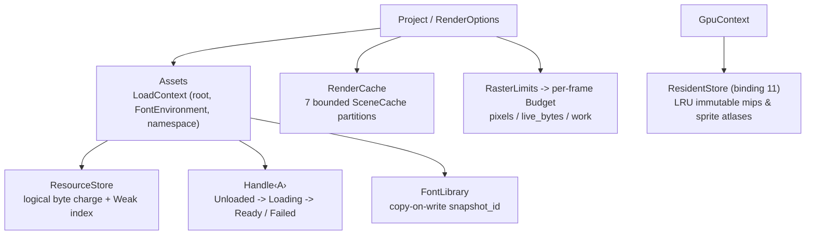

# Resources and fonts

This page records who owns resource bytes, how long they live, and what makes a cached value reusable. Nothing is read from disk, scanned from the host system, or decoded on a device unless the author explicitly requests it. Usage walkthroughs live in the [content tutorial](../tutorial/06-content.md); content-specific contracts live in [Content](content.md), admission rules in [Reliability](reliability.md), and session handoff in [Rendering and export](rendering.md#resources-and-content).

## Ownership model



| Object | Owns | Lifetime |
| --- | --- | --- |
| `Assets` | Typed entry table and `LoadContext` (absolute root, optional `FontEnvironment`, snapshot namespace) | Clones share registrations; `snapshot()` freezes resolved entries and isolates later mutations |
| `ResourceStore` | Logical byte counter and `Weak` entry index | Shared by clones; a new `Assets` owner starts with its own store unless `with_store` joins an existing one |
| `Handle<A>` | One shared entry: `Source`, sticky decode result, charged bytes | Until the last handle or owner drops; dropping releases the store charge |
| Decoded `Arc<A>` | Immutable decoded value | Can outlive every owner and handle; once handles drop, it is no longer store-accounted |
| `FontLibrary` | Font database, shaping engine, glyph/layout caches, usage log | Copy-on-write; cloned libraries share one frozen `snapshot_id` |
| `RenderCache` | Recomputable compute cache: `7` independently bounded LRU partitions | Shared by clones, sessions, and export workers until `clear` |
| `GpuContext` | Device-local immutable image/mip/atlas buffers and host comparison words | Shared by context clones; bounded LRU retention is separate from in-flight frame leases |
| `SceneCache` | Compute cache (LRU) of pure author computations keyed by call site, type, and key | Per cache instance; entries evict by LRU without invalidating held `Arc` values |

`ResourceStore` holds only `Weak` references and never pins decoded payloads on its own. `Assets::remove` unregisters a source without invalidating existing handles, and retained snapshots or handles keep their payload charged until dropped ([`asset.rs`](../../../crates/motion-core/src/asset.rs), [`handle.rs`](../../../crates/motion-core/src/asset/handle.rs), [`store.rs`](../../../crates/motion-core/src/asset/store.rs)).

## Explicit-IO policy

- **Explicit project root:** `Assets::new(root)` captures an absolute root (`std::path::absolute`) without reading or decoding anything. `Assets::default()` has an empty root: resolving a relative `Source::File` against an empty root yields a failed handle (`"require an explicit project root"`), so an empty owner never authorizes working-directory access. Relative paths containing `..` are rejected; explicit absolute paths are accepted as given.
- **Lazy registration:** `Assets::load`, `AssetsExt::image`, `Image::open`, and `Svg::open` retain only a `Source` and options. Reading and decoding happen on the first `Handle::get` (or when compiling a scene node that draws it).
- **Bounded encoded inputs:** File reads require a regular file of at most `64 MiB`, and `Asset::decode` receives `&[u8]` plus `&LoadContext`—never a filesystem path. `Source::Bytes` keys must be `1..=1,024` UTF-8 bytes without control characters, and the byte slice itself participates in equality and cache identity so reusing a key name with different bytes never returns stale data.
- **Zero implicit font discovery:** `FontLibrary::new()` starts empty and touches no files. Host fonts are available only through explicit `load_system_fonts` or `load_system_family` calls (`1..=1,024` UTF-8 bytes), which index metadata first and read selected font files on first use. Deterministic projects use `load_file`, `load_dir`, or `load_data` to freeze exact font bytes.
- **Hermetic SVG and Typst:** SVG parsing rejects DTDs, non-`data:` external `href` references, scripts, `foreignObject`, and animation elements, and requires a non-empty `FontLibrary` when `<text>` nodes appear. `FormulaCompiler::new` and `TypstCompiler::new` use bundled fonts with zero system discovery and reject imports, external files, and packages.

## Fonts

`FontLibrary` is copy-on-write: every mutation (`load_*`, `default_family`) mints a fresh `snapshot_id` and resets the shaping engine, paragraph layout cache, glyph cache, and usage log while clones keep sharing the previous snapshot.

- **Atomic registration limits:** `load_data` admits at most `4,096` faces and `256 MiB` of cumulative source bytes per library atomically—an invalid or empty payload leaves the library unchanged. `load_file` accepts regular files up to `256 MiB`, whereas lazy `FontFace` handles (`AssetsExt::font`) cap single files at `MAX_FONT_FACE_BYTES` (`32 MiB`). `load_dir` visits at most `4,096` sorted entries without following symlinked directories, loading `.ttf`, `.otf`, `.ttc`, and `.otc` files atomically. System metadata indexing (`load_system_fonts` / `load_system_family`) is capped at `65,536` faces. The first loaded face sets the default sans-serif, serif, and monospace family aliases.
- **Opaque core bridge:** `motion-core` never links a font engine; it carries an opaque `FontEnvironment` (`Arc<dyn Any + Send + Sync>` plus `snapshot_id`) that only `motion-content` downcasts ([`font.rs`](../../../crates/motion-content/src/font.rs)). `Assets::with_fonts` derives a new `Assets` view with an empty entry table so previously resolved SVGs cannot be reused across different font snapshots. A `Text` node bound with `Text::fonts` overrides the ambient `DrawContext` font environment; shaping requires one or the other.

## Cache identity

| Cache | Key components |
| --- | --- |
| `Assets` entry | Asset `TypeId`, canonical root, font `snapshot_id`, snapshot namespace, `Source` (including full `Bytes` payload) |
| Paragraph layout (`Paragraph`) | Text spans, paragraph/part styles, wrap width, font `snapshot_id` |
| Glyph outline (`Glyph`) | Font `snapshot_id`, face ID, `FontWeight`, glyph ID |
| Gradient LUT (`Gradient`) | Color stops, interpolation space, spread/extend mode |
| Coverage (`Coverage`) | Geometry path/shape, device transform, raster tolerance |
| Ink preview atlas (`Ink`) | Brush/ink material parameters, geometry, device density |
| Formula (`Formula` / `FormulaCompiler`) | Typst math source, size, family, fill, caller `revision`, `FORMULA_BACKEND_VERSION`, compiler `environment` |
| Declarative document (`declarative::CompileCache`) | Canonical document path, `(len, modified)` metadata stamp, resolved parameter overrides |
| `SceneCache` (`Scene`) | Call-site location, key `TypeId`, `Hash` + full `Eq` |
| GPU immutable resource (`ResidentStore`) | `WeakPatternImage` producer identity fast-path, else 64-bit FNV-1a hash + exact `f32::to_bits()` equality over all mip/atlas words |

- **No cross-context aliasing:** Everything that affects decoding or layout belongs to the key. Sharing a `ResourceStore` never lets `Assets` owners with different roots, namespaces, or font `snapshot_id` values alias each other's entries. `SceneCache` builders run outside cache locks and may execute more than once (concurrent misses, LRU eviction, `clear`, or zero-capacity caches), so builders must be pure.
- **GPU residency fast-path and collision cap:** Per-draw transforms, coverage, and instance headers stay out of GPU residency keys so resident mips and particle sprite atlases (binding `11`) reuse across frames. A `PatternImage` that matches an existing resident entry's `WeakPatternImage` hits immediately by identity without materializing mip words, hashing, or comparing texels; other or first-seen resources hash and verify exact bitwise `f32` equality, attaching `WeakPatternImage` on hit. At most `4` equal-hash entries (`MAX_HASH_MATCHES`) are retained; further hash collisions bypass retention (`bypasses`) rather than aliasing pixels or doing unbounded comparisons. Hits, misses, evictions, and disabled residency produce identical pixels.

## Limits and accounting

All byte limits track **logical** payload estimates rather than process RSS: allocator overhead, parser scratch buffers, driver allocations, and external `Arc` pins are excluded.

| Scope | Default allowance | Contract |
| --- | --- | --- |
| Encoded asset input | `64 MiB` | Enforced on file metadata, raw slice length, and bounded `Read::take` |
| `ResourceStore` | `256 MiB`, `4,096` entries | `with_limits(ResourceLimits)` requires `max_bytes > 0` and `1..=4,096` entries; charges `max(retained_bytes, encoded_len)` |
| Static / animated image decode | `16,384 px`/side, `16,777,216` px | Static PNG/JPEG/WebP stored as linear-premultiplied `RGBA16F` with mips; animated GIF/APNG/WebP capped at `4,096` frames and `256 MiB` decoded |
| SVG source | `8 MiB`, XML depth `64`, `100,000` nodes | DTDs, scripts, and external URLs rejected |
| `RenderCache` (`7` partitions) | `Coverage`: `2,048` / `16 MiB`<br/>`Paragraph`: `256` / `8 MiB`<br/>`Glyph`: `2,048` / `16 MiB`<br/>`Gradient`: `64` / `8 MiB`<br/>`Formula`: `32` / `32 MiB`<br/>`Ink`: `64` / `32 MiB`<br/>`Scene`: `256` / `8 MiB` | `RenderCache::with_limits` applies uniform `CacheLimits` to all `7` partitions; `fork_partition` isolates a single `CachePartition` while sharing the other `6` |
| GPU immutable residency | `64` entries, `64 MiB` | Counts host comparison words + device payload + entry overhead (`2 × payload + overhead`); `GpuContext::set_residency_limits` caps `max_entries <= 4,096`, `0` disables retention |
| `SceneCache::new` | Entry-bounded only | Byte accounting requires `SceneCache::with_limits` + `cache_with_cost`; single entries exceeding `max_bytes` return without retention |
| `FormulaCompiler` | `32` entries, `64 MiB` | Typst math source `<= 8,192 B` |
| `declarative::CompileCache` | `16` entries, `64 MiB` | Evicts LRU entries or invalidates automatically when any watched dependency file changes |
| `RasterLimits::authoring()` | `16,777,216` px, `256 MiB` live bytes, unbounded work | `RasterLimits::sandbox()` adds `max_work = 200,000,000` work units |

- **Per-frame `Budget` vs. cache retention:** [`Budget`](../../../crates/motion-core/src/budget.rs) tracks admitted raster pixels, `live_bytes` (with `peak_bytes`), and monotonic `work` for a single operation; callers release transient bytes, while `work` is never refunded. Every GPU frame conservatively admits worst-case immutable resource upload bytes and lookup/comparison work even when the `GpuContext` residency cache is warm, so cache occupancy never changes whether a frame passes admission. Conversely, an oversized resource that fits the frame's `Budget` still renders cleanly even when it exceeds `ResidentStore` retention limits.
- **In-flight GPU leases and telemetry:** Queued GPU frames hold direct `wgpu::Buffer` clones outside the mutable working-buffer pool, so LRU eviction, `clear_resources`, or `set_residency_limits` never recycles a buffer still referenced by an in-flight submission. `GpuContext::residency_stats` reports `GpuResidencyStats` (`hits`, `misses`, `upload_bytes`, `evictions`, `bypasses`, current `entries`, `retained_bytes`); clearing drops retained entries without resetting cumulative counters ([`residency.rs`](../../../crates/motion-render/src/gpu/residency.rs)).

## Deferred and eager content

| Deferred (retains `Source` / options) | Eager (executes immediately) |
| --- | --- |
| `Assets::load`, `Image::open`, `Svg::open`, `Svg::new(handle)` | `ImageAsset::from_bytes`, `SvgAsset::from_bytes_with_fonts`, `Assets::preload` |
| `Formula::typst` | `Formula::asset`, `FormulaCompiler::compile` |
| `Text` shaping during frame compilation | `Text::layout(&fonts)` for ahead-of-time measurement |

`Handle::state()` inspects `AssetState` (`Unloaded` → `Loading` → `Ready(Arc<A>)` or `Failed(Arc<Error>)`) without triggering I/O. Failures are sticky and never retried implicitly; concurrent callers coalesce onto a single decode, and a panicking decoder turns into a sticky asset error. Recursive asset resolution or nesting deeper than `64` fails deterministically. `Formula::typst` without an explicit compiler uses a process-wide bundled-font `FormulaCompiler` and therefore ignores fonts attached via `Assets::with_fonts`; pass `FormulaCompiler::with_fonts` for custom math faces.

## Threading and poisoning

`Asset`, `FontEnvironment`, `Assets`, `Handle`, `RenderCache`, and `GpuContext` are `Send + Sync`, allowing parallel CPU/GPU workers to share them without copying payloads:

- **Poison recovery:** `Assets`, `ResourceStore`, `RequestDiagnostics`, `FontUsage`, `ResidentStore`, and `FontLibrary` usage logs recover from poisoned mutexes (`lock_unpoisoned`) and continue operating on valid state.
- **Typed poison errors and invariants:** A poisoned `cosmic_text` shaping engine returns `ValidationError` (`"Font engine is poisoned"`); a poisoned formula cache returns `FormulaCompileError`; a poisoned audio clip lock returns `ValidationError`; `SceneCache` treats a poisoned lock as an internal invariant violation and panics.
- **Lock-free heavy compute:** Decoding, shaping, compilation, and `SceneCache` builders execute outside cache mutexes so slow misses never stall unrelated lookups.

## Failure and diagnostics

- **Explicit `RequestDiagnostics`:** Load errors carry both `Asset::KIND` and source identifier. `Handle::get_with` records failures into an explicit `RequestDiagnostics` sink (`loads` kept separate from scene-authoring `scene_errors`, both deduplicated by `Arc::ptr_eq` identity), with zero thread-local frame state.
- **Strict production vs. resilient Studio preview:** Production stills, CLI renders, and exports fail on the first resource or geometry error tagged with the frame index (`Error::at_frame`). Studio preview opts into `RenderOptions::allow_missing_assets(true)` (drawing a magenta placeholder for missing `Image` assets while retaining the diagnostic) and `RenderOptions::mark_invalid_geometry(true)` (marking invalid leaf geometry with a magenta square at its local origin instead of aborting the frame).
- **Deterministic font provenance:** `RenderOptions::font_usage` (`FontUsage`) logs every face actually selected during shaping with non-cryptographic source hashes, and `ExportReport::fonts` exposes the deduplicated list in deterministic order independent of worker completion order.

## Supplying assets from Studio and the CLI

Both Studio and the CLI consume the `RenderOptions` configured on `Project::render_options`, which bundle `resources: Option<Assets>`, `RenderCache`, and `RasterLimits`. Because the CLI exposes no global `--assets-root` or `--font` flags ([`cli.rs`](../../../crates/motion/src/project/cli.rs)), projects wire their asset root and fonts explicitly in code:

```rust,no_run
use motion::prelude::*;

fn main() -> motion::Result {
    let mut fonts = FontLibrary::new();
    fonts.load_file("assets/project.ttf")?;
    let assets = Assets::new("assets")?.with_fonts(fonts);
    let _options = RenderOptions::default().resources(assets);
    Ok(())
}
```

Compositions cloned from these options share the same `Assets` owner and `ResourceStore`, while individual `RenderSession` instances maintain isolated render targets.

## Owning sources

- [`crates/motion-core/src/asset.rs`](../../../crates/motion-core/src/asset.rs), [`asset/handle.rs`](../../../crates/motion-core/src/asset/handle.rs), [`asset/store.rs`](../../../crates/motion-core/src/asset/store.rs), [`asset/environment.rs`](../../../crates/motion-core/src/asset/environment.rs) — `Asset`, `Assets`, `Source`, `Handle`, `ResourceStore`, `RequestDiagnostics`, and `FontEnvironment`.
- [`crates/motion-core/src/budget.rs`](../../../crates/motion-core/src/budget.rs), [`authoring/context/cache.rs`](../../../crates/motion-core/src/authoring/context/cache.rs), [`authoring/context/partition.rs`](../../../crates/motion-core/src/authoring/context/partition.rs) — `RasterLimits`, `Budget`, `SceneCache`, `CacheLimits`, `RenderCache`, and the `7` `CachePartition` domains.
- [`crates/motion-content/src/font.rs`](../../../crates/motion-content/src/font.rs), [`asset.rs`](../../../crates/motion-content/src/asset.rs) — `FontLibrary`, copy-on-write `snapshot_id`, `ImageAsset`, `AnimatedImage`, and `SvgAsset`.
- [`crates/motion-render/src/gpu/residency.rs`](../../../crates/motion-render/src/gpu/residency.rs), [`options.rs`](../../../crates/motion-render/src/options.rs) — `GpuContext` immutable `ResidentStore`, `GpuResidencyStats`, `RenderOptions`, and `FontUsage`.
- [`crates/motion-formula/src/compiler.rs`](../../../crates/motion-formula/src/compiler.rs), [`crates/motion-scene/src/cache.rs`](../../../crates/motion-scene/src/cache.rs) — `FormulaCompiler` and declarative `CompileCache`.
