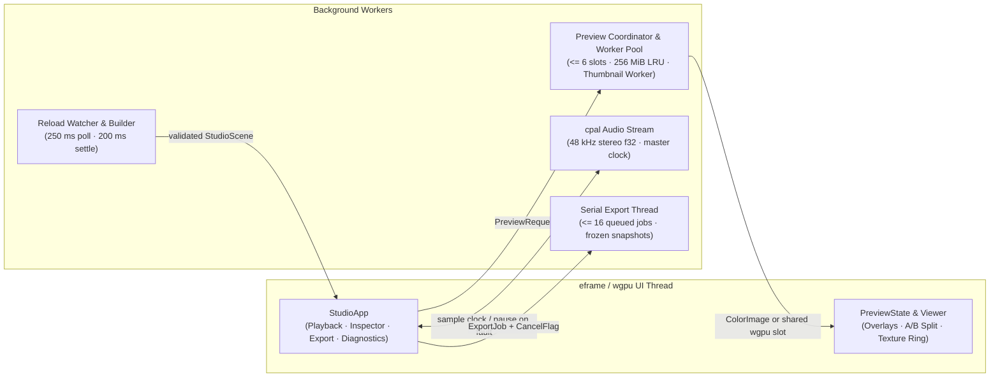

# Motion Studio

Motion Studio ([`motion-studio`](../../../crates/motion-studio/src/lib.rs), re-exported at `motion::studio` behind the `studio` Cargo feature) is the optional `egui`/`eframe` desktop workbench for inspecting, playing back and exporting compiled Rust scenes and hot-reloadable declarative documents. Enabling the `studio` feature builds the workbench without implicitly opening a window, scanning system fonts or forcing GPU scene rendering. For step-by-step authoring and CLI walkthroughs, see the [Studio tutorial](../tutorial/12-studio.md) and [CLI guide](../cli.md).

```sh
cargo run --release --features studio --example studio
cargo run --release -p motion-gallery --features studio,gpu --bin motion-gallery -- studio --demo type-in-motion
```

## Architecture and execution model

Studio is a thin interactive shell over the engine's headless contracts rather than a second rendering or export pipeline:



- **Single source of truth.** `StudioScene` binds one `Timeline` and one `Composition` render template, aligning audio to the timeline's frame grid and replacing the template's `FrameClock` with the timeline's exact rate and frame count (rejecting counts above `u32::MAX`). Preview, real-time audio playback and export all consume that same `Timeline` and share `RenderOptions`, `RenderSession` and `FrameRenderer` semantics.
- **Explicit desktop and `wgpu` host boundary.** `run` opens a native `eframe` window backed by `eframe::Renderer::Wgpu` (`1240×800` default, `900×620` minimum, composition output bounds validated in `1..=16_384`). Even when scene rendering selects `BackendPreference::Cpu`, launching the interactive window requires both a desktop display server and a compatible `wgpu` adapter for UI presentation; headless types (`StudioScene`, `AudioReadout`, `particle_presets`) require neither. Studio opens one scene per process with no in-window scene switcher.
- **UI isolation and state lifetimes.** Scene evaluation, rasterization, audio device output, file watching and encoding never run on the UI thread. `PlaybackState`, `InspectorState`, `ExportState` and `DiagnosticsState` separate control and observation lifetimes, while `PreviewState` remains independent so the viewport continues presenting the last completed frame while a newer request is in flight.
- **Per-scene cache isolation and fault containment.** Preview workers share `RenderCache` partitions across slots and settings changes while each registered scene forks an isolated `CachePartition::Scene` partition. Worker panics and GPU device loss surface as typed entries in `Diagnostics` instead of crashing the UI or silently switching backends; failures on the active main frame invalidate that scene's caches, whereas stale or speculative lookahead failures are discarded.
- **Private GPU devices vs. shared texture ring.** By default, each preview worker creates its own private GPU context and returns premultiplied `ColorImage` frames over channels so scene passes never contend with `eframe`'s surface fence lock. Setting `MOTION_STUDIO_SHARED_GPU=1` attaches preview workers to the UI's shared `wgpu` device and delivers frames through a zero-readback texture ring (`3..=12` slots per active size/device, written as sRGB bytes into `Rgba8Unorm` storage and registered with `egui` as `Rgba8UnormSrgb` views to avoid double sRGB encoding).

## Preview and playback

### Window, theme and viewer

- **Chrome and theme.** Neutral dark gray with a teal accent by default, paired with a header light/dark toggle. The header exposes render scale (`25%`, `50%`, `100%`), backend preference (`CPU` / `GPU`), audio mute and the Inspector drawer toggle (collapsed automatically below `1120 px` window width). A fixed bottom status bar reports the active backend, frame counter and worker activity.
- **Viewport navigation and backdrop modes.** Viewer zoom (`Fit`, `50%`, `100%`, `200%`) is decoupled from render scale; middle-drag or `Space`-drag pans, pinch or `Ctrl`-scroll zooms around the cursor, and trackpad scroll pans when zoomed. Four backdrop modes—`Checkerboard`, `Dark`, `White` and `Scene`—control alpha presentation: the first three keep `transparent = true` and composite the backdrop in the viewer without re-rendering when switching among them, whereas `Scene` sets `transparent = false` so workers composite over `RenderOptions::background`.
- **Interactive quality tiers.** Active playback and timeline scrubbing render at `RenderQuality::Draft` (`0.35 px` curve tolerance, single shutter sample, half-density ink and single-box blur; scrubbing also drops render scale to `25%`). Releasing a scrub restores the selected scale and schedules a `RenderQuality::Final` upgrade after `150 ms` of idle time. Exports unconditionally use `Final`.
- **Inspection (`Node bounds` and `Pixel inspector`).** Toolbar toggles control safe areas, grid, `Node bounds` and `Pixel inspector`. `Node bounds` captures a read-only compiler layout and z-order snapshot for approximate visual-bounds picking and inspects occurrence paths, transforms, filters, clips and masks. `Pixel inspector` enables explicit memory readback to inspect `sRGB8` and decoded SDR linear pixel values and to capture a reference frame for `A/B` split comparison; disabling `Pixel inspector` afterward restores zero-readback GPU preview while retaining the captured `A/B` reference.

### Timeline, scheduler and audio clock

- **Timeline and transport.** Renders tracks, clip spans, transition overlaps, an adaptive `MM:SS.mmm` / frame ruler, hover thumbnails (independent `16 MiB` / `128`-entry LRU at `<= 160×90`), a `1024`-bucket `AudioAnalysis` RMS waveform (capped at `300 s`), cached-frame intervals, user cue markers (`<= 256` cues, labels `<= 128` characters) and shared loop/export In/Out bounds (Out exclusive). Transport shortcuts bind `Space` (play/pause), `Left`/`Right` (`±1` frame, `±10` with `Shift`), `Home`/`End` (first/last frame) and `L` (loop).
- **Real-time playback scheduler.** Pressing Play waits up to `2 s` for the initial frame while neighboring frames render in parallel, then starts the clock immediately without pre-rendering the full timeline. The preview pool scales up to `6` worker slots (bounded by `cpu_threads - 1` and `2 GiB` divided by per-frame byte allowance), reserves `1` slot for interactive seeks on multi-slot pools and sizes speculative lookahead from measured worker latency. Late frames are skipped rather than slowing playback.
- **Preview frame LRU.** Retains up to `256 MiB` of logical pixel and metadata payload by default (`MOTION_STUDIO_CACHE_MIB=0..1024`; `0` disables retention and prefetch). CPU hits share immutable pixel buffers by reference without copying.
- **Audio master clock.** When audible timeline audio is present and unmuted, a background `cpal` stream outputs `48 kHz` stereo `f32` in bounded `MixedAudio` windows (up to `8192` samples per window) and drives playback time from consumed hardware frames. Silent timelines open no audio device; stream underruns or device errors pause playback with a diagnostic rather than silently drifting onto the host wall clock.

## Inspector, export queue and persistence

- **Inspector panels.** Organizes four tabs: `Export` (job configuration and queue), `Node` (picked hierarchy, transform and effect metadata), `Diagnostics` (bounded `128`-entry ring with click-to-seek and node highlight) and `Stats` (`Playback`, `Preview worker`, `Cache` and `Frame cost` sections separating GPU timestamp intervals from host wall time, with one-click plain-text copy).
- **Serial export queue.** Accepts H.264, H.265, VP9 with alpha, ProRes 4444, PNG sequences, GIF (timeline rate up to `100 fps`, otherwise `30 fps`) and single-frame PNG stills. Up to `16` queued jobs execute serially on a dedicated `motion-export` thread; each job freezes an immutable snapshot of output dimensions (`1..=16_384`), In/Out frame range, backend, shutter, codec and audio options (`PngSequence` and `Gif` strip timeline audio via `Timeline::visual()` before rendering). Up to `64` completion records retain typed errors and output-directory links. Active exports honor cooperative `CancelFlag` cancellation and transactional output replacement (see [export and FFmpeg](export.md)); closing the window cancels active work and joins worker threads before exit.
- **Session persistence.** `.motion/studio.json` (schema version `1`, hard-capped at `64 KiB`, written atomically via a same-directory temporary file) persists scene name, playhead frame, render scale, transparency, In/Out range and cue markers without auto-playing or auto-exporting on launch. Scene-specific fields (`frame`, `range`, `cues`) restore only when `scene` matches `StudioScene.name`, whereas `scale` and `transparent` restore across scenes. Audio mixer profiles save and load separately by file path without embedding media bytes.
- **Explicit non-goals.** Studio intentionally omits live Rust parameter editing, J/K/L shuttle speeds, command palettes, Tear-off/dockable floating panels, multi-scene switching and audio scrubbing.

## Hot reload

Scenes wrapped with `StudioScene::reloadable`—including declarative JSON films opened via `Project::document` or `motion studio <file.json>`—rebuild in place when watched files change:

- A background watcher polls `(modified_time, byte_len)` stamps every `250 ms`; once stamps settle for `200 ms`, the registered thread-safe loader runs off the UI thread.
- On success, Studio swaps the `StudioScene` in place, clamps the playhead, cues and In/Out range to the new frame count, preserves preview and export settings, pauses playback, clears stale frame caches and refreshes the watched file set (so newly referenced declarative assets are tracked automatically).
- On failure, the last valid scene stays interactive in the viewport while the error surfaces in the header (truncated to `600` characters) and in full inside `Diagnostics`. File edits detected while a build is already running mark the in-flight build dirty, discard its stale result on completion and immediately start a fresh settle cycle. Queued and active exports retain the scene snapshot captured when they were enqueued.

## Entry points, metering and environment

| Surface | Contract |
| --- | --- |
| `StudioScene` | Headless scene descriptor (`new`, `reloadable`, `is_reloadable`) validating frame-grid alignment and `u32` frame-index bounds before any window opens. |
| `run` | Blocking main-thread launcher validating output bounds (`1..=16_384`) and owning the `eframe` event loop and worker shutdown barrier. |
| `AudioReadout` / `BusReadout` | Headless loudness and bus-level analyzer over `MixedAudio` (`from_mix`, `exceeds`), computing integrated LUFS, sample peak dBFS, `4×` oversampled true peak dBTP, stereo correlation and `50 ms` per-bus RMS/peak levels without opening audio hardware. |
| `particles::particle_presets` | Builds ready-to-inspect `StudioScene` entries for built-in particle presets (re-exported in `motion::studio::prelude`). |
| `MOTION_STUDIO_SHARED_GPU=1` | Attaches GPU preview workers to `eframe`'s `wgpu` device via a `3..=12` slot zero-readback texture ring instead of default per-worker private devices. |
| `MOTION_STUDIO_CACHE_MIB` | Sets preview frame LRU capacity in integer MiB within `0..=1024` (default `256`; `0` disables frame retention and speculative prefetch). |

See [rendering](rendering.md), [audio](audio.md), [export and FFmpeg](export.md), [declarative documents](documents.md), [reliability](reliability.md) and [Gallery](../../../gallery/README.md).
