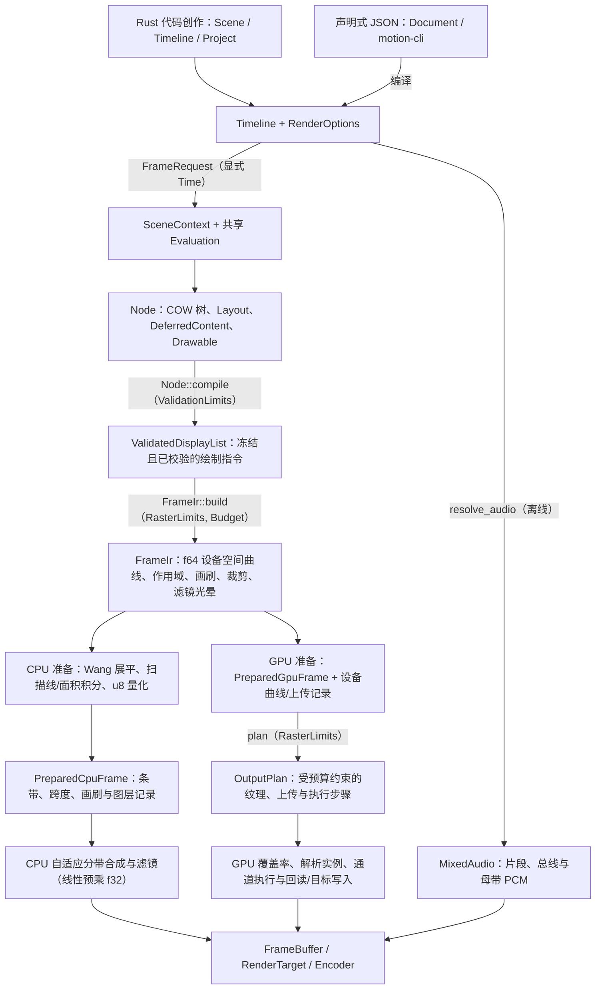
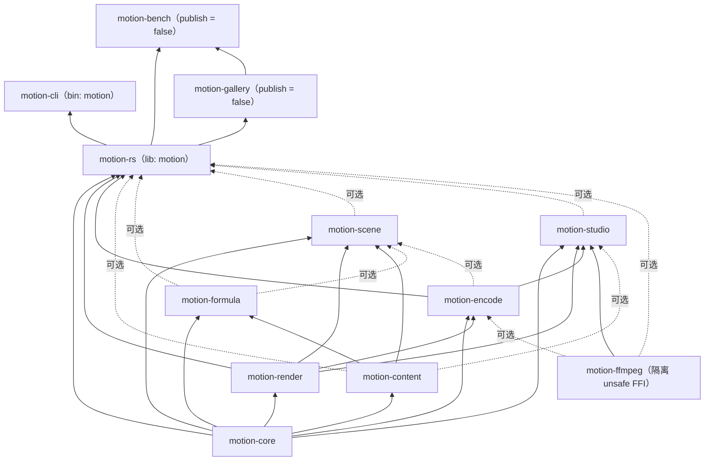

# 系统架构设计

Motion 是一个可编程 2D 视频引擎，围绕确定性的纯函数场景求值与共享渲染流水线构建，并将同一套帧语义分别交付给独立的 CPU 后端与 GPU 后端。实时预览、静帧渲染与短片导出均在显式时间点上求值完全相同的 `Timeline`，不存在隐式回放状态。

## 设计原则与边界

- **确定性与显式时间。** 画面是有符号整数 ticks（`Time`，每秒 `705,600,000` ticks）、非负时长（`Duration`）、有符号时间偏移（`TimeOffset`）、有理数帧率（`FrameRate`）、带键随机流（`Random`）与固定输入的纯函数。引擎没有全局可变状态或隐式挂钟推进；随机 Seek 跳帧与顺序导出始终生成完全一致的 `Node` 快照。
- **显式 I/O 与零环境隐式状态。** 引擎不会私下扫描目录、探测系统字体、弹出窗口、打开音频设备或自动挑选 GPU 适配器。所有资产、字体快照、缓存与共享 GPU 句柄都必须通过 `Assets`、`ResourceStore`、`FontEnvironment`、`RenderOptions` 与 `RenderContext` 显式传入。
- **不可变快照与全分支校验。** `Node` 树是不可变的写时复制（COW）结构。编译阶段完成布局测算、展开延迟内容，并对所有分支（包括零不透明度隐藏子树与屏幕外内容）执行 `ValidationLimits` 结构约束校验，随后才进入后端准备阶段。
- **先准入、后分配。** `ValidationLimits`、`Budget` 与 `RasterLimits` 在分配暂存缓冲或提交 GPU 工作前，先对结构节点出现次数、资源字节数、曲线段数与逻辑工作量执行配额准入。除隔离原生 FFI 边界的 `motion-ffmpeg` 外，所有库 crate 均强制启用 `#![forbid(unsafe_code)]`。
- **共享帧语义，独立后端执行。** 后端无关归一化阶段（`FrameIr`）一次性编码设备空间几何、作用域、画刷、裁剪与滤镜域。CPU 后端与 GPU 后端各自独立消费这份不可变语义，既不共享覆盖率缓冲区，也不要求跨后端像素逐比特一致。

## 端到端流水线

Rust 代码创作（`Project`、`Timeline`、`Scene`）与声明式 JSON 文档（`motion::declarative::Document` / `motion-cli`）编译至同一套 `Timeline` 契约；时间轴音频则在场景求值之外走独立的无状态离线准备路径：

### 各阶段数值与色彩精度边界

| 阶段 | 表示形式与契约 |
| --- | --- |
| 时间计量 | 精确 `i64`/`u64` ticks（`TICKS_PER_SECOND = 705_600_000`）与有理数 `FrameRate`；每个帧边界独立换算，不累加浮点秒数 |
| 创作与归一化 | `f64` 逻辑坐标（左上角原点，`+x` 向右、`+y` 向下）、弧度、动画进度、布局与 `FrameIr` 设备空间曲线；`Transform` 保持仿射变换，`Perspective` 仅对平面 2.5D 路径几何做透视投影 |
| 内部工作合成 | CPU 分带暂存与 GPU 池化工作/遮罩/保存源纹理统一采用有限的线性 sRGB 预乘 `f32`（GPU 为 `RGBA32F`，图像 Mip 为 `RGBA16F`）；`Color` 存储有限扩展编码 sRGB `f32` |
| 输出交付边界 | 按显式 `PixelFormat` 量化输出：`LinearRgba32Float`、`LinearRgba16Float`、`SrgbRgba8 { premultiplied }` 或 8/10-bit BT.709 有限范围 `Yuv420` |

### 1. 场景求值与编译

`SceneContext` 提供有符号的局部/全局 ticks、片段时长、有理数 `FrameRate`、逻辑设计边界、带键 `Random` 流、面向创作者的 `SceneCache`，以及共享的 `Arc<Evaluation>`（内含 `RenderQuality`、`Assets`、`FontEnvironment`、`RequestDiagnostics` 与 `RenderCache`）。`Scene` 回调返回不可变 `Node` 快照（或可失败的 `IntoSceneOutput`）。`Row` 与 `Column` 按插入顺序解析确定性布局；`SceneContext::measure` 将共享 `Evaluation` 连同局部时间交给 `DrawContext`；`Camera` 施加逆视图变换；`Skeleton` 在创作空间求解 2D 正向运动学。

动态文本、SVG 与 Typst 公式共享同一套基于不可变 `CompileCache` 键、`VectorTree`、`VectorSelection` 与弧长揭示 `VectorTree::reveal` 的 `DeferredContent` 管线，而非各自维护独立的特效引擎。`Node::compile` 在录制指令的同时完成结构不变量与 `ValidationLimits` 校验，产出 `Arc` 共享的 `ValidatedDisplayList`（而 `DisplayList` 作为可编辑的底层指令缓冲保留）。图像画刷引用不可变的 `ImagePixels`，程序化 `Paint::Mesh` 与 `AtmospherePaint` 则保留有界数学描述并由双端独立求值，渲染后端内部不存在延迟位图生成回调。`ValidatedDisplayList` 仅证明结构合法，不等同于设备可用或光栅预算充足。详见[核心创作模型](core.md)与[内容契约](content.md)。

### 2. 后端无关归一化（`FrameIr`）

`FrameIr::build` 在分配任何像素覆盖率之前，对 `ValidatedDisplayList` 执行二次校验、通过 `Budget` 核算 `RasterLimits`，并归一化有序作用域、画刷与裁剪引用、保守的嵌套滤镜依赖光晕（平级兄弟滤镜不叠加光晕）、带内边距尺寸以及输出视口窗口。

`FrameIr` 保留 `f64` 设备空间曲线、保守的 Wang 二阶导数线段上界与已准入资源字节数，但不生成覆盖率。局部几何配方保留了 CPU 变换算术与规范化的覆盖率缓存标识。由于活跃 `FrameIr` 存储与后端准备暂存区生命周期重叠，二者同时计入单帧逻辑峰值预算。通过结构与几何校验后，零不透明度图层作用域会被标记为隐藏：双端均跳过其中的填充覆盖率生成，不消耗填充、像素或覆盖率工作量上限。

### 3. 后端准备、规划与执行

CPU 后端与 GPU 后端各自直接消费不可变的 `FrameIr`，互不依赖对方的输出：

- **CPU 后端（`RenderPrepare` / `PreparedCpuFrame`）。** 按向上取偶的 Wang 步长细分曲线，以最多 4 行为一组扫描边表——当区间内边序可证明无交叉时走前缀和快速路径，否则回退到逐行 `f64` 梯形面积积分——并单次量化为 `u8` 条带（Strip）与合并的全覆盖跨度（Span），轴对齐矩形走专用解析路径。普通路径与字形轮廓采用保留亚像素相位的规范化设备原点缓存键，裁剪与超大坐标使用原始键；会话级暂存向量在缓存未命中之间最多保留每向量 1 MiB 空闲容量。合成阶段以全宽度自适应分带（默认 16 行，随嵌套滤镜光晕扩展，在字节预算紧张时自动收缩）在标量线性预乘 `f32` 中执行，并在写出前逐像素检查有限性。
- **GPU 后端（`PreparedGpuFrame` → `OutputPlan` → `gpu/execute`）。** 为符合条件的填充独立生成设备曲线描述符与 `f32` 瓦片覆盖率上传数据，为不符合条件的复杂路径与裁剪保留显式 CPU 覆盖率。无设备依赖的规划阶段（`gpu/plan`，通过 `PreparedGpuFrame::plan` 暴露）会整体跳过零不透明度作用域（不为隐藏子树分配滤镜、遮罩或合成通道），并在触碰 `wgpu` 设备前完成上传缓冲、池化 `RGBA32F` 工作纹理、暂存区与打包输出副本的预算准入。执行阶段（`gpu/execute`）解耦为命令编码与打包（`submission`）、GPU 曲线展平与瓦片覆盖率（`device_coverage`）、闭式解析轨迹 GPU 求值（`analytic`）、纹理上传与混合/滤镜通道（`textures`）、16×16 保序瓦片分箱（`particles`）、围栏完成与池回收（`pending`）以及有界保序在途调度（`queue`）。
- **实例与粒子协议分层。** `Canvas::instances` 录制受 `MAX_INSTANCE_COUNT`（`1,048,576`）约束的 `InstanceBatch`。任意自定义轨迹与固定步长物理模拟在确定性的 Rust 侧求值，通过 `InstanceUpload` 上传经校验的 12 字（48 字节 `InstanceRecord`）或 16 字（64 字节 `ExtendedInstanceRecord`）图元载荷，不可变精灵图集独立缓存在 `GpuContext` 中而无需随每次绘制重复上传。符合条件的内置闭式轨迹则可提供 `AnalyticInstanceUpload` 描述符，在 GPU 上直接求值为图元记录，再衔接 48 字节局部支撑计算与保序 16×16 瓦片合成；超出单精度范围的批次记录诊断回退计数而不切换渲染后端。详见[粒子实例契约](particles.md)与[渲染与导出](rendering.md)。

### 4. 合成、快门采样与显示变换

`RenderOptions` 承载会话级策略（`RenderQuality`、输出 `PixelSize`、`background`、`BlendSpace`、`MotionBlur`、`ShutterSampling`、`DisplayTransform`、`allow_missing_assets`、`mark_invalid_geometry`、`BackendPreference`、可选 `GpuContext`、`Assets`、`RenderContext`、`RenderCache`、`RasterLimits` 与 `FontUsage`）。`RenderSession` 持有可复用后端状态、暂存内存池与单帧 `RequestDiagnostics`；`FrameRequest` 按帧索引或精确 `Time` 寻址单帧；`FrameRenderer` 将 `RenderSession` 绑定到 `Composition` 的 `FrameClock`。

全帧 `MotionBlur` 与 `ShutterSampling` 先在线性预乘 `f32` 空间完成确定性的子帧采样累加，随后由 `DisplayTransform` 按固定顺序处理：`exposure_stops` → 场景线性 `Cdl`（`look`）→ 可选 `look_lut` → `ToneMap`（含可选 `reference_white`）→ `saturation` → 可选 `display_lut` → `OutputTransfer`（`Srgb` 或 `Gamma24`）→ 基于输出绝对坐标定种的 `FilmGrain`。`Look` 将场景侧 `SceneEffects`（`Optics`、`DepthOfField`、`GateWeave`、快门与滤镜）与输出侧 `DisplayTransform` 组合为可复用配方。

### 5. 输出表面、音频与事务性编码

渲染帧与预混音通过三类显式契约交付：

- **`FrameBuffer`。** 透明静帧（`render_still`）或带背底不透明帧（`Composition::render_frame`）对应的直通 `SrgbRgba8` 缓冲，或显式 `PixelFormat` 平面（`LinearRgba16Float`、`LinearRgba32Float`、`SrgbRgba8`、8/10-bit `Yuv420`）。编码输出平面在 `Drop` 时归还至独立有界的共享内存池。单帧直写方法（`save_png`、`write_ppm`、`write_rgb`）直接定义在 `FrameBuffer` 上，不经过视频导出的事务覆盖策略。
- **`RenderTarget`。** 借用的外部内存切片（仅在整帧渲染成功后替换）或经当前设备校验的外部 `wgpu` 纹理（原地写入）。在 [Studio](studio.md) 中，预览工作线程默认为每个会话使用私有 GPU 设备并上传预乘 `ColorImage`，以避免与 `eframe` 主表面围栏锁竞争；设置 `MOTION_STUDIO_SHARED_GPU=1` 后则切换至 UI 共享的 `wgpu` 设备，直接写入零 CPU 回读的纹理环。
- **`Encoder` 与 `MixedAudio`。** `motion-encode` 按有序阶段（`Preparing` → `Rendering` → `Finalizing` → `Completed`）驱动纯 Rust 的 `PngSequenceEncoder`、`GifEncoder`、可选进程内原生 `FfmpegEncoder`（通过 `motion-ffmpeg` 调用 `libav*` 支持 `H264`、8/10-bit `H265`、可选透明通道的 `Vp9` 与 `ProRes4444`，绝不派生 `ffmpeg` 子进程）以及自定义 `Encoder`。内置文件导出先写入同目录临时文件，仅在完成编码器冲洗与取消检查后才原子提交。时间轴音频通过 `Timeline::resolve_audio` 与 `MixedAudio` 离线解析（逐片段源采样率特效、重采样、包络、有序总线、闪避与母带链），在独立编码线程中送入原生复用器，或驱动 Studio 的 `cpal` 实时预览时钟。详见[导出与 FFmpeg](export.md) 与[音频系统](audio.md)。

## 所有权、缓存与执行边界

- **资源与字体快照。** `Assets` 在显式 `ResourceStore`（`Weak` 索引加逻辑字节计数器）内统一管理预加载值与惰性强类型 `Handle<A>`。独立的存储隔离不同工程；克隆共享已解析条目，而修改或调用 `with_fonts` 会派生新的快照标识。相对路径读取要求显式指定项目根目录。`FontLibrary` 初始为空；显式注册的字体字节通过写时复制 `snapshot_id` 冻结，显式请求的系统字体探测仅索引元数据并按需惰性读取选中的字体源。`ExportReport.fonts` 记录来自 `FontUsage` 的非密码学源字节哈希以便溯源审计。`RequestDiagnostics` 通过 `Handle::get_with` 显式传递后台加载失败，不存在隐式帧级线程局部变量。详见[资源管理](resources.md)。
- **七分区计算缓存。** `RenderOptions.cache`（`RenderCache`）是由 7 个独立受条目数与逻辑字节上限约束的 LRU `SceneCache` 分区（`CachePartition`）组成的可克隆缓存：`Coverage`、`Paragraph`（供 `SceneContext::measure` 与 `cache_layout` 使用）、`Glyph`、`Gradient`、`Formula`、`Ink` 与 `Scene`。求值计算在缓存锁外执行，缓存项均为纯函数可重算结果。Studio 会为每个注册场景独立 `fork` `CachePartition::Scene`，同时跨预览工作线程与设置变更共享其余 6 个分区。
- **逻辑配额与物理内存边界。** `ValidationLimits` 按结构节点出现次数而非唯一 `Arc` 指针计数，因此共享子树不会绕过场景复杂度上限。`RasterLimits` 约束已准入的逻辑工作量与同时存活的载荷字节数（默认 `RasterLimits::authoring()` 不设工作量上限，`RasterLimits::sandbox()` 额外施加 `200,000,000` 单位上限），它不是操作系统进程 RSS 硬上限、GPU 驱动分配器钩子或不可信回调沙箱。
- **失败、Panic 与设备规则。** 无头场景求值同步运行并直接向上传播用户回调中的 panic；Studio 工作线程通过 `catch_unwind` 捕获 panic 并保留强类型 `Error` 诊断，普通数据锁通过 `motion_core::sync` 恢复，而状态未知的第三方字体塑形器锁中毒则转为校验错误。预览请求允许合并丢弃，导出则严格渲染每一选中帧（依据第 0 帧逻辑峰值划分有界并行工作槽位，遇到更大后续帧时串行重试）。共享 `GpuContext` 在同一设备上序列化带作用域的提交；GPU 不可用或设备丢失时直接中止当前帧并返回 `Error`，绝不静默回退到 CPU 后端。详见[系统可靠性](reliability.md)。

## 包与特性管理

工作区根目录为虚包清单，默认成员为 [crates/motion](../../../crates/motion/Cargo.toml)（包名 `motion-rs`，库名 `motion`）。内部依赖严格单向自底向上流动，底层 crate 严禁反向依赖 facade：

| 包名称 | 职责范围 | 引擎内部依赖 |
| --- | --- | --- |
| [`motion-core`](../../../crates/motion-core/src/lib.rs) | 时间、几何、动画、`Scene`/`Node`/`Layout`/`Timeline`、绘制指令、预算、资源、实例与音频描述；可选 `serde`/`schema` | 无 |
| [`motion-render`](../../../crates/motion-render/src/lib.rs) | `FrameIr`、CPU/GPU 准备、规划与执行、滤镜、渲染会话、`FrameBuffer`/`RenderTarget`、`DisplayTransform` 与 `Look` | `motion-core` |
| [`motion-content`](../../../crates/motion-content/src/lib.rs) | 图像、字体/文本、SVG、`VectorTree`/变形、粒子、LUT 加载器及可选 `ink`/`diagram`/`captions`；可选 `serde`/`schema` | `motion-core` |
| [`motion-formula`](../../../crates/motion-formula/src/lib.rs) | 进程内 Typst 文档/数学公式编译、选择与公式变形 | `motion-core`, `motion-content` |
| [`motion-encode`](../../../crates/motion-encode/src/lib.rs) | 离线 `MixedAudio` 混音准备、进度/取消控制与事务性 PNG/GIF/FFmpeg 导出 | `motion-core`, `motion-render`；可选 `motion-ffmpeg` |
| [`motion-scene`](../../../crates/motion-scene/src/lib.rs) | 版本化声明式 JSON `Document` 数据模型、JSON Schema 与到 `Timeline` 的编译 | `motion-core`, `motion-render`, `motion-content`；可选 `motion-formula`, `motion-encode` |
| [`motion-studio`](../../../crates/motion-studio/src/lib.rs) | 原生 `egui`/`eframe` 桌面预览、`cpal` 实时播放、检查器与导出工作台 | `motion-core`, `motion-render`, `motion-encode`, `motion-ffmpeg`；可选 `motion-content` |
| [`motion-rs`](../../../crates/motion/src/lib.rs) | 公开 facade（`motion`）、五类导入命名空间、`Project` CLI 语法与 `VisualCheckPolicy` | 按特性选择的上述工作区 crate |
| [`motion-ffmpeg`](../../../crates/motion-ffmpeg/src/lib.rs) | 原生 `libav*` 绑定（`bindgen`）与线程隔离的编解码、复用与音频上下文 | 无 |
| [`motion-cli`](../../../crates/motion-cli/src/main.rs) | 轻量 `motion` 可执行程序，将声明式 JSON 工作流委托给 `motion::Project` | `motion-rs` |
| [`motion-bench`](../../../crates/motion-bench/Cargo.toml) | 未发布的 Criterion、阶段、广度与短片基准套件及数据溯源 `build.rs` | `motion-rs`, `motion-gallery`；可选 `motion-core` |
| [`motion-gallery`](../../../gallery/Cargo.toml) | 未发布的示范短片集与黄金图像/JSON 演示 | `motion-rs`；可选 `motion-ffmpeg` |

### Facade 公开命名空间

仅有 `motion-rs`（[`crates/motion/src/lib.rs`](../../../crates/motion/src/lib.rs)）负责装配公开创作命名空间；内部 crate 直接按路径私有导入上游符号，从不导入 `prelude` 或对上游根模块做通配重导出：

- `motion::prelude`：日常创作值类型、`Project`、`render_still`、`export`、`RenderOptions` 与 `ExportOptions`（`ink`、`diagram`、`captions`、`particles` 等可选专项工具保留在各自命名空间内，不进入 `prelude`）。
- `motion::extend`：开放扩展协议与实例记录（`Drawable`、`DeferredContent`、`Transition`、`Asset`、`AudioSource`、`RenderPrepare`、`Encoder`、`ProgressSink` 及实例协议）。
- `motion::render`：显式底层命令（`DisplayList`、`ValidatedDisplayList`）、预算与限额、`Composition`、`RenderSession`、`FrameRequest`、`FrameRenderer`、`PixelFormat` 与 `GpuContext`。
- `motion::encode`：具体编码器（`FfmpegEncoder`、`GifEncoder`、`PngSequenceEncoder`）、`EncoderFactory`、`ExportPhase`、`ExportReport`、`MixedAudio` 与 `PcmBuffer`。
- `motion::eager`：显式预求值编译接口（`CompileCache`、`VectorTree`、`Morph`、`MorphPath`、`ParagraphLayout`、`FormulaCompiler`）。

### Cargo 特性边界

facade 默认启用 `gpu,image,svg,text,particles,ffmpeg,studio,ink,diagram,captions,declarative`（`docs.rs` 构建移除了需要原生开发库的 `ffmpeg` 与 `studio`，并开启 `audio`）。启用编译特性仅开放对应的类型与编解码能力，不会在运行时隐式挑选 GPU、扫描系统字体、弹出桌面窗口或启动音频输出。

| 特性 | 能力与依赖边界 |
| --- | --- |
| `vector` | 启用 `motion-content` 矢量树、`Morph`/`MorphPath`、LUT 加载器与 `Image` 布局契约，不含光栅图像解码、字体与粒子 |
| `image` | 包含 `vector`；启用 PNG/JPEG/WebP/GIF 光栅解码与 `AnimatedImage` |
| `text` | 包含 `image`；启用 `FontLibrary`、`cosmic-text` 塑形与 `skrifa` 字形轮廓提取 |
| `svg` | 包含 `image` 与 `text`；通过 `usvg` 解析层（不使用 `resvg` 位图渲染）转换为共享矢量/绘制命令节点 |
| `particles` | 包含 `image`（独立于 `text`）；启用 `particles` 发射器、力场、固定步长模拟与粒子样式 |
| `ink` | 包含 `image`；在 `ink` / `vector::ink` 下暴露确定性笔刷描边、纸张纹理与颜料混合 |
| `diagram` / `captions` | 包含 `text`；暴露命名空间化的图表比例尺与 SRT/字幕轨道模块 |
| `typst` / `formula` | `typst` 使用内置字体通过 `motion-formula` 在进程内编译受信任标记；`formula` 包含 `typst` 并增加数学公式选择与变形 |
| `audio` / `ffmpeg` | `audio` 启用纯 Rust `symphonia`/`rubato`/`rustfft` 解码、混音与分析；`ffmpeg` 包含 `audio` 并链接原生 `motion-ffmpeg` |
| `gpu` | 在 `motion-render`、`motion-encode` 及已启用的 content/formula/studio crate 中开启 `wgpu`（Metal、Vulkan、DX12）后端 |
| `studio` | 包含 `ffmpeg` 并启用 `motion-studio`，但不会强制将场景切换到 GPU 后端 |
| `declarative` | 启用 `motion-scene`（`motion::declarative`），为 `motion-core` 与 `motion-content` 纯值策略类型开启 `serde` + `schema` 而不强制拉起可选内容引擎；已激活的内容特性会自动转发至 `motion-scene` |

## 源码布局与结构不变量

仓库级的目录与架构约束由 [`tools/check-structure.cjs`](../../../tools/check-structure.cjs) 与 [`tools/check-expects.cjs`](../../../tools/check-expects.cjs) 离线静态检查强制守护：

- **模块文件规范。** 统一采用 Rust 2024 现代模块布局（`foo.rs` + `foo/bar.rs`，禁止 `mod.rs`）。每个非测试 `.rs` 文件首行以大写字母开头的 `//!` 模块摘要起始，`mod` 与 `use` 声明置于顶部，`#[cfg(test)]` 测试模块置于文件末尾，且实现代码严格控制在 **800 行**以内（大型单测拆分至同级 `tests.rs`，跨包集成测试位于 `crates/motion/tests/`）。
- **核心目录职责。**
  - `motion-core/src/`：`time`、`geometry`、`path2d`（含 `boolean` 与 `morph`）、`shape`、`color`、`grading`、`optics`、`noise`、`animation`、`authoring`（`scene`、`node`、`modifiers`、`layout`、`context`、`compile`、`camera`、`skeleton`、`timeline`、`transition`）、`drawing`、`display_list`、`instances`、`asset`、`audio`、`budget` 与 `validation`。
  - `motion-render/src/`：`raster`（`frame_ir`、`paint`、`prepare`）、`prepared`、`cpu`（扫描线、覆盖率缓存、混合、裁剪、遮罩、滤镜、输出、内存池）、`gpu`（`abi`、`layout`、`context`、`residency`、`raster`、`plan`、`execute`）、`composition`、`display`、`look`、`options` 与 `output`。
  - `motion-content/src/` 与 `motion-formula/src/`：各领域内容模块（`image`、`font`、`text`、`svg`、`vector` + `vector/ink`、`particles`、`diagram`、`captions`）以及 Typst `compiler`、`frame`、`operations` 与 `typst_asset`。
  - `motion-encode/src/`、`motion-scene/src/` 与 `motion-studio/src/`：`audio`、`encoder`（`png`、`gif`、`ffmpeg`）与 `export`；声明式数据模型与 `compile/*`；以及桌面工作台 `app`、`preview`、`playback`、`timeline_ui`、`viewer`、`panels`、`audio` 与 `export`。
- **内存安全与 Panic 纪律。** 仅 `motion-ffmpeg` 允许 `unsafe` 且每个块必须附带 `// SAFETY:` 证明注释；宿主侧与 WGSL 着色器的 ABI 内存布局由 [`crates/motion-render/src/gpu/layout.rs`](../../../crates/motion-render/src/gpu/layout.rs) 静态断言对齐；生产代码中的每一处 `.expect(...)` 都必须在 `tools/check-expects.cjs` 中登记理由。

日常创作与扩展开发示例见[教程指南](../tutorial/README.md)与[架构与扩展章节](../tutorial/14-architecture-and-extending.md)，`Project` 与 `motion` 命令参数见[命令行参考](../cli.md)，独立特性矩阵与固件校验见[开发指南](../development.md)，性能评测方法见[性能基准](../benchmarks.md)。
