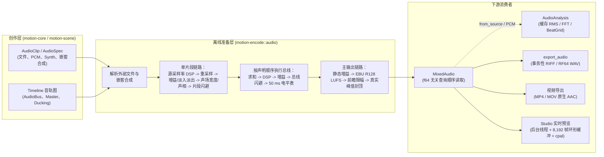

# 音频系统设计契约

音频系统严格解耦为纯声明式的创作描述与离线的确定性准备流水线。这两层均不触碰任何物理音频播放设备；实时音频输出仅作为独立消费者存在于桌面端 Studio 中。具体函数签名见 Rustdoc；本页记录所有权归属、配额上限、信号流顺序、确定性与故障容错契约。资产级上下文见[内容系统](content.md#创作工具与音频处理)，音视频封装与原子提交规则见[导出与 FFmpeg](export.md)。

## 所有权分层

| 层级 | 所属 Crate | 核心职责与拥有类型 |
| --- | --- | --- |
| 核心描述层 | [`motion-core`](../../../crates/motion-core/src/audio.rs) | `AudioSource`、`AudioClip`、`AudioBus`、`Master`、`Limiter`、`Loudness`、`Duck` / `Ducking`、`PanLaw`、`AudioEffect`、`AudioMetadata`、`ResolvedAudio`；仅负责结构描述与静态校验，不含 I/O 或 DSP 状态 |
| 声明式文档层 | [`motion-scene`](../../../crates/motion-scene/src/audio.rs) | `AudioSpec`、`SpatialSpec`、`BusSpec`、`MasterSpec`、`EffectSpec`、`DuckSpec`；负责 JSON Schema 校验并降级为 `Timeline` 音轨 |
| 离线准备与 DSP | [`motion-encode`](../../../crates/motion-encode/src/audio.rs) | `PcmBuffer`、`MixedAudio`、`BusMeter`、`LoudnessReport`、源时间变换、重采样、内置 `Effect` / `AnimatedEq`、`Synth`、`AudioAnalysis`、`WaveformPyramid`、事务性 `export_audio` |
| 交互式预览层 | [`motion-studio`](../../../crates/motion-studio/src/audio/preview.rs) | 后台混音线程、无锁播放环形缓冲区、`cpal` 音频流生命周期、`AudioReadout` 读数模型 |

- **无状态随机寻址数据源**：`AudioSource` 是纯函数式、支持并发（`Send + Sync`）、支持随机寻址的交错 `f32` 读取接口。重复读取绝不依赖先前的读取历史；短读与 EOF 尾部以静音补齐；返回非有限浮点数会被直接拒绝。混音器支持单声道（`1`）与双声道立体声（`2`）。
- **延迟解析事件**：`AudioClip::file` 与 `AudioClip::composition` 在构建场景时仅记录路径或嵌套 `Timeline`，不打开文件也不解码媒体。`Timeline::resolve_audio` 在不修改原 `Timeline` 的前提下生成 `ResolvedAudio` 快照，`MixedAudio::new` 仅在执行边界（导出、独立混音、Studio 预览或时长对齐）处解析延迟源。嵌套音频合成深度上限为 `16` 层。
- **显式时间轴贴合**：当 `Timeline` 开启 `fit_to_audio` 时，`audio::fitted` 会将有效时间轴时长扩展至完整覆盖所有已解析音频片段及效果器尾音，而绝不篡改已声明的视觉场景；在尾部音频播放完毕前，视觉轨道保持最后一帧定格。

## 配额与阈值限制

| 限制项 | 允许阈值 | 校验位置 |
| --- | --- | --- |
| 数据源采样率 / 声道数 | `1..=192,000 Hz`，单声道（`1`）或立体声（`2`） | `AudioClip::resolved_duration`、`PcmBuffer::new` |
| 单次混音 / WAV 导出 / Studio 列表片段数 | `256`（`MAX_CLIPS`） | `MixedAudio::new`、Studio 音频设置 |
| 总线数 / 单链效果器数 / 单目标闪避源数 | `16` / `16` / `4` | `Timeline` 校验、`AudioClip::resolved_duration` |
| 总线名称长度 / 嵌套合成深度 | `1..=128` 字节 / `16` 层 | `AudioClip`、`prepare_timeline` |
| 效果器尾音时长（Tail） | `0..=30 s`（作为静音输入追加至事件时长） | `AudioClip::resolved_duration` |
| 声明的时间跨度上限 | `<= 86,400 s`（`24 h`） | 片段、循环、ADSR 与混音校验 |
| 音量增益 / 声相 / 立体声宽度 | `0..=16` / `-1..=1` / `0..=2` | `AudioClip::resolved_duration` |
| 空间衰减系数 / 声场宽度 | `0..=1,000` / 有限正数设计单位 | `AudioClip::spatial`、`SpatialSpec` |
| 变速变调 / WSOLA 时间伸缩 / 移调 | `0.25..=4.0` 倍 / `0.25..=4.0` 倍（相关运算上限 `128,000,000` 次） / `-12..=12` 半音 | `SpeedSource`、`PcmBuffer::time_stretch`、`PcmBuffer::pitch_shift` |
| 内存常驻 PCM 缓冲区 | `32 Mi` 个 `f32` 采样点 = `128 MiB`（`MAX_SAMPLES`） | `PcmBuffer`、混音、总线子混音、快照、重采样暂存 |
| 编码音频输入体积 | `64 MiB`（`MAX_ENCODED_BYTES`） | `PcmBuffer::from_bytes` / `open` |
| 总线电平表 / 分析缓存 | `16 MiB` 电平迹线；每个 `PcmBuffer` 最多 `16` 条迹线或 `64 MiB`（`<= 1,000,000` 点） | `process_buses`、`AudioAnalysis` |
| 元数据限制 | `64` 个标签、`4,096` 个章节、`4,096` 字节文本 | `AudioMetadata::validate` |
| 输出采样率 | `1..=192,000 Hz`（`MixedAudio`）；`8,000..=192,000 Hz`（WAV）；`44,100` / `48,000` / `96,000 Hz`（视频 AAC） | `MixedAudio`、`AudioExportOptions`、`ExportOptions` |

上述配额限定单次产物分配与算法工作量，而非操作系统进程级 RSS 上限。超限请求一律返回 `ValidationError`，绝不静默截断。

## 播放事件、源时间变换与二维空间定位

- **独立的片段时钟**：`AudioClip` 在共享 `AudioSource` 之上定义时间轴 `start`、源内 `offset`、可选 `duration`（或 `trim(start, end)`）、外层场景裁剪上限 `limit`、线性 `volume`、`fade_in` / `fade_out`（重叠淡入淡出按乘法叠加），以及在片段局部时钟上采样的 `volume_envelope` 与 `pan_animation`（`Signal<f64>`）。
- **源时间变换（`AudioClipExt` 与 `PcmBuffer`）**：
  - `ReverseSource`（`.reverse()`）在不修改共享 PCM 内存的前提下对有界音频源做精确帧索引反转。
  - `SpeedSource`（`.speed(factor)`）使用无状态的 33 抽头汉宁窗 Sinc 核在 `0.25..=4.0` 范围内重采样，联动改变播放速度与音高。
  - `LoopSource`（`.loop_until(duration, crossfade)`）在 `86,400 s` 上限内循环有界片段，并在接缝处执行等功率交叉淡化（`crossfade < 0.5 * region`）；`.crossfade` 以等功率曲线衔接相邻双片段。
  - `PcmBuffer::time_stretch` 基于单声道互相关执行确定性 WSOLA（波形相似重叠相加）时间伸缩（`0.25..=4.0`，变速不变调）；`PcmBuffer::pitch_shift` 将 `SpeedSource` 与反向 WSOLA 时间伸缩组合，实现在精确保持总采样帧数不变的前提下移调 `-12..=12` 个半音。
- **屏幕坐标联动的二维空间定位**：`AudioClip::spatial`（及声明式 `SpatialSpec`）根据动态二维点 `Point` 相对听者坐标 `listener` 与声场半径 `width` 的偏移，计算局部时钟声相（`[-1, 1]`）与反比距离衰减（`rolloff` 范围 `0..=1,000`），并与已有音量包络相乘。该模型是显式的二维平面映射，而非三维 HRTF 或房间声学仿真。

## 准备与信号流顺序

`MixedAudio::new` 针对每个片段依次执行：

1. 在**源原生采样率**下读取源时间窗口（含效果器尾音所需的静音扩展）。
2. 在源原生采样率下按序运行片段的 `effects` 效果器链。
3. 若源采样率与目标混音采样率不同，重采样至目标混音采样率。
4. 应用静态 `volume`、片段局部 `volume_envelope` 以及线性 `fade_in` / `fade_out`。
5. 应用 Mid/Side `stereo_width`（`1.0` 保持原立体声像，`0.0` 折叠为单声道）及 `pan` / `pan_animation`。单声道源固定采用等功率声相；立体声平衡支持 `PanLaw::ConstantPower`（默认）、`PanLaw::Minus4_5dB`（两者在中心点均归一化为单位增益）或 `PanLaw::Linear`（仅衰减对侧声道）。
6. 应用片段级侧链闪避 `ducking`，保存为不可变的 `PreparedClip`。

随后针对整条混音统一执行一次：

1. **总线处理（`process_buses`）**：严格按声明顺序执行。每条 `AudioBus` 累加归属片段、运行总线 `effects`、应用静态增益、执行总线级 `ducking`，并记录 `50 ms` RMS 与采样峰值 `BusMeter` 迹线。未指定总线的片段直通主输出；引用未声明总线直接校验报错。
2. **侧链闪避隔离**：所有闪避触发源（Trigger）均在目标信号衰减前完整渲染完毕。总线触发源的声明顺序必须早于被闪避总线；片段触发源在自身增益与声相下独立渲染，且忽略其自身的闪避配置。峰值保持检测、启动时间（Attack）、释放时间（Release）与前瞻窗口在完整触发包络上离线运行。
3. **主输出链路（`MixedAudio::apply_master`）**：静态 `gain_db`（`-96..=24 dB`） -> 可选的 EBU R128 带门限积分响度归一化（`Loudness`，目标 `-70..=-5 LUFS` 并附带真实峰值上限） -> 可选的前瞻限幅器（`Limiter`，前瞻 `<= 20 ms`，`(0, 2] s` 线性增益恢复） -> 4 倍过采样带窗 Sinc 重建真实峰值（True Peak）封顶修正。`Master::default()` 为恒等直通（绝不自动归一化峰值）；`Master::safe()` 启用 `-1.0 dBFS` 封顶限幅器（`5 ms` 前瞻、`100 ms` 释放）而不做响度归一化。

## 离线效果器与尾音机制

`AudioEffect::process` 从全零初始状态接收完整交错缓冲区。滤波器与动态处理器的状态仅存在于离线准备阶段：混音器将每个片段或总线从其起点一次性运算完毕并缓存样本，后续随机寻址读取绝不会触发 IIR 滤波器冷启动瞬态误差。

- **内置 DSP（`Effect` 与 `AnimatedEq`）**：RBJ 双二阶 `Eq`（`HighPass`、`LowPass`、`Peak`、`LowShelf`、`HighShelf`、`Notch`，`Q` 范围 `0.1..=20`，增益 `-24..=24 dB`）、`AnimatedEq`（在片段原生时钟采样并以 `64` 帧斜坡平滑滤波器系数）、双声道联动 `Compressor`、平滑 `Gate`、分频段 `DeEsser`、反馈 `Delay`（`<= 5 s`，`|feedback| < 0.99`）以及并联阻尼梳状 + 串联全通扩散 `Reverb`。
- **显式尾音截断**：`Delay` 与 `Reverb` 要求显式声明 `tail`（`0..=30 s`），确定性地向输入追加静音并截断衰减尾音。自定义 `AudioEffect` 必须保证确定性，且在不触碰 PCM 数据的前提下实现 `validate(rate)`。
- **区间裁剪推论**：仅当音轨不含片段效果器、不含闪避、不含总线且 `Master` 为默认值时，带 `MixOptions::range` 的 `MixedAudio::new` 才直接拉取局部时间窗口；一旦启用任何有状态 DSP、总线、闪避或主输出处理，`MixedAudio::new` 都会从 `Time::ZERO` 完整准备整条时间轴再裁剪输出，确保滤波器状态、动态包络与 EBU R128 响度门限不会在子区间起点被截断重置。

## 确定性、程序化合成与音频分析

- **无关查询顺序的混音读取**：`MixedAudio::read` 按固定声明顺序以 `f64` 累加 `PreparedClip` 后再转为 `f32`，绝不触碰底层数据源或重采样器状态；任意 Seek 定位或改变读取块大小均产生完全一致的样本。
- **显式重采样策略**：支持 `ResampleQuality::Fast`（基于 FFT，默认选项，需要 `audio` 特性）与 `ResampleQuality::Sinc`（带窗 Sinc，单侧 `32` 个零交叉点）。
- **解析相位程序化合成（`Synth`）**：直接由整数帧索引解析积分振荡器相位，并对 `(seed, frame)` 做无状态哈希生成噪声。正弦波对固定的 `4,096` 段查找表做线性插值（误差 `< 3e-7`，约 `-130 dB`），不依赖平台相关的逐样本 `sin` 调用。内置 `Wave`（`Sine`、`Saw`、`Square`、`Triangle`、`White`、`Pink`、`Brown`）、`Adsr` 包络、带种子的 `Sound` 音效（`Whoosh`、`Click`、`Pop`、`Tick`、`Riser`、`Impact`、`SubDrop`、`Kick`、`Snare`、`Hat`、`Ambience`）、`metronome` 节拍器与 16 步 `drums` 鼓机。
- **冻结视觉分析信号（`AudioAnalysis`）**：封装不可变 `PcmBuffer`（通过 `Handle<PcmBuffer>` 或 `from_pcm`）或经 `from_source` 冻结任意 `AudioSource` 的有界区间，生成无状态 `AudioSignal` 曲线（实现 `FiniteAnimation<f64>`，相邻帧步长间线性插值，`[0, duration)` 之外返回 `0.0`）：包含 `loudness`（正向窗口线性 RMS，非 LUFS）、`band`、`pitch` 与 `onset_strength`，以及 `AudioSpectrum`（`spectrum`、`chroma`）、`AudioMarkers`（`onsets`，支持 JSON 读写）、`BeatGrid` 与 `WaveformPyramid`（底层最多 `1,000,000` 个峰值桶）。在 `Scene::render` 内采样分析信号零文件 I/O、零实时 FFT 开销。若视觉画面需跟随效果器或闪避后的成片律动，应对准备完毕的 `MixedAudio` 而非原始干声执行分析。

## 导出契约

- **视频容器混流**：`export` 在渲染第 `0` 帧前统一解析时间轴音频，通过规范化路径检查拒绝覆盖任何输入音频源文件的目标路径，按 `ExportOptions::audio_sample_rate`（`44,100`、`48,000` 或 `96,000 Hz`）针对导出区间构建单一 `MixedAudio` 并传入 `Encoder::open`。原生 MP4 与 MOV 编码双声道 `aac`，并精确截断至视频帧对应的采样上限（`ceil(frames * sample_rate / fps)`）；不支持音频的编码格式（`Vp9`、`Gif`、`PngSequence`）在画面求值启动前直接拒绝非空音轨。
- **独立 WAV 导出（`export_audio`）**：支持 `AudioFormat::Wav16`（可选确定性哈希 TPDF 抖动）、`AudioFormat::Wav24`（默认）与 `AudioFormat::WavF32`，声道支持 `AudioChannels::Stereo` 或 `AudioChannels::Mono`（`(L + R) / 2`），大体积数据自动由标准 RIFF 升级为 RF64。导出通过目标同目录临时文件原子提交，支持写入有界 RIFF `LIST INFO` 标签（WAV 明确拒绝章节元数据），未开启 `overwrite` 时绝不覆盖已有文件，且禁止输出路径与任何输入源路径重合。
- **响度测量**：`MixedAudio::loudness_report` 计算 EBU R128 `400 ms` 门限积分 LUFS、采样峰值、4 倍过采样真实峰值与声道间相位相关性（纯静音或不足一个测量块的信号不产生积分值），并按精确样本位内容缓存结果。

## Studio 预览边界

Studio 通过独立的 `motion-audio-preview` 后台工作线程、容量为 `8,192` 立体声帧的无锁环形缓冲区（每次生产者步进混音 `512` 帧）以及 `cpal` 在 `48 kHz` 双声道 `f32` 下实时播放。含总线、效果器、闪避或主输出处理的时间轴一次性完整预混；纯干声时间轴按需流式混音 `8,192` 帧 `MixOptions::range` 窗口。停止播放通过原子取消标志协作退出；声卡断开、缓冲区欠载或混音错误仅在界面上呈报 `AudioStatus::Failed`，绝不影响确定性导出。`AudioReadout` 无需打开音频硬件即可直接从 `MixedAudio` 读取积分 LUFS、采样/真实峰值、相位相关性与总线电平表。详见 [Studio 桌面工作台](studio.md)。

## Cargo 特性与错误分类

| Cargo 特性 | 启用能力 |
| --- | --- |
| `audio`（`motion-encode` 默认启用；`motion-rs` 可选，开启 `ffmpeg` 时自动启用） | Symphonia 解码（MP4/OGG/WAV 容器内的 WAV、MP3、AAC、FLAC、Vorbis）、`rubato` 重采样、`rustfft` 频谱分析、声明式 `EffectSpec` |
| `ffmpeg`（隐式启用 `audio`） | 进程内 `libavcodec` AAC 编码并混流至 MP4/MOV 容器 |
| 两者均未开启 | 显式 `PcmBuffer`、`Synth` 与同采样率混音依然可用；文件解码与跨采样率重采样显式报错 |

所有错误统一收敛为 `motion_core::Error`：非法参数返回带字段标识的 `ValidationError`（`audio.<field>`），缺失或被外部修改的文件返回 `Error::Asset`，来自数据源、包络、效果器或主输出链路的非有限采样在任何输出文件落盘前立即中止准备流程。

## 教程覆盖

[教程第 10 章](../tutorial/10-audio.md)讲解音频创作用法：数据源引入、事件排布、旁白时钟对齐、混音总线、侧链闪避、程序化合成、音频驱动视觉动画及常见陷阱。

## 源码实现对应

- 核心音频模型与校验：[`crates/motion-core/src/audio.rs`](../../../crates/motion-core/src/audio.rs)、[`crates/motion-core/src/audio/clip.rs`](../../../crates/motion-core/src/audio/clip.rs)、[`crates/motion-core/src/audio/metadata.rs`](../../../crates/motion-core/src/audio/metadata.rs)
- 声明式音频 Schema：[`crates/motion-scene/src/audio.rs`](../../../crates/motion-scene/src/audio.rs)
- PCM、源时间变换与混音：[`crates/motion-encode/src/audio.rs`](../../../crates/motion-encode/src/audio.rs)、[`crates/motion-encode/src/audio/pcm.rs`](../../../crates/motion-encode/src/audio/pcm.rs)、[`crates/motion-encode/src/audio/pcm/mix.rs`](../../../crates/motion-encode/src/audio/pcm/mix.rs)、[`crates/motion-encode/src/audio/sources.rs`](../../../crates/motion-encode/src/audio/sources.rs)
- 离线 DSP、主输出响度、合成与分析：[`crates/motion-encode/src/audio/effects.rs`](../../../crates/motion-encode/src/audio/effects.rs)、[`crates/motion-encode/src/audio/master.rs`](../../../crates/motion-encode/src/audio/master.rs)、[`crates/motion-encode/src/audio/synth.rs`](../../../crates/motion-encode/src/audio/synth.rs)、[`crates/motion-encode/src/audio/analysis.rs`](../../../crates/motion-encode/src/audio/analysis.rs)
- 独立 WAV 导出与 Studio 预览：[`crates/motion-encode/src/audio/export.rs`](../../../crates/motion-encode/src/audio/export.rs)、[`crates/motion-studio/src/audio/preview.rs`](../../../crates/motion-studio/src/audio/preview.rs)

