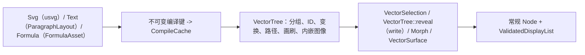

# Content 内容系统契约

位图图像、SVG、文本排版、Typst 公式、墨迹、图表、字幕、粒子与音频描述全部汇聚至同一套 `Node` 与 `ValidatedDisplayList` 流水线，而非各自维护独立的渲染引擎。纯值策略枚举（`Fit`、`Sampling`、`TextAlignment`、`TextSplit`、`WriteOptions`、`NibMode`、`BrushCap`、`PigmentMix`、`Preset`、`FieldCoordinate`、`CollisionResponse`、`ParticleEventKind`、`Inherit`）在不启用可选图像解码器或字体塑形器的情况下依然保留于 `motion-content` 中，并通过可选 `serde` 与 `schema` 特性供 `motion-scene` 直接复用。快速上手请参阅[内容教程](../tutorial/06-content.md)、[粒子教程](../tutorial/07-particles.md)、[数学公式教程](../tutorial/08-formula-typst.md)以及[音频教程](../tutorial/10-audio.md)。

## 资产与图像

- **惰性句柄与显式根目录。** `Assets` 在单一显式 `ResourceStore` 中统一管理预加载的 `Arc<A>` 值与惰性强类型 `Handle<A>` 条目。克隆共享已注册项；`Assets::snapshot` 冻结已解析条目并隔离后续修改，移除条目不会使已发出的句柄失效。相对路径文件读取必须配置显式项目根目录——空的 `Assets` 所有者绝不授予隐式读取当前工作目录的权限。`Image::open` 与 `Svg::open` 在创作期仅记录 `Source` 而不解码；实际解码结合渲染会话的 `Assets` 所有者与 `FontEnvironment` 快照执行。严格的生产导出遇到缺失资源直接报错，开启 `RenderOptions::allow_missing_assets` 则绘制显式诊断占位符并保留强类型错误记录。自定义解码资产实现 `Asset` trait；纯函数中间计算则放入 `SceneCache`。详见[资源管理](resources.md)与[资源核算](rendering.md#资源与内容)。
- **静态图像、序列帧动图与 LUT。** 解码图像限制单轴尺寸位于 `1..=16,384`、总源像素不超过 `16,777,216`、编码源字节不超过 `64 MiB`。`ImageAsset` 持有不可变的线性预乘纹素（`ImagePixels`）与有界 Mipmap 链；`Fit`、`Sampling`、UV 映射与圆角裁剪归属 `Image` 绘制节点，不引入冗余解码器。`AnimatedImageAsset` 保存合成后的 GIF/APNG 帧或显式定时帧序列；Tick 寻址、`ImageLoopMode`（`Loop`、`Once`、`PingPong`）、区间裁剪与倒放均为无状态源时间运算，往返播放绝不重复首尾端点时长。独立的 `.cube` 查找表通过 `load_lut`（`Lut3d`）与 `load_shaper`（`Lut1d`）显式读取（UTF-8 文本上限 `8 MiB`）。图像存储、GPU 工作纹理（`RGBA16F` Mip 与 `RGBA32F` 目标）和最终输出 `PixelFormat` 保持各自独立的精度边界。

## 程序化画刷 (Procedural Paints)

`motion-core` 持有解析程序化画刷的不可变描述与数学定义，使内容配方在场景求值期无需偷偷烘焙隐藏位图：

- **解析网格画刷（`Paint::Mesh`）。** `MeshPaint` 保存有界 `MeshGradient` 控制点晶格（单轴最多 `MAX_MESH_POINTS_PER_AXIS = 64`），并映射至被绘制形状的局部包围盒。CPU 后端与 GPU WGSL 着色器各自独立反求双线性面片局部坐标，使用三次 smoothstep 权重混合直通 Oklab 颜色并对 Alpha 做线性插值。重叠面片按晶格顺序覆盖（最后命中的面片生效），未覆盖区域保持透明。解析面片准入绝对值不超过 `10^6` 的归一化坐标与 `10^10` 的 Oklab 分量，保证 GPU `f32` 中间值全程有限。
- **解析氛围画刷（`AtmospherePaint`）。** 保存显式画布（单轴 `<= 16,384`）、有符号 `Time`、随机种子、色调、漂移向量、幅度归一化 Perlin fBm 倍频与雾气（`Fog`）、尘埃微粒（`Dust`）或椭圆漏光（`LightLeak`）包络（归一化微粒半径与漏光尺度须 `>= 1e-15`）。构造时无论图层是否可见，均预先校验整张画布的晶格支撑与包络边界。CPU 后端与 WGSL 独立求值完全一致的核心公式（含环绕微粒哈希与固定尘埃邻域），GPU 仅上传紧凑参数描述而非 CPU 预光栅化纹素。
- **预算准入与显式烘焙。** 后端准备阶段在分配内存前先通过 `Budget` 准入面片描述符、上传缓冲以及逐像素候选面片或噪声倍频工作量；GPU `f32` 计算与 CPU `f64` 计算在测试固件容差内视觉等价，但不要求逐比特相同。显式烘焙接口（`MeshGradient::rasterize`、`MeshGradient::pattern`、细分 `1..=32` 的 `MeshPaint::pattern`，以及 `Atmosphere::render`、`render_region`、`overlay`）继续服务于位图工作流；从烘焙 `ImagePattern` 切换为解析 `Paint::Mesh` 会自然消除固定位图分辨率、三角剖分与双线性纹理过滤带来的量化差异。

## SVG 与矢量树 (Vector Trees)

- **SVG 导入边界。** `Svg` 仅使用 `usvg` 的解析树层而非 `resvg` 位图渲染，将受支持的路径、分组、内嵌位图、塑形文本、裁剪、遮罩与滤镜转换为 Motion 共享的矢量与绘制指令模型。非 `data:` 外部 `href`、脚本、`foreignObject` 与 SVG 动画元素一律拒绝；包含 `<text>` 的 SVG 必须提供非空 `FontLibrary`。不受支持的特性保留为 `SvgDiagnostic` 或直接返回校验错误，绝不回退到隐藏浏览器或位图渲染器。
- **共享延迟矢量管线。** `VectorTree` 完整保留分组层级、元素 ID、变换、不透明度、路径、画刷与图像。SVG、动态文本与 Typst 公式统一收敛至同一套 `DeferredContent` 机制：不可变编译键构造持有编译产物（`VectorTree` 或 `ParagraphLayout`）的 `CompileCache`，创作期 `VectorSelection` 按原始分组/符号 ID 筛选子树，`VectorTree::reveal` 统一施加可见性与基于弧长的 `WriteOptions` 书写/填充揭示。任何影响编译结果的参数变更都会生成新的编译键与全新的 `CompileCache`，无需手动清理失效缓存。
- **Morph 变形与表面采样。** `Morph` 基于显式的叶子/子路径配对在两棵 `VectorTree` 之间插值，并对未匹配轮廓执行确定性过渡，而非假定输入拓扑完全同构。`VectorSurface` 对填充轮廓做三角剖分并按面积权重执行带种子的确定性采样（直接为粒子 `SurfaceEmitter` 提供发射起点与目标点，不引入第二套模拟运行时）。缓存 `VectorTree` 仅复用解析后的几何结构，既不缓存已渲染像素帧，也不会绕过每帧的 `ValidationLimits` 与 `RasterLimits` 准入。

## 字体与排版系统

- **显式 `FontLibrary` 快照。** `FontLibrary::new()` 初始为空，绝不隐式扫描宿主系统。`load_file`、`load_dir` 与 `load_data` 以写时复制 `snapshot_id` 冻结字体源字节（单库上限 `4,096` 个字面与 `256 MiB`；惰性 `FontFace` 资产上限 `32 MiB`），而显式调用的 `load_system_fonts` / `load_system_family` 最多索引 `65,536` 条元数据并按需惰性读取选中的字体文件。`Text::fonts` 可在局部覆盖 `DrawContext` 中的 `FontEnvironment`，排版塑形要求二者至少具备其一。
- **统一塑形引擎与三阶段排版。** 文本引擎由 `cosmic-text`（塑形、断行、双向文本 Bidi 与字体回退）与 `skrifa`（提取矢量字形轮廓）组合而成；字形轮廓直接汇入共享的 CPU/GPU 覆盖率流水线，不维护与字号绑定的独立位图字形集，字体 `snapshot_id`、face ID、字重与可变轴坐标共同构成 `CachePartition::Paragraph` 与 `CachePartition::Glyph` 的缓存键（支持矢量轮廓并不隐含支持彩色位图 Emoji）。文本管线严格拆分为三阶段：
  1. `ParagraphStyle` 描述源文本、富文本片段（`TextSpan`）、度量、折行宽度、`TextAlignment` 与可选 `FontLibrary`。
  2. 塑形产出唯一中间表示 `ParagraphLayout`，保留测量行、排版基线、定位字形 `TextGlyph`、扩展字素簇边界与源码字节区间（可通过 `motion::eager` 在渲染前自省或截断）。
  3. `Text` 附加画刷/墨迹与至多一种揭示模式（`write` 手写或继承局部时钟的 `TextSplit` 逐块 `TextPart` 变换，后设置者生效），且绝不拆散 UTF-8 码点或扩展字素簇。
- **字体溯源。** `ExportReport.fonts` 从 `FontUsage` 记录实际参与绘制（含命中字形缓存）的字体名与非密码学源字节哈希，用于资产溯源审计而非跨平台光栅逐像素一致承诺。

## Typst 与数学公式

`motion-formula` 将庞大的 Typst 编译依赖隔离在两项 Cargo 特性之后：`typst`（`TypstCompiler`、`TypstDocument`）使用内置捆绑字体在进程内编译自包含单页标记，禁止任何外部文件、包或网络访问；`formula` 在此基础上提供面向数学公式的 `Formula`、`FormulaOptions`、`FormulaCompiler`、`FormulaSelection` 与 `FormulaMorph`（不提供 LaTeX 转换器或磁盘公式缓存）。

- **不可变编译键与符号映射。** `Formula::typst` 仅保存源码与配置，不隐式初始化编译器。调用 `size` 或 `fill` 会生成全新的不可变编译键与独立的空 `CompileCache`，`FormulaSelection` 同样以此机制缓存剪枝后的子树。`FormulaAsset` 在输出矢量字形与几何线条的同时保留源码字节跨度与渲染符号 `FormulaSymbol` 的映射关系；`CachePartition::Formula` 中的有界内存复用严格以源码、样式、调用方修订号、`FORMULA_BACKEND_VERSION` 与编译器环境为键。通过 `motion::eager` 可在渲染前执行符号自省与精确子式选择，`FormulaMorph` 则将几何插值委托给共享的 `VectorTree` 变形引擎。Typst 输入被视为受信任创作标记，而非不可信代码沙箱。

## 创作工具与音频处理

- **墨迹（`ink` / `vector::ink`）。** `BrushStroke`（`BrushStrokeBuilder`、`BrushPreset`）将可变宽度笔尖描边（`NibMode`、`BrushCap`、压力/含墨量曲线、`BrushTiming` 提笔停顿及最多 `512` 个录制 `InputSample`）建模为非零绕数填充轮廓，与等宽 `StrokeStyle` 描边相互独立；`StrokeFont` 提供单线矢量书写字形。`Ink` 施加确定性的带种子干笔飞白、渗化、边缘粗糙度、颗粒沉淀、方向性纤维、叠墨加深、边缘积墨/暗边、各向异性、供 `Optics::Relight` 消费的可选 `height_map` 高度图以及 `Paper` 纸张纹理（程序化噪声或 `paper_transform` 空间内不超过 `512×512` 的 RGBA8 纹理）；`InkFill` 将非方向性材质子集应用于奇偶填充路径，`PigmentMix` 支持线性光或六波段 Kubelka-Munk 颜料混合。构建完成的 `BrushStroke` 仅计算并缓存一次完整笔触材质（上限 `262,144` 纹素与默认 `32,000,000` 次距离求值，可通过 `material_work_limit` 显式调整），并在弧长 `write` 揭示帧间共享复用；**所有 `RenderQuality` 档位均求值完整墨迹材质**，且 CPU 后端与 GPU 后端对墨迹轮廓共享 CPU 覆盖率。
- **图表（`diagram`）、字幕（`captions`）与粒子（`particles`）。** `Scale`、`LineChart`、`LabelLayout` 与 `Callout` 基于 `f64` 坐标与显式字体构建常规矢量与 `Text` 节点，绝不隐式探测字体。`CaptionTrack` 校验左闭右开 `CaptionCue` 时间区间与 SRT 导入导出；`CaptionStyle` 与 `CaptionLayout` 在 `ParagraphStyle` 之上预计算安全区多行字幕堆叠；`CueSheet` 统一管理字幕与最多 `256` 个具名旁白标记（时长上限 `24h`），其中 `CueSheet::retimed` 对时间点做精确纳秒比例缩放，但绝不隐式拉伸音频时长或自动重建已缓存的字幕布局。粒子发射器、力场、固定步长 `ParticleSimulation` 重放与 GPU 解析/瓦片实例契约详见[粒子实例契约](particles.md)。
- **音频声明与离线准备分离。** `motion-core` 仅持有纯数据声明（`AudioSource`、`AudioClip`、`AudioBus`、`Master`、`Ducking`、`AudioEffect`、`AudioMetadata`），而离线解码、重采样、源采样率特效、总线/母带混音以及 FFT/RMS `AudioAnalysis` 由 `motion-encode`（`audio` 特性）在无音频硬件条件下完成（`Timeline::resolve_audio` → `MixedAudio`）。文件音频源按窗口惰性解码且在执行期间必须保持内容不变；`PcmBuffer` 直接冻结采样点。预计算的 RMS 轨迹服务于可视化与参数调制，不等同于广播级 LUFS 响度或因果麦克风采样；实时 `cpal` 播放仅归属 [Studio](studio.md)。详见[音频系统](audio.md)与[导出与 FFmpeg](export.md)。

## 源码实现对应

- 资产与句柄：[asset.rs](../../../crates/motion-core/src/asset.rs)（`Assets`、`ResourceStore`、`Handle`）
- 内容包入口与共享策略：[lib.rs](../../../crates/motion-content/src/lib.rs)、[options.rs](../../../crates/motion-content/src/options.rs)
- 图像、SVG 与矢量树：[image.rs](../../../crates/motion-content/src/image.rs)、[svg.rs](../../../crates/motion-content/src/svg.rs)、[vector.rs](../../../crates/motion-content/src/vector.rs)
- 墨迹、图表与字幕：[ink.rs](../../../crates/motion-content/src/vector/ink.rs)、[diagram.rs](../../../crates/motion-content/src/diagram.rs)、[captions.rs](../../../crates/motion-content/src/captions.rs)
- 字体与文本排版：[font.rs](../../../crates/motion-content/src/font.rs)、[text.rs](../../../crates/motion-content/src/text.rs)
- Typst 与数学公式：[lib.rs](../../../crates/motion-formula/src/lib.rs)
- 音频准备与关联契约：[audio.rs](../../../crates/motion-encode/src/audio.rs) · [音频系统](audio.md) · [粒子实例契约](particles.md) · [资源管理](resources.md)
