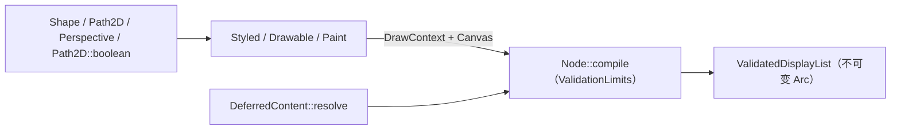

# Core 核心创作契约

`motion-core` 拥有精确时间模型、几何图形、无状态动画、不可变 `Node` 快照、排版布局、结构与光栅逻辑预算、色彩调色/光学效果数据以及后端无关的绘制指令录制协议。它绝不初始化字体引擎、GPU 设备、媒体编解码器、桌面窗口或回放时钟。可选的 `serde` 与 `schema` 特性在纯值与策略类型上暴露 JSON 序列化与 JSON Schema，使 `motion-scene` 直接复用核心定义而无需维护镜像结构体。可运行的创作示例请查阅[教程指南](../tutorial/README.md)。

## 数值精度与坐标边界

- **精度分工。** 创作层几何类型（`Point`、`Vector2`、`Size`、`Rect`、`Transform`、`Perspective`）、旋转角度、插值进度与缓动参数统一使用 `f64`。CPU 面积积分在执行单次 `u8` 覆盖率量化前保留 `f64` 梯形计算。`Color` 存储有限的扩展编码 sRGB `f32` 通道；着色、调色（`Cdl`、`Lut1d`、`Lut3d`）与线性预乘工作像素统一采用 `f32`。图像存储与输出 `PixelFormat` 各自维护独立的精度契约，系统不对所有公开数值参数做笼统的 `f64` 承诺。
- **坐标系与视口映射。** 逻辑设计坐标系以左上角为原点，`+x` 向右、`+y` 向下。`Rect` 存储对角顶点并遵循左闭右开包含判定（`left <= x < right`、`top <= y < bottom`）；退化或反转的非法几何直接报错，绝不静默归一化修正。旋转角度使用弧度制（`AngleLiteral` 将角度与转数字面量显式换算为弧度）。合成根画布将逻辑设计尺寸等比缩放并居中包含（`contain`）在整数 `PixelSize` 输出视口内；描边宽度与滤镜半径跟随组合变换，而曲线展平容差在设备像素空间衡量。
- **整数 Tick 算术与帧率。** `Time`（时间轴上的有符号时刻）、`Duration`（非负时长）与 `TimeOffset`（有符号时间偏移）是基于 `TICKS_PER_SECOND = 705_600_000` 整数 ticks 的三个独立强类型（精确整除 `24`、`25`、`30`、`48`、`50`、`60`、`120` 等影视帧率及最高 `192,000` Hz 的常见音频采样率）：
  - `Time - Time -> TimeOffset`
  - `Time ± Duration -> Time`、`Time ± TimeOffset -> Time`
  - `Time + Time` 在编译期直接拒绝，且负值 `Duration` 无法被构造。
  诸如 `2.seconds()` 等字面量构造 `Duration`；通过 `Duration::after_origin`、`Duration::offset` 与 `Time::since_origin` 显式转换。`FrameRate` 由一对非零整数构成（`fps!(30)`、`30_000/1001` 的 `FrameRate::NTSC`、`FrameRate::new` 或可失败的 `FrameRate::try_new`），每个帧边界通过整数算术独立换算，绝不累加浮点秒数。`f64` 秒数（`SceneContext::seconds`）仅作为动画数学公式的只读视图，绝非可变回放状态。

## 无状态动画体系

`Signal` 在显式的局部 `Time` 上纯函数采样数值，没有固有终点。`FiniteAnimation` 在此基础上扩展出非负的 `duration()`；仅有限动画才提供 `delay`、`then`、`repeat` 与 `ping_pong` 组合算子，从类型层面防止为无限信号捏造结束时间。

- **时间区间、缓动与插值。** `Interval { start, duration }` 是左闭右开 tick 区间内钳制进度与缓动进度的唯一权威定义，`SceneContext::progress_in`、`SceneContext::ease_in` 与 `Tween` 均基于它实现。`Interpolate` 接收 `f64` 进度并允许显式外推：Oklab 色彩插值可在将 Alpha 钳制于 `0..=1` 的同时外推扩展 RGB，而 `Transform` 插值则分解平移、旋转、缩放与斜切分量（`TransformComponents`），而非对矩阵元素或光栅像素直接线性插值。
- **关键帧、程序化信号与路径跟随。** `Keyframes` 要求严格递增的局部目标时刻（相等或递减的时间戳直接报错而非自动排序）、相对 `hold` 保持段以及由抵达关键帧持有的 `Easing`。内置缓动严格锚定 `0.0` 与 `1.0` 端点；`Easing::Custom` 钳制输入进度但保留回调自身的超调输出。`Spring` 采用闭式阻尼解析解与按 tick 取整的保守静止包络（`settle_duration`），而非逐帧状态积分；它与 `Noise`、`Oscillator` 一样仅实现 `Signal`。`FollowPath`（输出位置与切向 `PathSample`）、`remap` / `try_remap` 与 `piecewise` / `try_piecewise` 同样无状态组合。
- **校验边界。** `SpringBuilder`、`OscillatorBuilder` 与 `NoiseBuilder` 在 `build()` 时一次性完成参数范围校验，确保后续任意采样绝不溢出。便捷组合方法委托给返回 `Result` 的 `try_*` 变体并在 `# Panics` 中声明触发条件；动态或外部输入应调用 `try_*`。参数校验契约不等同于任意用户闭包的安全沙箱。详见[动画教程](../tutorial/03-animation.md)。

## Scene 场景与 Node 快照

规范的 `Scene` 接收 `&SceneContext` 并返回不可变 `Node`（`IntoSceneOutput` 同时支持直接返回 `Drawable` 叶子、异构元组或 `Result<_, ValidationError>`）。校验或回调失败会完整保留 `ValidationErrorKind`、结构路径 `path`、字段 `field` 以及可选的帧号 `frame`（包括隐藏分支与缓存子树内的错误），失败的场景绝不会被静默当成空白画面放行。

- **求值上下文。** `SceneContext` 提供有符号局部/全局 `Time`、片段 `Duration`、`FrameRate`、逻辑设计 `Size`、带键 `Random` 流、创作者侧 `SceneCache` 以及一份共享的 `Arc<Evaluation>`（内含 `RenderQuality`、`Assets`、`FontEnvironment`、`RequestDiagnostics` 与 `RenderCache`）。时间平移、嵌套时间轴与快门子帧采样均派生显式的子上下文。随机流键与 `SceneCache` 键必须完整覆盖决定计算结果的全部输入；命中缓存不能作为产生副作用或维护跨帧可变历史的理由。
- **写时复制 `Node` 树与修饰器。** `Node` 克隆时共享不可变 `Arc` 子树，仅在修改路径上发生写时复制。同级兄弟节点按稳定的 `z_index` 顺序绘制，相同 `z_index` 严格保持插入顺序（`z_index` 仅作用于当前父组内部，既不是全局 3D 深度排序，也不改变布局测量顺序）。空间与合成修饰器集中在 `NodeModifiers` 上：默认轴心 `Pivot` 为测量包围盒中心；定位操作（`at`、`align_to`、`next_to`）放置该轴心，而 `translate` 直接偏移局部坐标；组级 `opacity` 在子树完整绘制后统一合成一次，而非分别乘到各个重叠子节点上；`Elevation`（`0..=1024` 局部单位）则自动展开为接触阴影、方向主阴影与环境漫射阴影三层 `ShadowLayer`。

## 布局引擎与时间轴

- **确定性布局。** `Row` 与 `Column` 按插入顺序依次测量变换后的子节点，并严格使用与最终编译一致的 `FontEnvironment` 与 `ValidationLimits`（`SceneContext::measure` 在局部时间上传递共享 `Evaluation`）。文本节点对齐其真实的塑形排版基线，非文本节点使用显式几何回退基线；延迟计算的 `next_to`/对齐绝不会基于另一份不一致的字体快照执行测量。
- **摄像机、景深平面与骨骼。** `Camera`（`camera` / `try_camera`）向普通组子树施加经校验的有限可逆逆视图 `Transform`（`center`、正数 `zoom`、顺时针弧度 `rotation`）；`world_to_screen` 与 `screen_to_world` 在不含祖先变换的前提下互转视口坐标，固定 HUD 覆盖层应置于摄像机节点之外。`DepthOfField::capture` 将最多 `256` 个 `DepthPlane` 按远近排序，依据薄透镜弥散圆公式施加模糊（`focus_distance` 处精确为零，受 `max_radius` 封顶）及可选针孔视差缩放。`Skeleton` 在 2D 空间内根据 `Pose` 求解正向运动学并输出挂载于普通 `Node` 的 `BoneTransform`。
- **不可变 `Timeline` 与 `Project`。** `TimelineBuilder::build` 一次性冻结设计 `Size`、有理数 `FrameRate`、有序 `Track`、`Soundtrack`（`AudioClip` 事件、`AudioBus` 总线、`Master` 母带链）与总 `Duration`（将构建期收集的有界错误汇总为 `ErrorReport`）。片段边界独立对齐至帧 ticks，非整帧边界在 `Diagnostics` 中记录 `TimelineWarning`。`Transition` 仅衔接相邻两个片段（禁止三层重叠），两端场景各自保持独立的局部时钟。上方轨道合成在下方轨道之上。`Timeline` 不是 `Scene`：`TrackBuilder::nest` 嵌入子 `Timeline`（最多 `16` 层嵌套）时先裁剪并等比居中映射子视口，同时将其音频并入父级 `Soundtrack`，且不会隐式重定时父级时钟。在 facade 层，`Project` 注册惰性时间轴工厂与强类型 CLI 参数，`--list` 与 `--help` 绝不触发时间轴构建或外部资源探测。

## 几何系统与指令录制

- **路径、布尔运算与平面 2.5D 透视。** `Shape` 描述纯几何，附加填充或描边样式后生成 `Drawable`。`Path2D` 是写时复制的 `f64` 贝塞尔路径（`MAX_PATH_VERBS = 16_384`、`MAX_SVG_PATH_BYTES = 1_048_576`），缓存精确曲线极值包围盒与高斯积分弧长表，在 `trim` 与虚线切分时保留原始贝塞尔曲线段；后续合法编辑绝不会擦除早期已记录的构建错误。`Path2D::boolean`（`Union`、`Intersection`、`Difference`、`Xor`）先通过 `Budget` 准入边数上限（`MAX_BOOLEAN_EDGES`）、暂存字节与二次方求交工作量，在 `f64` 空间展平并在交点处切分重连为闭合线段轮廓，使 CPU 后端与 GPU 后端消费同一条结果路径。`Perspective` 将 `z = 0` 平面绕轴心按 `z`、`y`、`x` 顺序旋转并经针孔相机（`distance > 0`）投影：线段保持为线段，曲线细分为最多 `MAX_PERSPECTIVE_CURVE_PIECES`（`64`）段三次曲线；距相机平面不足 `1e-3 * distance` 或位于相机后方的点直接报错而非静默裁剪，`faces_camera` 返回朝向供调用方按需剔除背面。选定曲线、描边与圆弧计算使用 `kurbo`，而共享覆盖率光栅化完全由 Motion 自主实现。
- **画刷与解析程序化描述。** `Paint` 涵盖纯色 `Color`、线性/径向/扫描渐变、不可变 `ImagePattern`（`ImagePixels` + `Sampling`），以及两类解析程序化画刷：`Paint::Mesh(MeshPaint)`（单轴最多 `MAX_MESH_POINTS_PER_AXIS = 64` 控制点）与 `Paint::Atmosphere(AtmospherePaint)`。两类解析画刷均保留紧凑数学描述，由 CPU 后端与 GPU WGSL 着色器各自独立求值，而不在准备阶段逐帧向 CPU 位图烘焙；显式调用的 `MeshGradient::rasterize`、`MeshGradient::pattern` 与 `MeshPaint::pattern`（细分上限 `MAX_MESH_SUBDIVISIONS = 32`）则保留按需烘焙位图的能力。详见[程序化画刷](content.md#程序化画刷-procedural-paints)。
- **录制与结构配额。** `Drawable::draw` 在 `DrawContext` 下向受检 `Canvas` 写入指令（即使自定义回调忽略了 `Result`，`Canvas` 也会保留首个错误），`DeferredContent` 则在编译期展开为普通 `Node`。`Node::compile` 对所有分支（包括不可见图层与未激活的转场端点）执行 `ValidationLimits` 校验（默认上限 `100,000` 节点、`64` 层深度；自定义上限最高 `1,000,000` 节点、`128` 层深度，按结构出现次数而非唯一 `Arc` 计数），冻结并返回 `Arc` 共享的 `ValidatedDisplayList`。可编辑的底层 `DisplayList` 修改后必须重新校验；像素与内存配额则由下游 `Budget` / `RasterLimits`（默认 `RasterLimits::authoring()` 为 `16,777,216` 像素与 `256 MiB` 活跃字节；`RasterLimits::sandbox()` 额外施加 `200,000,000` 工作量上限）在准备与光栅化阶段强制执行。

## 图层合成与采样

- **有序滤镜、调色与光学效果。** `Filter` 是封闭的数据枚举（`Blur`、`DropShadow`、`Glow`、多尺度金字塔 `Bloom`、`Cdl`、`Lut`、`Optics`、`ColorAdjust` 与 `Custom(Vec<FilterOperation>)`），而非各后端私有的任意像素回调。子级效果始终先于父级完成：源子树绘制完成后依次经过滤镜、裁剪或遮罩，最后以组级 `opacity` 与 `BlendMode` 合成。在 `Filter::Custom` 中，`CompositeWithSource` 始终引用该滤镜的原始输入，而非前一条原语的中间输出。`Optics` 封装有界空间光学效果（`LensFlare` 眩光鬼影、径向畸变/色散 `Lens`、`cos^4` 暗角 `LensVignette`、支持 `Disc` 或 `3..=16` 叶片 `Polygon` 光圈的 Vogel 螺旋 `Bokeh`、`RadialBlur`、水平 `Anamorphic` 变形拉丝，以及基于 `HeightFrom::Luma` 或 `Alpha` 的 Sobel/Lambert/Blinn-Phong `Relight` 重打光）。滤镜绝不改变布局或轴心包围盒；准备阶段单独推导保守的设备空间捕获光晕。
- **裁剪、遮罩与混合空间。** 覆盖率裁剪将独立量化的覆盖率相乘；几何裁剪（`RectClip`、`ShapeClip`）在量化前执行多边形解析求交——同一 `Node` 上重复设置几何裁剪会替换前值，而父子嵌套则取交集。内容遮罩支持按 Alpha（`MaskMode::Alpha`）或 Rec.709 线性预乘亮度（`MaskMode::Luminance`）加权。`BlendSpace::LinearRgb` 为默认图层混合空间；`BlendSpace::Srgb` 构成显式的传递函数转换边界。
- **时间快门采样。** 单个 `Node` 只是瞬时快照，无法在时间维度重新采样。全帧或子树 `MotionBlur`（`shutter_angle` 位于 `0..=360` 度，`1..=64` 次采样）与 `ShutterSampling`（`ShutterCurve::Box`、`Triangle` 或 `Cosine` 曝光权重、可选分层抖动种子 `jitter_seed` 以及基于端点位移估计 `8..=64` 样本数的 `adaptive` 自适应采样）会在精确整数 tick 偏移处重复调用场景构建闭包并累加线性预乘结果，空画面样本保留其归一化权重，且拒绝嵌套快门捕获。`RenderQuality::Draft` 将快门退化为单次采样并放宽滤镜与展平近似；正式导出始终使用 `RenderQuality::Final`。

## 源码实现对应

- 时间与帧率：[time.rs](../../../crates/motion-core/src/time.rs)（`Time`、`Duration`、`TimeOffset`、`FrameRate`）
- 动画系统：[animation.rs](../../../crates/motion-core/src/animation.rs)（`Signal`、`FiniteAnimation`、`Interval`、`Keyframes`、`Spring`）
- 创作、布局与时间轴：[authoring.rs](../../../crates/motion-core/src/authoring.rs)（`Scene`、`Node`、`Row`、`Column`、`Camera`、`DepthOfField`、`Timeline`）
- 几何、透视与矢量路径：[geometry.rs](../../../crates/motion-core/src/geometry.rs)、[path2d.rs](../../../crates/motion-core/src/path2d.rs)（`Path2D`、`MorphPath`、`PathBooleanOp`）
- 绘制、网格与氛围画刷：[drawing.rs](../../../crates/motion-core/src/drawing.rs)（`Canvas`、`Paint`、`MeshGradient`、`AtmospherePaint`）
- 滤镜、光学与调色：[filter.rs](../../../crates/motion-core/src/filter.rs)、[optics.rs](../../../crates/motion-core/src/optics.rs)、[grading.rs](../../../crates/motion-core/src/grading.rs)
- 校验、预算与实例协议：[validation.rs](../../../crates/motion-core/src/validation.rs)、[budget.rs](../../../crates/motion-core/src/budget.rs)、[instances.rs](../../../crates/motion-core/src/instances.rs)
- 关联设计契约：[渲染与导出](rendering.md) · [系统可靠性](reliability.md)
