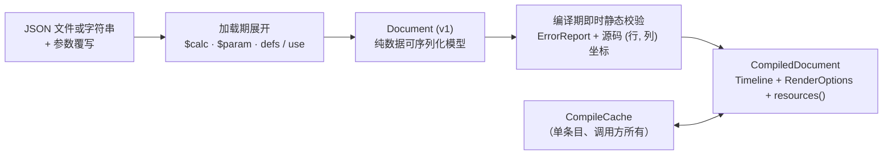

# 声明式文档设计契约

文档（Document）是对完整时间轴进行版本化描述的纯数据 JSON 格式：涵盖画布尺寸、帧率、背景色、多轨道时序场景、转场、音频事件、字体文件以及可选的胶片 Look 风格。`motion-scene` 包负责管理该数据模型、其 JSON Schema 规范以及到引擎 `Timeline` 的编译流水线；门面包在开启 `declarative` 特性时将其重新导出为 `motion::declarative`，并提供 `Project` 与命令行入口（参见[命令行文档](../cli.md#声明式文档)）。创作指引见[教程第 16 章](../tutorial/16-declarative.md)；具体类型定义见 Rustdoc。

## 核心与内容类型的直接复用

文档模型直接复用核心包与内容包的值类型，从根源上杜绝规范定义与引擎契约发生偏离：

- **核心值类型（`motion-core`）：** 基础枚举（`BlendMode`、`FillRule`、`MaskMode`、`ClipMode`、`LineCap`、`LineJoin`、`GradientSpace`、`GradientUnits`、`GradientExtend`、`Waveform`、`ArrowHead`、`Sampling`、`Direction`、`IrisShape`、`Pivot`、`InstanceBlend`）与纯值类型（`Color`、`Point`、`Rect`）在 `motion-core` 的 `serde` 与 `schema` 特性下直接实现 `Serialize`、`Deserialize` 与 `JsonSchema`。被复用类型的合法性校验（例如描边斜接限制）归属 Core 所有，编译器直接调用核心构造器而非重复实现检查。
- **内容策略类型（`motion-content`）：** 图像适配（Fit）、段落对齐与拆分、矢量手写选项、水墨笔尖模式、笔刷端帽、颜料混色模式、粒子预设名称、颜色场坐标、碰撞响应模式、事件类型及继承规则均直接复用 `motion-content` 通过独立于特性的 `serde` 与 `schema` 暴露的类型，不保留重复的 `*Spec` 兼容别名。
- **规范层自有包装器（`motion-scene`）：** 规范层仅定义核心与内容值类型无法直接表达的结构：动画包装器（`Animated<T>`）、加载期参数与模板占位符、以度数为单位的 `start` / `end` / `stops` 渐变对象、带动画宽度与虚线进度的描边、资源路径规格以及保留 `f64` 创作精度的几何结构。禁用某项内容特性后依然支持 JSON 解析与序列化，仅在编译期明确报告该能力未启用。

## 数据模型与语法规则

- **纯数据与 Builder 对等性：** 解析与序列化绝不读取外部文件、扫描系统字体或求值任何画面帧。同一套 Rust 结构体同时充当编程式 Builder API，因此在 Rust 代码中构造的 `Document` 与从 JSON 解析出的实例完全等价，并可通过 `Document::from_json` 与 `Document::to_json` 无损往返。
- **元素结构：** 每个 `Element` 包含可选的标识（`id`、`name`）、样式（`fill`、`stroke`、`fill_rule`、`trim`）、局部变换（`position`、`translate`、`rotate`、`scale`、`scale_xy`、`pivot`）、合成属性（`opacity`、`blend`、`z_index`、`hidden`）与效果（`filters`、`clip`、`mask`），并至多选取一个内容键（`children`、`rect`、`circle`、`ellipse`、`line`、`polyline`、`polygon`、`regular_polygon`、`star`、`arc`、`ring`、`arrow`、`spline`、`path`、`morph`、`text`、`image`、`svg`、`svg_morph`、`particles`、`trajectory`、`ruler`、`callout`、`line_chart`、`captions`、`formula`、`brush_stroke` 或 `ink_fill`）。同时指定两个内容键、未知字段键或未知枚举变体均属于解析错误；不含内容键的元素不绘制任何内容。
- **单位与字面格式：** 时间单位为秒，角度为顺时针度数，长度为设计坐标单位，点为 `[x, y]`，矩形为 `[left, top, right, bottom]`。帧率支持整数或 `"NUMERATOR/DENOMINATOR"` 分数字符串。颜色采用由 `Color::parse` 解析的 CSS 风格字符串；序列化时输出 `#rrggbb[aa]`，当 8 位整数无法无损表示时输出带小数分量的 `rgb()`。描边连接点支持 `"round"`、`"bevel"` 或 `{"miter": {"limit": 4}}`；轴心支持预设名如 `"top_left"`、`{"relative": [x, y]}` 或 `{"point": [x, y]}`。
- **动画属性（`Animated<T>`）：** 任何动画字段既接受固定常量，也接受恰好携带单个运动键的对象：`tween`、`keyframes`、`oscillate`、`noise`、`expr`、`spring`、`clock`、`map`、`follow_path`、`components` 或 `sum`。固定常量绝不会是包含这些运动键的 JSON 对象，因此常量与动画形态不会产生歧义。振荡器与噪声仅适用于数值属性；缓动函数为封闭的可序列化集合，不支持自定义 Rust 回调。

## 加载期展开机制

### 参数化与编译期计算

根级 `params` 对象声明具名的默认参数值——支持数值、布尔值、字符串、颜色、数组或任意 JSON 子树：

- **参数覆写与 `$param`：** 参数覆写通过 `Document::from_json_with`、`load_with`、`Project::document` 或 CLI `--params` 传入，其所有键必须已在 `params` 中声明，并整字段替换对应的默认值。`params` 之外的任何 `{"$param": "name"}` 对象在加载阶段、类型检查之前被替换为生效值。未知覆写键或未知 `$param` 名称会附带引用路径直接报错。
- **加载期算术计算（`$calc`）：** 任何 `{"$calc": "ceil($seconds * $fps / $pages) / $fps"}` 对象在参数覆写合并之后、`$param` 替换与 `defs` 展开之前求值一次有限 `f64` 浮点数。`$calc` 既可用于 `params` 内部，也可用于正文任意位置，以 `$name` 读取数值型或布尔型参数并按拓扑依赖自动解析（不受声明顺序限制）。严禁引用场景时间 `t`、元素属性绑定、循环依赖或产生非有限结果。落在精确 `f64` 整数范围内的整数值结果同样适用于整数字段；未参与算术运算的原始参数（如全宽 `u64` 随机种子）绝不会被强转为 `f64`。
- **准入计量与回写：** 单个参数上限为 `64 KiB`（每篇文档最多 `256` 个参数，计算依赖链最深 `32` 层），替换展开后的文档总体积不得超过 `MAX_DOCUMENT_BYTES`（`16 MiB`）——每次 `$param` 展开计费一次，声明本身不重复计费。加载后的 `Document` 在 `params` 中保留最终生效值并展开正文中所有占位符，同时数值参数仍可在运行期表达式中以 `$name` 读取。

### 可复用定义模板

根级 `defs` 对象声明具名的值、样式或组件子树，在参数替换之后、类型检查之前完成加载期展开：

- **模板展开（`use`）：** 根级 `params` 之外的任何 `{"use": "name"}` 对象都会展开为对应定义。对象引用点上的同级字段会整字段替换模板的顶层同名字段（不对嵌套对象或数组做深度合并）；标量与数组模板拒绝同级覆盖字段。模板自身可通过 `use` 继承其他模板并引用 `$param`；由参数值引入的 `use` 对象同样在引用点展开，且不修改已存储的 `params`。
- **保留键与实例隔离：** `$param`、`$calc` 与 `use` 在整份 Schema（`ValueRef`）中均为保留关键字，携带任一关键字的对象都会被无歧义地识别为加载期引用。实例 `id` 不会自动重命名，同一场景内多次复用带 `id` 的组件时需通过同级字段显式覆盖 `id`。未被引用的模板仅检查体积上限（`<= 64 KiB`），不执行展开与类型检查。引用链最深 `32` 层，展开后 JSON 嵌套最深 `128` 层，克隆累计字节数（无需分配临时 JSON 缓冲区即可精确统计）必须落在 `16 MiB` 上限之内。加载完成的 `Document` 保存展开后的结构并移除 `defs`。

## 动画组合、表达式与属性绑定

### 动画组合机制

- **解析解弹簧（`spring`）与路径跟随（`follow_path`）：** `spring` 复用 Core 解析解 `Spring` 模型，接收 `from`、`to` 及可选的 `mass`、`stiffness`、`damping`、`initial_velocity` 与 `settling_threshold`；非法物理参数或超过 `1e6` 秒的静止时长在编译期报错。`follow_path` 沿 SVG `data`、`duration`、`easing` 与目标分量 `component`（`x`、`y` 或顺时针度数 `angle`）直接采样核心弧长运动，不引入额外的路径近似算法。
- **时钟重映射（`clock`）与值域映射（`map`）：** `clock` 接收嵌套 `source`、有限 `scale` 与有符号秒数 `offset`（绝对值均不超过 `1e6`），在对齐引擎 ticks 后的 `clamp(t * scale + offset, -1e6, 1e6)` 时刻对源采样；负 `scale` 实现倒放，嵌套表达式与绑定读取重映射后的时钟。`map` 通过算术表达式 `expr` 变换数值型 `source`，仅在该表达式内 `t` 代表源输出值而非秒数（允许读取 `$param`，拒绝 `@id` 元素绑定）。
- **多通道组合（`components`）与求和（`sum`）：** `components` 为标量、`Point` 或 `Rect` 的每个通道提供独立的数值动画；`sum` 按序累加 `1..=32` 个数值源。递归动画组合深度上限为 `32` 层。`Animated::<f64>::compile` 支持在无参数、无绑定、无 I/O 的前提下校验独立采样器，方便 Rust Builder 预计算静态采样曲线。

### 表达式与同场景属性绑定

- **纯算术语法：** 数值、坐标点（`{"expr": ["x", "y"]}`）与矩形属性支持纯 `f64` 表达式，涵盖运算符 `+ - * / % ^`、比较运算（返回 `1.0` 或 `0.0`）、常量（`pi`、`tau`）、场景局部时间 `t`、数值参数 `$parameter`、属性绑定 `@id.path` 以及内置数学函数（`sin`、`cos`、`tan`、`asin`、`acos`、`atan`、`atan2`、`sqrt`、`abs`、`floor`、`ceil`、`round`、`fract`、`exp`、`ln`、`sign`、`radians`、`degrees`、`min`、`max`、`pow`、`mod`、`clamp`、`lerp`、`smoothstep`、`step`、`if`）。源码上限为 `4,096` 字节、`1,024` 个词法项与 `48` 层语法嵌套。
- **同场景属性绑定（`@id.path`）：** 场景内具有唯一 `id` 的元素可向同场景表达式暴露其自身的数值型创作属性（如 `@dot.rotate`、`@dot.position.x` 或 `@ring.circle.radius`），在相同场景局部时刻求值（读取元素自身属性，而非累积后的全局世界变换）。绑定依赖链最深 `32` 层（单场景最多 `1,024` 个独立绑定）；循环依赖、重复或未知 `id` 以及非数值目标路径均在编译期报错。表达式绝不读取历史帧、磁盘文件或全局状态。

## 内容类型与特性门控

| 内容键 | 所需特性 | 说明 |
| --- | --- | --- |
| `children`, `rect`, `circle`, `ellipse`, `line`, `polyline`, `polygon`, `regular_polygon`, `star`, `arc`, `ring`, `arrow`, `spline`, `path`, `morph` | 无 | 内置矢量几何与分组；`morph` 一次性配对两条 SVG 路径字符串并按进度插值 |
| `image` | `image` | 相对于 `base_dir` 解析的位图文件（在 `motion-scene` 内对应 `vector`，由门面包 `image` 转发） |
| `svg`, `svg_morph` | `svg` | 外部 SVG 文件或内联 `{"data": "<svg ...>"}`（`<= 16 MiB`），在编译期即时解析 |
| `text` | `text` | 纯文本 `content`、富文本 `spans`（`<= 256`）、`number` 数值读数、`split`、`visible_parts` 与逐切片 `parts` 动画 |
| `brush_stroke`, `ink_fill` | `ink` | 可变宽笔尖描边、数位板采样序列、纸纹颗粒、干湿晕染/沸腾抖动与颜料混色 |
| `particles`, `trajectory` | `particles` | 固定种子粒子模拟、预设配方、场算子、子发射器与解析轨迹模型 |
| `ruler`, `callout`, `line_chart` | `diagram` | 数据标注与折线图；文本标签通过渲染字体环境绘制 |
| `captions` | `captions` | 逐词/逐短语时间轴字幕，在编译期结合文档 `fonts` 完成排版 |
| `formula` | `formula` | Typst 数学公式编译、可选手写揭示与公式变形 |

当文档使用了未开启对应 Cargo 特性的内容键时，JSON 依然能够正常解析与序列化，仅在编译阶段报告明确的特性未启用诊断。编译器在编译期即时构建静态矢量、SVG、文本、字幕与 Typst 公式，使语法与排版错误立即在对应的 JSON 路径处暴露；同时 `CompiledDocument::render_options`（由 `Project` 与 CLI 自动调用）会将文档 `fonts` 注入 `RenderOptions`，供 `diagram` 图表标签直接复用。

### 矢量画刷与光学效果

- **动画渐变与顶点列表：** 线性渐变端点、径向渐变圆心/半径/焦点以及扫描渐变中心/角度（顺时针度数；整圈仅容忍浮点舍入误差，拒绝超过 `360°` 的跨度）均支持 `Animated` 属性，色标与插值模式保持固定。多边形（`>= 3` 点）与折线（`>= 2` 点）严格三选一接收静态 `points`、路径采样 `sample` 或逐顶点独立动画 `animated`（统一上限 `65,536` 个点）。
- **空间与光学滤镜：** 元素 `filters` 支持 `blur`、`blur_xy`、`drop_shadow`、`glow`、`color_adjust`、带种子的 `grain`（保留完整 `u64` 种子，并支持可选的 `0..=u32::MAX` 动画 `frame` 取整后与种子按位异或）以及共享的 `optics` 光学通道（镜头光晕、畸变/色散、暗角、带度数旋转的多边形散景、径向模糊、变形宽银幕光斑、重打光）；`LookSpec` 进一步提供快门运动模糊、空间泛光/光晕（支持动画化的 `intensity` 与 `strength`）、片门抖动、CDL 调色与色调映射。所有动画渐变与滤镜在编译期与每帧准备期双重校验，一旦动态参数越界即在该帧的 `filters[i]` 路径处报错，绝不向渲染后端传递非法参数。

### 子树裁剪

元素的 `clip.shape` 在元素局部坐标系下选取 `rect`、`rounded_rect`、`circle` 或 `path`。`rounded_rect` 复用矩形的 `bounds` 与可选 `corner_radius`（默认为 `0`），两者均支持 `Animated` 动画，并与其余裁剪形状共享相同的覆盖率或几何 `ClipMode`。采样出非法裁剪几何时直接返回 `ValidationError`，绝不静默丢弃裁剪。

### 数值文本读数 (Numeric Text Readouts)

`text` 严格三选一接收 `content`、`spans` 或 `number`。数值读数将动画化的 `value`、`0..=16` 范围内的十进制小数精度 `precision` 以及可选的固定前后缀 `prefix` / `suffix`（合并 UTF-8 长度上限 `4,096` 字节）组合在一起，并与普通文本共享段落对齐、排版与显式字体绑定。非有限表达式结果按 Rust 标准数值拼写输出，不执行任何无界的用户格式化脚本。

### 水墨与笔刷内容

- **笔刷描边与压感：** `brush_stroke` 严格三选一接收固定 SVG `path`、编译期采样折线 `points` 或录制采样点序列 `samples`（`<= 512` 项，含位置、压感、顺时针度数 `tilt` 倾角与秒级时间戳），并配对 `width` 与自有 `paint`（元素级 `fill`、`stroke`、`trim` 与 `fill_rule` 不适用于该内容）。压感支持三段式 `pressure`、有序 `pressure_curve` 或算术表达式 `pressure_from`（其中 `t` 表示归一化弧长而非场景秒数；允许读取 `$param`，拒绝 `@id` 绑定）。
- **书写揭示时钟：** `write` 按归一化全路径弧长（`0..=1`）揭示笔迹；`write_time` 提供显式的非负秒数（`0..=86,400`），驱动源既可使用录制样本自带的时间戳，也可指定显式 `timing` 描述（`<= 512` 项，包含落笔运动时长、单调控制点与子路径提笔停顿）。
- **墨水材质、纸纹与颜料混色：** `ink` 配置确定性的枯笔度（Dryness）、渗化（Bleed）、毛刺纤维、颗粒沉淀、水渍边缘、灰度高度、可选的 `wetness` 干湿年龄与干燥时长（`0..=86,400` 秒）、可选的双帧沸腾抖动 `wobble.frame`（`<= 2 * u32::MAX`）、6 系数仿射 `paper_transform` 以及 `paper` 纸纹（支持程序化噪声、显式内联 RGBA8 纹理或编译期按种子生成的 `noise_texture`，纹理边长均为 `1..=512` 纹素）。`ink_fill` 基于自有的 `path`、`paint` 与 `ink` 执行有界奇偶轮廓填充。`PaintSpec` 同时支持颜料混色 `{"pigment": {"first": ..., "second": ..., "amount": ..., "mode": ...}}`（动画 `amount` 位于 `0..=1`），通过原生线性光 `linear` 或六波段 `kubelka_munk` 模型混合颜色，而非合成器混合模式。固定笔刷配方在多个揭示帧之间共享同一份不可变的烘焙笔迹材质；动画化的画刷、湿度或沸腾帧则直接根据显式输入重建，不维护任何可变流体播放状态。

### 粒子模拟与解析轨迹

- **预设配方与显式模拟：** `particles` 既支持显式声明 `emitters` / `modifiers` / `style`，也支持直接选用 `preset` 预设（`sparks`、`embers`、`dust`、`motes`、`snow`、`rain`、`smoke`、`fire`、`confetti`、`fireworks`、`fireflies`、`logo_dissolve`、`logo_assemble`），配合局部 `bounds`、可选的 `density` / `speed` / `intensity` 乘数以及必填的 `(0, 3,600]` 秒模拟 `duration`（`preset.logo` 最多接收 `256` 条固定着色的 SVG 路径）。可选的动画化 `sample_time`（`0..=1e6` 秒）可在无状态跳转的前提下将模拟时钟与场景时钟解耦。
- **发射源、场算子与轨迹：** 显式发射源支持着色矢量表面、按 Alpha 或亮度加权的内联 RGBA8 图像（边长 `1..=512` 纹素）、动画路径进度、线性出生能量 `premultiplied_color` 以及在 `Scene` 缓存分区中惰性准备的字形轮廓。`configuration` 控制预热、双阶段循环、查询重映射、倒放许可、工作线程与工作量准入、拖尾、速度拉伸、视差与翻转策略；有序 `operator` 修饰器提供群体力、扫掠碰撞体、有向距离场网格、颜色场、32 位 `curl_noise` / `curl_flow` 随机种子（`0..=u32::MAX`）以及自定义槽位 `0..=2`（槽位 `3` 由 `root_only` 的 `sub_emitters` 保留）。生成的精灵图集帧边长限定在 `2..=256` 像素，纯数据 `node_circles` 则在无代码回调的前提下复现随年龄演化的矢量粒子外观。`trajectory` 求值解析轨迹模型 `Ballistic`、`Orbit`、`NoiseDrift` 与 `Converge`（`1..=65,536` 个编译期采样点）。

### 音频声明

根级 `audio` 片段、`buses`、`master`、`effects`、`spatial` 与 `ducked_by` 直接编译为核心包的 `AudioTrack` 与 `AudioMix` 模型（最多 `256` 个片段、`16` 条总线、每条处理链 `16` 个效果器、每个目标 `4` 路闪避触发）。片段的 `volume`、`pan`、`spatial` 空间坐标以及自动化 EQ 的 `frequency` / `gain` 均按片段局部秒数采样；`effects` 需要开启 `audio` 特性。完整的混音、DSP 与导出契约详见[音频设计契约](audio.md)。

## 版本规范与 JSON Schema

- **严格格式版本：** `version` 必须精确等于 `FORMAT_VERSION`（`1`）；其余任何数值都会在编译前报不受支持的值错误，不提供隐式迁移。解析器接受可选的 `$schema` 键供编辑器补全使用并在运行时忽略。
- **自动生成 Schema：** `motion::declarative::schema()` 生成 Draft 2020-12 JSON Schema，覆盖文档结构、封闭枚举、共享的 `ValueRef`（`$param` / `$calc` / `use`）分支以及静态数值范围；仓库提交的 [`schemas/motion.schema.json`](../../../schemas/motion.schema.json) 受自动化测试保护，确保与代码实现逐字节同步。
- **兼容性边界：** 只要所有旧版合法 JSON 文档仍以完全相同的语义解析通过，放宽现有字段以接受新的 JSON 表达形式即可保持 `FORMAT_VERSION = 1` 不变；即便对应的 Rust 规范类型随之放宽（例如升级为 `Animated<T>` 或 `SvgSourceSpec`，纯常量可通过 `.into()` 转换）。

## 编译、缓存与热重载

- **全量错误收集与不可变求值：** `Document::compile` 先校验全部属性并汇总诊断，随后再构造 `Timeline`。在每个场景内部，不含动画属性的静态元素仅构建一次并在所有帧间共享同一份 `Node` 快照；含动画的子树仅在场景局部时刻 `t` 重建自身。轨道项遵循引擎顺序游标规则（`scene`、`gap`、`transition`），`LookSpec` 则清晰拆分为场景内滤镜阶段与 `CompiledDocument::render_options` 显示阶段。
- **调用方所有的 `CompileCache`：** `CompileCache` 是面向磁盘文档的单条目编译缓存，在 `Project` 注册的具名文档、CLI 直接传入的 `.json` 路径及其克隆实例之间共享（纯 Rust 闭包工厂绝不缓存）。缓存命中要求规范化绝对路径、文档完整字节、序列化后的参数覆写以及所有受监视依赖文件的字节内容完全一致——即使文件修改时间未变但发生等长内容编辑，也会精准失效。快照准入上限为 `16 MiB` 输入总字节与 `256` 个依赖文件；超出上限的依赖集合正常执行全量编译而不写入缓存，重载失败绝不覆盖上一次成功的缓存条目。
- **资源路径与热重载：** 相对字体、图像、SVG 与音频路径相对于 `CompileOptions::base_dir`（`load` 默认取文档所在目录）解析，并拒绝任何包含 `..` 的父级越界路径。文档 `fonts` 在编译期读取并覆盖渲染环境的默认字体；位图 `image` 通过渲染 `Assets` 惰性加载；`svg` 在编译期解析；`audio` 在导出期流式解码（参见[资源管理契约](resources.md)）。`CompiledDocument::resources()` 返回去重后的依赖文件列表（文档主文件排在首位），同时供 `Project::check` / `validate`（对首帧、中间帧与尾帧执行无渲染预检）以及 Studio [热重载](studio.md#热重载)文件监视器复用。

## 配额与参数上限

| 约束项 | 上限阈值 |
| --- | --- |
| 单个文档文件体积（`MAX_DOCUMENT_BYTES`） | `16 MiB` |
| 内联或外部 SVG 源码（`svg`, `svg_morph`） | `16 MiB` |
| `CompileCache` 快照总字节 / 受监视依赖文件数 | `16 MiB` / `256` 个文件 |
| 时间戳、时长、延迟、`clock` 偏移/缩放与 `sample_time` | `0..=1e6 s`（`clock` 为 `±1e6`） |
| 设计画布宽高尺寸 | `1..=65,536` |
| 元素嵌套层级（含遮罩） | `64` 层 |
| 多边形、折线、样条曲线、`Converge` 与 `Seek` 点数 | `65,536` 个点 |
| 正多边形边数 / 星形顶点数 | `3..=4,096` / `2..=4,096` |
| 单次编译保留的诊断条数 | `256` 条 |
| 单文档参数个数 / 单个参数体积 / `$calc` 依赖链深度 | `256` 个 / `64 KiB` / `32` 层 |
| 单文档模板定义个数 / 单个定义体积 | `256` 个 / `64 KiB` |
| 模板 `use` 调用链深度 / 展开后 JSON 嵌套深度 | `32` 层 / `128` 层 |
| 表达式或 `$calc` 源码体积 / 词法项 / AST 嵌套深度 | `4,096 B` / `1,024` 项 / `48` 层 |
| 动画组合嵌套深度 / 单次 `sum` 输入源数量 | `32` 层 / `32` 个 |
| 属性绑定链深度 / 单场景独立绑定总数 | `32` 层 / `1,024` 个 |
| 富文本 `spans` 数量 / 数值读数小数位与前后缀总字节 | `256` 段 / `0..=16` 位, `4,096 B` |
| 水墨录制 `samples` 或 `timing` 项数 / 纸纹或内联图像边长 | `512` 项 / `1..=512` 纹素 |
| 水墨录制时间戳、`write_time` 与 `wetness` 时钟 | `0..=86,400 s` |
| 粒子预设时长 / `preset.logo` 路径数 / 精灵图集单帧边长 | `(0, 3,600] s` / `256` 条 / `2..=256` px |
| 粒子请求数量、单次爆发量或轨迹点数 | `1,000,000` |
| 音频片段数 / 总线数 / 单链效果器数 / 单目标闪避触发数 | `256` / `16` / `16` / `4` |

针对矢量路径、描边拓扑、滤镜效果、缓存分区与光栅化内存的底层引擎配额在渲染执行期依然严格生效（参见[可靠性契约](reliability.md)与[资源管理契约](resources.md)）。

## 诊断与源码定位

- **源码行列号映射：** 从磁盘文件加载产生的诊断会在原始文本中精确定位失败的 JSON 路径与字段，并追加 `(line L, column C)`——当具体子键因 `$param` 或 `use` 展开而不存在于原始文本中时自动回退到最深的有效父键；遇到未知字段键时直接指向该键本身（当合法候选字段超过 `8` 个时省略 serde 冗长的候选列表）；仅在通过 `Document::from_json` 直接解析内存字符串时省略编译期行列号。
- **拼写纠错提示与结构化路径：** 对于未知字段键、枚举变体、参数名、场景元素 `id`、音频片段与总线名称以及表达式函数名，编译器会在编辑距离（Levenshtein distance）`<= 3` 的范围内推荐最接近的合法名称。语法解析失败返回携带 JSON 路径的 `ValidationError`；编译失败返回单个 `ValidationError` 或汇总所有非法属性的 `ErrorReport`（如 `tracks[0].items[0].scene.content.children[2].circle.radius`）。

## 核心源码索引

- [`crates/motion-scene/src/document.rs`](../../../crates/motion-scene/src/document.rs)、[`element.rs`](../../../crates/motion-scene/src/element.rs)、[`content.rs`](../../../crates/motion-scene/src/content.rs)、[`paint.rs`](../../../crates/motion-scene/src/paint.rs)、[`effects.rs`](../../../crates/motion-scene/src/effects.rs) — `Document`、`Element`、`Content`、`PaintSpec`、`FilterSpec` 与 JSON Schema 生成。
- [`crates/motion-scene/src/params.rs`](../../../crates/motion-scene/src/params.rs)、[`definitions.rs`](../../../crates/motion-scene/src/definitions.rs) — 加载期 `$calc`、`$param` 与 `defs` / `use` 展开及字节准入计量。
- [`crates/motion-scene/src/animation.rs`](../../../crates/motion-scene/src/animation.rs)、[`value.rs`](../../../crates/motion-scene/src/value.rs)、[`ink.rs`](../../../crates/motion-scene/src/ink.rs)、[`particles.rs`](../../../crates/motion-scene/src/particles.rs)、[`audio.rs`](../../../crates/motion-scene/src/audio.rs) — 声明式动画、水墨、粒子与音频规范定义。
- [`crates/motion-scene/src/compile.rs`](../../../crates/motion-scene/src/compile.rs)、[`compile/`](../../../crates/motion-scene/src/compile)、[`cache.rs`](../../../crates/motion-scene/src/cache.rs)、[`diagnostics.rs`](../../../crates/motion-scene/src/diagnostics.rs) — 即时静态校验、`CompiledDocument`、`CompileCache`、源码行列映射与编辑距离纠错。
- [`schemas/motion.schema.json`](../../../schemas/motion.schema.json) — 纳入版本控制的 Draft 2020-12 标准 JSON Schema 产物。
