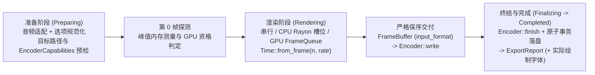

# 导出与 FFmpeg

本页记录导出链路的设计契约：时间轴上的帧如何变为像素、像素如何送达编码器、支持哪些编解码器与像素格式，以及产物文件如何原子提交或在失败时丢弃。[渲染与合成](rendering.md)负责单帧覆盖率、GPU 执行、缓存与帧预算；[音频系统](audio.md)负责离线 PCM 准备；[系统可靠性](reliability.md)负责全局故障模型。使用引导见[导出教程第 11 章](../tutorial/11-export.md)。英文原文（以英文为准）：[../../en/design/export.md](../../en/design/export.md)。

## 流水线模型

[`export`](../../../crates/motion-encode/src/export.rs) 在调用者线程上统一编排内置编码器与自定义编码器（`ExportOptions::encoder`），并始终按递增帧索引严格保序写入：

| 阶段 | 契约与职责 |
| --- | --- |
| `Preparing` | 解析时间轴音频（若存在 `AudioDuration::Fit` 场景则先行适配总时长）、规范化导出选项与帧区间（`selected`）、拦截覆盖冲突与音频源文件自覆写、校验 `EncoderCapabilities`、将时间轴音频混音为 `MixedAudio`，并在渲染任何一帧前调用 `Encoder::open`。 |
| `Rendering` | 帧 `n` 在 `Time::from_frame(n, rate)` 时刻直接渲染为 `Encoder::input_format()` 所声明的 `PixelFormat`（绝不二次重解释），并在每帧交付给 `Encoder::write` 时上报 `ProgressSink::frame_completed`。 |
| `Finalizing` | 调用 `Encoder::finish` 冲刷延迟编码包、关闭临时封装容器并原子提交目标路径，随后附上从每次导出新建观测接收器记录并去重后的 `Vec<FontIdentity>`（字体族名称与来源哈希，复用 `RenderOptions` 或 `RenderCache` 亦不串扰）。 |
| `Completed` | 仅在 `Encoder::finish` 成功提交且 `ExportReport`（含 `path`、`frames`、`range`、`elapsed_seconds`、`bytes`、`fonts`）准备就绪后发出。 |

## 纯原生 API 绑定

视频与音频编码在进程内直接通过 [`motion-ffmpeg`](../../../crates/motion-ffmpeg/src/lib.rs) 调用 `libav*` 原生 C 库函数。引擎绝不派生外部 `ffmpeg` 可执行文件子进程，也不设命令行回退通道；测试套件使用的媒体流自检工具（[`inspect.rs`](../../../crates/motion-ffmpeg/src/inspect.rs)）同样基于原生 `libavformat` / `libavcodec` 解复用构建。`PngSequence` 与 `Gif` 编码器由纯 Rust 实现，完全不依赖 FFmpeg 库。

## 默认值、帧区间与帧率换算

`ExportOptions::new(path)` 默认使用 `Codec::h264(18)`（`EncoderPreset::Medium`）、不透明纯黑背景（`Color::BLACK`）、`48,000 Hz` 音频采样率、`overwrite = false`、`workers = available_parallelism().min(64)` 与 `max_parallel_bytes = 4 GiB`。

| 规则约束 | 契约说明 |
| --- | --- |
| 半开区间 `range` | 必须满足 `0 <= start < end <= duration`；`None` 默认选取 `0..duration`。 |
| 帧网格向上取整 | `start` 与 `end` 按输出帧网格向上取整到下一个帧边界；不包含任何帧的空区间直接校验失败，`ExportReport::range` 记录规范化后的实际区间。 |
| 输出帧率 | 与 `timeline.frame_rate()` 一致；唯一例外是 `Codec::Gif { frame_rate, .. }`，它按自身独立的 `frame_rate` 网格对时间轴采样。 |
| 并发参数边界 | `workers` 必须在 `1..=64` 范围内，且 `max_parallel_bytes` 必须严格大于 `0`。 |

## 编解码器矩阵

| `Codec` 变体 | 封装容器 / 底层库 | `input_format()` | `EncoderCapabilities` | Alpha | 核心约束与说明 |
| --- | --- | --- | --- | --- | --- |
| `H264 { quality, preset }` | MP4 / `libx264` | `Yuv420 { bit_depth: 8 }` | 支持音频，最大 `16,384²`，偶数尺寸 | 不支持 | CRF `0..=51`；`preset`：`Medium`、`Slow`、`Slower` |
| `H265 { quality, preset, bit_depth, params }` | MP4 / `libx265` | `Yuv420 { bit_depth: 8 \| 10 }` | 支持音频，最大 `16,384²`，偶数尺寸 | 不支持 | CRF `0..=51`；`BitDepth::Ten` 选择 Main10（`yuv420p10le`）；可选 `params` `<= 4,096 B` 且严禁 NUL |
| `Vp9 { quality, alpha }` | WebM / `libvpx-vp9` | `Yuv420 { bit_depth: 8 }`；开启 `alpha` 时为非预乘 `SrgbRgba8` | 不支持音频，最大 `16,384²`，偶数尺寸 | 可选 | CQ `0..=63`；拒绝时间轴音频（`WebM` 不提供 AAC 复用路径） |
| `ProRes4444` | MOV / `prores_ks` | 非预乘 `SrgbRgba8`（`yuva444p10le`） | 支持音频，最大 `16,384²`，偶数尺寸 | 支持 | 固定广播级配置，无可调质量或预设 |
| `PngSequence` | `NNNNNN.png` 序列目录 | 非预乘 `SrgbRgba8` | 不支持音频，尺寸无硬上限，倍数 `1` | 非预乘 | 纯 Rust；拒绝时间轴音频与容器元数据 |
| `Gif { frame_rate, colors }` | GIF | 非预乘 `SrgbRgba8` | 不支持音频，最大 `65,535²`，倍数 `1` | 1-bit 透明色板 | 纯 Rust；`2..=256` 色调色板；累积有理数帧延时须落入 `1..=65,535` 厘秒 |

- **透明编解码器自动清除底色：** 通过 `ExportOptions::codec` 选择 `PngSequence`、`ProRes4444`、`Vp9 { alpha: true, .. }` 或 `Gif` 时，会自动将默认的 `Color::BLACK` 背景置为 `None` 以保留透明通道；不透明编解码器默认压平至纯黑背景（可通过 `.render(...)` 显式覆盖）。
- **原生时长、音频与容器元数据：** 原生 FFmpeg 导出要求总帧数在 `1..=u32::MAX` 之间且总时长不超过 `86,400` 秒。时间轴音频编码为双声道立体声 AAC-LC，采样率支持 `44,100`、`48,000`（默认）或 `96,000 Hz`。原生视频流标记为 BT.709 基色与矩阵、受限范围（Limited Range），传递函数默认为 sRGB（`IEC 61966-2-1`），当 `DisplayTransform` 选择 `gamma24` 时切换为 BT.709。MP4 封装启用 `+faststart` 并使用 `705,600,000` ticks/秒作为影片时间刻度与章节刻度。`AudioMetadata` 最多校验 `64` 个容器标签与 `4,096` 个有序不重叠章节，在 `PngSequence` 与 `Gif` 上会被拒绝。若所链接的 FFmpeg 构建缺少对应编码器，将在 `open` 阶段返回 `io::ErrorKind::Unsupported`（由 `VideoCodec::available` 判定）。

## 像素数据交换

[`output.rs`](../../../crates/motion-render/src/output.rs) 定义了 CPU 与 GPU 后端共享的 `PixelFormat` 契约：

- **受支持的像素布局：** `LinearRgba16Float`、`LinearRgba32Float`、`SrgbRgba8 { premultiplied }` 与 `Yuv420 { bit_depth }`（`8` 或 `10` 位、偶数尺寸、BT.709 受限范围，10-bit 按小端序 `u16` 存储）。`FrameBuffer` 持有经过严格边界校验的平面与显式字节步幅（Stride）。
- **量化抖动与裸像素写入：** [`yuv.rs`](../../../crates/motion-render/src/output/yuv.rs) 执行 4:2:0 色度子采样，显示变换量化路径施加确定性的 `4×4` 有序抖动。不透明 `SrgbRgba8` 帧缓冲还额外提供独立的 `write_ppm`（P6）与 `write_rgb` 辅助方法（[`rgb.rs`](../../../crates/motion-render/src/output/rgb.rs)），无需依赖 FFmpeg 或导出级防覆盖暂存即可直接写出裸像素。

## 流式处理与多线程架构

导出流水线逐帧流式推进，绝不在内存中缓存整部影片：

- **专用 `motion-encoder` 编码线程：** `FfmpegEncoder` 启动专用的 `motion-encoder` 工作线程，由容量为 `2` 帧的有界通道供给画面（[`worker.rs`](../../../crates/motion-encode/src/encoder/ffmpeg/worker.rs)）。所有 `libav*` 裸指针（含创建与销毁）完全隔离在该线程内部，工作线程发生 panic 会安全转换为 `Error::Encoder`。注意 `2` 槽通道限制的是排队中的帧消息而非全部存活帧或进程 RSS（生产者与编码器各自还可能同时持有一帧）；音频 PCM 直接从不可变的已准备 `f32` 采样读取，独立于该视频队列。
- **CPU 并发槽位与结构性串行回退：** 当 CPU 后端配置 `workers > 1` 时（[`parallel.rs`](../../../crates/motion-encode/src/export/parallel.rs)；`.workers(1)` 保持串行），第 `0` 帧先行在主线程串行渲染以测量单帧峰值内存，据此在总帧数、首帧逻辑峰值两倍与 `max_parallel_bytes` 约束下收敛并发工作槽位数。并行槽位显式沿用首帧的 CPU 后端决策而不再重新探测 GPU，并平分 `max_parallel_bytes` 而非为每个槽位预留完整的单帧上限。私有 Rayon 线程池令槽位 `i` 按步长渲染帧 `i, i + workers, ...`，协调器严格按帧索引顺序退休并写出帧，确保输出字节与串行执行逐位一致（`parallel_export_matches_serial_pixels_ntsc_ranges_and_progress`）。若后续某帧超出单槽位的 `max_bytes` 预算上限，**唯有**该结构性内存准入错误会汇合工作线程并在原始单帧限制下串行继续尚未写入的帧；无效内容、工作量限制错误与 panic 立即向上传播。因此场景闭包必须是纯函数且可重复求值。
- **GPU 准备与回读队列：** 当启用 `gpu` 特性、`backend != Cpu`、导出帧数大于 `1`、`Gpu::supports_packed_output` 支持当前 `(size, format)` 且成功激活 `GpuContext` 时（[`gpu.rs`](../../../crates/motion-encode/src/export/gpu.rs)），第 `0` 帧同时探测 CPU 准备/规划最大值与 `OutputPlan::peak_bytes`，将并行 CPU 工作槽位与单一渲染会话的 `FrameQueue`（`1..=3` 个在途槽位；工作线程数由实测决定而非固定为两个）分离。工作线程通过 `OutputPlan::with_planning_limit` 在各自槽位内约束 CPU 准备与设备无关规划开销（保守计入设备与暂存预留），而完成的计划保留原始提交限制，并在提交到 `FrameQueue` 前检查在途字节（空间不足时先完成最早的输出），再严格按序提交与编码。仅有槽位字节准入失败会汇合工作线程、排空队列并在原始单帧限制下串行重试。聚合并行额度不含编码器存储、共享 `Assets`、缓存与空闲池，也不构成进程 RSS 上限。

## 事务性落盘与防覆盖保证

| 输出目标 | 事务暂存机制 |
| --- | --- |
| 视频（`MP4`、`MOV`、`WebM`）与 `Gif` | 先写入目标父目录下的临时文件 `.motion-video-*` / `.motion-gif-*`，终结时通过 `persist`（`overwrite = true`）或 `persist_noclobber`（`overwrite = false`）原子替换落盘。 |
| `PngSequence` | 将序列帧写入同级 `.motion-png-*` 临时目录，终结时原子安装或交换目标目录（在支持的平台上调用 `renameat_with` 的 `NOREPLACE` 或 `EXCHANGE`；覆盖时要求已有目标必须为真实目录）。 |
| 自定义 `Encoder` | 自行维护暂存事务边界；发生错误或被取消后 Drop 未完成的编码器必须彻底丢弃半成品产物。 |

- **目标路径保护与 Unix 创建权限：** 当 `overwrite = false` 时，若目标已存在，流水线会在调用 `Encoder::open` 或求值任何一帧之前直接报错 `io::ErrorKind::AlreadyExists`。当 `overwrite = true` 时，旧文件或旧目录在最终原子提交前保持完好无损。若导出目标规范化路径正被时间轴的某个 `AudioSource::File` 引用，即便 `overwrite = true` 也会无条件拒绝，防止边读边覆写音频源。在 Unix 上，事务性的 PNG、GIF 与原生视频文件请求 `0666` 创建权限，`PngSequence` 暂存目录请求 `0777` 权限；新建与覆盖输出均遵循进程 `umask`，导出过程绝不读取或修改 `umask`。取消、报错或提前 Drop 均会自动清理暂存临时文件与目录（[`native.rs`](../../../crates/motion-encode/src/encoder/ffmpeg/native.rs)）。

## 协作式取消与错误处理

- **协作式轮询：** `ProgressSink::is_cancelled` 在准备前、帧与帧之间、有界工作队列阻塞等待期间（每 `10 ms` 轮询一次）及终结冲刷阶段持续检查；一旦触发立即返回 `Error::Cancelled` 且零产物落盘。
- **带帧号的类型化归因：** 场景求值与光栅化错误通过 `Error::at_frame` 附带出错帧索引。第 `0` 帧或并发工作线程上的 panic 由 `catch_unwind` 捕获并报告为 `Error::ScenePanic`。原生编解码与封装错误统一封装为 `Error::Encoder`（内含附带 FFmpeg 错误码与消息的 `io::Error`）。`Encoder::write` 拒绝乱序帧索引、尺寸不匹配或像素格式不符的帧，而 `Encoder::finish` 拒绝帧数未写满的终结请求。

## 特性开关、平台要求与 `unsafe` 边界

| 维度 | 说明细节 |
| --- | --- |
| `ffmpeg` 特性（`motion-encode`，`motion` 默认启用） | 启用进程内 `libav*` 音视频编码；关闭时视频编解码器在 `open` 阶段返回 `Unsupported`，而纯 Rust 的 `PngSequence` 与 `Gif` 保持可用。 |
| `gpu` 特性 | 启用 GPU 端输出像素打包与流水线化 `FrameQueue` 导出路径。 |
| 构建与运行时依赖 | 构建需安装 `pkg-config`、FFmpeg 开发头文件与库（`libavformat`、`libavcodec`、`libavfilter`、`libswscale`、`libswresample`、`libavutil`）以及供 `bindgen` 使用的 `libclang`（[`build.rs`](../../../crates/motion-ffmpeg/build.rs)）；运行时动态库（Unix 下通过 `rpath` 解析）须包含 `libx264`、`libx265`、`libvpx-vp9`、`prores_ks` 与 `aac`。 |
| 隔离的 `unsafe` FFI 边界 | 全工作区所有 `unsafe` 代码块均隔离在 `motion-ffmpeg` 内，受 `unsafe_op_in_unsafe_fn = "deny"` 与 `clippy::undocumented_unsafe_blocks = "warn"` 约束，每处均附带显式 `// SAFETY:` 不变式注释。`bindgen` 仅白名单导出所需 C 符号，`Encoder` 独占持有并在 `Drop` 中释放 `libav*` 句柄（且绝不提交半成品），向 `motion-encode` 及上层仅暴露纯安全 Rust 接口。 |

## 归属源码 (Owning sources)

- [`crates/motion-encode/src/export.rs`](../../../crates/motion-encode/src/export.rs)、[`export/options.rs`](../../../crates/motion-encode/src/export/options.rs)、[`export/render.rs`](../../../crates/motion-encode/src/export/render.rs) — `export`、`ExportOptions`、`Codec`、`Encoder`、`EncoderCapabilities`、`ExportReport` 与帧区间规范化。
- [`crates/motion-encode/src/export/parallel.rs`](../../../crates/motion-encode/src/export/parallel.rs)、[`export/gpu.rs`](../../../crates/motion-encode/src/export/gpu.rs) — 有界 Rayon CPU 工作槽位、结构性预算串行回退与流水线化 GPU `FrameQueue` 导出。
- [`crates/motion-encode/src/encoder/ffmpeg.rs`](../../../crates/motion-encode/src/encoder/ffmpeg.rs)、[`encoder/png.rs`](../../../crates/motion-encode/src/encoder/png.rs)、[`encoder/gif.rs`](../../../crates/motion-encode/src/encoder/gif.rs) — `FfmpegEncoder`（`motion-encoder` 线程）、`PngSequenceEncoder` 与 `GifEncoder`。
- [`crates/motion-ffmpeg/src/lib.rs`](../../../crates/motion-ffmpeg/src/lib.rs)、[`encoder.rs`](../../../crates/motion-ffmpeg/src/encoder.rs)、[`settings.rs`](../../../crates/motion-ffmpeg/src/settings.rs)、[`inspect.rs`](../../../crates/motion-ffmpeg/src/inspect.rs) — `unsafe` `libav*` FFI 边界、色彩元数据、`+faststart` MP4 封装与原生媒体流自检。
- [`crates/motion-render/src/output.rs`](../../../crates/motion-render/src/output.rs)、[`output/yuv.rs`](../../../crates/motion-render/src/output/yuv.rs)、[`output/rgb.rs`](../../../crates/motion-render/src/output/rgb.rs) — `PixelFormat`、`FrameBuffer`、BT.709 `Yuv420` 转换与裸 RGB/PPM 写入器。
