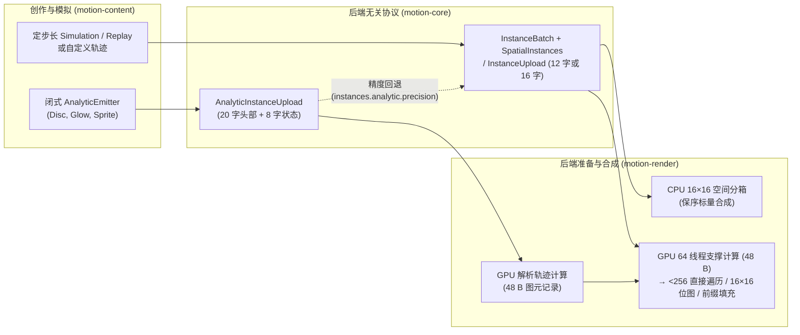

# 粒子系统与实例协议契约

粒子系统以单条 `InstanceBatch` 显示列表指令执行，而非展开为子 `Node` 树。本文档规定 [`motion-core`](../../../crates/motion-core/src/instances.rs)、[`motion-content`](../../../crates/motion-content/src/particles.rs) 与 [`motion-render`](../../../crates/motion-render/src/gpu/particle_tiles.rs) 共用的记录结构、CPU/GPU 求值与空间分块协议、准入限制及确定性重放不变量。创作接口与示例见[粒子系统教程](../tutorial/07-particles.md)，帧级 GPU 调度见[渲染与合成](rendering.md#gpu-渲染)，共享精灵图驻留见[资源管理](resources.md#预算配额与内存计量)。

## 记录结构与执行流水线

Motion 将创作与模拟状态（`Particle`）同后端无关的图元记录（`InstanceRecord`、`ExtendedInstanceRecord`）、闭式 GPU 轨迹上传（`AnalyticInstanceUpload`）以及设备端支撑元数据严格分离。引擎不存在第二套基于 `Layer` 的粒子运行时，也不包含任意 GPU 轨迹程序解释器。

| 结构 | 归属 | 布局 | 契约说明 |
| --- | --- | --- | --- |
| `Particle` | `motion-content` | `72` 字节（`#[repr(C)]`） | 运行时模拟与轨迹状态：`position`、`velocity`、有限线性预乘 `color`（`alpha` 位于 `0..=1`，保留未截断 HDR RGB，`alpha == 0` 时 RGB 为零）、`size`（`0..=4096`）、`rotation`、`age >= 0`、`lifetime`（`(0, 3600]` 秒）、不回收的 `index: u64` 以及 `custom: [f32; 4]`。 |
| `InstanceRecord` | `motion-core` | `12` 个 `f32` 字（`48` 字节） | 基础已求值图元（`Disc`、`Glow`、`Sprite`、`Segment`）：包含 `position`、`start`、`color`、`radius`、`rotation`、`width` 与 `InstanceKind`（`0..=3`）；不携带寿命、速度、随机种子、模型或模拟历史。 |
| `ExtendedInstanceRecord` | `motion-core` | `16` 个 `f32` 字（`64` 字节） | `InstanceRecord`（`base`）加 `extra: [f32; 4]`，支持全部 13 种 `InstanceKind`（`0..=12`），新增 `SpriteSheet`、`TaperedSegment`、`Polygon`、`Ring`、`Capsule`、`Soft`、`Quad`、`Bokeh` 与 `Ribbon`。 |
| `InstanceUpload` | `motion-core` | `4` 字（`16` 字节）头部 + `count * stride` 字 + 可选 RGBA 纹素 | 头部 `[count, sprite_width, sprite_height, layout]`，其中 `layout = stride + (blend_id << 5)`（低 5 位为记录步长 `12` 或 `16`，第 5 位以上编码 `InstanceBlend`，在 `f32` 下精确无损）。 |
| `AnalyticInstanceUpload` | `motion-core` | `20` 字（`80` 字节）头部 + 每实例 `8` 字（`32` 字节） | 已准入的显式种子、帧时间、有界模型参数及每实例 `AnalyticInstanceState`，在 GPU 上闭式求值为 `48` 字节图元记录。 |
| GPU 支撑元数据 | `motion-render` | 每实例 `48` 字节（`max(count * 48, 16)`） | 由独立 `64` 线程计算 pass 生成的独立计费设备缓冲区，绝非 `InstanceUpload` 的别名。 |

## CPU 空间分箱与合成

当 `InstanceBatch::spatial()` 提供 `SpatialInstances` 时，内置批次会将每个实例的保守支撑区域投射到 `16×16` 设备空间分块（tile）中。每个分块以升序保留原始实例索引，使逐像素标量覆盖率与合成仅访问重叠候选图元，同时严格维持源顺序。

- **保守支撑包围盒。** 包围盒保留 `Glow` 的 `3×` 半径截断、旋转精灵、线段与拖尾跨度、抗锯齿羽化及数值保护边距。无法在有限设备坐标内可靠构造包围盒的批次，或未提供 `SpatialInstances` 的自定义 `InstanceBatch` 实现，自动回退为遍历完整有序切片。
- **零源透明恒等。** 采样在遇到零源透明样本（`alpha == 0` 且 RGB 全为 `0`）时跳过目标像素读写，并按原始顺序执行所有非零贡献（包括 `alpha == 0` 的发光加法 HDR 贡献）。
- **准入与失败原子性。** 分块元数据与索引条目计入逻辑活跃与峰值字节数；工作量按分箱构建开销与各分块实际访问的实例像素数计费，而非 `instances * frame_pixels`。这仅细化算法工作量计量，不改变配置的 `RasterLimits`。渲染失败绝不会提交部分更新的公开输出帧，工作量计数的下降也不代表跨后端逐字节一致或实时帧率承诺。

## 上传协议与扩展图元

`Canvas::instances` 与 `InstanceBatch` 仍是任意自定义轨迹、CPU 定步长物理模拟以及闭式解析集合之外样式的求值边界。`InstanceUpload` 在构造时校验 `count <= MAX_INSTANCE_COUNT`（`1,048,576`）、有限几何与颜色、精灵图尺寸（`width` 与 `height` 同时为 `0` 或同时位于 `1..=16_384`）、精确的线性 RGBA 纹素数量以及受检内存分配。未提供 GPU 上传载荷的纯 CPU 批次会被显式 GPU 消费者直接拒绝，而不会悄然切换后端。

- **统一头部与混合策略。** `InstanceUpload::new` / `new_blended`（`stride = 12`）与 `InstanceUpload::new_extended`（`stride = 16`）均在头部字 `3` 写入 `stride + (blend_id << 5)`，可选的共享精灵纹素统一紧接在 `4 + count * stride` 字之后。`InstanceBlend`（`SourceOver`、`Plus`、`Screen`、`Multiply`）为批次级合成策略：未显式指定时，`GlowDots` 默认使用 `Plus`，其余内置样式默认使用 `SourceOver`，`ParticleVisual::blend` 可在双后端上统一覆盖任意样式。
- **扩展图元不变量（`ExtendedInstanceRecord`）。** 扩展图元不改变 `Disc`、`Glow`、`Sprite` 与 `Segment` 的既有判别值（`0..=3`），并在构造时校验有限参数且不截断 HDR RGB：
  - `SpriteSheet`：`base.width` 存放 `(0, 64]` 范围内的拉伸宽高比；`extra` 存放归一化 `[u0, v0, u1, v1]` 晶格边界（`0..=1`，且 `u0 < u1`、`v0 < v1`）。
  - `TaperedSegment` 与 `Ribbon`：`base.width` 存放起点直径，`base.radius` 与 `base.color` 存放终点半径与颜色，`extra` 存放线性预乘起点 RGBA，两端 `alpha` 均须位于 `0..=1`。
  - `Polygon`、`Ring`、`Soft`、`Capsule`、`Quad` 与 `Bokeh`：分别校验整数多边形边数（`3..=32`）、内径比（`(0, 1]`）、柔和度（`0..=1`）、`extra[2]` 中的宽高比（`Capsule` 与扩展 `Sprite` 为 `1..=64`，`Quad` 为 `(0, 64]`），以及散景叶片数（`0` 或整数 `3..=32`）与圆度/边缘增强（`0..=1`）。
- **精灵图集驻留。** GPU 规划阶段在 `12` 字与 `16` 字步长下均将不可变的尾部精灵纹素与单次绘制的头部和记录分离。Binding `11` 直接读取驻留在 `GpuContext` 中的图集，缓存命中时改变时间、实例坐标或绘制变换不会重复上传像素。原始 `InstanceUpload` 仍保留尾部纹素供 CPU 消费；GPU 准入在缓存命中时依然全额计入主机比较存储、最坏设备上传字节与比对工作量，且设备存储上限判定独立于缓存占用（见[资源管理](resources.md#预算配额与内存计量)）。
- **有界邻域与历史轨迹查询。** `Plexus` 采用确定性空间哈希（`NeighborIndex`），最多支持 `65,536` 个粒子状态并强制执行配对与逻辑工作量上限，绝不退化为无界 $O(n^2)$ 扫描。多段拖尾（`Trails`）与丝带（`Ribbon`）对同一历史时刻共享一次采样与 ID 查找：单次渲染在已准入的工作缓冲区（`64 MiB` 历史/索引上限）内持有前向 `ReplayCursor`，按升序推进查询时刻（位于最近快照与目标时刻之间时继续前向递推，否则从最近快照重放），并在本次渲染结束时立即释放，不保留跨帧状态，保证同一帧重复渲染结果完全一致。

## GPU 求值与有序分块

GPU 后端从直接上传记录或闭式解析状态准备 `48` 字节图元记录，再统一进入支撑计算与有序 `16×16` 分块：

- **闭式解析轨迹求值（`AnalyticInstanceUpload`）。** 符合条件的内置 `AnalyticEmitter`（`Ballistic`、`Converge`、`Orbit`、`NoiseDrift` 下的 `Disc`、`Glow` 与 `Sprite`）上传显式种子、帧时间与有界模型参数，无需在 CPU 侧上传求值后的坐标。上传最多准入 `1,048,576` 个状态，要求 `0 <= age < lifetime <= 3600` 秒、数值量级 `<= 1,000,000`、时间与噪声相位 `<= 8192`。超出 `f32` 安全精度范围时在 `instances.analytic.precision` 报告 `Unsupported`，递增 `InstanceBatch::analytic_fallback` 与准备阶段的 `analytic_cpu_fallbacks` 计数，并回退至 CPU 物化图元记录，但不切换整帧后端，也不改变 CPU 参考流。定步长物理模拟绝不在 GPU 上执行。
- **支撑 pass 与 `< 256` 直接遍历。** `64` 线程计算 pass 将每个图元的保守支撑区域写入独立计费的 `48` 字节元数据缓冲区（`max(count * 48, 16)` 字节）。少于 `256` 个实例的小批次保留直接循环着色器路径，避免分箱调度与同步开销。
- **保序位图分块（`>= 256` 主路径）。** 当位图（bitset）布局及其保守工作量满足设备存储与 `RasterLimits` 时，单次 `64` 线程计算 pass 为每个粒子分配一个调用，在其覆盖的每个 `16×16` 分块中原子置位源顺序对应的位（每 `32` 个粒子占一个 `u32` 字）。特化的分块合成流水线从低位到高位枚举置位位，无需回读 GPU 摘要即可严格保持混合顺序。
- **计数–前缀和–填充回退路径。** 当位图超出预算或设备上限时，GPU 分块执行 `count`、`prefix` 与 `fill` 三趟计算 pass，先回读 `16` 字节摘要（`references`、64 位工作量、`overflow`），再分配对齐的独立 `16` 字节引用记录（消除打包分量并发读写竞争）并准入实际分块像素工作量。索引、设备存储或工作量一旦溢出即在公开输出提交前令该帧失败，绝不静默截断索引。返回的单帧统计反映实际路径的工作量与存储，而内部 GPU 计划统计仅记录静态准入开销；实测吞吐量数据归属[性能基准](../benchmarks.md)。

## 定步长模拟重放与碰撞

CPU 定步长物理模拟（`Simulation`）基于显式种子确定性推进（默认步长 `1/240` 秒），并在不可变的 `PreparedReplay` 中保留有界快照以供随机帧时刻求值。

- **配额上限（`SimulationLimits`）。** 默认上限为 `16,384` 个存活粒子（启用双相位 `loop_period` 交叉淡入淡出时每条通道各占 `max_particles / 2`）、保留快照加工作缓冲区与事件队列总计 `64 MiB`、`1,000,000` 步、`100,000,000` 工作单元、子发射器递归深度 `8`（硬上限 `32`）、累计出生 `1,000,000` 个粒子以及每步 `65,536` 个排队事件。无缝循环的两个相位共享单次渲染查询的工作量预算。
- **标准快照与增强快照。** 简单模拟保留紧凑快照与原有带键随机流；使用事件触发、子发射器、群体规则（`Boids`、`ParticleCollisions`）、`prewarm`、`loop_period`、时间重映射、多工作线程求值或依赖出生状态的强度/颜色规则时，自动启用携带出生颜色与子发射深度的增强快照。全局单调不回收的 `u64` ID、保序事件队列以及按规则与步长隔离的 `Random` 键确保模拟结果与工作线程数完全无关；自定义回调中的 panic（含汇合工作线程的 panic）会原样向上传播。
- **扫掠碰撞体与有向距离场（SDF）。** 解析碰撞体与 `SignedDistanceGrid`（`SdfCollider`）以 `Particle::size` 作为碰撞半径。SDF 网格保留带符号距离采样与精确缓存的边界保护带，要求显式声明分辨率与准备预算且满足单步位移 `speed * step < cell_size`，缓存键完整纳入几何身份、包围盒、分辨率与准备预算。边界保护带保护展平后保留下来的细薄几何特征，但不会恢复已被声明的表面展平容差省略的原始曲线。

