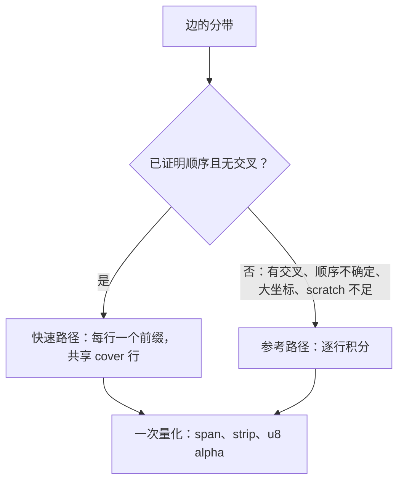
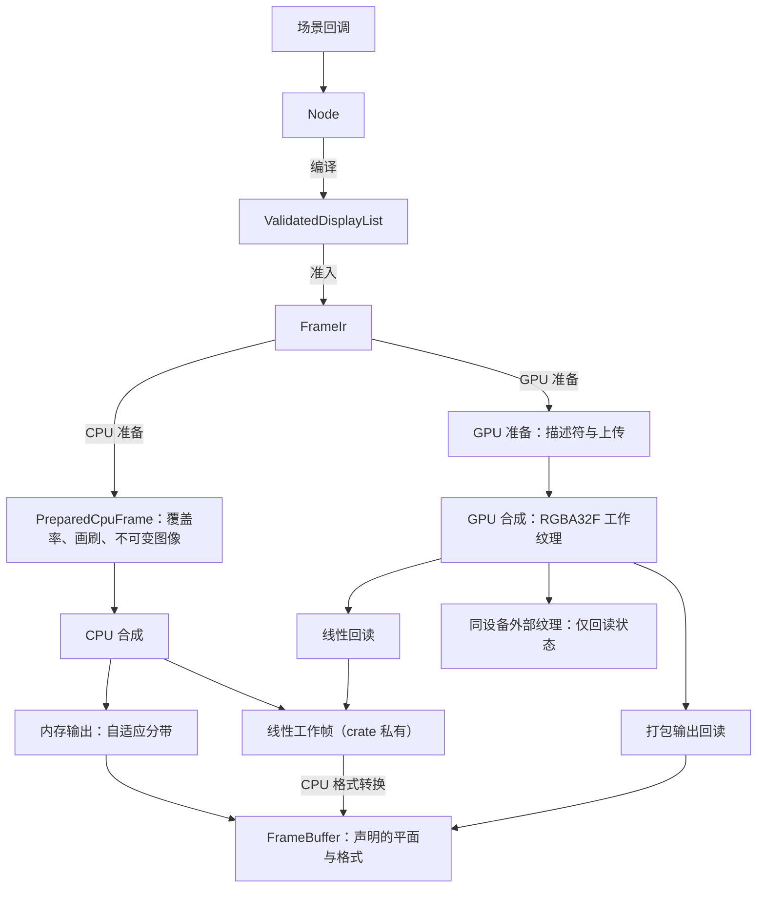
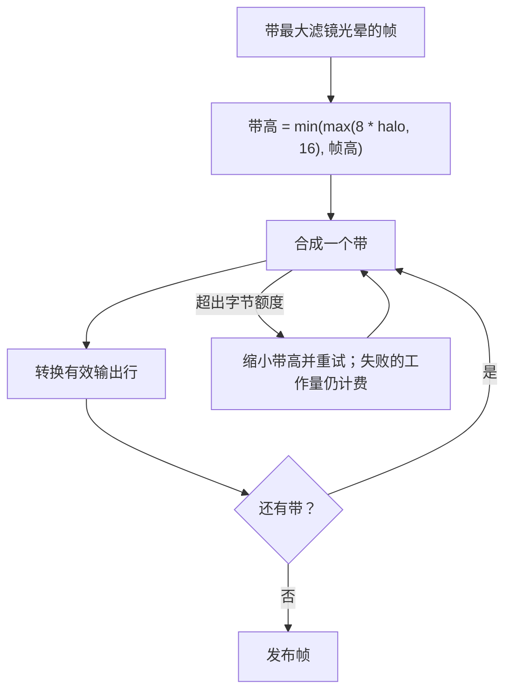
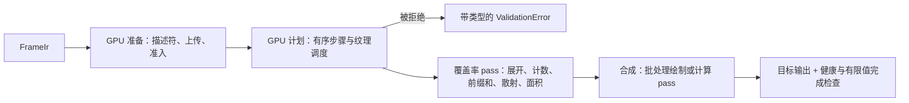
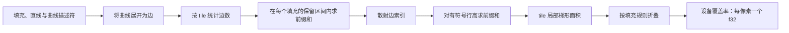
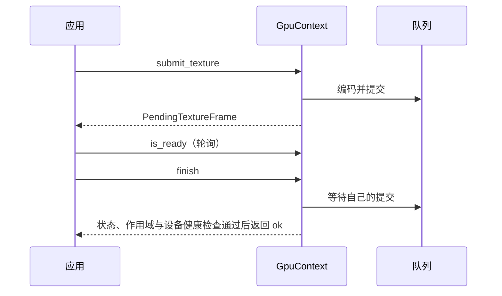
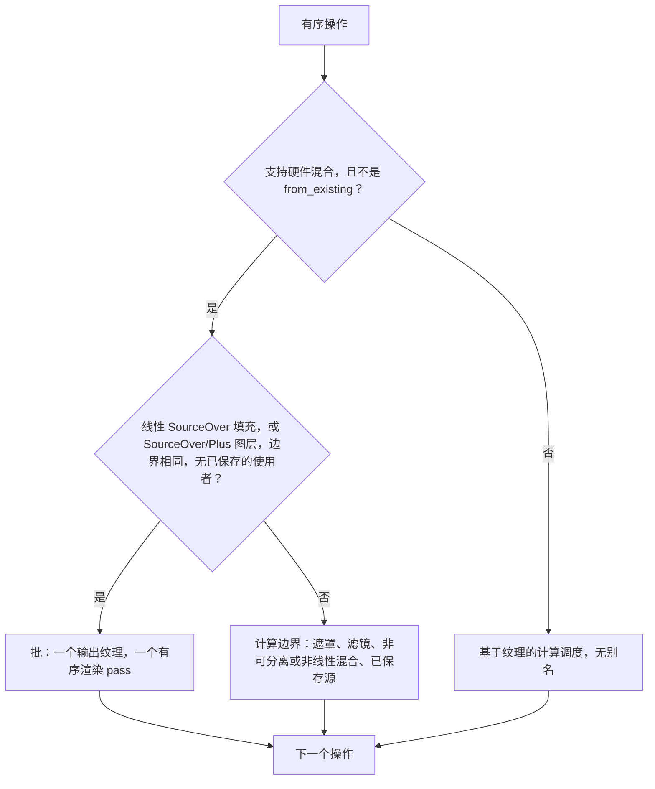
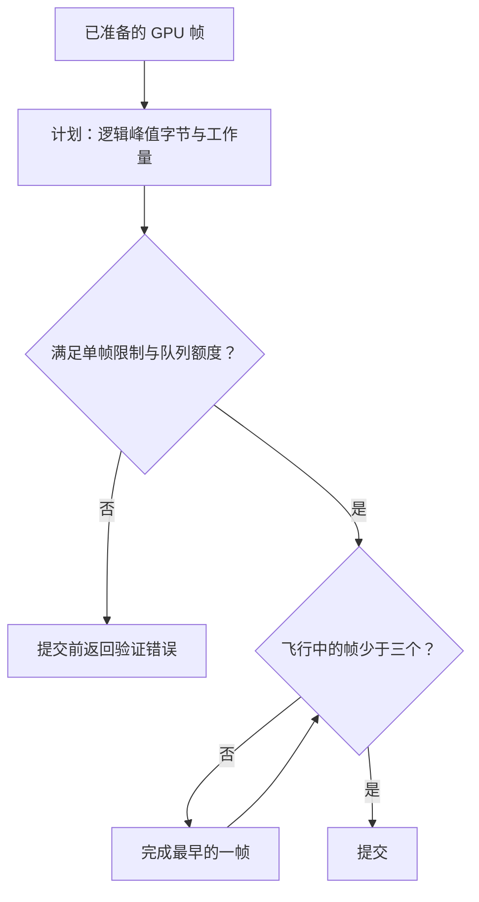

# 渲染与合成

使用 `motion::prelude` 进行创作，`motion::render` 获取渲染契约，`motion::extend` 获取实现协议。已准备的覆盖率（strip、span、画刷记录与图层）以及 GPU 计划是 [`motion-render`](../../../crates/motion-render/src/lib.rs) 的 crate 私有内容；`PreparedCpuFrame` 只公开尺寸、统计与计数。逻辑尺寸使用 `f64`；输出的 `PixelSize` 使用正整数维度。`Composition` 会把逻辑内容等比包含进输出视口。多帧时间线导出、并发工作线程调度以及视频/GIF/序列帧编码归属[导出与 FFmpeg](export.md)。英文原文（以英文为准）：[../../en/design/rendering.md](../../en/design/rendering.md)。

## 后端准备与效果

`FrameIr` 在分配任何覆盖率之前，先校验全部内容，并规范化设备空间曲线、作用域、画刷、裁剪与滤镜域。它准入结构存储、资源字节以及保守的 Wang 线段上界。CPU 后端与 GPU 后端各自独立消费这份不可变描述。

规范化后，两个后端都跳过零透明度图层内的填充覆盖率，包括嵌套的滤镜和遮罩作用域。隐藏内容仍需通过结构与几何校验，但不会占用设备填充数、像素数或覆盖率工作量上限。
GPU 规划也跳过完整的零透明度作用域，因此隐藏的填充、滤镜 pass、遮罩捕获和图层合成不会分配执行纹理或生成 GPU pass。命令遍历仍计入预算，匹配的作用域闭合后恢复处理可见的兄弟节点。

公开的 `RenderPrepare` 与 `PreparedCpuFrame` 只描述 CPU 覆盖率。GPU 会话与打包导出工作线程使用独立的准备结果，从不构造 CPU 准备帧；底层 GPU 使用者仍可显式上传一个 CPU 准备帧。符合条件的填充由设备生成覆盖率，参见 [GPU 渲染](#gpu-渲染)。

`PreparedGpuFrame` 直接持有共享的 `FrameRecords` 与 GPU 特有的设备几何。内部渲染与公开输出规划使用同一个已准备的值，无需单独的内部帧包装器。其记录保持私有，不公开任何 CPU 渲染 API。

### CPU 覆盖率

CPU 准备用设备空间容差展平曲线、积分多边形面积并记录紧凑的覆盖率。两条路径都不是超采样渲染器。没有相交的带使用经过验证的面积/覆盖前缀快速路径；其余带使用精确的逐行积分参考路径：

1. 在保持边顺序所需的事件处建立垂直切分，包括相关的交点。
2. 对每个区间内的活动交叉点排序，并更新 NonZero 绕数或 EvenOdd 奇偶，合并连续的内部区域。
3. 以 f64 对像素列裁剪并积分梯形，然后把覆盖率量化为紧凑的 span、strip 与 u8 alpha。



快速路径对整个带的边只排序一次，并证明每个活动区间的顺序相同。只有被证明重合的边或共享端点才会绕过其舍入保护。填充规则的状态变化选出真实的填充边界，因此重叠轮廓不会被盲目求和。回退绝不修改覆盖率；即使回退也会计入证明工作量，scratch 在成功与拒绝时都会释放。较紧的字节限制可能选择峰值更低的回退，所以不受限运行的峰值不一定是最小可准入限制下的峰值。

每带最多四行、以四列为一组的分组会省略空覆盖，把完全覆盖的组合并为 span，把边缘覆盖保留为 strip。每个面积只量化一次（钳制、乘法、半稳定 epsilon、舍入），存放在带的 scratch 中并复用于 strip 输出。Strip 与 span 的原点是绝对坐标；平移后的缓存可能改变对齐，因此使用者应采用每条记录的实际坐标与高度。矩形有专门的解析路径。两条 CPU 路径都保持 CPU 覆盖率格式与精确的参考重放。

曲线展平使用设备空间中 Wang 的二阶导数上界：弦误差至多为 `0.75 * curvature / count^2`。曲线分段数向上取整到满足该上界的最小偶数，这在省略水平边时保持对称反转。该上界是以等号满足的，所以依赖面积而非边位置的使用者要自行选择容差：`VectorTree::surface` 使用 0.0025 个树单位。重放遵循[同环境确定性契约](reliability.md#确定性重放保证)，而不是跨平台逐字节一致或精确曲线面积的承诺。

会话准备会在覆盖率缓存未命中之间复用多边形带面积、边扫描、活动边、行交叉与梯形列的存储。每个带仍会把其准入的面积值清零，并保持相同的积分顺序、字节与工作量计费及失败边界；只有向量容量得以保留，每个向量每个会话最多空闲 1 MiB，与共享覆盖率缓存无关。超大的存储在该路径结束后丢弃，包括失败的尝试。形状裁剪的光栅化仍分配自己的 scratch。

### CPU 合成

CPU 合成采用标量、面向行的实现。纯色 `SourceOver` 的 span 把剩余 alpha 项提到像素循环之外；其他所有模式保持逐像素公式与精确运算顺序，不使用乘加融合。每个像素在发布前都检查工作存储是否有限，合成失败时目标保持不变。

合成有意排除以下两条经场景实测证明开销大于收益的路径：

- **逐像素通道向量化（`wide` 的 `f32x4`/`f32x8` `SourceOver`、`f64x4` 混合与覆盖率量化）：** 逐像素通道打包与有限值检查的开销与被替代的标量运算相当；仅事先实测获胜的逐行循环才可引入 SIMD。
- **帧内分块并行 Rayon 池与融合点滤镜：** 带滤镜的帧无法使用，多数图层规模会因同步开销回退，而 CPU 导出工作线程本就在帧粒度上通过 Rayon 并行。

### 效果

效果使用共享的有序 Filter 原语。布局边界保持不变，准备阶段推导保守的设备捕获区域。子效果先于父效果完成；源经过滤镜、遮罩或裁剪，然后以不透明度与混合合成。保存源的操作保留其显式输入。覆盖率裁剪、几何求交与内容遮罩有不同的量化与顺序契约。用法参见[绘制](../tutorial/05-drawing.md)。

- **模糊**使用有界归一化的盒式近似与透明边界。CPU 的均匀盒在半径 1 与 2 时使用直接的整数加权采样。更大的半径使用滑动窗口：由一个对齐的 2r+1 样本块的后缀加上下一个块的前缀构成，因此每个样本只做加法、从不再减，无论半径多大每个样本都是三次加法，并且离开窗口的大 HDR 值不会抹掉剩下的较小值。垂直 pass 一次遍历整行、最多 32 KiB 的和表，使表留在 L1 中。窗口全为透明黑的块不经求和直接写出，输出逐位一致。pass 缓冲区事先不清零，只清零写入域之外的像素。小 sigma 的小数核保持其加权路径。所有路径都保持有限值检查、计费字节（和表在每个 pass 计费并释放）以及同后端的精确重放。大盒的累加顺序与早先的补偿式和不同，所以历史输出会在 f32 舍入级别上有差异；跨后端容差不变。
- **泛光（Bloom）**是两个后端共享的降采样金字塔。第 `k` 层像素 `(x, y)` 对第 `k - 1` 层位于 `(2x, 2y)` 的 2×2 块取平均，坐标为设备坐标减半 `k` 次。每一层都从其未模糊的父层降采样，然后以 `radius` 个本层像素模糊，覆盖 `radius * 2^k` 个设备像素。从最粗的层开始，每个更细的层把其归一化权重乘以自己的模糊结果，加到以 `((x + 0.5) / 2 - 0.5, (y + 0.5) / 2 - 0.5)` 双线性采样的更粗层之和上。着色、alpha 钳制与 Plus 合成只对全分辨率之和应用一次。`motion_core::filter::bloom_bounds` 给出支撑范围，GPU 计划使用几何相同的 `Downsample` 与 `Upsample` 步骤。粗层的开销是其父层的四分之一，所以整个金字塔约为一次全分辨率模糊的 4/3。
- **散景（Bokeh）**（`Optics::Bokeh`）使用 `Optics::bokeh_taps(radius)` 个孔径采样点，即 `ceil(1.4 * radius^2)` 并限制在 8..=64，在达到上限之前使 Vogel 螺旋间距保持在约 1.5 像素。两个后端都从共享参数读取该数量，并按每个采样点四次读取计费。
- **精确的捷径。** 多个阶段跳过或缩短工作而不改变任何输出位：`ChannelOffset` 只采样所需的通道与 alpha，并丢弃权重为零的双线性采样；图层合成与 Glow 跳过透明黑的源像素（在所有模式下合成都不会改变它们）；RGBA8 编码器通过对阈值位模式的桶索引查找抖动后的字节，不透明像素走直接路径。
- **墨迹（Ink）。** 最终画笔墨迹在每次带索引的候选距离计算执行之前先准入，依据 3200 万的默认材质上限，而不是因为纹素数乘以全部采样数超过该上限就拒绝纹理。纹理尺寸与 262144 纹素的上限不变，准备失败不会发布材质图像。材质准入与帧的光栅工作量和字节相互独立。距离笔画比任何覆盖或晕染所能到达的范围更远的纹素，经几次包围盒测试后直接写为透明；这与完整的最近线段搜索逐位一致。

未加滤镜且没有额外裁剪的 CPU `PushLayer`/`Fill`/`PopLayer` 序列可以直接绘制到父层，而不分配隔离图像。每个被覆盖的像素仍然填充透明的局部像素、舍入、应用图层不透明度，再次舍入后才进行原始混合；不透明度不会折叠进画刷 alpha。曲线与相交路径保留共享的非重叠覆盖率记录。带滤镜的图层、添加了 alpha 或几何裁剪的图层、继承了几何裁剪的图层以及多项目图层保持隔离合成。

准备阶段还会把符合条件的、无滤镜无裁剪的 Plus/LinearPlus 捕获区域，与 Fill 覆盖和已完成子图层边界的并集求交。带滤镜的子图层贡献其完整的保守捕获区域（含光晕）；遮罩所有者与粒子捕获保留其原始边界。这种边界收缩同时适用于 CPU 与 GPU 使用者，其条件扫描与栈元数据在准备阶段准入。

## 帧与静帧

Composition 拥有一个 `FrameClock`（有理帧率与帧数，不设默认值）和一个 `RenderOptions`（尺寸、背景、资源、后端策略等）；除 `with_options` 与 `configure` 之外没有逐项设置器。随机访问帧与缓存复用请复用 `frame_renderer(size)`，其 `FrameRenderer` 包装一个 `RenderSession`。对于 Timeline 输出，`render_still` 与导出使用相同的 `RenderOptions` 策略。`render_frame` 与 `render_frame_sampled` 返回完全不透明的直通 `SrgbRgba8` `FrameBuffer`：帧合成在 `RenderOptions::background`（取为不透明）之上，未设置时合成在白色之上。其 `write_ppm` 与 `write_rgb` 显式截断或替换所选文件，并拒绝非不透明缓冲区。需要透明 PNG 时请使用 `render_still` 与直通 RGBA8 `FrameBuffer`：它在目标目录内创建临时文件过渡暂存（Unix 下请求 `0666` 权限并遵循进程 `umask`，不读取或修改 `umask`），且除非显式允许覆盖否则保护已有目标文件。多帧导出的暂存与目录权限见[导出与 FFmpeg](export.md#事务性落盘与防覆盖保证)。

```rust,no_run
use motion::prelude::*;
use motion::render::Composition;
let composition = Composition::new(320, 180, motion::render::FrameClock::new(fps!(30), 60));
let mut renderer = composition.frame_renderer(Size::new(320.0, 180.0))?;
let circle = Circle::new(Point::new(160.0, 90.0), 24.0)?;
let frame = renderer.render_frame(15, |_| {
    Node::from(circle.clone().fill(Color::rgb(20, 160, 130)))
})?;
frame.write_ppm("frame.ppm")?;
# Ok::<(), motion::Error>(())
```

`RenderOptions` 选择输出尺寸、背景与透明度、后端、资源、结构与光栅限制，以及可选的快门采样。`FrameBuffer` 保留其声明的平面与格式：直通或预乘的 sRGB RGBA8、线性预乘的 RGBA16F 或未量化的 RGBA32F，或有限范围 BT.709 的 8 或 10 位 YUV420。YUV 要求偶数维度与不透明像素。没有隐式的 HDR 色调映射。`PreparedCpuFrame::render_linear` 与 `Gpu::render_linear` 返回 RGBA32F 的 `FrameBuffer`，可由 `FrameBuffer::linear_pixel`、`linear_pixels` 与 `to_format` 读取或转换；它们背后的 CPU 工作帧是 crate 私有的。

`RenderQuality::Final` 是默认的生产策略。Draft 显式允许在几何、快门采样与墨迹材质上使用预览近似；它不是不同的输出分辨率，也不等价于 Final 的结果。当 sigma 至少为 1 时，Draft 模糊使用一个方差匹配的盒，更小的 sigma 保持 Final 的小核策略。质量必须在重放与缓存标识中保持固定。Studio 在播放与拖动时请求 Draft，导出时强制使用 Final；参见 [Studio 指南](studio.md#预览与回放)。

### 执行与输出路径

创作、准备与像素执行是相互分离的边界。两个后端都消费 `FrameIr`：CPU 后端准备 CPU 覆盖率，而 GPU 后端在设备上为符合条件的填充生成覆盖率，其余的上传。图中展示的是主要路径，不包含所有常量帧或格式的快速路径。



这些路径不可互换：GPU 上普通的 `RenderSession` 内存目标使用线性回读再进行 CPU 格式转换，而受支持的打包输出 API 以及带 `device_packing` 的请求（`render_frame*` 发出的就是这种）则在回读之前打包。外部纹理避免了帧像素回读，但仍会检查提交完成与有限值状态。受支持的目标与异步完成参见 [GPU 渲染](#gpu-渲染)。

CPU 请求不会初始化合成用的 GPU。启用 `gpu` feature 时默认使用 GPU，且 GPU 请求在失败后绝不会回退到 CPU。提供共享的 `GpuContext` 只确立设备身份，不选择后端。

### CPU 内存输出

显式的 CPU 内存输出以全宽自适应分带进行合成。准备阶段缓存最大的嵌套滤镜链光晕；相互独立的兄弟节点不会叠加光晕。带高通常为 `min(max(8 * halo, 16), frame_height)`，当 `16 * halo >= frame_height` 时使用全高合成。字节额度紧张时会先缩小带高再重试，所有失败尝试的工作量仍保持计费。保守的滤镜光晕保留屏幕外与跨带的依赖；只转换有效的输出行。遮罩、每层一次的不透明度、仅源效果与全局噪声坐标均不变。Bayer 相位相对于最终输出原点，YUV 的带保持完整的 2×2 色度块。显式的完整线性 API 保留完整线性帧；带 `device_packing` 的 GPU 请求则回读打包后的直通 sRGB RGBA8。



CPU 线性帧到 RGBA8 的转换与 `FrameBuffer` 平面转换共用一个逐行编码器，包括直通与预乘 alpha 以及 Bayer 相位，并直接写入各自的输出存储，没有中间 RGBA 图像。同步与待完成的 GPU 线性回读共享裁剪与有限像素的校验：对齐的小端行使用经检查的类型化拷贝，其他行则显式解码小端分量。两者都保留调用方的诊断路径。打包回读与外部纹理输出独立于这个线性内核。

CPU 的图层、遮罩、保存源与滤镜 scratch 存储共享一个有界的会话池（四个缓冲区，最多 64 MiB 且不超过当前字节额度的四分之一）。编码后的内存平面有单独的共享池（四个缓冲区，最多 64 MiB 且不超过额度的八分之一）。帧持有其平面直到被丢弃；克隆拥有独立的字节，绝不别名可写存储。查询 `pooled_cpu_bytes` 与 `pooled_output_bytes` 得到的是空闲容量，而不是存活的帧载荷或进程 RSS。所有带共享累计的工作量准入，包括重复的命令与光晕工作；逻辑峰值包含已准备的数据、最终输出、存活的捕获与转换 scratch。失败不会发布部分帧，健康的重试可以复用存储。

渐变几何与图像逆变换只准备一次。CPU 画刷行复用垂直映射项；有界二进制网格上的水平乘积精确递推，其他变换使用直接求值。相同的 LUT、硬停止语义、延伸方式与浮点顺序仍是参考标准。

CPU YUV 转换保留 f32 `libm` 传输函数与 f64 BT.709 量化作为精确参考。共享的 2150 项（8600 字节）sRGB 表在 f32 指数段内插值；线性趾部与端点处理保持精确。`2^-20` 的传输误差保护由显式的、仅在 release 下运行的穷举测试对每一个插值后的 f32 输入验证；更换编译器、`libm` 或传输算术时需重新运行。该保护分别传播到 Y 与平均后的 2×2 Cb/Cr 值，包括 10 位输出的 4 倍样本缩放，任何可能跨越半整数量化边界的区间都使用精确计算。均匀块复用精确量化的样本。输出容差、alpha 策略与转换工作量额度均不变，共享的不可变表不计入每帧逻辑存活字节。

### 限制

`RasterLimits::default()` 选择 `authoring()`：16,777,216 个光栅像素与 256 MiB 逻辑存活字节，没有工作量上限（`max_work = u64::MAX`）。工作量计数与溢出检查仍然启用。选用 `RasterLimits::sandbox()` 可得到 200,000,000 单位的工作量上限，也可提供显式的 `max_work`。两种策略都不约束任意 Rust 回调、墙钟时间或进程 RSS。

### 渲染请求

对于显式目标与精确时间的请求，直接复用 `RenderSession`：

```rust,no_run
use motion::prelude::*;
use motion::render::{FrameAt, FrameBuffer, FrameRequest, PixelFormat, RasterLimits, RenderSession, RenderTarget};

let size = PixelSize::new(320, 180);
let mut session = RenderSession::new(Size::new(320.0, 180.0), RenderOptions::default().size(size))?;
let mut output = FrameBuffer::new(size, RasterLimits::default())?;
session.render(FrameRequest {
    at: FrameAt::Time(250.milliseconds().after_origin()),
    frame_rate: FrameRate::NTSC,
    duration: 2.seconds(),
    background: None,
    target: RenderTarget::Memory(&mut output),
    format: PixelFormat::SrgbRgba8 { premultiplied: false },
    device_packing: false,
}, |context| Node::from(context.bounds().fill(Color::WHITE)))?;
# Ok::<(), motion::Error>(())
```

`FrameAt::Time` 不会对齐到帧网格；`FrameAt::Index` 按请求的帧率精确换算。`FrameRenderer::render_frame*`、`Composition::render_frame*` 与 `render_still` 都是这一条请求路径的薄封装。`device_packing` 让 GPU 渲染的直通 `SrgbRgba8` 请求在设备上打包字节，其结果可能因 GPU 的 f32 舍入而与主机转换不同。运动模糊可能多次调用构建器。

- 内存目标仅在成功时才被替换，渲染期间其旧的保留载荷仍然计费。外部纹理在 GPU 失败后没有回滚保证。
- 每个请求安装新的诊断并清除之前的总量。`last_stats` 描述成功的内存输出，而不是外部纹理的转换。每个阶段报告 `WorkStats { peak_bytes, work }`，`RenderSession::report()` 把统计、计时与后端类型汇总为一个 `FrameReport`。
- 请求中的背景覆盖选项中的背景。`render_frame*` 合成在 `RenderOptions::background`（取为不透明）之上，未设置时为白色；`render_still` 与直接请求在没有给定背景时保持透明。
- `backend_kind()` 报告由后端偏好确定的后端类型；`requested_backend()` 报告偏好本身。

## 资源与内容

缓存保留、可复用的空闲存储与逐请求准入衡量的是不同的东西。共享同一个所有者并不会合并这些额度，也不构成 RSS 上限。完整的资源、字体、惰性句柄与中毒恢复契约见[资源与字体](resources.md)；下表汇总渲染会话与设备上下文如何与各所有者交互。

| 所有者 | 保留的数据 | 共享与计费边界 |
| --- | --- | --- |
| `Assets` / `ResourceStore` | 已解码的类型化资源（默认 `256 MiB` / `4096` 条目） | 克隆的 `Assets` 共享注册；`with_store` 让相互独立的所有者共享计费；保留的快照与直接持有的 `Arc` 在释放前持续存活。 |
| `SceneCache` | 纯场景计算（默认 `256` 条目） | 默认按条目数限制；通过 `with_limits` 与 `cache_with_cost` 声明拥有的堆键值字节时按字节计费。 |
| `RenderCache` | `Coverage`、`Paragraph`、`Glyph`、`Gradient`、`Formula`、`Ink`、`Scene` | `RenderOptions.cache` 在会话与导出工作线程之间共享分区；缓存命中仍要经过每帧光栅准入。 |
| `RenderSession` 池 | 空闲 CPU scratch、编码平面存储与渐变 LUT | 活动帧与捕获仍是存活载荷；被丢弃的输出平面归还给有界共享池。 |
| `GpuContext` | 设备状态、可变工作池与 binding 11 不可变 LRU | 克隆共享设备身份；飞行中的租约保留在其提交上，直到成功完成。 |

### 缓存

`RenderOptions.cache` 在 `FrameRenderer`、`RenderSession` 与导出工作线程的克隆之间共享七个 `RenderCache` 分区（定义于 [`partition.rs`](../../../crates/motion-core/src/authoring/context/partition.rs)）：

| 分区（`CachePartition`） | 条目数 | 字节 |
| --- | --- | --- |
| `Coverage` | `2048` | `16 MiB` |
| `Paragraph` | `256` | `8 MiB` |
| `Glyph` | `2048` | `16 MiB` |
| `Gradient` | `64` | `8 MiB` |
| `Formula` | `32` | `32 MiB` |
| `Ink` | `64` | `32 MiB` |
| `Scene` | `256` | `8 MiB` |

各分区独立淘汰最旧条目，`RenderCache::fork_scene` 可隔离单场景的 `Scene` 计算而共享其余六个分区，且命中时仍会检查光栅预算。公开的 `RenderPrepare` 调用不会隐式获得跨帧缓存。

覆盖率键保留完整的动词相等性、填充规则、容差与光栅尺寸。当曲线与多轮廓字形路径的仿射项恰好位于有界的 `1/65536` 网格上，且其控制凸包位于光栅内四像素时，可以复用任意整数平移相位。冷路径与缓存路径使用相同的规范原点。小数相位、被裁剪的路径与不安全的精度会回退，缓存命中仍要经过请求的存储与工作量准入。

不可变的 `Path2D` 快照为每个源路径保留最多四个成功的描边轮廓，逻辑动词与条目载荷合计不超过 `1 MiB`，以完整的描边样式为键。成功的路径编辑通过写时复制使该缓存失效；失败的编辑保留它，旧的克隆仍可复用。缓存的快照不固定派生的弧长或更多描边缓存。`Canvas` 在命中时仍计费源与输出的结构限制；这并不冻结自定义绘制回调。

`RenderSession` 还保留最多 `64` 个渐变颜色表，逻辑载荷合计不超过 `8 MiB`。完整的色标与颜色位模式以及插值空间标识一张表；几何、变换、LOD 与有效性检查仍是逐请求的。表通过 `Arc` 共享，活动帧的工作量与字节计费不变。请分别查询 `cached_paint_bytes()` 与 `cached_coverage_bytes()`。这些限制不含分配器容量、驱动开销与外部持有的快照，也不是 RSS。

### 内容

内容解码、矢量/文本/公式编译与字体索引归属 `motion-content` 与 `motion-formula`（见[内容](content.md)与[资源](resources.md#字体库管理)）。在渲染交接边界上：

- `Node::compile` 在增量命令校验后返回 `ValidatedDisplayList`；普通准备会复用其已测得的需求，不再重扫命令。帧内的命令准备是串行的；导出工作线程提供跨帧并发，而不是帧内并行覆盖率后端。
- `DisplayList` 对底层调用方保持可编辑（通过 `into_editable` 修改并重新校验，通过 `with_background` 获取仅背景快照）。图像画刷通过 `ImagePattern` 引用不可变的 `ImagePixels`，无需单独的图像解析阶段。
- `RenderContext` 携带 `Assets` 与结构限制；`RenderOptions.gpu_context` 是显式 GPU 注入点，`FrameRenderer::submit_to_texture` 支持无需整帧 CPU 回读的同设备预览输出。内存输出与外部纹理输出仍是各自独立的契约。

## GPU 渲染

GPU 后端基于 `wgpu` 执行，具备显式的设备归属、确定性的分块覆盖率计算 pass、池化的 `RGBA32F` 工作纹理、异步提交追踪以及严格的字节与工作量准入。

### 后端选择与设备归属

- 启用 `gpu` feature 时，引擎默认使用 GPU 后端；未启用时默认使用 CPU 后端。`BackendPreference::Cpu` 显式选择标量参考后端，且不会接触任何设备。
- `Gpu` 需要受支持的原生 wgpu 适配器。仅当 `allow_software` 为 true 时才接受软件适配器。
- 不会回退到 CPU。适配器、策略与自检失败、不支持的内容、计划被拒绝、设备丢失和执行失败，都以带类型的错误返回。`BackendKind` 只报告实际使用的后端。
- `GpuContext` 拥有设备、队列、管线、设备丢失监视器和提交串行化。克隆共享同一身份。Studio 与外部纹理通过导入已有的兼容设备（`GpuContext::from_existing`）接入，而不是每帧创建设备。
- `RenderOptions::gpu_context` 是显式注入点。`RenderContext` 只拥有资源与结构策略，不拥有设备；挂载设备并不会选择后端。`RenderSession` 负责后端决策与请求级诊断，上下文克隆维持共享设备的生命周期。

#### 上下文构造与自检

构造阶段创建纹理、粒子以及所有受支持的输出管线（打包、有限值检查、RGBA16F/RGBA8/BGRA8 呈现），查询 `Rgba32Float` 的附件与混合能力，仅在适配器支持时才请求适配器特定格式特性，并在验证与内存不足作用域内完成一次空提交。克隆与工作会话复用这些管线。这并不保证驱动的首次使用开销消失。

首次选择 GPU 时会运行一次所有克隆共享的视觉自检：独立准备 CPU 参考覆盖率与 GPU 边记录，并比较小型夹具：空间画刷、分组混合、曲线、两种填充规则下的自相交、亚像素轮廓、嵌套几何裁剪、滤镜保护带以及大坐标覆盖率。几何夹具必须确实包含 GPU 覆盖率。比较在黑、白背景上检查 alpha 与线性光合成，使用各夹具自己的 RMS 容差，因此透明填充区域不会稀释误差。自检成功不会掩盖之后发生的设备丢失。它是正确性检查，不是延迟基准。

### 共享数据与输出

`FrameIr` 在任一后端准备覆盖率之前，先准入 `f64` 设备曲线、线段上界、不可变资源以及规范化的合成语义。CPU 与 GPU 的准备共用一次场景遍历，通过后端接口只决定：填充如何产生覆盖率、哪些资源保持存活、粒子如何被观察。`FrameIr` 按身份对每张不同的图案图像只计费一次；CPU 帧借用不可变资源并释放这部分 IR 计费，GPU 帧则保留它以供上传。



GPU 准备独立持有设备边记录，与公开的 CPU `PreparedCpuFrame` 分开。`FrameRenderer` 的 GPU 准备与打包导出工作线程既不构造 CPU 准备帧，也不初始化设备。底层 API 仍可上传显式准备好的 CPU 帧。

工作颜色为有限的线性预乘 RGBA32F。符合条件的曲线以按静态 Wang 上界确定大小的描述符形式到达 GPU，由一个 pass 展开为边记录，因此主机既不展平也不上传这些边。仅含直线的上传同样被接受。其余覆盖率（贴花、CPU 生成的裁剪覆盖率）仍在 CPU 上生成并上传。解析矩形和 CPU 裁剪覆盖率属于 GPU 准备的一部分，不是回退。

网格（mesh）与大气（atmosphere）画刷上传控制点或参数描述，而不是预烘焙的纹素；CPU 与 WGSL 各自独立计算面片几何、Oklab 插值、带种子的噪声与包络。显式烘焙 API 是独立的，其细分与采样可能与之不同。参见[程序化画刷](content.md#程序化画刷-procedural-paints)。

#### 覆盖率模型

覆盖率遵循 Skia 解析抗锯齿与 Vello 精细光栅化器的模型：每个像素累积其所在 tile 内各边的有符号面积，再加上每行的进位，然后按填充规则折叠总和（非零规则对其幅值取上限，奇偶规则对其折叠）。解析快捷路径使用包含于 {0, 1} 或 {-1, 0} 的绕数范围。若某像素有多条边穿过、所在行内有边起止、携带的子行绕数不一致，或绕数重数较高，该像素进入细化候选：对 4×4 网格上采样的绕数应用填充规则；除非采样绕数仍处于上述两个范围之一，否则用采样均值替代解析面积。采样覆盖率的量化步长为 1/16，但这不是相对于 CPU 精确面积的误差上限。面积以可回绕的定点数求和，原子散射的顺序不会改变结果；高绕数重数改用采样覆盖率。局部的抗锯齿差异允许在[视觉验收](reliability.md#视觉验收标准)的 Overlap 档位内出现。CPU 渲染保持自己的参考算术；选定 GPU 后，失败也绝不会切换后端。

覆盖率使用 16×16 像素的 tile。下列 pass 产生 f32 采样，合成时直接使用，不经过 u8 量化：



一条边会进入其经 tile 带裁剪后的 x 范围所接触的每个 tile。有符号高度只在该边的最后一个 tile 之后才向后传播，所以空的内部 tile 仍保留绕数，包括孔洞与位于屏幕左侧之外的轮廓。边上传相对于填充原点，面积计算时再减去 tile 原点。

在选择 GPU 覆盖率之前，主机端准备阶段会根据直线端点或曲线控制点凸包（每条曲线最多八个按均匀分段边界切分的子曲线凸包）以及 Wang 分段上界，保守地准入 tile 数量、索引容量与工作量。水平方向两侧各多留一个 tile，以覆盖接缝处的插值舍入。限制如下：

| 项目 | 上限 |
| --- | --- |
| 每个 tile 的边引用数 | 4096 |
| 每个填充的 tile 工作单元 | 2^28 |
| 每帧的 tile 工作单元 | 2^30 |
| 每帧的包围盒像素数 | 2^24 |
| 每帧的填充数 | 32768 |
| 局部坐标范围 | 8192 像素 |

坐标超出范围、tile 密度过高、贴花图像图案或超出上述上限时，返回指明路径的不受支持 `gpu.coverage` 验证错误；不存在 CPU 覆盖率路线。调用方的字节或工作量额度耗尽同样是验证错误。

计划阶段会预留主机、上传与设备描述符、tile 计数器与偏移、完整的保守索引容量，以及每行五个值：积分后的有符号高度和四个采样行各自的绕数。细化工作量按每个 tile 的每个像素针对每条边引用执行全部 16 个采样计入。前缀 pass 先对每个填充在 64 个 tile 的分段块内做块扫描，再以有界批次扫描各填充的块和，并在独立的 dispatch 中把所得基址加回；每个 tile 记录中的保留字复用为块和临时存储，因此无需额外设备缓冲区，且前缀诊断覆盖全部三个 dispatch。计数、前缀和、散射 pass 从不扩容缓冲区，也不回读。设备缓冲区与二维 dispatch 的限制在编码前检查。池化的计数器在每次计数 pass 之前清零，每个行进位和输出采样都只有一个写入者。打包计划按实际的打包缓冲区校验设备限制；线性回读计划则保留浮点缓冲区检查，包括滤镜填充。

#### 覆盖率与裁剪上传

覆盖率上传保留本地整数矩形，而不是整张画布。含 strip 的填充引用每帧一次上传的 strip、span 与打包 u8 alpha 数组中的绝对范围。每条五字的 strip 记录在其高度字的第 31 位存放存储判别位：CPU 记录寻址共享覆盖率缓冲区中打包的 u8 字节；设备记录寻址独立的 `device_coverage` 绑定（binding 12）中的 f32 字，该绑定由覆盖率 pass 写入、由合成读取。

硬件填充片元通过 quad 实例索引自己的记录，因此按稀疏填充计费。必须以计算 pass 运行的填充，以及任何不超过 16 个 strip 与 span 的裁剪，会逐像素扫描所引用的范围，并按该扫描计费。更大的裁剪使用稠密的打包覆盖率，其查找开销不随记录数增长。条件裁剪携带一个八字的头部，以及三个相互独立的 alpha、child、ancestor 载荷；着色器计算 `alpha * min(child / ancestor, 1)`，分母为零时结果为零。空间画刷载荷跟随已编码的覆盖区域，贴花保留 CPU 的 f64 拒绝逻辑与 CPU 覆盖率。

#### 粒子实例

实例上传在 `16` 字节头部之后携带经过检查、与后端无关的 `InstanceRecord`（`48` 字节，`12` 字）或 `ExtendedInstanceRecord`（`64` 字节，`16` 字）载荷，以及可选的驻留在 binding `11` 上的共享精灵纹素。符合条件的内置解析轨迹则改为上传显式的种子、时间与模型参数，由一个 GPU pass 生成支撑区域、有序 `16×16` tile 与合成所使用的 `48` 字节图元记录。不支持或精度不足的解析情形采用带诊断的 CPU 物化，而不是切换后端。上传、生成状态与 `48` 字节支撑元数据存储分别计费，定步长模拟仍在 CPU 上。记录布局、数量/工作量限制与重放约束参见[粒子](particles.md)。

#### 诊断

`PreparedGpuFrame::gpu_stats` 返回 `GpuPreparationStats`：逻辑准备总量、保留的 GPU 线段、已准入的 tile 与索引容量，以及几何上传字节数（仅包括分箱 uniform 与填充、直线、曲线描述符）。`RenderSession::report()` 以 `gpu_preparation` 暴露同一次已完成的尝试，适用于内存、纹理与仅准备请求，包括部分执行失败的情形；新请求会清除它。

#### Uniform ABI

每次合成 dispatch 使用 256 字节的 `#[repr(C)]` Pod 结构 `GpuUniforms`。帧、边界、操作、值行、源矩形与标志分别从字节偏移 0、16、32、64、192 与 240 开始。WGSL 的 `Settings` 结构具有相同布局，[`layout.rs`](../../../crates/motion-render/src/gpu/layout.rs) 中的断言与 ABI 测试会检查大小、偏移以及 Naga 验证。着色器装配从 Rust 的判别值生成操作与混合常量，因此 WGSL 不重复维护数值表。

### 输出目标

| 目标 | 行为 |
| --- | --- |
| 线性回读 | 将最终工作图像解析到线性缓冲区；同步 |
| 打包 RGBA8 与 YUV420（8/10 位） | 直接读取最终的 RGBA32F 纹理；同步回读 |
| 外部纹理 | 像素留在 GPU 上；只读取一个有限值状态字 |

- 所有目标在转换前都执行相同的有限值检查与延迟 alpha 校正。裁剪打包还会在其打包 dispatch 中检查裁剪区域之外的值；裁剪的纹理输出使用并行的有限值检查覆盖裁剪区域之外，片元负责校验裁剪区域本身。未裁剪的呈现不需要额外 pass。保留 RGBA16F 的半精度范围检查。
- RGBA8 与 BGRA8 是编码输出，RGBA16F 是线性输出。转换保留 alpha，并使用共享的确定性抖动策略。不支持的外部目标是错误，不会走 CPU 上传。
- 外部纹理必须属于同一设备，并且是单层、单 mip、单采样的 2D 渲染附件，格式须为受支持的输出格式。
- YUV 打包要求宽度能被 8 整除且高度为偶数；其他合法的偶数尺寸使用线性回读与 CPU 转换。两种位深都使用 8×2 tile 的 dispatch，并保证每个字只有一个所有者。10 位 YUV 在每个 u32 中存放两个小端 u16 采样，有限范围下 Y 为 64..=940，U/V 为 64..=960。传输函数、调色与颗粒在量化之前执行，抖动幅度保持在半个采样以内。FFmpeg 消费的是主机平面，而不是 GPU 表面。

#### 异步完成

`GpuContext::submit_texture` 与 `FrameRenderer::submit_to_texture` 返回 `PendingTextureFrame`，不会等待。发布目标之前必须调用 `finish`：它会检查该帧自己的提交、有限值状态、验证与内存不足作用域以及设备健康。`is_ready` 轮询时不会进行全局队列等待，同步的纹理 API 使用同一实现。被丢弃的待完成帧不会把飞行中的资源归还到池中。



### 工作纹理与批处理

所有工作颜色图像都是池化的 RGBA32F 纹理，包括隔离图层、遮罩和保留的滤镜输入。中间图像保留全局整数原点与边界，但使用局部的行步长与 dispatch 范围。读取保留图像之外的位置返回透明黑，包括模糊采样点与小数位移。画刷、噪声、裁剪、保护带与输出坐标保持全局，最终图像为完整尺寸。

#### 调度

计划阶段对每个操作只分类一次，并选择两种原生调度之一：



- **批。** 符合条件的连续操作共享一个输出纹理与一个渲染 pass。该 pass 先用输入纹理初始化背景，再用硬件混合绘制实例化的 quad 或图层矩形。当该批是背景的最后一个使用者、边界一致、alpha 未被延迟且没有源与之别名时，该批直接累积到背景纹理本身。一个只读计算 pass 会先检查背景每个逻辑像素是否有限。源载荷的保守界限为 65536，使无界的 HDR 源走经检查的计算路径。
- **Plus。** 硬件 Plus 同时累加 RGB 与 alpha。包含 Plus 的批会把结果标记为延迟 alpha 饱和：纹理输入读取与最终输出转换只对被标记的 alpha 取上限 1，不会重新缩放 HDR 的 RGB。
- **计算边界。** 遮罩、滤镜、非可分离与非线性混合以及已保存的中间使用者，直接读取工作纹理，并用共享的合成算术写入另一张输出纹理。不支持硬件混合的设备以及来自 `from_existing` 的上下文使用基于纹理的计算调度。这是原生 GPU 路径，不是 CPU 回退。

基于依赖关系的最后使用调度在提交前分配二维纹理槽位。空闲槽位按容量选择，宽高可以独立增长。输入、已保存的滤镜源与最终输出保持存活直到最后一次读取；批或计算输出从不与存活的背景或源别名，同时存活的槽位获得相互独立的租约。静态准入按批调度与纯计算调度两者中较大的总容量计费。池化容量可能超过逻辑图像的范围；viewport、scissor、dispatch 保护以及全局到局部的读取都使用逻辑范围，因此多余容量不会影响像素。

#### 缓冲池与驻留

- **可变池。** 已完成的工作纹理以及 uniform、数据、状态和顶点上传，按精确的大小、格式与用途复用。租约在对应提交成功完成之前由该待完成提交持有。空闲载荷限制为帧额度的四分之一，且每个共享上下文最多 64 MiB，最多 512 个缓冲区与 32 个纹理。绑定组不池化；这不是零分配保证。
- **驻留资源。** 不可变的图像、mip 与图集字存放在独立的共享上下文 LRU 中，通过 binding 11 读取。与某个驻留条目是同一份共享像素存储的图案图像，按身份命中，无需哈希；其他图像或首次出现的图像则先哈希，再比较精确的编码内容是否相等，因此像素改变后绝不会与旧资源混淆。默认上限为 64 个条目与 64 MiB，计入主机比较字与设备载荷，条目数最多可配置到 4096。即使命中，准入仍按未命中与有界查找工作量保守计算。驻留缓冲区有专用的飞行中租约，且从不进入可变池，所以淘汰不会覆盖待完成的帧。限制、清除与统计参见[资源](resources.md#预算配额与内存计量)。
- **暂存。** 硬件绘制批把上传聚合到已准入的 `MAP_WRITE | COPY_SRC` 暂存缓冲区中。成功完成后，暂存缓冲区被异步重新映射，并与其他缓冲区共享空闲字节与 512 个缓冲区的限制；只有大小精确匹配且已映射的缓冲区才会被复用。仍在映射中的被跳过，映射失败的被丢弃，未命中时直接创建新的已映射暂存缓冲区，不等待也不增加额外轮询。被丢弃或失败的提交不会归还暂存缓冲区。

#### 共享顶点、uniform 与操作数据

在一个硬件批内，实例矩形共享一个顶点缓冲区，每次绘制绑定自己的连续切片并使用局部实例索引，从而保持 quad 顺序。背景保留单独的矩形缓冲区。当参数记录的 256 字节步长满足设备的最小 uniform 偏移对齐且载荷能放入一个缓冲区时，它们共享一个缓冲区；每个绑定通过静态偏移与大小暴露一条记录，从不使用动态偏移。否则（包括实例载荷过大时），该批保持每次绘制独立缓冲区，不增加填充或计费。对于 N 次绘制与 Q 条实例记录，共享可减少 2(N - 1) 个工作缓冲区租约，使用已映射暂存时还可减少 2(N - 1) 条拷贝命令，而载荷字节数（顶点 16Q、uniform 256N）不变。

操作数据路径（binding 4）单独聚合，且仅用于至少三次绘制的硬件运行；更短的运行保留每次绘制独立的数据。计划阶段为每一步准入一个八字节的大小条目和四个布局工作单元，并对每个符合条件的批以事务方式尝试。记录起点按 256 字节对齐，最后一条记录没有尾部填充，填充会同时计入工作缓冲区与暂存的准入（初始化与传输各为每个填充 f32 字一个工作单元）。元数据或填充准入失败、设备对齐限制或载荷过大，都会让该批保持每次绘制独立缓冲区，且不产生部分计费。已映射暂存会将间隙清零，并为每个共享批编码一次拷贝。即使所有运行都很短，布局元数据仍保持准入。该策略仍处于实验阶段：它不是已被接受的通用优化，测量结果保存在[性能历史](../../performance-runs.json)中。

### 阶段观测

`RenderSession::enable_timings` 分别记录求值、编译、覆盖率准备、GPU 规划、命令编码与提交、完成与回读、输出转换的主机端观测。CPU 分带输出把合成与转换作为一个融合阶段报告。命令编码并不是视频或音频编码器的耗时。

设备只协商 `TIMESTAMP_QUERY`（有意不使用 `TIMESTAMP_QUERY_INSIDE_ENCODERS`）。合成、最终输出与回读拷贝边界使用标记计算 pass 记录时间戳，六个覆盖率计算 pass 则各自写入起止时间戳，因此无需编码器内部写时间戳特性。导入的设备只使用其已有特性，不支持的设备继续渲染，只是不报告设备时间戳。

启用观测的提交拥有 `18` 个查询以及两个 `144` 字节的解析与回读载荷（共 `288` 字节，与光栅化总量分开报告）。未启用观测时不分配任何资源。GPU 时间戳覆盖覆盖率 pass（曲线展开、分箱计数、前缀扫描、散射、行高与细化光栅化）、合成与滤镜、最终打包/解析/呈现，以及输出与状态回读拷贝；不包括主机等待、映射回调、像素提取与队列延迟。在任何覆盖率 pass 未执行时，覆盖率槽位清零，不会留下过期的池化值。回读还会校验起止顺序、相邻阶段单调性以及保守的回读前主机墙钟上界：`NotExecuted`、`Reversed`、`OutOfOrder` 与 `ExceedsWallTime` 状态不产生时长，因此过期的驱动计数器或时间戳回绕绝不会发布伪造耗时。每个提交有自己的句柄，可隔离飞行中的结果（包括乱序完成）；只有该帧通过设备、作用域错误、有限值与输出检查后才发布结果。被丢弃或失败的帧不发布任何时间戳。Studio 的 Stats 将设备区间与主机墙钟时间分开显示。

### 限制与验证



- `FrameQueue` 为每个已提交计划预留其逻辑峰值，而不是配置的上限；最多接纳三帧，并在执行计划之前拒绝超出的聚合字节。打包输出使用 `OutputPlan::peak_bytes` 把输出与回读资源计入，`OutputPlan::with_planning_limit` 则独立于提交额度限制 CPU 侧计划构造开销（供 [GPU 导出工作线程](export.md#流式处理与多线程架构)使用）。计划本身是 crate 私有的；调用方通过 `OutputPlan`、`FrameQueue::submit` 与 `Gpu::render_linear` 规划。
- 内存输出与 GPU 导出使用专用的打包计划。它们先于可选的批数据填充预留输出资源，省略未使用的 RGBA32F 映射回读与 CPU 线性帧预留，并保留真实的 RGBA32F 工作与输出纹理。打包存储、映射回读与 CPU 持有的输出同时存在，因此三份载荷以及状态与元数据字都要计费。输出尺寸与格式由规划固定；打包计划不能复用于浮点回读或外部纹理。不支持的打包格式使用线性回读。可选的布局回退是事务性的。
- 光栅限制统计的是逻辑存活载荷与保守工作量，而不是物理显存或进程 RSS。本地图像容量、元数据、上传、暂存与输出都在提交前计费，逻辑峰值不等于实际分配或 RSS 的节省。其余的池化与减少拷贝的输出工作属于计划事项。

### 验证范围

GPU 夹具与 CPU 后端对比，覆盖裁剪、遮罩、混合、滤镜、文本、图像、矢量与粒子输出、外部纹理以及设备失败，并检查视觉上稳定的重放。比较使用[视觉验收](reliability.md#视觉验收标准)中的级别与命名档位：在黑白背景上分别计算全局 RMS、16x16 分块 RMS 与 3x3 邻域离群像素，而不是全局 LSB 阈值或逐字节一致；几何缺失、裁剪泄漏和可见的重放闪烁属于缺陷。更严格的既有夹具只是局部回归检查，不限制新的 GPU 算法。CPU 确定性检查保持精确。原生夹具还覆盖线性与 HDR 输出、打包 RGBA 与 YUV、有序的三帧完成、共享顶点与 uniform 缓冲区、全部四种遮罩模式、Plus 与 Hue 边界以及纯计算路径。字体与硬件输入是显式的；编译通过并不能证明适配器可用或跨平台像素一致，这些检查也都不是 FPS、RSS 或跨设备性能结果。测量数据见[基准报告](../benchmarks.md#当前实测数据)。

其他关联契约参见[核心创作模型](core.md#图层合成与采样)、[导出与 FFmpeg](export.md)、[资源与字体](resources.md)、[粒子](particles.md)、[Studio](studio.md) 与[可靠性](reliability.md)。
