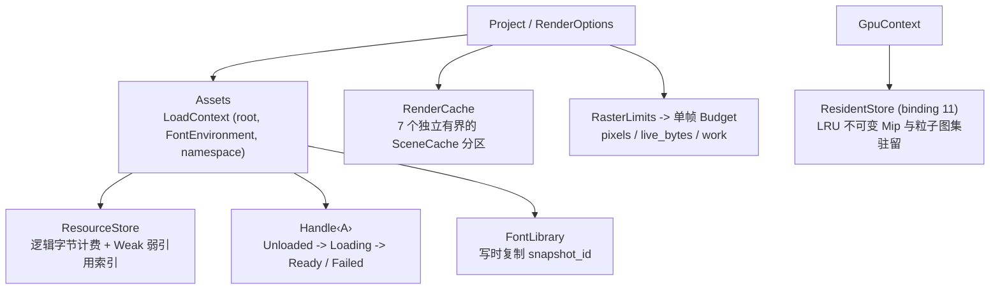

# 资源与字体

本页记录资源字节的所有权归属、生命周期边界以及缓存复用条件。除非创作者在代码中显式请求，系统绝不会从磁盘读取文件、扫描宿主系统字体或在显卡设备上解码数据。使用引导见[内容系统教程](../tutorial/06-content.md)；内容层契约见[内容系统](content.md)，准入限制见[系统可靠性](reliability.md)，会话交接规则见[渲染与导出](rendering.md#资源与内容)。

## 所有权模型



| 对象 | 拥有内容 | 生命周期 |
| --- | --- | --- |
| `Assets` | 强类型条目表与 `LoadContext`（绝对根路径、可选 `FontEnvironment`、快照命名空间） | 克隆共享已注册项；`snapshot()` 冻结已解析条目并隔离后续修改 |
| `ResourceStore` | 逻辑字节计数器与 `Weak` 弱引用条目索引 | 克隆共享；新创建的 `Assets` 默认拥有独立存储，除非通过 `with_store` 显式接入已有存储 |
| `Handle<A>` | 单个共享条目：`Source`、粘性解码结果、计费字节数 | 存活至最后一个句柄或所有者被 Drop；Drop 时释放存储计费 |
| 解码后的 `Arc<A>` | 不可变解码值 | 生命周期可超越所有所有者与句柄；句柄全部释放后不再计入存储配额 |
| `FontLibrary` | 字体数据库、塑形引擎、字形/布局缓存、字体使用日志 | 写时复制；克隆实例共享同一份冻结的 `snapshot_id` |
| `RenderCache` | 可重算计算缓存：`7` 个独立有界的 LRU 分区 | 由克隆实例、渲染会话与导出工作线程共享，直至显式调用 `clear` |
| `GpuContext` | 设备端不可变图像/Mipmap/图集缓冲区与主机侧比对字 | 由上下文克隆实例共享；有界 LRU 驻留独立于在途帧租约 |
| `SceneCache` | 纯创作期计算的 LRU 缓存，按调用点、类型与键索引 | 每个缓存实例独立持有；条目按 LRU 逐出且不破坏外部已持有的 `Arc` 值 |

`ResourceStore` 仅持有 `Weak` 弱引用，自身绝不强引用驻留解码载荷。`Assets::remove` 注销数据源但不会使已发出的句柄失效，保留的快照或句柄在其被 Drop 之前持续占用配额（[`asset.rs`](../../../crates/motion-core/src/asset.rs)、[`handle.rs`](../../../crates/motion-core/src/asset/handle.rs)、[`store.rs`](../../../crates/motion-core/src/asset/store.rs)）。

## 显式 I/O 策略

- **显式项目根目录：** `Assets::new(root)` 仅捕获绝对根路径（`std::path::absolute`），不执行任何读取或解码。`Assets::default()` 的根路径为空：在空根路径下解析相对 `Source::File` 会直接得到失败句柄（`"require an explicit project root"`），空所有者绝不授予隐式读取当前工作目录的权限。包含 `..` 的相对路径直接拒绝；显式传入的绝对路径按原样接受。
- **惰性注册：** `Assets::load`、`AssetsExt::image`、`Image::open` 与 `Svg::open` 仅保存 `Source` 与选项；首次调用 `Handle::get`（或编译绘制该资源的场景节点）时才真正读取并解码。
- **有界编码输入：** 文件读取要求目标为不超过 `64 MiB` 的常规文件，`Asset::decode` 仅接收 `&[u8]` 与 `&LoadContext`，绝不接收文件路径。`Source::Bytes` 的键长须为 `1..=1,024` UTF-8 字节且不含控制字符；原始字节切片直接参与相等性与缓存身份判定，因此同名键绑定不同字节内容绝不会误命中旧资产。
- **零隐式系统字体探测：** `FontLibrary::new()` 初始为空且不触碰文件系统。宿主字体仅在显式调用 `load_system_fonts` 或 `load_system_family`（`1..=1,024` UTF-8 字节）时可用——先行索引元数据，首次实际命中时再读取对应字体文件。追求跨机器确定性的工程应通过 `load_file`、`load_dir` 或 `load_data` 固化精确字体字节。
- **封闭的 SVG 与 Typst 沙箱：** SVG 解析拒绝 DTD、非 `data:` 外部 `href` 引用、脚本、`foreignObject` 与动画元素，且包含 `<text>` 节点时要求非空 `FontLibrary`。`FormulaCompiler::new` 与 `TypstCompiler::new` 仅使用内嵌字体，零系统字体探测，并拒绝外部导入、外部文件与外部包。

## 字体库管理

`FontLibrary` 采用写时复制语义：每一次修改（`load_*`、`default_family`）都会铸造全新的 `snapshot_id`，并重置塑形引擎、段落布局缓存、字形缓存与使用日志，而既有克隆实例继续共享上一份不可变快照。

- **原子注册与上限约束：** `load_data` 对单个字体库原子准入最多 `4,096` 个字面（Face）与累计 `256 MiB` 源字节——损坏或空载荷不会留下任何半成品状态。`load_file` 接受不超过 `256 MiB` 的常规文件，而惰性 `FontFace` 资产句柄（`AssetsExt::font`）单文件上限为 `MAX_FONT_FACE_BYTES`（`32 MiB`）。`load_dir` 按排序路径最多遍历 `4,096` 个目录项（不追踪符号链接目录），原子加载其中的 `.ttf`、`.otf`、`.ttc` 与 `.otc` 文件。系统字体元数据索引（`load_system_fonts` / `load_system_family`）上限为 `65,536` 个字面。首个成功注册的字面会自动设为默认的 sans-serif、serif 与 monospace 字体家族别名。
- **不透明核心桥接：** `motion-core` 从不链接字体引擎，仅传递不透明的 `FontEnvironment`（`Arc<dyn Any + Send + Sync>` 加 `snapshot_id`），唯有 `motion-content` 可将其向下转型（[`font.rs`](../../../crates/motion-content/src/font.rs)）。`Assets::with_fonts` 会派生出带空条目表的新 `Assets` 视图，防止在不同字体快照间误复用已解析的 SVG。通过 `Text::fonts` 显式绑定的 `Text` 节点优先覆盖 `DrawContext` 中的环境字体；文本塑形要求至少具备其一。

## 缓存身份识别规则

| 缓存层级 | 缓存键（Key）组成要素 |
| --- | --- |
| `Assets` 条目 | 资产 `TypeId`、规范化根路径、字体 `snapshot_id`、快照命名空间、`Source`（含完整 `Bytes` 载荷） |
| 段落布局（`Paragraph`） | 文本片段、段落/局部样式、折行宽度、字体 `snapshot_id` |
| 字形轮廓（`Glyph`） | 字体 `snapshot_id`、Face ID、`FontWeight`、Glyph ID |
| 渐变查找表（`Gradient`） | 色标序列、插值色彩空间、延展模式 |
| 覆盖率（`Coverage`） | 几何路径/形状、设备空间变换、光栅公差 |
| 水墨预览图集（`Ink`） | 笔刷/水墨材质参数、几何轨迹、设备像素密度 |
| 数学公式（`Formula` / `FormulaCompiler`） | Typst 数学源码、字号、字体家族、填充画刷、调用方 `revision`、`FORMULA_BACKEND_VERSION`、编译器 `environment` |
| 声明式文档（`declarative::CompileCache`） | 规范化文档路径、`(len, modified)` 元数据戳、解析后的参数覆盖集 |
| `SceneCache`（`Scene`） | 调用点源码位置、键 `TypeId`、`Hash` + 完整 `Eq` 相等性 |
| GPU 不可变资源（`ResidentStore`） | `WeakPatternImage` 生产者身份快速通道；否则计算 64 位 FNV-1a 哈希并对全部 Mip/图集字执行逐位 `f32::to_bits()` 全等校验 |

- **零跨上下文串扰：** 凡会影响解码或排版结果的因素一律纳入缓存键。即便多个 `Assets` 所有者共享同一个 `ResourceStore`，只要根路径、命名空间或字体 `snapshot_id` 不同，也绝不会互相复用条目。`SceneCache` 构建闭包在缓存锁外部运行，且可能因并发未命中、LRU 逐出、`clear` 或零容量配置而多次求值，因此必须保持纯函数语义。
- **GPU 驻留身份快速通道与碰撞封顶：** 单次绘制的变换矩阵、覆盖率与实例头不包含在 GPU 驻留键中，使常驻 Mip 链与粒子精灵图集（binding `11`）可跨帧直接复用。若某张 `PatternImage` 与某个驻留条目的 `WeakPatternImage` 指向同一份共享像素源，则直接按身份命中，无需物化 Mip 字、计算哈希或逐纹素比对；其余或首次出现的资源则计算哈希并执行逐位 `f32` 全等校验，命中后挂载 `WeakPatternImage` 供后续帧走快速通道。同哈希桶最多保留 `4` 个条目（`MAX_HASH_MATCHES`）；超出的哈希碰撞直接绕过驻留（计入 `bypasses`），绝不混淆像素或触发无界比对。缓存命中、未命中、逐出或禁用驻留生成的像素完全一致。

## 预算配额与内存计量

所有字节配额均追踪**逻辑有效载荷**估算值，而非操作系统进程的物理 RSS：内存分配器开销、解析器临时缓冲、显卡驱动内部分配以及外部持有的 `Arc` 引用均不包含在内。

| 作用范围 | 默认配额 | 契约说明 |
| --- | --- | --- |
| 编码资产输入 | `64 MiB` | 在文件元数据、原始切片长度及有界 `Read::take` 三处同时校验 |
| `ResourceStore` | `256 MiB`、`4,096` 条目 | `with_limits(ResourceLimits)` 要求 `max_bytes > 0` 且条目在 `1..=4,096` 内；按 `max(retained_bytes, encoded_len)` 计费 |
| 静态 / 动态图像解码 | 单边 `16,384 px`、`16,777,216` 像素 | 静态 PNG/JPEG/WebP 存为带 Mipmap 的线性预乘 `RGBA16F`；动态 GIF/APNG/WebP 上限 `4,096` 帧与 `256 MiB` 解码载荷 |
| SVG 源码 | `8 MiB`、XML 深度 `64`、`100,000` 节点 | 拒绝 DTD、脚本与外部 URL |
| `RenderCache`（`7` 个分区） | `Coverage`：`2,048` / `16 MiB`<br/>`Paragraph`：`256` / `8 MiB`<br/>`Glyph`：`2,048` / `16 MiB`<br/>`Gradient`：`64` / `8 MiB`<br/>`Formula`：`32` / `32 MiB`<br/>`Ink`：`64` / `32 MiB`<br/>`Scene`：`256` / `8 MiB` | `RenderCache::with_limits` 对全部 `7` 个分区统一施加 `CacheLimits`；`fork_partition` 隔离指定 `CachePartition` 并共享其余 `6` 个分区 |
| GPU 不可变显存驻留 | `64` 条目、`64 MiB` | 同时计入主机比对字、设备载荷与条目管理开销（`2 × payload + overhead`）；`GpuContext::set_residency_limits` 限制 `max_entries <= 4,096`，设为 `0` 禁用驻留 |
| `SceneCache::new` | 仅限制条目数 | 字节计量需调用 `SceneCache::with_limits` 配合 `cache_with_cost`；单条超限值直接返回而不驻留 |
| `FormulaCompiler` | `32` 条目、`64 MiB` | 单个 Typst 数学源码 `<= 8,192 B` |
| `declarative::CompileCache` | `16` 条目、`64 MiB` | 超额按 LRU 逐出，且任一受监视依赖文件变更时自动失效重编译 |
| `RasterLimits::authoring()` | `16,777,216` 像素、`256 MiB` 活跃字节、无工作量上限 | `RasterLimits::sandbox()` 额外施加 `max_work = 200,000,000` 工作量上限 |

- **单帧 `Budget` 与驻留配额正交分离：** [`Budget`](../../../crates/motion-core/src/budget.rs) 统计单次操作的准入光栅像素、瞬态 `live_bytes`（含 `peak_bytes`）与单调递增的 `work`；调用方释放瞬态字节，而已消耗的 `work` 绝不退还。即便 `GpuContext` 显存缓存已预热，每一帧 GPU 规划仍按最坏情况下的未命中上传字节与哈希查找/比对工作量保守准入，确保缓存冷热绝不改变单帧准入判定。反之，只要单帧 `Budget` 放行，超出 `ResidentStore` 驻留上限的大资源依然能正常渲染，仅跳过缓存保留。
- **在途 GPU 租约与观测统计：** 排队中的 GPU 帧在可变工作缓冲池之外直接持有 `wgpu::Buffer` 克隆句柄，因此 LRU 逐出、`clear_resources` 或调低驻留配额绝不会提前回收在途提交仍在引用的显存缓冲。`GpuContext::residency_stats` 返回 `GpuResidencyStats`（`hits`、`misses`、`upload_bytes`、`evictions`、`bypasses`、当前 `entries` 与 `retained_bytes`）；清空缓存释放保留条目，但不重置累计观测计数（[`residency.rs`](../../../crates/motion-render/src/gpu/residency.rs)）。

## 延迟加载与即时加载

| 延迟模式 Deferred（保留 `Source` / 选项） | 即时模式 Eager（立即求值） |
| --- | --- |
| `Assets::load`、`Image::open`、`Svg::open`、`Svg::new(handle)` | `ImageAsset::from_bytes`、`SvgAsset::from_bytes_with_fonts`、`Assets::preload` |
| `Formula::typst` | `Formula::asset`、`FormulaCompiler::compile` |
| 帧编译阶段对 `Text` 执行排版塑形 | `Text::layout(&fonts)` 提前测量排版布局 |

`Handle::state()` 在不触发 I/O 的前提下查看当前 `AssetState`（`Unloaded` → `Loading` → `Ready(Arc<A>)` 或 `Failed(Arc<Error>)`）。失败状态具有粘性（Sticky），绝不隐式重试；并发调用方自动汇合到同一次解码，解码器若发生 panic 会转化为粘性资产错误。递归资产解析或嵌套深度超过 `64` 层会确定性报错。未显式传入编译器的 `Formula::typst` 使用进程级内嵌字体 `FormulaCompiler`，不会读取 `Assets::with_fonts` 注册的字体；自定义数学字体须通过 `FormulaCompiler::with_fonts` 注入。

## 线程模型与锁中毒处理

`Asset`、`FontEnvironment`、`Assets`、`Handle`、`RenderCache` 与 `GpuContext` 均满足 `Send + Sync`，支持多线程 CPU/GPU 工作槽位零拷贝共享：

- **锁中毒恢复：** `Assets`、`ResourceStore`、`RequestDiagnostics`、`FontUsage`、`ResidentStore` 以及 `FontLibrary` 使用日志在互斥锁中毒时通过 `lock_unpoisoned` 恢复并继续维护有效状态。
- **类型化中毒错误与内部不变量：** `cosmic_text` 塑形引擎锁中毒返回 `ValidationError`（`"Font engine is poisoned"`）；公式缓存锁中毒返回 `FormulaCompileError`；音频片段锁中毒返回 `ValidationError`；`SceneCache` 将锁中毒视为内部不变量破坏并直接 panic。
- **锁外重计算：** 资产解码、文本塑形、公式编译与 `SceneCache` 构建闭包一律在缓存互斥锁外部运行，慢速未命中绝不阻塞无关条目的并发查询。

## 故障处理与诊断

- **显式 `RequestDiagnostics`：** 加载错误同时携带 `Asset::KIND` 与数据源标识。`Handle::get_with` 将失败写入显式传递的 `RequestDiagnostics` 收集器（资源加载错误 `loads` 与场景创作错误 `scene_errors` 分离存储，均按 `Arc::ptr_eq` 指针身份去重），不存在隐式帧级线程局部状态。
- **严格生产导出与容错 Studio 预览：** 静帧渲染、CLI 命令与生产级导出默认遇到首个资源或几何异常即返回带帧号（`Error::at_frame`）的错误。Studio 预览则显式启用 `RenderOptions::allow_missing_assets(true)`（缺失 `Image` 绘制洋红色占位图并保留诊断记录）与 `RenderOptions::mark_invalid_geometry(true)`（非法叶子几何在其局部原点绘制洋红色方块而非中断整帧）。
- **确定性字体溯源：** `RenderOptions::font_usage`（`FontUsage`）记录塑形期间实际选中的每个字面及其非密码学源字节哈希，`ExportReport::fonts` 以独立于并发线程完成次序的确定性顺序返回去重列表。

## 在 Studio 与 CLI 中注入资源

Studio 与 CLI 统一消费 `Project::render_options` 上注册的 `RenderOptions`（内含 `resources: Option<Assets>`、`RenderCache` 与 `RasterLimits`）。由于 CLI 不设全局 `--assets-root` 或 `--font` 命令行参数（[`cli.rs`](../../../crates/motion/src/project/cli.rs)），工程应在代码中显式绑定资产根目录与字体快照：

```rust,no_run
use motion::prelude::*;

fn main() -> motion::Result {
    let mut fonts = FontLibrary::new();
    fonts.load_file("assets/project.ttf")?;
    let assets = Assets::new("assets")?.with_fonts(fonts);
    let _options = RenderOptions::default().resources(assets);
    Ok(())
}
```

由该配置克隆出的各个 `Composition` 共享同一个 `Assets` 所有者与底层 `ResourceStore`，而各 `RenderSession` 独立持有各自的渲染目标。

## 归属源码 (Owning sources)

- [`crates/motion-core/src/asset.rs`](../../../crates/motion-core/src/asset.rs)、[`asset/handle.rs`](../../../crates/motion-core/src/asset/handle.rs)、[`asset/store.rs`](../../../crates/motion-core/src/asset/store.rs)、[`asset/environment.rs`](../../../crates/motion-core/src/asset/environment.rs) — `Asset`、`Assets`、`Source`、`Handle`、`ResourceStore`、`RequestDiagnostics` 与 `FontEnvironment`。
- [`crates/motion-core/src/budget.rs`](../../../crates/motion-core/src/budget.rs)、[`authoring/context/cache.rs`](../../../crates/motion-core/src/authoring/context/cache.rs)、[`authoring/context/partition.rs`](../../../crates/motion-core/src/authoring/context/partition.rs) — `RasterLimits`、`Budget`、`SceneCache`、`CacheLimits`、`RenderCache` 与 `7` 个 `CachePartition` 缓存域。
- [`crates/motion-content/src/font.rs`](../../../crates/motion-content/src/font.rs)、[`asset.rs`](../../../crates/motion-content/src/asset.rs) — `FontLibrary`、写时复制 `snapshot_id`、`ImageAsset`、`AnimatedImage` 与 `SvgAsset`。
- [`crates/motion-render/src/gpu/residency.rs`](../../../crates/motion-render/src/gpu/residency.rs)、[`options.rs`](../../../crates/motion-render/src/options.rs) — `GpuContext` 不可变 `ResidentStore`、`GpuResidencyStats`、`RenderOptions` 与 `FontUsage`。
- [`crates/motion-formula/src/compiler.rs`](../../../crates/motion-formula/src/compiler.rs)、[`crates/motion-scene/src/cache.rs`](../../../crates/motion-scene/src/cache.rs) — `FormulaCompiler` 与声明式文档 `CompileCache`。
