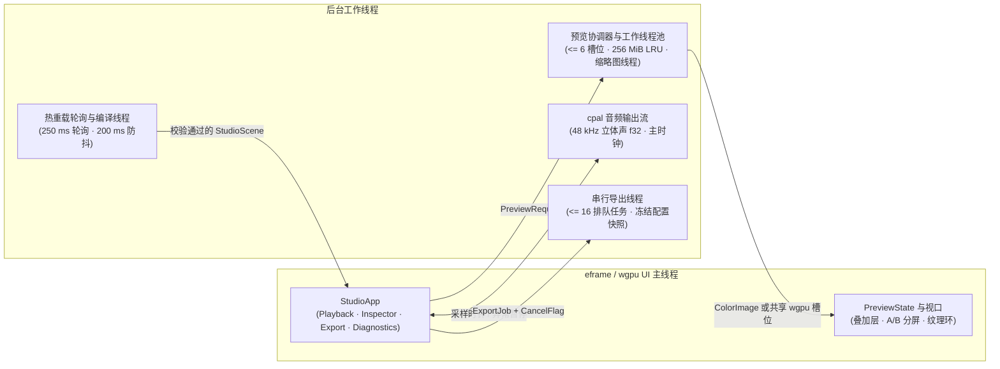

# Motion Studio

Motion Studio（[`motion-studio`](../../../crates/motion-studio/src/lib.rs)，在启用 Cargo `studio` 特性后重导出于 `motion::studio`）是可选的 `egui`/`eframe` 桌面工作台，用于交互式检查、实时回放与导出编译后的 Rust 场景及支持热重载的声明式文档。启用 `studio` 特性仅构建工作台能力，不会在导入时隐式打开窗口、扫描系统字体或强制启用 GPU 场景渲染。创作步骤与命令行用法请参阅 [Studio 教程](../tutorial/12-studio.md)与[命令行指南](../cli.md)。

```sh
cargo run --release --features studio --example studio
cargo run --release -p motion-gallery --features studio,gpu --bin motion-gallery -- studio --demo type-in-motion
```

## 架构与执行模型

Studio 是构建在引擎无头（Headless）核心契约之上的一层轻量交互壳，而非独立的第二套渲染或导出管线：



- **单一真源契约。** `StudioScene` 将一条 `Timeline` 与一个 `Composition` 渲染模板绑定，自动将音频对齐至时间轴帧网格，并用时间轴的精确帧率与总帧数替换模板的 `FrameClock`（总帧数超过 `u32::MAX` 时拒绝构造）。预览渲染、实时音频回放与生产导出全部消费同一份 `Timeline`，共享 `RenderOptions`、`RenderSession` 与 `FrameRenderer` 语义。
- **显式桌面与 `wgpu` 宿主边界。** `run` 启动基于 `eframe::Renderer::Wgpu` 的原生桌面窗口（默认 `1240×800`，最小 `900×620`，启动前校验输出尺寸位于 `1..=16_384`）。即便场景渲染选择 `BackendPreference::Cpu`，启动交互窗口仍需要原生桌面会话与兼容的 `wgpu` 显示适配器；而 `StudioScene`、`AudioReadout` 与 `particle_presets` 等无头模型无需窗口或声卡即可独立调用。每次进程启动仅加载单个场景，不提供窗口内多场景切换器。
- **UI 线程隔离与状态分组。** 场景求值、光栅化、声卡输出、文件轮询与视频编码均运行在后台线程，绝不阻塞 UI 线程。内部将 `PlaybackState`、`InspectorState`、`ExportState` 与 `DiagnosticsState` 的生命周期相互隔离，并使 `PreviewState` 保持独立，确保新帧尚在后台计算时视口可持续稳定展示上一完成帧。
- **场景级缓存隔离与故障收敛。** 预览工作槽位在切换帧或调整设置时共享 `RenderCache` 分区，每个注册场景各自 fork 独立的 `CachePartition::Scene` 分区。工作线程 panic 与 GPU 设备丢失均收敛为 `Diagnostics` 中的强类型记录，绝不令工作台崩溃或悄然切换后端；当前主帧失败会清空该场景缓存，过期请求或前瞻预取的失败则直接丢弃。
- **私有 GPU 设备 vs. 共享纹理环。** 默认模式下，每个预览工作线程持有独立的私有 GPU 上下文并通过通道传回预乘 `ColorImage`，避免场景计算抢占 `eframe` 主渲染表面的 Fence 锁。设置 `MOTION_STUDIO_SHARED_GPU=1` 后，预览工作线程直接挂载到 UI 的共享 `wgpu` 设备，通过零回读纹理环传递画面（每个活动尺寸/设备维持 `3..=12` 个槽位，渲染器将 sRGB 字节写入 `Rgba8Unorm` 存储并以 `Rgba8UnormSrgb` 视图注册至 `egui`，防止重复 sRGB 编码偏色）。

## 预览与回放

### 窗口、主题与视口检查

- **界面布局与主题。** 默认采用中性深灰配蓝绿色点缀，支持顶部栏一键切换浅色/深色主题。顶部栏包含渲染缩放（`25%`、`50%`、`100%`）、后端选择（`CPU` / `GPU`）、静音开关及右侧 Inspector 抽屉开关（窗口宽度 `< 1120 px` 时默认收起）；底部状态栏固定显示当前后端、帧号与后台繁忙状态。
- **视口导航与背景模式。** 视图缩放（`Fit`、`50%`、`100%`、`200%`）独立于实际渲染比例；支持鼠标中键或按住 `Space` 拖拽平移、捏合或 `Ctrl`+滚轮围绕指针缩放，以及放大状态下触控板滚动平移。视口提供 `Checkerboard`、`Dark`、`White` 与 `Scene` 四种背景模式：前三种保持 `transparent = true` 并由视口直接合成衬底（相互切换不触发重新渲染），`Scene` 则令 `transparent = false`，由工作线程在 `RenderOptions::background` 上合成。
- **交互质量档位。** 连续播放与时间轴拖拽统一采用 `RenderQuality::Draft`（`0.35 px` 曲线容差、单次快门采样、半密度墨迹与单盒模糊；拖拽期间同时将渲染比例降至 `25%`）。释放拖拽后立即恢复选定渲染比例，并在静止 `150 ms` 后补发 `RenderQuality::Final` 精细渲染。导出任务始终强制使用 `Final`。
- **结构与像素检查（`Node bounds` 与 `Pixel inspector`）。** 工具栏控制安全区、网格、`Node bounds` 与 `Pixel inspector`。`Node bounds` 读取编译器布局与 Z 序只读快照以支持近似视觉包围盒拾取，展示节点实例路径、变换矩阵、滤镜及裁剪/遮罩信息。`Pixel inspector` 开启显式内存回读以查看鼠标处 `sRGB8` 与解码 SDR 线性像素值，并支持抓取基准帧进行 `A/B` 分屏对比；抓取后关闭 `Pixel inspector` 即可恢复零回读 GPU 预览，已抓取的 `A/B` 基准帧仍保留。

### 时间轴、实时调度与音频时钟

- **时间轴与传输快捷键。** 展示轨道、片段区间、转场重叠区、自适应 `MM:SS.mmm` / 帧号标尺、悬停缩略图（独立 `16 MiB` / `128` 项 LRU，尺寸 `<= 160×90`）、`1024` 点 `AudioAnalysis` RMS 波形（上限 `300 s`）、已缓存帧区间、用户标记点（最多 `256` 个 Cue，名称上限 `128` 字符）以及循环/导出共用的 In/Out 区间（Out 为开区间）。快捷键：`Space`（播放/暂停）、`Left`/`Right`（步进 `±1` 帧，按住 `Shift` 为 `±10` 帧）、`Home`/`End`（首/尾帧）、`L`（循环开关）。
- **实时回放调度。** 点击 Play 后最多等待首帧 `2 s`（邻近帧并行预热），随后立即启动回放时钟，绝不预先渲染整部短片。预览池最多扩展至 `6` 个工作槽位（受 `CPU 线程数 - 1` 与 `2 GiB / 单帧最大字节配额` 共同约束），多槽位池保留 `1` 个槽位专供交互 Seek，并根据实测帧耗时动态调整前瞻预取窗口；超时晚到的帧直接跳过，绝不拖慢主时钟。
- **预览帧 LRU 缓存。** 默认保留 `256 MiB` 逻辑像素与元数据载荷（可通过 `MOTION_STUDIO_CACHE_MIB=0..1024` 覆盖，设为 `0` 时禁用帧保留与预取）。CPU 缓存命中直接共享不可变像素缓冲区引用，无需额外拷贝。
- **音频主时钟。** 当时间轴存在可听且未静音的音频时，后台 `cpal` 输出流以最多 `8192` 采样一窗的 `MixedAudio` 输出 `48 kHz` 双声道 `f32`，并由硬件实际消费的采样数驱动画面时钟。空混音不打开音频设备；发生声卡欠载或设备故障时立即暂停回放并记录诊断，绝不静默漂移回系统墙钟。

## 检查器、导出队列与会话持久化

- **Inspector 四大面板。** 包含 `Export`（导出表单与队列）、`Node`（拾取节点层级、变换与效果属性）、`Diagnostics`（上限 `128` 条的诊断环，支持点击跳帧与节点高亮）以及 `Stats`（分 `Playback`、`Preview worker`、`Cache`、`Frame cost` 展示帧率、缓存命中率、逻辑字节峰值，并将 GPU 时间戳区间与主机墙钟耗时分列，支持一键复制纯文本摘要）。
- **串行导出队列。** 支持 H.264、H.265、带 Alpha 的 VP9、ProRes 4444、PNG 序列、GIF（不超过 `100 fps` 时沿用时间轴帧率，否则采用 `30 fps`）及单张 PNG 静帧。专属 `motion-export` 线程串行执行最多 `16` 个排队任务；每个任务在入队瞬间冻结输出尺寸（`1..=16_384`）、In/Out 区间、后端、快门、编码器与音频配置快照（`PngSequence` 与 `Gif` 在渲染前通过 `Timeline::visual()` 剥离音频轨），并保留最多 `64` 条历史完成记录（含类型化错误与输出目录快捷入口）。活动任务遵循协作式 `CancelFlag` 取消与事务性文件替换（见[导出与 FFmpeg](export.md)）；关闭窗口会主动取消活动任务并等待后台线程清理退出。
- **会话持久化。** `.motion/studio.json`（版本号 `1`，硬上限 `64 KiB`，通过同目录临时文件原子替换写入）保存场景名称、播放帧号、渲染缩放、透明开关、In/Out 区间与 Cue 标记，重新启动时绝不自动播放或自动导出。场景专属字段（`frame`、`range`、`cues`）仅在 `scene` 与当前 `StudioScene.name` 匹配时恢复，`scale` 与 `transparent` 则跨场景恢复。音频混音配置支持按外部路径独立保存与加载，不内嵌源媒体字节。
- **明确边界与非目标。** Studio 刻意不提供编译期参数在线编辑、J/K/L 多倍速穿梭键、命令面板、可停靠浮动面板、窗口内多场景目录切换及拖拽监听音频（Audio Scrubbing）。

## 热重载

通过 `StudioScene::reloadable` 注册的场景（包括 `Project::document` 或 `motion studio <file.json>` 打开的声明式 JSON 文档）在受监视文件变更时支持原地重建：

- 后台监视器每 `250 ms` 轮询一次文件修改时间与字节长度；变更稳定 `200 ms` 后，在工作线程执行线程安全的重建闭包。
- 重建成功后原地替换 `StudioScene`，将播放头、Cue 标记与 In/Out 区间裁剪至新总帧数范围内，保留预览与导出配置、暂停回放、清空过期帧缓存，并同步刷新受监视的资源依赖列表。
- 重建失败时视口继续保留上一有效场景并维持可交互状态，同时在顶部栏（截断至 `600` 字符）与 `Diagnostics` 面板（保留完整堆栈/诊断）展示错误，防止半保存编辑导致黑屏。若构建期间再次检测到文件改动，当前构建会被标记为过期并在结束后立即丢弃结果、重新进入防抖编译；已入队或正在运行的导出任务始终使用其入队时的场景快照。

## 入口契约、电平读数与环境变量

| 接口 / 配置 | 契约说明 |
| --- | --- |
| `StudioScene` | 无头场景描述符（`new`、`reloadable`、`is_reloadable`），在打开任何窗口前完成音频帧网格对齐与 `u32` 总帧数上限校验。 |
| `run` | 阻塞式主线程入口，校验输出尺寸（`1..=16_384`），独占管理 `eframe` 事件循环与退出时的后台线程汇合屏障。 |
| `AudioReadout` / `BusReadout` | 基于 `MixedAudio` 的无头响度与总线电平分析模型（`from_mix`、`exceeds`），无需打开声卡即可计算积分 LUFS、采样峰值 dBFS、`4×` 过采样真实峰值 dBTP、立体声相位相关性及各总线 `50 ms` 窗口 RMS/峰值电平。 |
| `particles::particle_presets` | 将内置粒子预设批量构建为可直接预览的 `StudioScene` 列表（同时在 `motion::studio::prelude` 重导出）。 |
| `MOTION_STUDIO_SHARED_GPU=1` | 令 GPU 预览工作线程共享 `eframe` 的 `wgpu` 设备，通过 `3..=12` 槽位纹理环零回读呈现画面，替代默认的每线程私有设备模式。 |
| `MOTION_STUDIO_CACHE_MIB` | 以整数 MiB（`0..=1024`）覆盖预览帧 LRU 缓存容量（默认 `256`；设为 `0` 时禁用帧保留与投机预取）。 |

相关设计契约参见[渲染与合成](rendering.md)、[音频系统](audio.md)、[导出与 FFmpeg](export.md)、[声明式文档](documents.md)、[系统可靠性](reliability.md)与 [Gallery 展厅](../../../gallery/README.md)。
